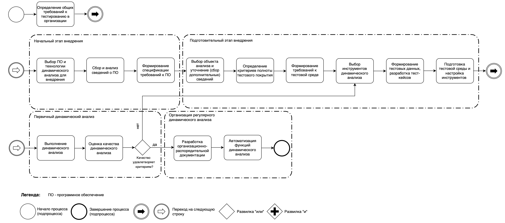
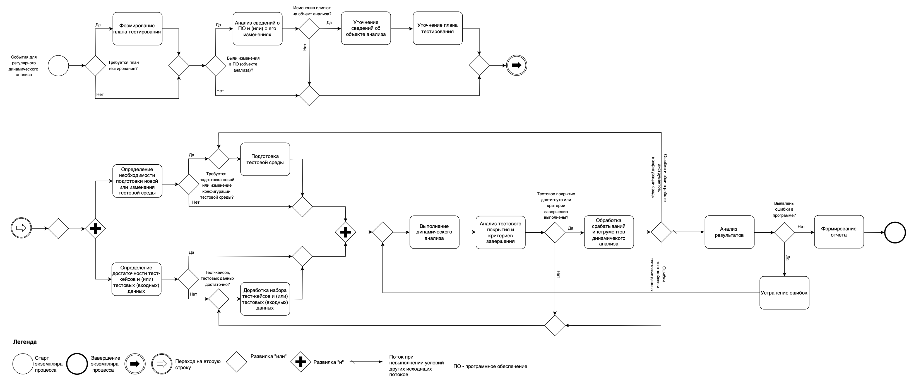
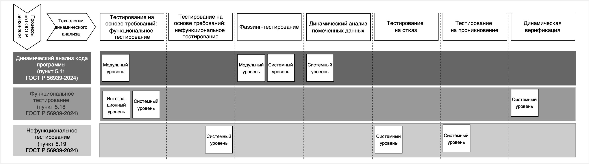

# Технологии динамического анализа ПО

**Материалы к занятию по проекту национального стандарта «Защита информации. Разработка безопасного программного обеспечения. Технологии динамического анализа. Общие требования»** (первая редакция, ТК 362, ФСТЭК России + ИСП РАН).

> Полная интерактивная версия — `landing/index.html` (карта технологий, цикл дефекта, встроенные схемы). Здесь — текстовый конспект.

## Содержание
- [01 Термины и определения](#01-термины-и-определения)
- [02 Паспорт проекта](#02-паспорт-проекта)
- [03 Зачем нужен стандарт](#03-зачем-нужен-стандарт)
- [04 Место в комплексе стандартов](#04-место-в-комплексе-стандартов)
- [05 Структура документа](#05-структура-документа)
- [06 Три уровня тестирования](#06-три-уровня-тестирования)
- [07 Восемь технологий динамического анализа](#07-восемь-технологий-динамического-анализа)
- [08 Фаззинг-тестирование: требования раздела 8.3](#08-фаззинг-тестирование-требования-раздела-83)
- [09 Вспомогательные методы (8.8)](#09-вспомогательные-методы-88)
- [10 Внедрение технологии: четыре этапа (раздел 6)](#10-внедрение-технологии-четыре-этапа-раздел-6)
- [11 Регулярное выполнение (раздел 7) и организация (раздел 5)](#11-регулярное-выполнение-раздел-7-и-организация-раздел-5)
- [12 Матрица применимости (Приложение А)](#12-матрица-применимости-приложение-а)
- [13 Требования к инструментам (раздел 9)](#13-требования-к-инструментам-раздел-9)
- [14 Требования к специалистам (раздел 10)](#14-требования-к-специалистам-раздел-10)
- [15 Как это связано с практикумом по фаззингу](#15-как-это-связано-с-практикумом-по-фаззингу)
- [16 Замечания к первой редакции](#16-замечания-к-первой-редакции)
- [17 Нормативная база и официальные источники](#17-нормативная-база-и-официальные-источники)
- [18 Частые вопросы](#18-частые-вопросы)

## 01 Термины и определения

Занятие начинаем с терминологии: три стандарта используют близкие слова в разных значениях. Ниже — определения по текстам документов, дословно, с указанием пункта.

**37** терминов в проекте по динамическому анализу

**23** термина в ГОСТ Р 56939-2024

**36** терминов в ГОСТ Р 71207-2024

> ℹ️ **Как читать:** «Динамический анализ» и «статический анализ» — это **виды работ** по исследованию программы: первый опирается на исполнение кода, второй — на исходный код без запуска. Одно и то же слово в разных стандартах может означать разное: например, «программный компонент» в ГОСТ Р 56939-2024 и в проекте по динамическому анализу определён по-разному, поэтому ниже у каждого термина указан источник и пункт.

### Динамический анализ (37 терминов)

проект ГОСТ Р «Защита информации. Разработка безопасного программного обеспечения. Технологии динамического анализа. Общие требования»

| Термин | Определение | Пункт |
|---|---|---|
| **автоматизированное тестирование** | Способ тестирования (анализа), реализуемый с использованием инструментальных средств для запуска тестирования, позволяющий минимизировать участие человека в процессе тестирования. Примечание - Тестовые примеры частично или полностью выполняются специальными инструментальными средствами, однако разработку тестовых примеров и сценариев тестирования, подготовку данных, анализ результатов выполнения может выполнять человек. | 3.1.1 |
| **автоматическое тестирование** | Способ тестирования (анализа), реализуемый с использованием инструментальных средств при наступлении определенных событий (условий), заданных человеком, но не требующий непосредственного участия человека в процессе тестирования. Примечание - Примером является автоматический запуск анализа при обновлении программного кода путем интеграции инструментальных средств с системой непрерывной интеграции. | 3.1.2 |
| **датчик срабатывания ошибок** | Конструкция исходного или бинарного кода, которая вставляется в программу при ее сборке из исходного кода, интерпретации или двоичной трансляции и которая при обнаружении определенной ошибки в ходе выполнения программы вызывает ее аварийное завершение и (или) выдачу диагностической информации. | 3.1.3 |
| **динамический анализ** | Вид работ по исследованию программы (объекта анализа), основанный на анализе поведения и кода программы в режиме непосредственного исполнения (функционирования). | 3.1.4 |
| **инструмент динамического анализа** | Инструментальное средство, которое выполняет динамический анализ автоматическим или автоматизированным способом. | 3.1.5 |
| **исполняемый файл** | Бинарный файл, содержащий исполняемый модуль программы, который может быть запущен в среде выполнения программы. | 3.1.6 |
| **компилятор** | Инструментальное средство, выполняющее компиляцию. | 3.1.7 |
| **компиляция (сборка программы)** | Трансляция программы из ее исходного кода на языке программирования высокого уровня в бинарный код машинного языка. | 3.1.8 |
| **критерий полноты тестового покрытия** | Значение тестового покрытия, достижение которого достаточно для завершения динамического анализа объекта анализа. | 3.1.9 |
| **наблюдаемое поведение** | Поведение программы или иного объекта анализа, связанное с взаимодействием с внешними по отношению к объекту процессами, другими объектами, устройствами, включая ввод и вывод данных, работу с внешними областями памяти, обработку или генерацию событий или прерываний. Примечание - Для одного и того же объекта анализа наблюдаемое поведение может меняться в зависимости от того, какие средства используются для контроля за поведением программы. В частности, средства контроля за состоянием внутренних переменных или выполнения отдельных инструкций внутри программы могут сделать выполнение таких инструкций или чтение (запись) некоторых внутренних областей памяти доступным для наблюдения извне программы. | 3.1.10 |
| **объект анализа** | Программное обеспечение, программа, программные компоненты или программные модули, отдельные функции (фрагменты программы), подлежащих динамическому анализу. Примечание - Объект анализа является эквивалентным термином по отношению к терминам «объект тестирования» и «элемент тестирования», используемых в других стандартах, принятых для применения в Российской Федерации. | 3.1.11 |
| **ожидаемый результат** | Предсказанное характерное поведение программы или иного объекта анализа при определенных тестовых условиях. | 3.1.12 |
| **ошибка в поведении** | Несоответствие наблюдаемого поведения программы или иного объекта анализа требованиям или ожиданиям пользователей, которое может являться причиной невозможности выполнения требуемых функций или нарушения информационной безопасности. Примечание — Ошибка в поведении может проявляться как отказ, некорректный результат вычислений, чрезмерное снижение производительности или увеличение времени ответа, недопустимый расход ресурсов процессора или памяти, снижение пропускной способности каналов передачи данных и иным способом. | 3.1.13 |
| **ошибка в программе** | Конструкция или набор конструкций в исходном или бинарном коде программы, наличие которой указывает на возможность реализации угроз безопасности информации и (или) на ошибку реализованного в программе алгоритма. | 3.1.14 |
| **поведение программы** | Совокупность действий, выполняемых программой (или иным объектом анализа), включающая в себя получение входных данных и внешних воздействий, чтение и запись данных в ходе их обработки, взаимодействие с внешними устройствами и программами, вывод полученных результатов. Примечание - Поведение программы зависит как собственно от программы, алгоритма и описаний структур данных, так и от компиляторов и других средств программно-аппаратной платформы, включая операционную систему, на которой программа выполняется, а также от действий внешних по отношению к программе, например, от ввода данных от пользователя, обмена данными по телекоммуникационным протоколам, переключения процессов и потоков программы операционной системой. | 3.1.15 |
| **поверхность атаки** | Множество подпрограмм (функций) программы, обрабатывающих данные, поступающие посредством интерфейсов, непосредственно или косвенно подверженных риску атаки. | 3.1.16 |
| **повторное тестирование** | Подтверждающее тестирование объекта анализа, проводимое для проверки успешности устранения ошибки внесенными изменениями. | 3.1.17 |
| **программа** | Данные, предназначенные для управления конкретными компонентами системы обработки информации в целях реализации определенного алгоритма. | 3.1.18 |
| **программное обеспечение** | Совокупность программ системы обработки информации и программных документов, необходимых для эксплуатации этих программ. | 3.1.19 |
| **программный модуль** | Программа или функционально завершенный фрагмент программы, предназначенный для хранения, трансляции, объединения с другими программными модулями и загрузки в оперативную память. | 3.1.20 |
| **программный компонент** | Программа или совокупность программ, рассматриваемая как единое целое, выполняющая законченную функцию. | 3.1.21 |
| **разработчик программного обеспечения** | Организация, выполняющая работы на всех стадиях разработки программного обеспечения или ответственная, как минимум, за такие процессы жизненного цикла, как процессы реализации и процессы поддержки программного обеспечения. Примечания 1 Стадии разработки — по ГОСТ 19.102-77, процессы жизненного цикла — по ГОСТ Р ИСО/МЭК 12207-2010. 2 Согласно ГОСТ Р ИСО/МЭК 27000-2021 пункт 3.50 под «организацией» понимают, помимо прочего, индивидуальных предпринимателей, компании, корпорации, фирмы, партнерства, благотворительные организации, учреждения, любые составные части и сочетания названных объектов вне зависимости от того, зарегистрирована ли организация в качестве юридического лица, является ли она государственной или частной. 3 По тексту стандарта в том же значении применяется также понятие «организация» для улучшения восприятия текста. | 3.1.22 |
| **регрессионное тестирование** | Тестирование, проводимое после внесения изменений в объект анализа или в его среду функционирования, с целью определения влияния или подтверждения невлияния внесенных изменений на ранее протестированные функции (свойства) объекта. | 3.1.23 |
| **ручное тестирование** | Способ тестирования, при котором тестирование объекта анализа выполняется людьми на основе задокументированного сценария с проверкой результатов путем сравнения фактических и ожидаемых результатов. | 3.1.24 |
| **санитайзер** | Компонент компилятора, встраивающий датчики срабатывания ошибок в генерируемый код во время компиляции программы. | 3.1.25 |
| **сборочная среда** | Совокупность программных и аппаратных средств, служб связи, интерфейсов, форматов данных, протоколов, стандартов, обеспечивающих преобразование исходного кода программ в программные модули в соответствии с представленными метаданными и с учетом зависимостей программного модуля. | 3.1.26 |
| **сценарий тестирования** | спецификация ручного или автоматизированного тестирования, содержащая сведения о тестовых примерах (тест-кейсах) и последовательности выполнения. | 3.1.27 |
| **тестирование** | Комплекс мероприятий, проводимых для выявления и оценки функций и свойств объекта анализа. | 3.1.28 |
| **тест-кейс** | Набор предварительных условий, входных данных, пошаговых инструкций и ожидаемых результатов, разработанный для наблюдения за поведением программы или иного объекта анализа для достижения целей тестирования. Примечания 1 Тест-кейс является синонимом термина «тестовый пример» (ГОСТ Р 56920-2025, пункт 3.20), а также термина «контрольный пример» (ГОСТ Р 56921-2016/ISO/IEC/IEEE 29119-2:2013, ГОСТ Р 56922-2016/ISO/IEC/IEEE 29119-2:2013). 2 Тест-кейс может быть представлен как набор инструкций в виде документа для человека в случае ручного тестирования, и в виде программы в случае автоматизированного (автоматического) тестирования. | 3.1.29 |
| **тестовое покрытие** | Мера полноты набора тест-кейсов, которая может выражаться тестовым покрытием программного кода, тестовым покрытием требований, тестовым покрытием формальных моделей объекта анализа или иным способом. | 3.1.30 |
| **тестовое покрытие программного кода** | Отношение, выраженное в процентах, между количеством участков кода программы (программного модуля) определенного вида, задействованных в ходе динамического анализа, и всем совокупным количеством достижимых участков кода этого вида. Примечание — Покрытие кода может вычисляться для инструкций, базовых блоков, ветвлений в коде, функций. | 3.1.31 |
| **тестовое покрытие требований** | Отношение, выраженное в процентах, между количеством требований, предъявляемых к программе (программному модулю или компоненту) и тестируемых в ходе динамического анализа, и количеством всех предъявляемых к ней требований. | 3.1.32 |
| **технологии динамического анализа** | Совокупность видов, уровней, методов, способов и процессов динамического анализа, инструментальных средств и правил их применения. | 3.1.33 |
| **уровень тестирования** | реализация процесса тестирования (динамического анализа), которая зависит от уровня грануляции объекта анализа и цели тестирования и в рамках которой используются группы тест-кейсов, объединенные общим назначением. Примечание - В контексте настоящего стандарта рассматриваются три уровня тестирования: модульное тестирование, интеграционное тестирование и системное тестирование. Указанные уровни тестирования предусмотрены ГОСТ Р 56920-2024, при этом комплексное тестирование в настоящем стандарте определено как интеграционное. | 3.1.34 |
| **фаззер** | Инструментальное средство динамического анализа, которое выполняет фаззинг-тестирование. | 3.1.35 |
| **фактические результаты** | Совокупность поведения программы или совокупность условий, связанных данных или тестовой среды, полученные в результате выполнения тест-кейса. | 3.1.36 |
| **юнит-тест** | Тест-кейс, который проверяет программу или отдельные программные модули в изоляции от других модулей и программ. 3.2 В настоящем стандарте применены следующие обозначения и сокращения: | 3.1.37 |

### Разработка безопасного ПО (23 термина)

ГОСТ Р 56939-2024 «Защита информации. Разработка безопасного программного обеспечения. Общие требования»

| Термин | Определение | Пункт |
|---|---|---|
| **безопасное программное обеспечение** | Программное обеспечение, разработанное в ходе реализации совокупности процессов (мер), направленных на предотвращение появления и устранение 1 недостатков программы. | 3.1 |
| **динамический анализ кода программы** | Вид работ по инструментальному исследованию программы, основанный на анализе кода программы в режиме непосредственного исполнения (функционирования) кода. | 3.2 |
| **документация разработчика программного обеспечения** | Совокупность программных и иных документов, предназначенных для организации и проведения работ по созданию программного обеспечения и/или подтверждения соответствия требованиям настоящего стандарта. Примечание - К программным относятся документы, содержащие сведения, необходимые для разработки, изготовления, сопровождения и эксплуатации программ. К иным документам относятся документы, не относящиеся к программным и содержащие сведения, подтверждающие соответствие требованиям настоящего стандарта. | 3.3 |
| **инструментальное средство** | Компьютерная программа, используемая как средство разработки, тестирования, анализа, производства или модификации других программ или документов на них. [ГОСТ Р 51904-2002, пункт | 3.4 |
| **интерфейс программного обеспечения** | Способ взаимодействия между программами или между программами и пользователями. | 3.5 |
| **компонент программного обеспечения** | Составная часть (программный модуль) программного обеспечения, выполняющая определенную функцию. | 3.6 |
| **компьютерная атака** | Целенаправленное несанкционированное воздействие на информацию, на ресурс автоматизированной информационной системы или получение несанкционированного доступа к ним с применением программных или программно - аппаратных средств. [ГОСТ Р 51275-2006, пункт | 3.7 |
| **недостаток программы** | Любое несоответствие программы заданным требованиям или любая ошибка, допущенная в ходе проектирования или реализации программы, которая в случае ее неисправления может являться причиной невозможности выполнения требуемых функциональных возможностей или уязвимости программы. | 3.8 |
| **поверхность атаки** | Множество подпрограмм (функций, модулей) программного обеспечения, обрабатывающих данные, поступающие посредством интерфейсов, напрямую или косвенно подверженных риску атаки. [адаптировано из ГОСТ Р 56498-2015, пункт | 3.9 |
| **пользователь (программного обеспечения)** | Лицо, применяющее программное обеспечение. | 3.10 |
| **программа** | Данные, предназначенные для управления конкретными компонентами системы обработки информации в целях реализации определенного алгоритма. 1 | 3.11 |
| **программное обеспечение** | Совокупность программ системы обработки информации и программных документов, необходимых для эксплуатации этих программ. | 3.12 |
| **программный модуль (модуль программного обеспечения)** | Программа или функционально завершенный фрагмент программы, предназначенный для хранения, трансляции, объединения с другими программными модулями и загрузки в оперативную память. | 3.13 |
| **сборка программного обеспечения** | Процесс построения из исходного кода программ программных модулей, готовых к выполнению или интерпретации, и/или библиотек. | 3.14 |
| **сборочная среда** | Совокупность программных и аппаратных средств, служб связи, интерфейсов, форматов данных, протоколов, стандартов, обеспечивающих преобразование исходного кода программ в программные модули в соответствии с представленными метаданными и с учетом зависимостей программного модуля. [Адаптировано из ГОСТ Р 54593-2011, пункт | 3.15 |
| **система сборки программного обеспечения** | Совокупность программных средств и конфигурационных файлов, которая позволяет выполнить сборку конкретного экземпляра конкретной программы. | 3.16 |
| **среда разработки программного обеспечения** | Интегрированная система, включающая в себя аппаратные средства, программное обеспечение, программно-аппаратные средства, процедуры и документы, необходимые для разработки программного обеспечения. [ГОСТ Р 51904-2002, пункт | 3.17 |
| **статический анализ исходного кода программы** | Вид работ по инструментальному исследованию программы, основанный на анализе исходных текстов программы с использованием специализированных инструментальных средств (статических анализаторов) в режиме, не предусматривающем исполнения кода, и выполняемый для определения свойств программы; в частности, статический анализ применяется для выявления потенциальных ошибок в программе. Примечание - Термины "анализ исходных текстов" и "анализ исходного кода" взаимозаменяемы в силу устоявшейся профессиональной терминологии. | 3.18 |
| **управление конфигурацией программного обеспечения** | Скоординированные действия, направленные на формирование и контроль конфигурации программного обеспечения. | 3.19 |
| **уязвимость программы** | Недостаток программы, который может быть использован для реализации угроз безопасности информации. 1 Примечание - Уязвимость программы может быть результатом ее разработки без учета требований по обеспечению безопасности информации, вследствие наличия ошибок проектирования или реализации или в результате применения небезопасных инструментальных средств и языков программирования, имеющих ошибки проектирования, реализации или конфигурирования. | 3.20 |
| **функциональное тестирование программы** | Вид работ по исследованию программы, направленный на выявление отличий между ее реально существующими и требуемыми свойствами. | 3.21 |
| **фаззинг-тестирование программы** | Вид работ по исследованию программы, основанный на передаче программе случайных или специально сформированных входных данных, отличных от данных, предусмотренных алгоритмом работы программы. | 3.22 |
| **экспертиза исходного кода программы** | Вид работ по выявлению недостатков программы в исходном коде программы, направленный на оценку ее свойств и основанный на анализе исходного кода программы в режиме, не предусматривающем реального выполнения кода. | 3.23 |

### Статический анализ ПО (36 терминов)

ГОСТ Р 71207-2024 «Защита информации. Разработка безопасного программного обеспечения. Статический анализ программного обеспечения. Общие требования»

| Термин | Определение | Пункт |
|---|---|---|
| **анализ иерархии классов** | Статический анализ, позволяющий выявить в программах на объектноориентированных языках список классов, реализованных в программе, а также отношения наследования между этими классами. | 3.1.1 |
| **анализ косвенных вызовов** | Статический анализ, позволяющий в программе, использующей вызовы по указателю или вызовы виртуальных методов, установить множество процедур, которые могут вызываться при выполнении заданного косвенного вызова. Примечание Анализ потока управления, анализ потока данных, анализ помеченных данных, анализ псевдонимов и анализ косвенных вызовов в общем случае дают приближенные результаты. | 3.1.2 |
| **анализ помеченных данных** | Статический анализ, при котором анализируется течение потока данных от источников до стоков. Примечания 1 Под источниками понимаются точки программы, в которых данные начинают иметь пометку некоторое заданное свойство. Под стоками понимаются точки программы, в которых данные перестают иметь пометку. 2 Распространенная цель анализа помеченных данных показать, что помеченные данные не могут попасть из источников точек ввода пользователя в стоки процедуры записи на диск или в сеть. Факт такого попадания означает утечку конфиденциальных данных. | 3.1.3 |
| **анализ потока данных** | Статический анализ, при котором определяются свойства обрабатываемых программой данных. Примечание Могут определяться возможные значения переменных и констант, точки программы, в которых используются определенные переменные и пр. | 3.1.4 |
| **анализ потока управления** | Статический анализ, при котором выделяются процедуры программы, линейные участки кода процедур и условия переходов между этими участками. | 3.1.5 |
| **анализ программы на синтаксическом уровне** | Статический анализ, при котором обрабатывается представление программы, полностью отражающее ее синтаксическую структуру, например абстрактное синтаксическое дерево. | 3.1.6 |
| **анализ псевдонимов** | Статический анализ, позволяющий установить наличие в программе доступа к одной и той же переменной или функции с помощью различных ссылок (указателей). | 3.1.7 |
| **внутреннее представление** | Структуры данных или служебный язык, которые используются статическим анализатором для представления исходного кода программы в ходе анализа. Примечание Внутреннее представление может строиться как перед выполнением основного анализа в ходе отдельного, настраиваемого пользователем этапа контролируемой сборки ПО, так и вместе с выполнением статического анализа (например, когда используемый язык программирования не требует выполнения сборки). | 3.1.8 |
| **императивный язык программирования** | Язык программирования, в котором используется парадигма программирования, описывающая действия над данными в терминах последовательности команд. | 3.1.9 |
| **индуктивная переменная** | Переменная цикла программы, значение которой может быть выражено в виде функции от счетчика цикла или других индуктивных переменных. Примечание Индуктивные переменные, как правило, выражаются линейными функциями от счетчика цикла, изменяясь на каждой итерации цикла на фиксированное целое значение. | 3.1.10 |
| **инструментальное средство** | Компьютерная программа, используемая как средство разработки, тестирования, анализа, производства или модификации других программ или документов на них. [ТОСТ P 51904—2002, пункт 3.17] | 3.1.11 |
| **контролируемая сборка ПО** | Сборка MO, при выполнении которой статическим анализатором фиксируются порядок запуска программных средств, их настройки и используемые конфигурации. 2 ГОСТ Р 71207—2024 | 3.1.12 |
| **критическая ошибка в программе** | Ошибка, которая может привести к нарушению безопасности обрабатываемой информации. | 3.1.13 |
| **ложноотрицательное срабатывание (ошибка второго рода)** | Отсутствие предупреждения об ошибке со стороны статического анализатора в ситуации наличия заведомо известной ошибки в программе, которая способна реализоваться в ходе выполнения программы. | 3.1.14 |
| **ложноположительное срабатывание (ошибка первого рода)** | Выданное статическим анализатором предупреждение, которое указывает на конструкцию или несколько конструкций в программе (возможно, в совокупности с некоторым множеством возможных значений переменных программы), не содержащих ошибку, которая может реализоваться в ходе выполнения программы. | 3.1.15 |
| **межмодульные связи** | Совокупность связей по управлению, когда код одного программного модуля передает управление другому модулю, и связей по данным, когда программные модули совместно используют какиелибо данные. | 3.1.16 |
| **межмодульный анализ** | Статический анализ, при котором выполняется совместный анализ программы или нескольких программ, состоящих из нескольких программных модулей, и выявляемые свойства программы затрагивают процедуры или переменные из различных модулей. | 3.1.17 |
| **межпроцедурный контекстночувствительный анализ** | Статический анализ, при котором выявляемые свойства программы учитывают взаимодействие нескольких процедур, в том числе возникающее в результате выполнения нескольких процедур или вызовов процедурами друг друга, а также контексты их вызова. Примечания 1 В ходе анализа учитывается контекст вызова процедуры при обработке ее вызова, т. е. сопоставляется информация из вызывающей и вызываемой процедур применительно к каждому месту вызова и его окружению: фактическим параметрам, состоянию глобальных переменных ит. п. 2 Термины | 3.1.18 |
| **модельный вариант (ошибки)** | Подтип некоторого типа ошибки в программе, отнесение к которому осуществляется исходя из особенностей реализации ошибки данного типа и особенностей языка программирования. Примечание Разбиение типа ошибки на модельные варианты применяется изза технологических ограничений статического анализа в целях эффективной работы статических анализаторов, сводя задачу поиска ошибки более общего типа к задаче поиска ошибок множества подтипов. | 3.1.19 |
| **ошибка в программе** | Конструкция или набор конструкций в исходном коде программы, наличие которой указывает на возможность реализации угроз безопасности информации и/или на ошибку реализованного в программе алгоритма. Примечания 1 Ошибка в программе может быть уязвимостью программы, программной закладкой, ошибкой реализованного алгоритма, приводить к утечке конфиденциальных данных, отказу программного обеспечения и пр. В настоящем стандарте в задачи статического анализа не входит разграничение ошибок в части последствий, необходимо найти потенциальные места ошибок. 2 При анализе части программы (процедур) с неизвестным контекстом вызова ошибка может реализоваться в контексте, не содержащемся в известной анализатору части. В этом случае судить о ложности срабатывания можно лишь с учетом всей программы. | 3.1.20 |
| **поточный вариант (ошибки)** | Способ выражения ошибки в исходном коде программы через конкретную структуру потоков управления и данных. Примечание Поточные варианты являются общими для всех типов ошибок, так как характеризуют не саму ошибку, а способ ее выражения в исходном коде программы (характерный вид потоков управления и данных). | 3.1.21 |
| **программа** | Данные, предназначенные для управления конкретными компонентами системы обработки информации в целях реализации определенного алгоритма. ГОСТ Р 71207—2024 | 3.1.22 |
| **программное обеспечение** | Совокупность программ системы обработки информации и программных документов, необходимых для эксплуатации этих программ. | 3.1.23 |
| **путь выполнения** | Последовательность операторов программы или процедуры, которая выполняется при заданных входных данных или параметрах процедуры. | 3.1.24 |
| **разработчик программного обеспечения** | Организация, выполняющая работы на всех стадиях разработки программы или ответственная, как минимум, за такие процессы жизненного цикла, как процессы реализации и процессы поддержки программных средств. Примечание Стадии разработки по ГОСТ 19.102, процессы жизненного цикла по ГОСТ Р ИСО/ МЭК 12207. | 3.1.25 |
| **сборка ПО** | Процесс построения из исходных модулей ПО программных модулей, готовых к выполнению или интерпретации, и/или библиотек. | 3.1.26 |
| **сборочная среда** | Совокупность программных и аппаратных средств, служб связи, интерфейсов, форматов данных, протоколов, стандартов, обеспечивающих преобразование исходного кода программ в программные пакеты в соответствии с представленными метаданными и с учетом зависимостей программного пакета. | 3.1.27 |
| **сигнатурный анализ** | Статический анализ, определяющий наличие свойства программы при помощи поиска строк в исходном коде программы по некоторому образцу, в том числе заданному с помощью формального языка поиска, например при помощи регулярных выражений. | 3.1.28 |
| **система непрерывной интеграции** | Система, обеспечивающая автоматизированную сборку и тестирование ПО. Примечание Частые автоматизированные сборки ПО применяются для скорейшего выявления ошибок и решения проблем, возникающих при объединении изменений кода. | 3.1.29 |
| **система сборки ПО** | Совокупность программных средств и конфигурационных файлов, которая позволяет выполнить сборку ПО. | 3.1.30 |
| **среда анализа ПО** | Совокупность программных и аппаратных средств, служб связи, интерфейсов, форматов данных, протоколов, стандартов, обеспечивающих статический анализ программы. | 3.1.31 |
| **статистический анализ** | Статический анализ, определяющий статистику для некоторого свойства программы, например: насколько часто в программе проверяется возвращаемое значение некоторой функции. | 3.1.32 |
| **статический анализ** | Вид работ по инструментальному исследованию программы, основанный на анализе исходных кодов в режиме, не предусматривающем реального выполнения кода, и выполняемый для определения свойств программы. Примечания 1 В профессиональной терминологии устоялось взаимозаменяемое применение терминов «анализ исходных текстов» и «анализ исходного кода». 2 В частности, статический анализ применяется для выявления ошибок в программе. | 3.1.33 |
| **статический анализатор** | Программное инструментальное средство, которое выполняет статический анализ в автоматическом режиме. | 3.1.34 |
| **тип ошибки** | Категория ошибок в программе, отражающая их общность в свойствах или характеристиках. Примечание Статические анализаторы снабжают предупреждения об ошибке диагностической информацией, в состав которой входит тип ошибки. Применяемая в статических анализаторах типизация разнится, что затрудняет соотнесение предупреждений, полученных от разных анализаторов. Для облегчения работы с предупреждениями в диагностическую информацию добавляют соотнесение ошибки с одной из популярных систем классификации дефектов безопасности, например с перечнем угроз BAY ФСТЭК России или MITRE CWE. 4 ГОСТ Р 71207—2024 | 3.1.35 |
| **чувствительный к путям выполнения анализ** | Статический анализ программы, при котором могут быть определены ее свойства, проявляющиеся лишь на некоторых путях выполнения программы, и условия (или часть условий), при обращении которых в истину выполнение программы пойдет по указанному анализатором пути. 3.2 В настоящем стандарте применены следующие сокращения: БДУ банк данных угроз; ЭВМ электронная вычислительная машина; CWE общий перечень дефектов (недостатков) безопасности (Common Weakness Enumeration); POSIX набор стандартов, описывающих интерфейсы между операционной системой и прикладной программой (Portable Operating System Interface); SARIF формат обмена результатами статического анализа на основе JSON для вывода инструментов статического анализа (Static Analysis Results Interchange Format). | 3.1.36 |

## 02 Паспорт проекта

Кратко о том, что именно стандартизируется и для кого документ написан.

**8** технологий динамического анализа (раздел 8)

**3** уровня тестирования: модульный, интеграционный, системный

**4** этапа внедрения каждой технологии

**37** терминов и 3 сокращения в разделе 3

### Объект стандартизации

Технологии динамического анализа ПО, используемые в процессах разработки безопасного ПО согласно ГОСТ Р 56939-2024 «Защита информации. Разработка безопасного программного обеспечения. Общие требования».

#### Аспект стандартизации

Общие требования к содержанию работ по внедрению и регулярному выполнению процессов разработки безопасного ПО, в которых применяются технологии динамического анализа; требования к методам анализа, инструментальным средствам и специалистам, задействованным в этих процессах.

#### Цель применения

Повышение безопасности ПО путём его тестирования в режиме функционирования (исполнения кода), то есть в динамике.

### Паспорт

ОбозначениеГОСТ Р (проект, первая редакция), обозначение и дата введения не определены НаименованиеЗащита информации. Разработка безопасного программного обеспечения. Технологии динамического анализа программного обеспечения. Общие требования РазработчикиФСТЭК России; ФГБУН «Институт системного программирования им. В.П. Иванникова» РАН (ИСП РАН) ВнесёнТК 362 «Защита информации» ОснованиеПлан работы ТК 362 на 2026 год СтатусПроект, первая редакция; введён впервые; не подлежит применению до утверждения ВзаимосвязьДополняет и уточняет ГОСТ Р 56939-2024; часть комплекса стандартов по разработке безопасного ПО УДК / ОКС004.056.053 / 35.030:35.080 Ключевые словабезопасное программное обеспечение, динамический анализ, фаззинг-тестирование, функциональное тестирование, модульное тестирование, системное тестирование, регрессионное тестирование, тестирование на отказ

### Кому адресован стандарт

#### Организациям-разработчикам ПО

Выбор технологий, планирование и выполнение динамического анализа, документирование процессов, отчётность, метрики.

#### Разработчикам инструментов

Требования к функциональным возможностям инструментов динамического анализа, в том числе фаззеров и средств работы с тест-кейсами.

#### Организациям, оценивающим соответствие

Требования к процессам разработки безопасного ПО, в рамках которых применяются технологии динамического анализа, как к объекту оценки.

## 03 Зачем нужен стандарт

Обоснование из введения и пояснительной записки к проекту.

#### Почему это стало критично

Вероятность реализации угроз растёт из-за применения технологий искусственного интеллекта: ИИ ускоряет автоматизированный сбор и интеллектуальный анализ сведений о ПО — его функциональных возможностях, логике реализации, интерфейсах, входных данных, трассах выполнения, сбоях, — а затем и автоматизированную разработку и непрерывную модификацию вредоносных программ.

Противодействием служат процессы динамического анализа: они позволяют выявлять ошибки и уязвимости на ранних этапах разработки, до того как они будут использованы на этапе эксплуатации.

#### Что даёт применение

- соответствие ПО предъявляемым требованиям, включая требования безопасности;
- повышение надёжности ПО;
- снижение рисков реализации угроз безопасности и некорректного функционирования;
- рост защищённости ПО в целом.

Стандарт не требует применять всю совокупность описанных технологий: разработчик выбирает технологии, уровни и методы на основании собственных критериев и лучших практик. При этом функциональное тестирование на модульном и системном уровнях и фаззинг-тестирование названы базовыми технологиями, составляющими основу тестирования ПО в динамике.

> ℹ️ **Три формы требований:** Положения стандарта выражены вспомогательными глаголами: **«должен»** — обязательное требование, **«рекомендуется»** — рекомендованное к реализации, **«может»** — возможное направление реализации. Это важно при оценке соответствия: обязательны только формулировки со словом «должен».

## 04 Место в комплексе стандартов

Проект позиционируется как составная часть комплекса стандартов по разработке безопасного ПО и опирается на 15 ссылочных документов.

#### Связь с ГОСТ Р 56939-2024

ГОСТ Р 56939-2024 задаёт процессы разработки безопасного ПО и общие требования к ним. Новый стандарт уточняет требования к тем процессам, где ПО исследуется в динамике:

- динамический анализ и фаззинг-тестирование (п. 5.11 ГОСТ Р 56939-2024);
- функциональное тестирование (п. 5.18);
- нефункциональное тестирование (п. 5.19).

Пересмотр, изменение или отмена действующих документов при этом не требуются.

#### Смежные документы, на которые опирается проект

- ГОСТ Р 56920-2024 — тестирование ПО, общие положения;
- ГОСТ Р 56921-2016 (ISO/IEC/IEEE 29119-2) — процессы тестирования;
- ГОСТ Р 56922-2016 (ISO/IEC/IEEE 29119-3) — документация тестирования;
- ГОСТ Р ИСО/МЭК 29119-4-2021 — проектирование тестов;
- ГОСТ Р ИСО/МЭК 12207-2010 — процессы жизненного цикла;
- ГОСТ Р 71206-2024 — безопасный компилятор C/C++;
- ГОСТ Р 58143-2018 — тестирование проникновения;
- ГОСТ Р 59453.1-2021, 59453.3-2025, 59453.4-2025 — формальная модель управления доступом;
- ГОСТ 19.101-2024, ГОСТ 19.102-77, ГОСТ 19781-90 — программная документация и терминология;
- ГОСТ Р ИСО/МЭК 27000-2021 — СУИБ, терминология.

Из проекта следует, что международные и региональные стандарты в качестве основы не использовались; научно-исследовательские работы для разработки не выполнялись — основой стали результаты деятельности в рамках сертификации процессов разработки безопасного ПО.

> ℹ️ **Важное разграничение:** Термин «динамический анализ» в стандарте не тождествен процессу динамического анализа из ГОСТ Р 56939-2024 — кроме случаев, когда соответствие указано явно. Технологии динамического анализа применимы как в рамках этого процесса, так и в любом другом процессе, где уместно исследовать поведение и код программы в динамике.

## 05 Структура документа

Десять разделов и три приложения: два справочных (диаграммы процессов) и одно рекомендуемое (матрица применимости технологий).

| Раздел | Название | Что внутри |
|---|---|---|
| 1 | Область применения | Объект стандартизации, процессы ГОСТ Р 56939-2024, адресаты. |
| 2 | Нормативные ссылки | 15 документов, включая смежные стандарты по тестированию и защите информации. |
| 3 | Термины, определения и сокращения | 37 терминов (динамический анализ, объект анализа, уровень тестирования, санитайзер, фаззер и др.), сокращения СЗИ, ПО, API. |
| 4 | Общие положения | Формы требований, уровни тестирования, свобода выбора технологий. |
| 5 | Общие требования к организации динамического анализа | Общие требования к тестированию на уровне организации и их обязательный состав. |
| 6 | Общие требования к внедрению технологий | Четыре этапа внедрения: начальный, подготовительный, первичный анализ, организация регулярного анализа. |
| 7 | Общие требования к регулярному выполнению | План тестирования, анализ изменений, регистрация и анализ результатов. |
| 8 | Описание и требования к технологиям | Восемь технологий с требованиями к объектам анализа, тестовой среде, тест-кейсам, покрытию и анализу результатов. |
| 9 | Требования к инструментам | Общие функциональные требования, отдельно — к фаззерам и к средствам работы с тест-кейсами. |
| 10 | Требования к специалистам | Четыре профиля компетенций, включая фаззинг и автоматизацию. |
| А | Приложение А (рекомендуемое) | Матрица: технологии × процессы ГОСТ Р 56939-2024 × уровни тестирования. |
| Б | Приложение Б (справочное) | Диаграмма процесса внедрения технологий динамического анализа. |
| В | Приложение В (справочное) | Диаграмма процесса выполнения регулярного динамического анализа. |

## 06 Три уровня тестирования

Уровень определяется грануляцией объекта анализа и целью тестирования. Комплексное тестирование в стандарте отнесено к интеграционному.

*Схема. Три уровня тестирования. Один и тот же динамический анализ применяется к объектам разной грануляции. На модульном уровне обязателен сбор покрытия программного кода, на системном — покрытие требований по спецификации. Номера процессов приведены по ГОСТ Р 56939-2024.*

*Интерактивная версия: diagrams/testing-levels.html*

**Модульное** *[модули и фрагменты]*

Анализ программных модулей или отдельных фрагментов программ изолированно от других модулей, компонентов и программ. Используются API-интерфейсы модулей.

Покрытие: программный код — обязательно. Применяются тестовые дублёры, «заглушки», имитации.

**Интеграционное** *[взаимодействие частей]*

Анализ нескольких взаимосвязанных составных частей ПО: подсистем, компонентов, программ, модулей. Цель — корректность взаимодействия и выявление ошибок в поведении.

Покрытие: требования и код в зависимости от технологии.

**Системное** *[ПО в целом]*

Анализ ПО в целом: соответствие заданным требованиям и выявление ошибок в поведении. Проверяется взаимодействие ПО с аппаратными средствами, внешним ПО, информационными системами и пользователями.

Покрытие: требования (по спецификации) — обязательно.

> ℹ️ **Обязательный минимум:** На модульном уровне при применении любой технологии разработчик **должен** обеспечить сбор тестового покрытия программного кода — по исходному или бинарному коду. Минимально измеряется покрытие инструкций или базовых блоков; более детально — ветвления, последовательности базовых блоков, комбинации условий. Сбор покрытия только по бинарному коду требует обоснования.

### Какая технология на каком уровне применяется

| Технология | Уровень тестирования | Процесс по ГОСТ Р 56939-2024 |
|---|---|---|
| Функциональное тестирование | модульный → интеграционный → системный | 5.11; 5.11 или 5.18; 5.18 |
| Нефункциональное тестирование | системный | 5.19 |
| Фаззинг-тестирование | модульный и системный | 5.11 |
| Динамический анализ помеченных данных | системный | 5.11 |
| Тестирование на отказ | системный | 5.19 |
| Тестирование на проникновение | системный | 5.19 |
| Динамическая верификация | системный | 5.18 |
| Вспомогательные методы | зависит от основной технологии | применяются внутри других технологий |

## 07 Восемь технологий динамического анализа

Раздел 8 — ядро документа: для каждой технологии определены назначение, уровень тестирования, требования к объекту анализа, тестовой среде, тест-кейсам и данным, а также к сбору покрытия и анализу результатов.

**8** технологий динамического анализа

**3** процесса ГОСТ Р 56939-2024

**3** уровня тестирования

**21** связей на карте

Подробности по каждой технологии — в карточках ниже; интерактивная карта с подсветкой связей — в landing/index.html. **Цикл дефекта по шагам — ниже, в разделе «Как это связано с практикумом».**

**8.1. Функциональное тестирование**

Проверка соответствия объекта анализа функциональным требованиям, включая требования безопасности, и выявление расхождений между реальными и требуемыми функциями.

Методы: на основе моделей, по сценариям, на основе опыта, с тестовыми оракулами. Каждый тест-кейс должен давать один вердикт.

**8.2. Нефункциональное тестирование**

Проверка нефункциональных требований: отказоустойчивость, нагрузка, надёжность, стресс. Выполняется на системном уровне с принципом независимости тестировщиков от разработчиков.

Покрытие: требования по спецификации нефункциональных требований.

**8.3. Фаззинг-тестирование** *[тема практикума]*

Подача случайных или специально сформированных входных данных с отслеживанием сбоев: аварийных завершений, утечек памяти. Выполняется на модульном и системном уровнях.

Подробный разбор — [ниже](#fuzz).

**8.4. Анализ помеченных данных**

Выявление поведения, приводящего к утечке конфиденциальных сведений: контролируемый нарушителем ввод достигает защищённых операторов либо защищаемые данные попадают в открытые каналы.

Только системный уровень; пометки на уровне байт или битов — не машинных слов.

**8.5. Тестирование на отказ**

Проверка возможности привести объект в аварийное состояние искусственным внедрением ошибок или имитацией сбоев взаимодействующих компонентов, устройств, сервисов.

Требуется матрица тестовых сценариев: тип сбоя, условия, ожидаемый результат, критерии прохождения.

**8.6. Тестирование на проникновение**

Выявление и подтверждение актуальности уязвимостей имитацией действий потенциального нарушителя.

Выполняется по ГОСТ Р 58143-2018; в область стандартизации самого проекта не входит.

**8.7. Динамическая верификация**

Проверка соответствия поведения программы поведению, предусмотренному её формальной моделью: входы и выходы отображаются в интерфейсы модели, модель анализируется с фактическими воздействиями.

Для ПО СЗИ с управлением доступом — по ГОСТ Р 59453.4-2025; в область проекта не входит.

**8.8. Вспомогательные методы**

Снятие трасс, инструментирование кода, динамическая бинарная трансляция, динамическое символьное выполнение, динамическое профилирование, перехват потоков выполнения.

Применяются внутри других технологий и влияют на поведение программы — это надо учитывать.

### Что требуется от разработчика по каждой технологии

| Технология | Объект анализа | Особые требования |
|---|---|---|
| Функциональное | Системный уровень — ПО или подсистемы; интеграционный — компоненты и модули; модульный — как минимум модули требований назначения и функций безопасности. | Юнит-тесты: атомарность, изолированность, читаемость, повторяемость. Тест-кейсы, проверяющие критичные функции и требования безопасности, должны быть автоматизированы. Модульное тестирование рекомендуется выполнять самим разработчикам кода, системное — тестировщикам. |
| Нефункциональное | ПО в целом или подсистемы. | Тестовая среда должна соответствовать среде функционирования ПО и настраиваться по эксплуатационной документации. |
| Фаззинг | Системный — ПО или компоненты; модульный — как минимум модули, составляющие поверхность атаки и реализующие функции безопасности. | Фаззинг-цели, приоритеты, коллекции входных данных или правила порождения, словари лексем, функции-обёртки, синтетические бинарные модули, критерии завершения. |
| Помеченные данные | Системный уровень. | Реализация только через динамическое бинарное инструментирование, полносистемную эмуляцию или инструментирование компилятором. Инструментирование исходного кода на уровне языка не допускается. Требуется контроль сетевой активности. |
| Тестирование на отказ | Системный уровень. | Определение потенциальных точек отказа по архитектуре и зависимостям между сервисами; допускаются некорректные входные данные. |
| Динамическая верификация | Системный уровень. | Нужна формальная модель поведения; для ПО СЗИ — модель управления доступом. |

## 08 Фаззинг-тестирование: требования раздела 8.3

Самая подробная часть стандарта и одновременно тема сегодняшнего практикума — от выбора цели до анализа результатов.

*Схема. Конвейер фаззинг-тестирования. Схема собрана по пунктам 8.3.6–8.3.24: от объекта анализа и фаззинг-целей через корпус входных данных, обёртку и тестовую сборку с датчиками срабатывания ошибок — к прогону фаззера и разбору результатов. Пунктирные связи показывают два возврата в цикл: пополнение корпуса по ходу прогона и повторный прогон после исправления.*

*Интерактивная версия: diagrams/fuzzing-pipeline.html*

#### Методы (8.3.3)

- **По способу генерации данных:** мутационное (изменение участков входных данных — инвертирование битов, перестановка блоков и др.) и генерационное (по заданному формату).
- **По полноте сведений об объекте:** «чёрный ящик», «серый ящик», «белый ящик».

Выполнять рекомендуется автоматизированным или автоматическим способом.

#### Фаззинг-цели (8.3.7–8.3.9)

Для каждого объекта анализа определяются конкретные участки кода (функции) и интерфейсы, подлежащие фаззингу. Приоритет отдаётся обработке входных данных (парсеры, анализаторы), функциям идентификации и аутентификации, управлению доступом.

- сведения о языках программирования;
- сведения об API: назначение, способы и протоколы взаимодействия, типы данных, доступность нарушителю;
- точки входных воздействий и наблюдения поведения;
- среда функционирования для проведения фаззинга;
- сигнатура функции, формат данных, классы эквивалентности ввода и граничные значения, ограничения по числу и частоте вызовов.

#### Наборы входных данных (8.3.11)

Требования к формируемым наборам:

- валидность — данные не должны приводить к аварийному завершению;
- покрытие различных ветвей программного кода;
- исключение дубликатов;
- минимальность размера файлов данных;
- представительность: версии, режимы и опции формата, граничные значения.

Начальный корпус необходимо минимизировать средствами фаззера. Источники: тест-документация и тест-кейсы функционального тестирования, автотесты и юнит-тесты, сценарии применения по документации, открытые наборы данных, ранее сформированные, сгенерированные и синтетические данные.

Для фаззеров с коллекциями — сформировать коллекции под каждую цель; для фаззеров без коллекций — правила порождения входных данных; для фаззеров со словарями — словари лексем.

#### Функции-обёртки (8.3.12)

Обёртки вызывают целевой код, конвертируя данные фаззера в аргументы тестируемых функций в соответствии со спецификациями интерфейсов, типов и контекста.

- приём входных данных от фаззера и преобразование в аргументы целевой функции;
- унифицированный формат ответа;
- перенаправление или закрытие потоков вывода, не влияющих на результат;
- перехват ожидаемых исключений и аварийное завершение при сбоях;
- минимум логики и операций;
- возможность многократного последовательного вызова в одном процессе с независимыми итерациями;
- воспроизводимость при одинаковых условиях и данных.

Разработку обёрток рекомендуется поручать разработчикам тестируемых модулей; возможна автоматизированная генерация обёрток по исходному коду.

#### Синтетические цели (8.3.13)

Допускается фаззинг специально подготовленных синтетических целей: из исходного кода выделяются участки обработки входных данных, изолируются тестовыми дублёрами и собираются в синтетический бинарный модуль. Требования к таким модулям: изоляция mock-объектами, взаимодействие с фаззером, вызов целевой функции, корректное освобождение ресурсов, сборка с санитайзерами, отсутствие посторонних тестовых функций и исполняемых автотестов.

### Критерии завершения фаззинг-тестирования (8.3.20)

Стандарт требует обеспечить сбор покрытия программного кода и определить критерии завершения. Возможные критерии из примечания к пункту:

**×2** число найденных уникальных путей превышает число стартовых образцов как минимум вдвое

**×2** процент достигнутого покрытия вдвое превышает покрытие от стартовых образцов

**%** покрытие по строкам или базовым блокам не ниже установленного значения

**N ч** фаззер не находит новые пути и покрытие не растёт при подаче уникальных мутаций

#### Что должно быть в результатах (8.3.22)

- данные о работе инструментов: длительность, количество аварийных завершений, число найденных путей выполнения;
- сведения о срабатываниях инструментальных средств;
- диагностика: дампы аварийных завершений, информация датчиков срабатывания ошибок, ошибки в поведении;
- наборы данных, подача которых приводит к ошибкам или аварийному завершению;
- достигнутое структурное покрытие по строкам или базовым блокам.

#### Что включает анализ результатов (8.3.23)

- определение достигнутого покрытия для каждого тестируемого модуля;
- анализ обнаруженных ошибок поведения (аварийных завершений, «зависаний») и их актуальности;
- определение типа актуальных ошибок и их критичности;
- проверку непокрытых участков кода — в том числе для обнаружения программных закладок и оценки необходимости новых тест-кейсов.

Найденные аварийные завершения могут указывать как на ошибку в исходной программе, так и на некорректно подготовленную синтетическую цель или обёртку.

> ℹ️ **Отдельно о защите от анализа:** Если при фаззинге выявлены механизмы, препятствующие исследованию, соответствующие модули и участки кода рекомендуется подвергнуть дополнительному анализу, например в ходе экспертизы исходного кода (8.3.24).

> ℹ️ **Повторное и регрессионное тестирование:** Разработанные тест-кейсы и наборы данных должны использоваться при повторном и регрессионном фаззинг-тестировании (8.3.17); для повышения эффективности рекомендуется брать новые наборы данных или адаптировать имеющиеся (8.3.18).

## 09 Вспомогательные методы (8.8)

Шесть методов, которые применяются внутри других технологий: они дают информацию о ходе выполнения программы, но могут искажать её поведение.

**Снятие трасс**

Последовательность выполнения на уровне машинных команд или конструкций языка плюс события. При критическом замедлении рекомендуется двухэтапная схема: сначала запись внешних недетерминированных событий, затем детерминированное воспроизведение со снятием трассы.

**Инструментирование кода**

Внесение инструментального кода: по исходным текстам или по бинарному (в том числе промежуточному) представлению, статически при сборке или динамически во время исполнения. Внесённые изменения сами могут влиять на поведение программы.

**Динамическая бинарная трансляция**

Трансформация кода выполняющейся программы; вход и выход — исполняемый код. Трансляция с одновременным инструментированием — основа для других технологий, например анализа помеченных данных.

**Динамическое символьное выполнение**

Значения переменных заменяются символьными величинами, накапливается система ограничений, которая передаётся решателю (SMT). Даёт рост покрытия, но число путей растёт экспоненциально — есть ограничение по объёму кода.

**Динамическое профилирование**

Сбор количественных характеристик: время работы функций, число вызовов, память, загрузка процессора, частота ввода-вывода. Результат — профиль выполнения для оценки производительности и поиска узких мест.

**Перехват потоков выполнения**

Наблюдение, фильтрация, модификация или подмена поведения: выбор точки перехвата, замещение кода или таблицы адресов, выполнение перехватчика. Вариант — имитация отказов библиотечных функций («fault injection»).

## 10 Внедрение технологии: четыре этапа (раздел 6)

Последовательность одинакова для всех технологий; особенности конкретной технологии добавляются требованиями раздела 8.

#### 1. Начальный этап (6.2)

- определить ПО и технологию динамического анализа, включая уровень тестирования;
- собрать и проанализировать сведения о ПО: назначение, архитектура, системные требования, среды функционирования, функциональные и нефункциональные требования, сценарии применения, протоколы и интерфейсы, языки программирования, поверхность атаки;
- сформировать спецификацию требований с выделением высокого и низкого уровней, с уникальными идентификаторами и прослеживаемостью.

#### 2. Подготовительный этап (6.3)

- определить объект анализа и уровень тестирования;
- собрать дополнительные сведения, предусмотренные требованиями технологии;
- подготовить тестовую сборку с датчиками срабатывания ошибок, определить флаги компиляции и возможность применения санитайзеров;
- определить критерии полноты и способы сбора тестового покрытия;
- сформировать требования к тестовой среде, изолированной от среды разработки и эксплуатации;
- выбрать инструменты, разработать тест-кейсы, сценарии и тестовые данные, обеспечить их хранение и версионирование;
- подготовить тестовую среду и среду сборки, сохранить конфигурации инструментов.

#### 3. Первичный динамический анализ (6.4)

- определить критерии и стартовые события начала, критерии завершения, требования к результатам и их хранению;
- выполнить тестовую сборку, если это предусмотрено технологией;
- выполнить анализ в подготовленной среде, обеспечить сбор покрытия;
- сохранить результаты и оценить качество анализа по трём критериям: корректная работа инструментов, достижение требуемого покрытия или критериев завершения, регистрация хода анализа и отчётность.

Если хотя бы один критерий не достигнут, разработчик должен принимать меры — уточнять выбор инструментов, конфигурацию среды, состав тест-кейсов и данных — и повторять анализ.

#### 4. Организация регулярного анализа (6.5)

- критерии приоритета при выполнении анализа и устранении недостатков;
- порядок классификации недостатков и определения критичности ошибок;
- периодичность анализа, критерии повторного и регрессионного тестирования, события запуска;
- требования к отчётности;
- метрики и целевые показатели качества процесса (рекомендуется);
- перечень автоматизируемых функций и план работ по автоматизации.

### События, при которых анализ выполняется обязательно (6.5.1)

- изменение архитектуры ПО в целом или отдельного объекта анализа;
- изменение состава функциональных и нефункциональных требований и возможностей ПО либо способа их реализации;
- изменение среды и условий функционирования ПО или объекта анализа;
- обновление или изменение конфигураций используемых инструментов динамического анализа.

### Обязательный состав отчёта (6.5.1)

Наименование и версия ПО; наименование и версия объекта анализа; сведения об инструментах; описание среды функционирования; перечень и последовательность выполненных тест-кейсов; описание ограничений и непроверявшихся аспектов; полученные результаты, перечень обнаруженных ошибок и результаты их анализа; выводы. Для фаззинга перечень дополняется сведениями о данных, подача которых привела к ошибкам в поведении или аварийному завершению.

 **Приложение Б.** Диаграмма процесса внедрения технологий динамического анализа: начальный и подготовительный этапы, первичный анализ, организация регулярного анализа.

## 11 Регулярное выполнение (раздел 7) и организация (раздел 5)

Что должно быть определено на уровне организации и как выглядит повторяющийся цикл анализа.

#### Общие требования на уровне организации (5.2)

Разработчик должен определить и задокументировать требования к тестированию, не специфичные для конкретного ПО. Обязательный минимум:

- цели тестирования;
- область применения процессов динамического анализа;
- перечень применяемых процессов и технологий;
- критерии выбора технологий, уровня и способов тестирования;
- критерии выбора объектов анализа для каждой технологии с учётом уровня.

По каждой технологии с учётом уровня дополнительно указываются: этапы жизненного цикла, на которых выполняется тестирование; требования к автоматизации; требуемая степень участия или независимости участников — кто именно выполняет анализ (разработчики кода, тестировщики, специалисты по ИБ) и кто верифицирует результаты.

#### План тестирования (7.3)

Перед регулярным анализом рекомендуется формировать план, содержащий:

- наименование ПО и цель тестирования;
- технологию, уровень, методы и способы тестирования;
- документацию, которой нужно руководствоваться;
- критерии начала, критерии полноты покрытия и завершения;
- объём тестирования, описание тестовой среды, ожидаемые результаты;
- сведения о тест-кейсах и сценариях; технические и временные ограничения; исполнителей и сроки.

Отдельный план рекомендуется формировать для каждой технологии. Если тестирование автоматическое и запускается при изменении кода, план может быть нецелесообразен.

### Анализ изменений перед прогоном (7.4)

1. уточнить сведения о ПО, включая спецификацию требований;
2. уточнить состав объектов анализа, подлежащих тестированию;
3. собрать или уточнить сведения об объектах анализа;
4. проверить достаточность и актуальность сценариев и тест-кейсов, при необходимости доработать их;
5. выполнить дополнительную настройку или создать новую тестовую среду.

### Обработка результатов (7.6)

Оценивается полнота покрытия или достижение условий успешного завершения; затем выполняется обработка срабатываний инструментов с разделением на два класса: ошибки, связанные с некорректными тест-кейсами, данными, конфигурацией запуска или настройкой среды, устраняются непосредственно после выявления; ошибки в поведении анализируются — определяются причина, критичность и действия по принятому в организации порядку управления недостатками.

 **Приложение В.** Диаграмма процесса выполнения регулярного динамического анализа.

## 12 Матрица применимости (Приложение А)

Какие технологии применяются в каких процессах ГОСТ Р 56939-2024 и на каких уровнях тестирования.

 **Приложение А (рекомендуемое).** Применение технологий динамического анализа в процессах разработки безопасного ПО по ГОСТ Р 56939-2024 с учётом уровней тестирования.

> ℹ️ **Как читать матрицу:** Строки — процессы ГОСТ Р 56939-2024: динамический анализ кода программы (п. 5.11), функциональное тестирование (п. 5.18), нефункциональное тестирование (п. 5.19). Столбцы — восемь технологий. В пересечениях указаны уровни тестирования, на которых технология применяется в рамках процесса. Например, фаззинг-тестирование применяется на модульном и системном уровнях в рамках процесса динамического анализа; динамическая верификация — на системном уровне в рамках функционального тестирования.

## 13 Требования к инструментам (раздел 9)

Стандарт не называет конкретные продукты, а задаёт функциональные требования — их удобно использовать как чек-лист при выборе инструмента.

#### Общие требования (9.1)

- возможность адаптации и доработки под среду разработки: техническая поддержка и обновления, свободное распространение в исходных кодах, собственная разработка;
- детектирование ошибок: срабатывания датчиков, непредусмотренное аварийное завершение, ошибки тестовых оракулов, непроверенное использование пользовательского и сетевого ввода, ошибки работы с памятью, использование неинициализированной памяти, целочисленные переполнения;
- возможность анализа в среде функционирования ПО;
- хранение результатов запуска;
- присвоение каждому предупреждению идентификатора для однозначного поиска в результатах;
- интеграция с системами управления требованиями, отслеживания ошибок, непрерывной интеграции;
- тестирование объектов, функционирующих в привилегированном режиме (например, ядра ОС).

#### Требования к фаззерам (9.2)

- реализация методов: мутационный фаззинг с мутациями на генетических алгоритмах, генерационный фаззинг, фаззинг с применением динамического символьного выполнения;
- обнаружение нештатного функционирования (аварийных завершений, «зависаний») и, при критической ошибке, определение её конкретного типа;
- поддержка режима параллельного исследования различных входных данных.

Допускается несоответствие требованию о работе в среде функционирования ПО: фаззинг может выполняться в другой среде.

#### Требования к средствам работы с тест-кейсами (9.3)

- сбор результатов тестирования;
- детерминированное выполнение тестов и воспроизведение наблюдаемых эффектов;
- мониторинг и отладка тестов совместно с объектом анализа при ручном создании тестов.

> ℹ️ **Дополнительные ориентиры выбора (6.3.7):** При выборе фаззера разработчик должен учитывать результаты сравнительной оценки фаззеров по динамике роста тестового покрытия — из открытых источников, от производителя или полученные самостоятельно; в качестве примера публичного сервиса указан FuzzBench. При выборе проприетарных инструментов рекомендуется отдавать предпочтение средствам российских разработчиков. Для сбора покрытия по исходному коду в примечании названы `gcov`, `lcov`, `llvm-cov`, по бинарному коду — `drcov`.

## 14 Требования к специалистам (раздел 10)

Четыре профиля: базовая подготовка плюс специализированные умения.

#### База для всех участников (10.1)

- языки программирования анализируемого ПО;
- основы программной инженерии и жизненного цикла ПО;
- базовые принципы устройства операционных систем и положения POSIX;
- основные сетевые протоколы и сервисы;
- назначение и архитектура ПО, инструменты разработки и отладки;
- умение работать с документацией на ПО и определять функциональные возможности.

#### Дополнительно по направлениям

- **Функциональное тестирование (10.2):** анализ данных от инструментов и поиск ошибок поведения; разработка ручных тестов и подготовка данных для автогенерации; работа со средствами сбора покрытия.
- **Фаззинг-тестирование (10.3):** компетенции разработчика ПО плюс ИБ; алгоритмы и структуры данных, теория сложности; основы безопасности ПО; определение фаззинг-целей; оценка влияния ошибок на безопасность и выделение критичных; разработка обёрток; формирование наборов и коллекций данных, создание синтетических модулей.
- **Автоматизация (10.4):** компетенции разработчика плюс системное администрирование; оценка временных и вычислительных ресурсов; создание инфраструктуры анализа.

Рекомендуется привлекать специалистов с опытом динамического анализа или прошедших программы повышения квалификации по этим технологиям (10.5).

## 15 Как это связано с практикумом по фаззингу

Каждый шаг сегодняшней лабораторной работы соответствует конкретному пункту проекта стандарта — это удобно использовать при защите отчёта.

*Схема. Жизненный цикл дефекта, найденного фаззером. Слева направо — путь от сохранённого фаззером входа до исправления; ниже — подтверждение повторным прогоном входа и регрессионный прогон корпуса. Отдельная ветка: находка, которая не воспроизводится, возвращает к проверке стенда и обёртки, а не превращается в дефект.*

*Интерактивная версия: diagrams/defect-lifecycle.html*

### Интерактив: цикл дефекта из фаззинга

**1 / 7**

#### Обнаружен

Фаззер сохранил вход, вызвавший сбой. Результат должен содержать вход, дампы и диагностику датчиков.

**Стандарт:** 8.3.22 — состав результатов фаззинг-тестирования.

**На практике:** `out/default/crashes/id:*`, `findings/crash-*`

**2 / 7**

#### Воспроизведён

Повторный запуск цели с тем же входом даёт ту же ошибку. Если нет — это не дефект, а вопрос к стенду и обёртке.

**Стандарт:** 8.3.23 — анализ результатов; аварийное завершение может указывать на некорректную обёртку или синтетическую цель.

**На практике:** `./build/fuzz_target out/default/crashes/id:*` (AFL++) или `./build/main_libfuzzer findings/crash-*` (libFuzzer)

Вернитесь к стенду: параметры сборки, обёртка, версия цели. Пункт 8.3.23 прямо предупреждает, что падение может быть не в программе, а в синтетической цели или обёртке.

**3 / 7**

#### Минимизирован

Вход сокращён до минимального воспроизводимого — так дефект проще разбирать и хранить в корпусе.

**Стандарт:** 8.3.11 — минимизация наборов входных данных средствами фаззера.

**На практике:** `./build/main_libfuzzer -minimize_crash=1 -runs=10000 findings/crash-*`

**4 / 7**

#### Разобран

Определены тип и критичность ошибки; проверяются непокрытые участки кода.

**Стандарт:** 8.3.23 — тип и критичность, покрытие по каждому модулю, непокрытые участки.

**На практике:** ASan: `stack-buffer-overflow`, `src/main.cpp:29`

**5 / 7**

#### Исправлен

Правка ограничивает копирование размером буфера. Действия — по порядку управления недостатками организации.

**Стандарт:** 7.6 проекта (обработка результатов) и регламент управления недостатками по ГОСТ Р 56939-2024.

**На практике:** `std::min(declared_size, sizeof(name))`

**6 / 7**

#### Подтверждён

Старый вход больше не падает — исправление работает.

**Стандарт:** 8.3.17 — разработанные тест-кейсы и наборы данных используются при повторном тестировании.

**На практике:** `./build/fuzz_target_fixed out/default/crashes/id:*` → выход 0

**7 / 7**

#### Регрессия

Полный прогон корпуса и новых наборов данных: новых падений нет — цикл закрыт.

**Стандарт:** 8.3.18 — регрессионное фаззинг-тестирование с новыми или адаптированными наборами данных.

**На практике:** повторный `afl-fuzz -i in -o out2` — без находок

| Шаг практикума | Требование проекта |
|---|---|
| Выбор цели фаззинга: функция разбора входного формата | Фаззинг-цели — участки кода и интерфейсы, обрабатывающие входные данные (парсеры, анализаторы) — 8.3.7; объекты анализа на модульном уровне — 8.3.6. |
| Сборка с санитайзером (`AFL_USE_ASAN=1`, `-fsanitize=address,undefined`) | Тестовая сборка с датчиками срабатывания ошибок, определение флагов компиляции и возможностей санитайзеров — 6.3.3; сборка синтетического модуля с санитайзерами — 8.3.13. |
| Seed-файлы `FUZ1\x01A`, `hello`; каталог `in/` или `corpus/` | Формирование наборов входных данных: валидность, покрытие ветвей, отсутствие дубликатов, минимальность, представительность — 8.3.11. |
| Harness `LLVMFuzzerTestOneInput` и запуск через `@@` | Функции-обёртки: приём данных от фаззера, преобразование в аргументы, минимум логики, повторные вызовы в одном процессе — 8.3.12. |
| Запуск `afl-fuzz` / `libFuzzer`, наблюдение за покрытием и числом путей | Сбор тестового покрытия программного кода и определение критериев завершения фаззинг-тестирования — 8.3.20. |
| Каталоги `out/default/crashes/` и `findings/`, дампы, `fuzzer_stats` | Состав результатов: длительность, число аварийных завершений, найденные пути, диагностика, наборы данных, приведшие к сбою, достигнутое покрытие — 8.3.22. |
| Разбор ASan-отчёта, поиск первопричины в коде | Анализ результатов: покрытие по каждому модулю, актуальность ошибок, их тип и критичность, проверка непокрытых участков — 8.3.23. |
| Исправление проверки границ и повторный прогон | Повторное и регрессионное фаззинг-тестирование с использованием разработанных тест-кейсов и наборов данных — 8.3.17–8.3.18. |
| Минимизация входного файла | Минимизация начального корпуса средствами фаззера — 8.3.11. |

> ℹ️ **Что стоит добавить в отчёт по стандарту:** Если оформлять отчёт как артефакт процесса, понадобятся: сведения об объекте анализа и уровне тестирования, перечень инструментов с конфигурациями запуска, описание тестовой среды, состав и версионирование тест-кейсов и наборов данных, зафиксированные параметры сборки, достигнутое покрытие, перечень ошибок с оценкой критичности и выводы (6.3.15, 6.5.1, 8.3.16).

## 16 Замечания к первой редакции

Технические и редакционные наблюдения по тексту проекта — могут быть направлены в рамках публичного обсуждения. Все ссылки на пункты приведены по файлу проекта.

> ℹ️ **Нумерация:** **Раздел 8.3:** нарушена последовательность пунктов — после 8.3.13 следует 8.3.16 (отсутствуют 8.3.14, 8.3.15), после 8.3.20 следует 8.3.22 (отсутствует 8.3.21). Пропуски влияют на перекрёстные ссылки и на восприятие документа при оценке соответствия.

> ℹ️ **Ошибка в тексте требования:** **Пункт 8.6.2** (раздел «Тестирование на проникновение») начинается словами «Тестирование на отказ реализуется на системном уровне…» — очевидная копия пункта 8.5.2. Требование должно относиться к тестированию на проникновение.

> ℹ️ **Ссылки на стандарты:** **Пункт 3.1.29, примечание 1** ссылается на «ГОСТ Р 56920-2025», тогда как в разделе 2 и в остальном тексте используется ГОСТ Р 56920-2024.
> **Пункт 8.7.1** ссылается на [ГОСТ Р 59453.2-2021](https://protect.gost.ru/gost/details/9d86f094-8b1f-4527-b944-a60572d52c41), который отсутствует в перечне нормативных ссылок (там указаны 59453.1-2021, 59453.3-2025, 59453.4-2025).

> ℹ️ **Перекрёстная ссылка требует проверки:** **Пункт 8.3.19** предписывает настраивать тестовую среду, среду сборки и среду выполнения «с учётом требований, указанных в 8.3.6», однако пункт 8.3.6 определяет объекты анализа, а требования к тестовой среде для фаззинга изложены в 8.3.10. Похоже на устаревшую ссылку после правки нумерации.

> ℹ️ **Редакционные опечатки:** **8.8.4** — «в перовое множество»; **8.3.20, примечание** — «в течении которых»; **9.1.2** — «ошибки, выявляемыми тестовыми оракулами»; **8.3.13** — «синтетические бинарных модулей».

> ℹ️ **Расхождение с пояснительной запиской:** В ПЗ при перечислении разделов проекта пропущен раздел «Общие требования к организации динамического анализа» (в самом стандарте это раздел 5). Также в ПЗ разделы названы без номеров — стоит синхронизировать перечень с окончательной структурой документа.

> ℹ️ **Наблюдение по существу:** Критерии завершения фаззинг-тестирования приведены в примечании к пункту 8.3.20, то есть как пример, а не как требование. Формально разработчик обязан лишь «определить критерии завершения» — без минимальных ориентиров. Если цель — сопоставимость результатов между организациями, критерии (например, двукратный рост покрытия или N часов без новых путей) логичнее вынести в основное требование либо в рекомендуемое приложение.

Замечания носят технический характер и не затрагивают конструкцию документа: структура «организация → внедрение → регулярное выполнение → технологии → инструменты → специалисты» выглядит целостной и хорошо сочетается с процессами ГОСТ Р 56939-2024.

## 17 Нормативная база и официальные источники

Ссылки ведут только на официальные ресурсы: портал Росстандарта, сайты разработчиков проекта и регулятора.

#### Разработчики и регулятор

- [ФСТЭК России](https://fstec.ru/) — разработчик проекта, регулятор в области защиты информации.
- [ТК 362 «Защита информации»](https://fstec.ru/tk-362) — технический комитет, внёсший проект; план работы комитета.
- [ИСП РАН им. В.П. Иванникова РАН](https://www.ispras.ru/) — соразработчик проекта, исследования по динамическому анализу и фаззингу.
- [РБПО.рф](https://secure-software.ru/) — совместный проект ФСТЭК России и ИСП РАН по разработке безопасного ПО.

#### Документы и материалы по теме

- [НПА и ГОСТы](https://secure-software.ru/npa-and-gost/) — нормативные документы, стандарты и методики по безопасной разработке ПО.
- [Динамический анализ](https://secure-software.ru/science/dinamicheskiy-analiz/) — публикации по фаззингу, гибридному фаззингу, динамической символьной интерпретации, анализу бинарного кода.
- [Опубликование ГОСТ на портале Росстандарта](https://protect.gost.ru/gost/) — федеральный информационный фонд стандартов.
- [Росстандарт](https://www.rst.gov.ru/) — национальный орган по стандартизации.

### Нормативные ссылки проекта

Все документы — из раздела 2 первой редакции проекта. Где у документа есть карточка в федеральном информационном фонде стандартов, дана прямая ссылка; в остальных случаях — поиск по обозначению в том же фонде.

| Документ | Наименование |
|---|---|
| [ГОСТ Р 56939-2024](https://protect.gost.ru/gost/details/f3818925-a96f-4f55-96e9-46b44720ee64) | Защита информации. Разработка безопасного программного обеспечения. Общие требования — базовый стандарт комплекса. |
| [ГОСТ Р 71206-2024](https://protect.gost.ru/gost/details/69c88ad4-65e4-41b5-a9dd-f43131dfb249) | Защита информации. Разработка безопасного программного обеспечения. Безопасный компилятор языков С/С++. Общие требования — источник терминов «датчик срабатывания ошибок», «санитайзер». |
| [ГОСТ Р 56920-2024](https://protect.gost.ru/gost?search=56920) | Системная и программная инженерия. Тестирование программного обеспечения. Общие положения. |
| [ГОСТ Р 56921-2016](https://protect.gost.ru/gost?search=56921) | Системная и программная инженерия. Тестирование программного обеспечения. Часть 2. Процессы тестирования (ISO/IEC/IEEE 29119-2). |
| [ГОСТ Р 56922-2016](https://protect.gost.ru/gost?search=56922) | Системная и программная инженерия. Тестирование программного обеспечения. Часть 3. Документация тестирования (ISO/IEC/IEEE 29119-3). |
| [ГОСТ Р ИСО/МЭК 29119-4-2021](https://protect.gost.ru/gost?search=29119) | Информационные технологии. Методы и средства обеспечения качества. Процессы тестирования. Часть 4. Проектирование тестов. |
| [ГОСТ Р ИСО/МЭК 12207-2010](https://protect.gost.ru/gost?search=12207) | Информационная технология. Системная и программная инженерия. Процессы жизненного цикла программных средств. |
| [ГОСТ Р ИСО/МЭК 27000-2021](https://protect.gost.ru/gost?search=27000) | Информационные технологии. Методы и средства обеспечения безопасности. Системы менеджмента информационной безопасности. Общий обзор и терминология. |
| [ГОСТ Р 58143-2018](https://protect.gost.ru/gost?search=58143) | Информационная технология. Детализация анализа уязвимостей программного обеспечения. Часть 2. Тестирование проникновения — на него опирается раздел 8.6. |
| [ГОСТ Р 59453.1-2021](https://protect.gost.ru/gost/details/3fa98ad7-e0ac-4f80-8fe2-5eebace2b3f7) | Защита информации. Формальная модель управления доступом. Часть 1. Общие положения. |
| [ГОСТ Р 59453.3-2025](https://protect.gost.ru/gost/details/8ffe1cc6-fb09-4bc4-b58c-0b2bde326126) | Защита информации. Формальная модель управления доступом. Часть 3. Рекомендации по разработке. |
| [ГОСТ Р 59453.4-2025](https://protect.gost.ru/gost/details/94033865-427e-41ca-bcbc-b6174d4a659e) | Защита информации. Формальная модель управления доступом. Часть 4. Рекомендации по верификации средства защиты информации, реализующего политики управления доступом. |
| [ГОСТ 19.101-2024](https://protect.gost.ru/gost/details/5cee0533-a1f4-41fe-bcb3-bc79e7e74490) | Единая система программной документации. Виды программ и программных документов. |
| [ГОСТ 19.102-77](https://protect.gost.ru/gost?search=19.102) | Единая система программной документации. Стадии разработки. |
| [ГОСТ 19781-90](https://protect.gost.ru/gost?search=19781) | Обеспечение систем обработки информации программное. Термины и определения — источник определений «программа», «программное обеспечение», «программный модуль». |

Отдельно в тексте проекта упоминается [ГОСТ Р 71207-2024](https://protect.gost.ru/gost/details/9dd6f064-6014-4416-a3ca-ef72ce0a6c3a) «Статический анализ программного обеспечения. Общие требования» — из него адаптированы отдельные термины («ошибка в программе», «разработчик программного обеспечения»), хотя в перечень нормативных ссылок он не включён.

## 18 Частые вопросы

**❓ Стандарт обязателен к применению?**

Это проект: в первой редакции указано, что он не подлежит применению до утверждения. После утверждения требования со словом «должен» становятся обязательными для организаций, применяющих стандарт добровольно или в рамках оценки соответствия процессов разработки безопасного ПО.

**❓ Нужно ли внедрять все восемь технологий?**

Нет. Стандарт прямо указывает, что не устанавливает требования о применении всей совокупности технологий. Разработчик выбирает технологии, уровни и методы по своим критериям. Базовыми названы функциональное тестирование на модульном и системном уровнях и фаззинг-тестирование.

**❓ Чем этот стандарт отличается от ГОСТ Р 71207-2024?**

ГОСТ Р 71207-2024 посвящён статическому анализу: код исследуется без исполнения. Новый проект описывает технологии, которые исследуют поведение и код программы в режиме исполнения. Формально оба дополняют ГОСТ Р 56939-2024 в разных частях.

**❓ Фаззинг можно проводить на тестовой сборке, а не на реальном продукте?**

Да, и стандарт это прямо предусматривает: допускается тестовая сборка с датчиками срабатывания ошибок (6.3.3, 8.3.19), а также синтетические бинарные модули, собранные из выделенных участков кода с тестовыми дублёрами (8.3.13). При этом наборы данных, приведшие к сбоям, должны сохраняться как результаты (8.3.22).

**❓ Что считается завершением фаззинг-тестирования?**

Разработчик обязан определить критерии завершения сам. В примечании к 8.3.20 приведены ориентиры: двукратное превышение числа найденных путей или процента покрытия относительно стартовых образцов, достижение установленного процента покрытия по строкам или базовым блокам, либо заданное число часов без новых путей и прироста покрытия.

**❓ Относятся ли инструменты вроде AFL++ и libFuzzer к «инструментам динамического анализа»?**

Да. Раздел 9 задаёт требования к инструментам по назначению, а не по конкретным продуктам: общие функциональные требования, отдельно — к фаззерам (методы, обнаружение нештатного функционирования, параллельный режим) и к средствам разработки, генерации и исполнения тест-кейсов.

**❓ Почему в стандарте много отсылок к тестовой документации?**

Потому что динамический анализ встроен в процессы тестирования ПО: раздел 7 опирается на план тестирования, а требования к сценариям и тест-кейсам согласованы с ГОСТ Р 56939-2024 (п. 5.11.3.4) и серией ГОСТ Р 56920–56922 / 29119.
