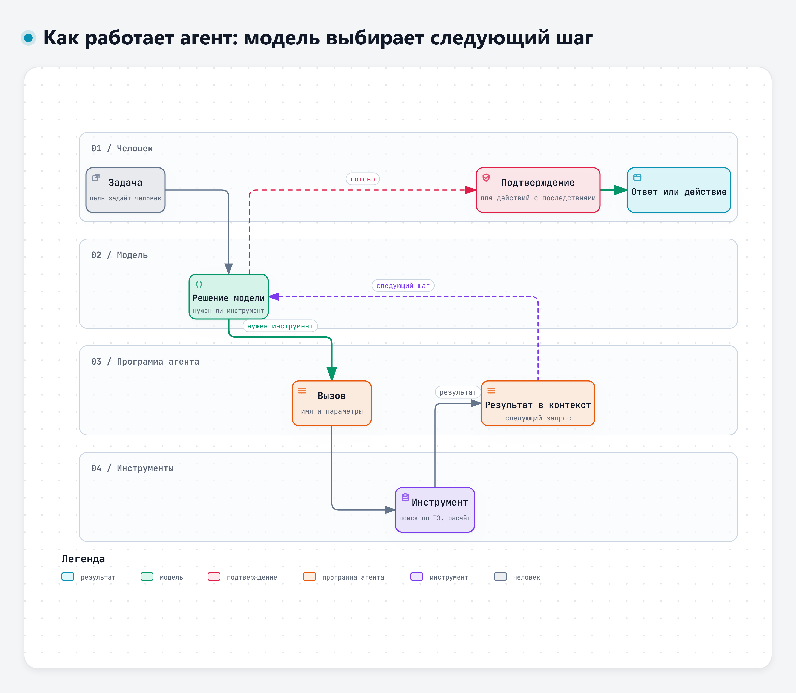

# Тема 1.1. Языковые модели и чат-сервисы: что умеют и где ошибаются

Цель первой темы – понять, с каким инструментом мы имеем дело. Тогда понятно, где ему можно доверять, а где нужно проверять каждую строчку.

## 1. Что такое большая языковая модель

Большая языковая модель обучена на огромном объёме текстов. Из них она усвоила, как обычно продолжаются фразы, рассуждения, таблицы, программы. Когда вы задаёте вопрос, модель не ищет готовый ответ в базе. Она по частям составляет продолжение текста, которое лучше всего подходит к вашему запросу и ко всему, что уже есть в диалоге.

У такого способа работы есть сильные и слабые стороны:

- модель хорошо пишет связный текст, переносит приёмы из одной области в другую, быстро делает черновики, сводки, таблицы;
- модель стремится выдать правдоподобный ответ, даже если не знает верного. Правдоподобное и верное часто совпадают, но не всегда.

> «LLMs are prone to hallucination, generating plausible yet nonfactual content.»
>
> Перевод: «Языковые модели склонны к галлюцинациям: они порождают правдоподобный, но не соответствующий фактам текст.» – Huang и соавт., 2025 [1]

## 2. Чат-сервис на основе модели

Удобная аналогия из доклада А. Субботина на ИИ-митапе ЦГУ 6 ноября 2026 года [18]: модель похожа на толкового стажёра в первый день. Он умный, быстро читает и пишет, но без инструкции, доступа к нужным документам и руководителя, который принимает работу, пользы от него немного. Всё это вокруг модели и даёт чат-сервис, а в организациях – внутренние системы на её основе.

Сама модель – это программа на серверах разработчика. Пользователь работает с ней через чат-сервис с дополнительными функциями.

**Контекст диалога.** Модель учитывает текст текущего чата: ваши сообщения, свои ответы и загруженные файлы. Объём контекста ограничен. В очень длинном диалоге начало может перестать учитываться или учитываться хуже. Другие ваши чаты модель, как правило, не видит, если в сервисе не включена специальная функция памяти.

**История чатов.** Сервис хранит диалоги, к ним можно вернуться. Где хранится история и как её удалить, зависит от сервиса и вида доступа. Это разберём на практике.

**Файлы и изображения.** Многие сервисы принимают документы и картинки: модель пересказывает их, извлекает таблицы, отвечает на вопросы по тексту. Распознанное с изображения тоже нужно проверять.

**Режим рассуждения.** Модель перед ответом строит цепочку промежуточных шагов. На задачах с несколькими шагами это обычно помогает, но ответ получается дольше. Безошибочности режим не гарантирует.

**Поиск в интернете.** Сервис находит страницы и опирается на них в ответе. Это снижает риск устаревших сведений, но не отменяет проверку: найденная страница может быть неподходящей, а пересказ – неточным.

## 3. Сервисы, с которыми работаем на курсе

Сведения ниже взяты из справки и пользовательских соглашений сервисов на 10.11.2026. Функции и названия меняются часто, поэтому на практике проверим их в интерфейсе.

| Сервис | Оператор | Вход | Режимы | Файлы | Данные |
|---|---|---|---|---|---|
| GigaChat | ПАО Сбербанк | Телефон или Сбер ID | В интерфейсе есть кнопки «Рассуждение» и «Исследование», ответы со ссылками на источники | По справке DOCX, PDF, TXT, изображения до 15 МБ. Один новый файл – один новый чат. Запрос до 4000 символов | Обработка на серверах банка, право РФ. Соглашение запрещает передавать в запросах персональные данные [S1], [S2] |
| Алиса AI | ООО «Платформа ИИ-решений» (Яндекс) | Яндекс ID | «Эксперт» – режим рассуждения, без платной опции 20 запросов в день. Поиск через Яндекс | DOC, DOCX, PDF, TXT до 100 МБ, изображения до 20 МБ | Без платной опции история хранится 14 дней. Запросы могут использоваться для улучшения сервисов, отказаться можно в настройках Яндекс ID. Данные граждан РФ хранятся в РФ [S3], [S4], [S5] |
| DeepSeek | Hangzhou DeepSeek Artificial Intelligence (КНР) | Телефон или почта, Google, Apple | Режимы Expert и Instant, поиск | Файлы и изображения принимает, форматы официально не указаны | Данные хранятся в КНР, право КНР. Данные используются для обучения, это можно отключить переключателем «Improve the model for everyone» [S6], [S7] |
| Qwen | Nth Power Global Tech Singapore, обработка Alibaba Cloud (Сингапур) | Почта, Google, GitHub, Apple | Поиск, «Глубокое исследование» | Файлы и изображения принимает, форматы официально не указаны | Данные хранятся в Сингапуре, право Сингапура. Может использовать обезличенный контент для обучения моделей. Отказаться можно письмом на адрес из соглашения, но отзывы об ответах всё равно используются для обучения [S8], [S9] |

**Названия меняются.** Чат Яндекса сейчас называется «Алиса AI». Платная опция к нему – «Алиса Плюс»: больше запросов в режиме «Эксперт» и бессрочное хранение текстовой истории; сгенерированные изображения хранятся 30 дней. Название «Алиса Про» Яндекс относит к тарифам Яндекс 360, это другая подписка [S4].

**Бесплатный доступ рассчитан на личное использование.** По соглашению GigaChat предоставляется для личного некоммерческого использования совершеннолетнему резиденту РФ [S2]. Условия Алисы AI тоже говорят о некоммерческом использовании, а использовать тексты и изображения в иных целях можно только с опцией «Алиса Плюс» [S3]. Для рабочих задач организации заключают отдельные договоры или разворачивают собственные решения. Какой доступ разрешён вам, определяют правила вашей организации.

У DeepSeek данные хранятся в Китае, у Qwen – в Сингапуре, и действует право этих стран [S6], [S8], [S9]. Оба сервиса могут использовать данные пользователей для обучения моделей: DeepSeek – пока пользователь не отключит это в настройках, Qwen – в обезличенном виде, отказ оформляется письмом.

Кроме внешних сервисов, во многих организациях есть внутренние чаты на моделях, развёрнутых на собственных серверах. Такие чаты нужны для работы с данными, которые нельзя отправлять наружу. Если у вас есть такой чат, учитывайте его при выборе инструмента.

## 4. Доступ к сервисам

- **Учётная запись.** Для входа обычно нужен аккаунт сервиса: Сбер ID, Яндекс ID, почта или телефон.
- **Бесплатный и платный доступ.** Бесплатно можно работать в GigaChat, Алисе AI и Qwen. Условия оплаты веб-чата DeepSeek в его документах не описаны. Платная подписка обычно даёт больше запросов, дополнительные функции, иногда более сильные модели.
- **Личный и корпоративный доступ.** Личная учётная запись и корпоративный доступ отличаются условиями обработки данных. Что разрешено в рабочих задачах, определяют правила вашей организации, а не тариф.
- **Ограничения.** У сервисов есть лимиты на длину сообщения, размер файла и число запросов. При превышении сервис предупредит или временно ограничит доступ.

**Как получить доступ на работе.** На предприятиях доступ к ИИ-сервисам часто закрыт по умолчанию и открывается по заявке с обоснованием. Если сервис не открывается с рабочего места, обращайтесь в подразделение, которое выдаёт доступ. Обходные пути не годятся: личный телефон, пересылка файлов на домашнюю почту, флешка. Именно так рабочие данные и утекают.

## 5. Где модели ошибаются

**Выдуманные факты, ссылки и числа.** Это называют галлюцинациями: ответ правдоподобен по форме, но не соответствует фактам или не подтверждается источником [1]. Особенно заметно это на ссылках. В одном исследовании модели подбирали литературу для систематических обзоров. Доля выдуманных ссылок составила от 28,6 до 91,4 % в зависимости от модели [3]. Это модели 2023 года и одна узкая задача. Но и в проверке 2026 года на вопросах по анатомии доля выдуманных ссылок у трёх современных моделей, в том числе у DeepSeek, составила от 23 до 48 % [16]. Номер стандарта, пункт документа, фамилия автора в ответе модели – всё это надо проверять.

> «Hallucination refers to the generation of content by an LLM that is fluent and syntactically correct but factually inaccurate or unsupported by external evidence.»
>
> Перевод: «Галлюцинацией называют порождение моделью текста, который гладок и грамматически правилен, но фактически неверен или не подтверждается внешними данными.» – Alansari, Luqman, 2025, препринт arXiv [17]

> «Any references generated by such models warrant thorough validation by researchers.»
>
> Перевод: «Любые ссылки, которые порождают такие модели, требуют тщательной проверки исследователями.» – Chelli и соавт., 2024 [3]

> «Human verification remains essential before incorporating LLM-generated references into academic or educational materials.»
>
> Перевод: «Проверка человеком остаётся обязательной, прежде чем включать ссылки, порождённые моделью, в научные или учебные материалы.» – Ülkir, Paslı, 2026 [16]

**Разные ответы на один вопрос.** Модель может на одинаковый вопрос ответить по-разному, в том числе по существу. Исследователи из Оксфорда показали: когда на один и тот же фактический вопрос модель даёт несовместимые по смыслу ответы, она, скорее всего, сочиняет [2]. Обратное неверно: модель может уверенно и одинаково повторять ошибку. Если ответ важен, задайте вопрос ещё раз в новом чате и сравните факты в ответах. Расхождение – повод проверить, совпадение проверку не заменяет. Для вопросов вида «предложи возможные причины» разные наборы ответов нормальны.

> «By detecting when a prompt is likely to produce a confabulation, our method helps users understand when they must take extra care with LLMs and opens up new possibilities for using LLMs that are otherwise prevented by their unreliability.»
>
> Перевод: «Определяя, когда запрос, скорее всего, приведёт к конфабуляции, наш метод помогает пользователям понять, когда с языковыми моделями нужно быть особенно осторожными, и открывает новые возможности применения моделей, которым иначе мешает их ненадёжность.» – Farquhar и соавт., 2024 [2]

**Устаревшие сведения.** Модель знает то, что было в обучающих данных на момент обучения. Новые редакции стандартов, цены, изменения в законодательстве она может не знать. Режим поиска помогает, но ссылки всё равно надо открывать.

**Вычисления и инженерная логика.** Модель может верно описать методику и ошибиться в подстановке чисел или в переводе единиц. В исследовании 2026 года модели решали инженерные задачи по расчёту конструкций и оптимизации. Типовые сбои: геометрические рассуждения, многошаговые вычисления, выбор при противоречивых ограничениях [4].

> «The study further exposes systematic failure modes across the examined task types, including geometric reasoning, multi-step numerical computation, and optimization under conflicting constraints.»
>
> Перевод: «Исследование также выявляет систематические виды сбоев во всех рассмотренных типах задач, в том числе в геометрических рассуждениях, многошаговых численных расчётах и оптимизации при противоречивых ограничениях.» – Mysior, Iniotakis, 2026 [4]

Обзор применения моделей в машиностроении приходит к тому же: модели полезны как помощник для работы с документами, данными и инструкциями, но не как замена инженерного расчёта и проверки [10].

> «Overall, the evidence indicates that LLMs are becoming useful semantic and coordination layers in engineering workflows, but not dependable engineering substitutes.»
>
> Перевод: «В целом данные показывают, что языковые модели становятся полезным смысловым и координирующим звеном в инженерной работе, но не надёжной заменой инженерным инструментам.» – Sorour, Sahbel, 2026 [10]

**Согласие с ошибкой в вопросе.** Если в вопрос заложена неверная посылка, модель чаще примет её, чем поправит. Подробнее – в теме 1.2.

Ответ модели всегда проверяет инженер. Модель экономит время на черновике, но ответственность за результат на том, кто его использует.

У этого правила есть обратная сторона, которую К. Овчинников в докладе на том же митапе назвал парадоксом надзора [19]. По его мысли, проверка результата требует собственной компетенции, а чрезмерное делегирование может ослаблять навык самостоятельной работы. Практический вывод: ИИ стоит брать помощником в той работе, которую вы понимаете и можете проверить сами.

## 6. От чата к агенту

Сервисы на моделях удобно разложить по ступеням:

1. **Чат** – отвечает на ваш текст.
2. **Чат с файлами и поиском** – читает загруженные документы и найденные страницы.
3. **Помощник по документам** – ищет ответ в подключённой базе документов организации.
4. **Агент** – сам решает, какой инструмент вызвать (поиск, расчёт, запрос в другую систему), вызывает его, смотрит на результат и продолжает работу.

Интерактивная версия схемы – файл `08-Схемы/d1-cikl-agenta.html`.

Ступени условные и могут пересекаться: поиск по документам выполняет программа, а за окном обычного чата иногда работает агентный цикл. Главное различие в том, кто выбирает следующий шаг. На первых трёх ступенях работа идёт по сценарию, заданному программой, а решения о дальнейших действиях принимает человек. Агент выбирает следующее действие сам, поэтому и требования к проверке выше. Подробнее – в дополнительном материале «От чата к агенту» и в модуле 5.

## 7. Правило с первого занятия

В ИИ-сервисы отправляются только учебные и открытые материалы. Рабочие документы, переписку, фамилии, обозначения изделий не вставляем, даже если очень хочется проверить на настоящей задаче. Почему это правило такое строгое и как работать с данными разного уровня, разберём в теме 2.1.

## Что запомнить

- Модель составляет правдоподобный текст, а не достаёт проверенный ответ из базы.
- Ссылки, номера документов, числа и расчёты в ответе проверяются всегда.
- Один и тот же вопрос может дать разные ответы. Это повод проверить, а не выбрать понравившийся.
- Доступ на работе – только законным путём, через подразделение, которое его выдаёт.
- В сервисы – только учебные и открытые материалы.

## Источники

Нумерация общая для тем 1.1 и 1.2.

**Научные публикации**

- [1] Huang L., Yu W., et al. A Survey on Hallucination in Large Language Models: Principles, Taxonomy, Challenges, and Open Questions // ACM Transactions on Information Systems. 2025. https://doi.org/10.1145/3703155
- [2] Farquhar S., Kossen J., et al. Detecting hallucinations in large language models using semantic entropy // Nature. 2024. https://doi.org/10.1038/s41586-024-07421-0
- [3] Chelli M., Descamps J., et al. Hallucination Rates and Reference Accuracy of ChatGPT and Bard for Systematic Reviews: Comparative Analysis // Journal of Medical Internet Research. 2024. https://doi.org/10.2196/53164
- [4] Mysior M., Iniotakis C. Evaluating large language models on text-based engineering design tasks: performance gaps and failure modes // Research in Engineering Design. 2026. https://doi.org/10.1007/s00163-026-00504-1
- [10] Sorour S., Sahbel A. Large language models in intelligent manufacturing and mechanical engineering: a review of robotics, fault diagnosis, design, and engineering knowledge workflows // Journal of Intelligent Manufacturing. 2026. https://doi.org/10.1007/s10845-026-02927-y
- [17] Alansari A., Luqman H. Large Language Models Hallucination: A Comprehensive Survey. 2025. Препринт arXiv. https://doi.org/10.48550/arXiv.2510.06265
- [16] Ülkir M., Paslı B. Reference Hallucination, Citation Reliability, and Readability of Large Language Models in Anatomy-Related Question Answering // Clinical Anatomy. 2026. https://doi.org/10.1002/ca.70187

**Сервисы** (страницы открыты 10.11.2026)

- S1. GigaChat. Справка: начало работы, частые вопросы, документы, изображения. https://giga.chat/help/articles/how-to-start-work-with-gigachat ; https://giga.chat/help/articles/faq ; https://giga.chat/help/articles/work-with-docs ; https://giga.chat/help/articles/gigachat-load-picture
- S2. Пользовательское соглашение GigaChat. https://developers.sber.ru/docs/ru/policies/gigachat/agreement
- S3. Условия использования сервиса «Алиса AI». https://yandex.ru/legal/alice_chat/
- S4. Алиса AI. Справка: чат, опция «Алиса Плюс», режим «Эксперт», файлы. https://alice.yandex.ru/support/ru/assistant/chat-alice ; https://alice.yandex.ru/support/ru/assistant/alice-plus ; https://alice.yandex.ru/support/ru/assistant/chat/intellect ; https://alice.yandex.ru/support/ru/assistant/chat/files
- S5. Политика конфиденциальности Яндекса. https://yandex.ru/legal/confidential/
- S6. DeepSeek Privacy Policy. https://cdn.deepseek.com/policies/en-US/deepseek-privacy-policy.html
- S7. DeepSeek Terms of Use; анонс DeepSeek-V4 Preview. https://cdn.deepseek.com/policies/en-US/deepseek-terms-of-use.html ; https://www.deepseek.com/en/news/v4-preview/
- S8. Qwen. Соглашение об оказании услуг; страница входа; описание сервиса. https://qwen.ai/termsservice ; https://chat.qwen.ai/auth ; https://qwen.ai/home
- S9. Qwen. Политика конфиденциальности. https://qwen.ai/privacypolicy

**Выступления и вебинары**

- [18] Субботин А. Платформы для совместной работы с ИИ-агентами. Доклад на ИИ-митапе ЦГУ, 06.11.2026 (презентация доклада).
- [19] Овчинников К. Инженер после AI. Доклад на ИИ-митапе ЦГУ, 06.11.2026 (презентация доклада). На слайде о парадоксе надзора докладчик ссылается на материал Anthropic «How AI Is Transforming Work at Anthropic» (2025).
- [20] Гагарин П. Разработка с агентами: от постановки задачи до деплоя. Вебинар учебного центра «МАСКОМ», 28.07.2026 (презентация вебинара).

Полный список источников дня – в файле «Источники» в папке дня.

---

<!-- author-block -->
**Автор курса**

Виталий Пиков

- Архитектор информационной безопасности
• РБПО • DevSecOps • AppSec
- Лектор и автор образовательных программ по ИБ и РБПО

Телефон: +7 (963) 782-92-78 ·
E-mail: vitaly@pikov.expert ·
Сайт: https://pikov.expert ·
Telegram: @UnderLineSecurity
