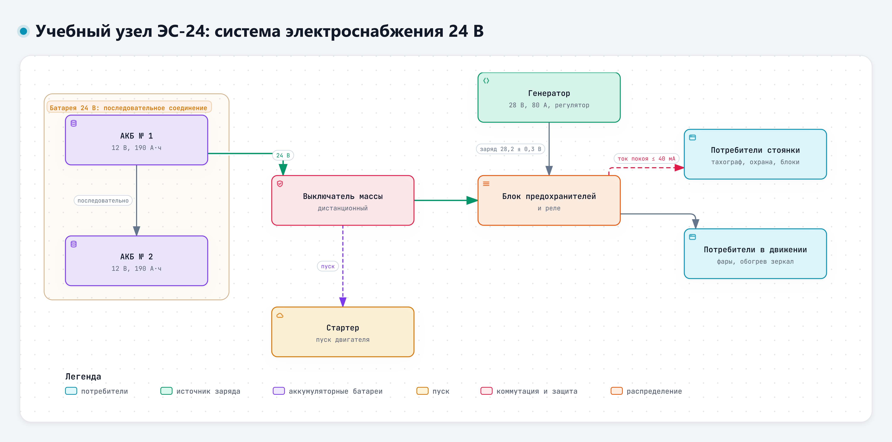

# Учебный кейс: система электроснабжения 24 В

Все материалы кейса учебные. Узел условный, значения подобраны для упражнений и не взяты из документации реального изделия. Поэтому кейс можно целиком отправлять в любой из сервисов, с которыми мы работаем на занятиях.

Кейс пригодится на всём курсе. В первый день нужны описание узла, фрагмент технического задания и перечень замечаний.

## 1. Описание узла

Узел ЭС-24 – система электроснабжения условного грузового автомобиля с бортовой сетью 24 В. В неё входят:

- генератор 28 В, 80 А со встроенным регулятором напряжения;
- две свинцово-кислотные стартерные аккумуляторные батареи 12 В, 190 А·ч, соединённые последовательно;
- дистанционный выключатель массы;
- блок предохранителей и реле;
- потребители, которые работают на стоянке: тахограф, охранная система, блок управления двигателем в дежурном режиме, головное устройство в режиме ожидания.

Автомобиль эксплуатируется круглый год, в том числе на стоянках под открытым небом при температуре до −25 °C.

Интерактивная версия схемы – файл `08-Схемы/d1-uzel-es24.html`.

## 2. Фрагмент технического задания

| Пункт | Требование |
|---|---|
| 4.1 | Номинальное напряжение бортовой сети – 24 В. |
| 4.2 | Напряжение, которое поддерживает регулятор при температуре +25 °C, – 28,2 ± 0,3 В. |
| 4.3 | Ток, потребляемый от аккумуляторных батарей при выключенном зажигании и включённом выключателе массы (ток покоя), – не более 40 мА. Измеряется через 30 мин после выключения зажигания. |
| 4.4 | После стоянки 14 суток при температуре окружающего воздуха до −25 °C двигатель должен запускаться штатным стартером без внешнего источника питания. |
| 4.5 | Напряжение разомкнутой цепи каждой аккумуляторной батареи после стоянки 14 суток – не ниже 12,2 В. |
| 4.6 | Ток отдачи генератора на холостом ходу двигателя (600 мин⁻¹) – не менее 40 А. |

Других пунктов в разделе 4 нет.

## 3. Перечень замечаний по испытаниям опытного образца

| № | Замечание |
|---|---|
| З-1 | Перед стоянкой батареи были полностью заряжены. После 9 суток стоянки при температуре от −18 до −22 °C напряжение разомкнутой цепи батарей перед пуском – 11,9 В и 12,0 В. Двигатель запустился только со второй попытки. |
| З-2 | Ток покоя через 30 мин после выключения зажигания – 85 мА, через 2 ч – 62 мА. |
| З-3 | На холостом ходу при включённых фарах дальнего света и обогреве зеркал напряжение бортовой сети снижается до 26,1 В. |
| З-4 | На клемме «плюс» батареи № 1 следы окисления. Момент затяжки клемм в документации не указан. |
| З-5 | Предохранитель цепи тахографа сгорел дважды за 1200 км пробега. |

## 4. Учебный ответ модели для проверки

Этот ответ подготовлен для занятия, в нём специально оставлены ошибки. Задача слушателя – найти их, сверяясь с описанием узла и техническим заданием. Вопрос, на который «отвечала модель»:

> Оцени по замечанию З-2, укладывается ли ток покоя в требования, и посчитай, через сколько суток батареи разрядятся до 50 %.

Ответ:

> Ток покоя 85 мА выше рекомендуемого, но укладывается в допуск по п. 4.3 ТЗ (не более 100 мА), так что формально несоответствия нет.
>
> Две батареи по 190 А·ч, соединённые последовательно, дают общую ёмкость 380 А·ч. Разряд до 50 % – это 190 А·ч. При токе 85 мА: 190 / 0,085 = 2235 ч, то есть примерно 9,3 суток.
>
> Зимой при −25 °C ёмкость батарей возрастает примерно на 10 %, поэтому запас по стоянке даже больше расчётного. По п. 4.8 ТЗ допускается разряд батарей до 30 % без последствий для пуска.
>
> Рекомендация: заменить генератор на модель большей мощности. Замечание З-2 можно закрыть без доработки.

---

<!-- author-block -->
**Автор курса**

Виталий Пиков

- Архитектор информационной безопасности
• РБПО • DevSecOps • AppSec
- Лектор и автор образовательных программ по ИБ и РБПО

Телефон: +7 (963) 782-92-78 ·
E-mail: vitaly@pikov.expert ·
Сайт: https://pikov.expert ·
Telegram: @UnderLineSecurity
