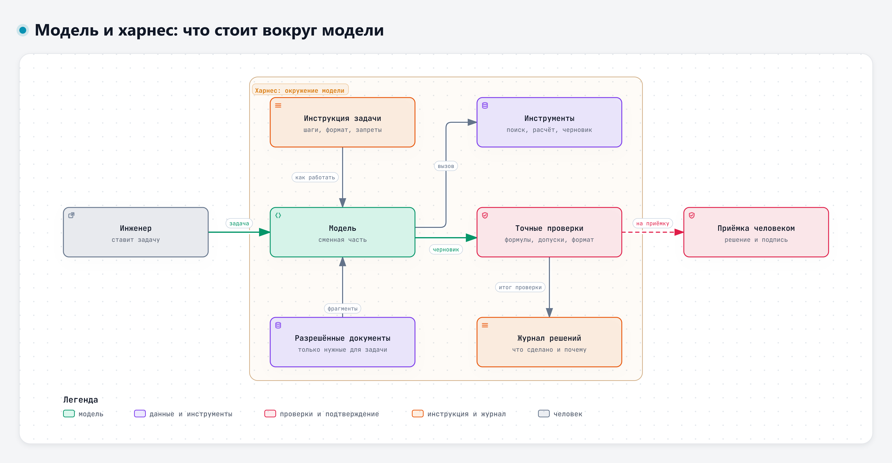
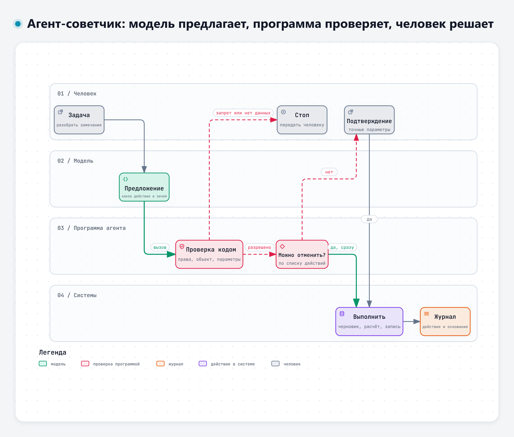
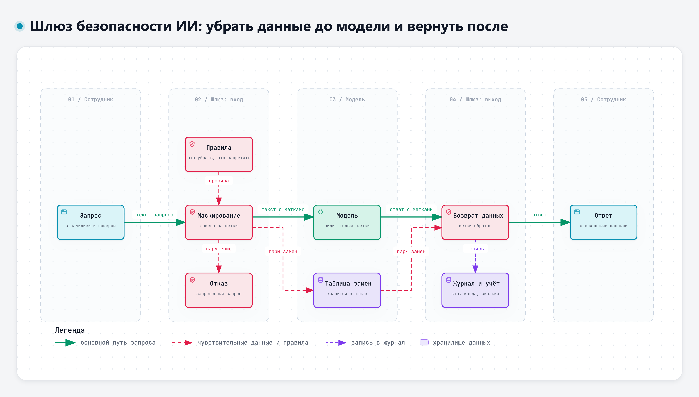

# Тема 5.1. Внутренние решения организации и инструменты за пределами разрешённых сервисов

Четыре дня мы работали в чат-сервисах, открытых на рабочем месте. Сегодня посмотрим шире: какие модели есть за пределами этих сервисов, что бывает внутри организаций и как устроены помощники и агенты, которые работают не в окне чата, а внутри рабочих процессов. Главная мысль темы: результат зависит не только от модели, но и от всего, что стоит вокруг неё.

## 1. Сильные модели за пределами разрешённых сервисов

### Что сейчас считается сильным

Крупные зарубежные разработчики выпускают модели, которые на сложных задачах заметно сильнее бесплатных чатов. Для примера – три модели, как их описывают сами разработчики на страницах для программистов (страницы открыты 10.11.2026).

| Разработчик | Модель | Как описана | Что умеет по описанию |
|---|---|---|---|
| OpenAI | GPT-6 Astra | «Our most capable model for the most demanding work» – модель с самыми широкими возможностями для самых сложных задач | Контекст 1,05 млн токенов, ответ до 128 тыс. токенов, несколько уровней рассуждения, инструменты: вызов функций, поиск в интернете, поиск по файлам, работа с компьютером. Знания – по 30.04.2026 [33] |
| Google | Gemini 4 Carbon | «Our strongest reasoning model» – самая сильная модель для рассуждений | Контекст 1 млн токенов; принимает текст, изображения, звук, видео, PDF; рассчитана на сложную разработку программ, работу с разными видами данных и научные рассуждения [35] |
| Anthropic | Claude Fable 5.2 | «For demanding reasoning and long-horizon agentic work» – для сложных рассуждений и долгой самостоятельной работы агентов | Контекст 1 млн токенов, ответ до 128 тыс. токенов; принимает текст и изображения; рассуждение включено всегда, его глубину задаёт уровень усилия; работает с инструментами. Знания – по состоянию на июнь 2026 года [51], [52] |

Anthropic советует для большинства задач начинать с более дешёвой Claude Opus 5.5, а Claude Fable 5.2 брать для сложных рассуждений и долгой работы агентов [51]. На странице Claude Fable 5.2 указана дата выпуска – 9 ноября 2026 года [52]. На страницах OpenAI и Google даты выпуска не указаны, поэтому для этих моделей их здесь нет. У всех трёх разработчиков есть и более дешёвые модели, есть сильные модели и у других зарубежных разработчиков. Названия меняются несколько раз в год, поэтому таблица – снимок на дату, а не справочник.

Чем такие модели сильнее на деле:

- **Длинный контекст.** До миллиона токенов в одном запросе: в него помещается большой комплект документов, а не только выдержка.
- **Инструменты.** По описаниям OpenAI и Anthropic их модели работают с инструментами [33], [51]; у OpenAI перечислены поиск в интернете и по файлам, вызов функций, работа с компьютером [33].
- **Уровни рассуждения.** Модель можно попросить рассуждать дольше над сложной задачей.

Но и у сильной модели граница возможностей неровная. В эксперименте с 758 консультантами доступ к модели того времени ускорял и улучшал работу на задачах внутри её возможностей, а на одной задаче за их пределами правильных решений стало меньше [3].

> «However, for a complex managerial task selected to be outside the frontier, subjects using AI were 19% less likely to produce correct solutions compared with those without AI, pointing to potential limitations of AI supporting knowledge workers.»
>
> Перевод: «Однако на сложной управленческой задаче, специально выбранной за пределами этой границы, участники, работавшие с ИИ, на 19 % реже приходили к правильному решению, чем те, кто работал без ИИ, что указывает на возможные ограничения ИИ в поддержке работников умственного труда.» – Dell'Acqua и соавт., 2026 [3]

Для инженера вывод такой: сильная модель не отменяет проверки. Она расширяет возможности, но граница остаётся, и заранее не всегда понятно, справится ли модель с вашей задачей.

### Почему данные организации туда загружать нельзя

**Первое – формальное.** В списках стран, где эти разработчики открывают доступ к своим моделям, России нет. На странице OpenAI со списком поддерживаемых стран и территорий прямо сказано, к чему ведёт работа за пределами списка [34]:

> «Accessing or offering access to our services outside of the countries and territories listed below may result in your account being blocked or suspended.»
>
> Перевод: «Доступ к нашим сервисам или предоставление доступа к ним за пределами перечисленных ниже стран и территорий может привести к блокировке или приостановке вашей учётной записи.» – OpenAI, Supported countries and territories [34]

У Google в списке стран, где доступны Gemini API и Google AI Studio, России тоже нет [36]. Нет её и в списке стран и регионов на странице Anthropic (страница открыта 10.11.2026, на ней указана дата вступления этой редакции в силу – 12.11.2026) [53]. Anthropic отдельно оговаривает, что важно, где человек находится физически [53]:

> «Any country or region not listed is unsupported. This includes: Use by persons while physically located in an unsupported region, including users and personnel of otherwise supported entities.»
>
> Перевод: «Любая страна или регион, которых нет в списке, не поддерживаются. Сюда относится использование людьми, которые физически находятся в неподдерживаемом регионе, в том числе пользователями и сотрудниками организаций, для которых доступ в остальном открыт.» – Anthropic, Supported Regions Policy [53]

Значит, работа с этими моделями из России противоречит правилам самих разработчиков. На курсе обходные пути не обсуждаются и не советуются.

**Второе – данные уходят из-под контроля.** Отправленный текст обрабатывается на серверах разработчика, хранится по его правилам и по праву его страны. Как это устроено у DeepSeek и Qwen, мы разбирали в теме 1.1: данные хранятся в КНР и в Сингапуре и могут использоваться для обучения. У зарубежных платных сервисов свои условия, но можно ли ими пользоваться, определяют правила вашей организации, а не сам сотрудник. Что относится к коммерческой тайне и конструкторской документации, тоже определяют перечни организации (тема 2.1).

**Третье – зависимость.** Сервис, к которому у организации нет договора, может пропасть в любой момент. А. Субботин на отраслевом ИИ-митапе (ноябрь 2026) рассказывал, как у знакомых ему людей однажды ночью разом заблокировали учётные записи в одной сильной зарубежной модели, и причину никто так и не узнал [39]. Это рассказ докладчика, а не исследование, но страница OpenAI выше показывает, что такой исход прямо предусмотрен правилами сервиса.

Что из этого следует на практике. Сильные зарубежные модели полезно знать: на открытых задачах они показывают, чего можно ожидать от ИИ через год-два. Но для работы с данными организации путь один: разрешённые сервисы и внутренние решения.

## 2. Что бывает внутри организации

Во многих организациях, где внедряют ИИ, есть несколько видов внутренних решений. Есть ли они у вас и как называются, уточните в своей организации: ниже описаны виды, а не конкретные продукты.

### Внутренний чат на локальных моделях

Модель с открытыми весами разворачивают на серверах организации. Сотрудник работает в привычном окне чата, но текст не уходит за пределы организации. Это главный ответ на вопрос «где работать с документами, которые нельзя отправлять наружу».

У такого решения есть цена. В статье о применении моделей в медицине разница описана коротко [9]:

> «Closed LLMs of private companies offer ease of deployment but pose risks related to data privacy and vendor dependence. Open LLMs deployed on local hardware enable greater model customization but demand resources and technical expertise.»
>
> Перевод: «Закрытые модели частных компаний легко внедрить, но их использование связано с рисками для конфиденциальности данных и зависимостью от поставщика. Открытые модели, развёрнутые на собственном оборудовании, дают больше возможностей настройки, но требуют ресурсов и технической квалификации.» – Dennstädt и соавт., 2025 [9]

Модели, которые можно развернуть у себя, часто уступают лучшим закрытым [12]. Насколько – зависит от задачи. В исследовании на заводе сравнивали модели для помощника, который отвечает операторам по документации цеха: лучшая закрытая модель того времени стабильно опережала остальные, но открытые отставали ненамного, и авторы считают их привлекательными из-за защиты данных и возможности настройки [10].

Дорогое ли это оборудование? Не обязательно. В работе 2026 года обычную рабочую станцию с одной потребительской видеокартой превратили в сервер для модели: она выдавала 29–65 токенов в секунду на задачах помощника по документам и программам, без выхода данных наружу [11]. Для небольшой службы такого может хватить, для всей организации нужны серверы мощнее (вывод автора курса).

Ещё одна оговорка: локальная модель сама по себе не гарантирует конфиденциальность. Исследователи показали, что запросы могут сохраняться и утекать через программы, которые обслуживают модель: при загрузке, в памяти, в журналах, через интерфейс [13]. Поэтому внутренний чат проверяют и настраивают специалисты по защите информации, как любую другую систему.

### Помощник по документам

Это внутренний чат, к которому подключена база документов организации: стандарты, инструкции, руководства. На вопрос он сначала ищет подходящие фрагменты и отвечает по ним, со ссылками. Мы говорили о таком поиске с дополнением контекста в теме 2.2. В заводском исследовании операторы отметили, что информацию так находить быстрее, но если рядом есть опытный коллега, учиться предпочитают у него [10].

Полезность помощника по документам определяют две вещи: какие документы ему разрешено читать и насколько они актуальны. Если в базе лежит устаревшая редакция стандарта, помощник уверенно ответит по ней.

### Конструктор агентов для сотрудников без программирования

Конструктор позволяет сотруднику самому собрать помощника под свою задачу: написать инструкцию, приложить нужные документы, выбрать разрешённые инструменты, задать порядок шагов. Программировать не нужно.

По обзору 2025 года, такие платформы заметно упрощают начало работы, но проблемы с гибкостью и надёжностью сохраняются [14].

Хорошо работают конструкторы, в которых жёсткие шаги заданы схемой, а модель вызывается только там, где нужен текст. В одной из платформ, описанных в 2026 году, так и сделано: детерминированное дерево шагов и модель только в отмеченных точках [15]. Для инженерной задачи это означает: проверку допуска делает шаг схемы, а модель пишет пояснение к отклонению.

### Подключение готовых решений к чату

К внутреннему чату можно подключать инструменты: поиск по базе документов, запрос в систему учёта, расчёт. Каждое подключение включается отдельно и даёт помощнику новую возможность. Вместе с возможностью растёт и цена ошибки, поэтому подключения согласуют с ИТ и защитой информации, а не включают по желанию пользователя.

### Инфраструктура для тех, кто программирует

Программирующим сотрудникам организация может дать программный доступ к внутренним моделям, отдельные учётные записи для агентов, стенд с тестовыми данными, журналы вызовов. На этом строят собственных агентов под задачи службы. Описание такого агента – дополнительное задание практики, образец – в документе 5-5 дополнения к кейсу.

### Покупать или делать самим

В ноябре 2026 года на онлайн-конференции форума All-over-IP Н. Галкин, директор департамента ИТ сети ресторанов «Кофемания», объяснял, как компания решает, что купить, а что сделать самим [55]. Зрелое покупают: видеоаналитику, генерацию материалов для маркетинга, анализ отзывов. Сами делают то, где своя экспертиза выше рынка, и то, что нельзя выпускать наружу: «меню, рецепты, технологические карты, технологические процессы». Со слайда доклада: «мы не пишем свою видеоаналитику, но никому не отдаём свои алгоритмы спроса» [55].

Для инженерной службы такими сведениями будут конструкторская и технологическая документация, результаты испытаний, сведения о поставщиках. Это и есть то, для чего нужны внутренние решения.

### Модель и харнес

Всё, что стоит вокруг модели, в отрасли называют харнесом (от английского harness – сбруя, упряжь). Это инструкции, доступ к одним данным и запрет на другие, инструменты, проверки, журнал решений и точки, где решает человек.

Интерактивная версия схемы – файл `08-Схемы/d5-model-harness.html`.

А. Субботин на митапе предложил аналогию: «Модель это повар. Харнес это кухня». Если повар заболел, выходит другой, и кафе работает дальше, потому что рецепты, продукты и порядок на кухне остались [39]. По его мысли, задачу чаще решает не самая умная модель, а хорошо устроенное окружение. Отсюда его итоговый совет: «Не ждите самую умную модель. Соберите харнес, в котором справится та модель, что у вас уже есть» [39]. В первый день мы вспоминали другое его сравнение: модель похожа на толкового стажёра, которому нужны инструкция, доступ к документам и руководитель, принимающий работу. Харнес и есть всё это вместе.

Для внутренних решений аналогия особенно полезна. Внутренняя модель может быть слабее зарубежной, но если инструкция написана ясно, документы подобраны, а результат проверяется, её хватает на многие рутинные задачи. Инструкции стоит сразу писать так, чтобы с ними справилась и более простая модель: тогда смена модели не ломает работу.

Субботин добавлял ещё одно правило: сначала описать работу, потом звать агента [39]. Вывод для службы: если процесс не описан, агент его не исправит, а будет быстро повторять ту же путаницу.

### Агент или фиксированная цепочка

Не каждой задаче нужен агент. В руководстве разработчиков Anthropic по построению агентов различаются цепочки, где шаги заранее заданы программой, и агенты, где модель сама выбирает следующий шаг [37]. Совет оттуда же:

> «When building applications with LLMs, we recommend finding the simplest solution possible, and only increasing complexity when needed.»
>
> Перевод: «При создании приложений на языковых моделях мы рекомендуем искать самое простое решение и усложнять его, только когда это необходимо.» – Anthropic, Building effective agents, 2024 [37]

Для службы это значит: если задача укладывается в три одинаковых шага, достаточно шаблона запросов или цепочки в конструкторе. Агент нужен там, где порядок шагов заранее неизвестен. Тот же вывод в «Кофемании» сделали на своих проектах: «Если это линейный процесс, то дешевле использовать робота», а ИИ поручают задачи, где нужно понимать контекст и составлять текст [55].

## 3. ИИ-агент как советчик: что поручать модели, а что нет

### Модель предлагает, программа проверяет, человек решает

Агент из первого дня – цикл: модель выбирает действие, программа его выполняет, результат возвращается модели. Безопасный агент для инженерной работы устроен как советчик. Модель разбирает текст и предлагает следующий шаг. Программа проверяет, разрешено ли это действие, над каким объектом и с какими параметрами. Человек подтверждает то, что нельзя отменить.

Интерактивная версия схемы – файл `08-Схемы/d5-agent-sovetchik.html`.

**Что сразу, что со спросом.** В. Малаканов на митапе показал простое правило: действие, которое человек отменит одной кнопкой, агент делает сразу; действие, которое делает запись в личный кабинет человека, всегда согласует. И добавил: «Модель может быть уверена хоть на 100%. Напоминание без спроса мы всё равно не ставим» [41]. Его же совет тем, кто начинает: «начните с действия, которое легко отменить» [41]. В инженерной работе обратимые действия – создать черновик, выполнить расчёт, найти пункт. Необратимые – отправить письмо, изменить статус замечания, исправить документ.

**Права проверяет код, а не модель.** Если правило «не отправляй наружу» записано только в инструкции, модель может его нарушить: она не выполняет правила, а продолжает текст. Субботин сформулировал это так: «Закрыть отправку наружу в настройках. Агент может сам решить кому-то написать. Просьба в тексте не спасет, спасет запрет» [39].

Исследование 2026 года показало это на числах. Модели поручали решать, когда кадровый процесс требует обязательного согласования человеком [16]:

> «Ungoverned Qwen2.5 identified elevated risk but failed to escalate any of the 43 sensitive cases to mandatory human approval, yielding HITL recall equal to 0.»
>
> Перевод: «Модель Qwen2.5 без внешних ограничений распознала повышенный риск, но не передала на обязательное согласование человеку ни одного из 43 чувствительных случаев: доля случаев, переданных человеку, оказалась равна нулю.» – Pacella и соавт., 2026 [16]

Авторы решили это так, как советуют докладчики митапа: минимальный уровень согласования задаётся правилом в программе, и модель не может опуститься ниже него [16]. В промышленной архитектуре, описанной в том же году, действия с оборудованием проходят только через проверенный слой управления, а без документированного разрешения человека не выполняются: точка согласования защищена криптографически [17].

**Опасность растёт с самостоятельностью.** А. Морозов на митапе: «Опасность агента пропорциональна тому, что он умеет делать без подтверждения» [40]. У агента, который только читает документы и пишет черновики, меньше возможностей напрямую изменить рабочие системы. Содержание его черновика всё равно проверяют: нет ли в нём ошибок и не попали ли туда сведения, которые получателю видеть не положено. Агент, который может отправлять, удалять и менять записи, ошибается дорого.

**Стоп-условия и передача человеку.** С. Скидан рассказывал на митапе об агенте, который работает в поддержке до оператора. В схеме его агента прямо записаны «Стоп-условия: Нет данных, конфликт или риск» [42]. Если данных не хватает, агент не выдумывает ответ, а передаёт вопрос человеку. Его формулировка: «Хороший агент не удерживает клиента любой ценой: он собирает контекст и вовремя передаёт кейс» [42]. Для инженерного агента стоп-условия такие: нет пункта ТЗ, противоречие в данных, несовместимые единицы, подозрительная строка в документе.

**Модель-«судья» – дешёвая проверка шага.** Проверку действий агента не обязательно поручать большой модели: она пишет рассуждение, тратит секунды и отвечает свободным текстом, который ещё надо разобрать. На онлайн-конференции форума All-over-IP в ноябре 2026 года А. Мирошкин показывал слайды о «моделях принятия решений» [57]. Такая модель получает закрытый вопрос («что сделать с действием?») и варианты с определениями: пропустить, заблокировать, передать человеку. Вместе с вопросом ей передают, кто и зачем действует, что именно делает агент, факты, которые проверила программа, и правило одной строкой. В ответ она выбирает один вариант и сообщает уверенность. Порог уверенности задаёт политика: чем дороже ошибка, тем выше порог, остальное уходит человеку. Числа на этих слайдах иллюстративные, так и указано.

Ограничения там же: «Гарантирован формат ответа, а не его правота», «Чего нет в запросе – того судья не учтёт» [57]. Итог автора: «Быстрый судья не заменяет архитектуру защиты. Он делает контроль дешёвым на каждом шаге агента» [57]. Для курса правило не меняется: права проверяет программа, а необратимое действие подтверждает человек, какой бы уверенной ни была модель.

О том, почему это важно, говорила на той же конференции Н. Галимова («Билайн»). Риск агентов она описала так: «превращение ошибки в данных в автономно выполняемое ошибочное действие» [56].

### Что оставить точным проверкам

Модель хорошо работает с текстом: читает, сопоставляет, пересказывает, предлагает. Плохо – там, где нужна точность: допуски, арифметика, единицы, формат номера. Всё точное отдают обычной программе, формуле в таблице, проверке по списку.

- Сравнение 85 мА с 40 мА делает формула, а не модель.
- Расчёт разряда батареи – таблица с формулой, модель только помогает её составить.
- Комплектность документации – сверка по перечню.
- Формат обозначения документа – проверка по шаблону.

Исследователи агентов приходят к тому же. Дешёвая детерминированная проверка до того, как действие выполнено, – недооценённый способ надзора за агентом [18]. Авторы системы, которая пишет программы для промышленных контроллеров, прямо говорят, что модели не дают гарантий правильности, и строят работу вокруг формальной проверки кода [19].

Обзор применения моделей в машиностроении подводит итог: расчёт, моделирование и управление модели не заменяют, зато помогают инженеру работать с документами, данными и программами [30].

> «This review shows that, in most engineering settings, their value is not that they replace simulation, control, or numerical analysis tools, but that they help engineers work across documents, data sources, software environments, and natural-language instructions more efficiently.»
>
> Перевод: «Обзор показывает, что в большинстве инженерных задач их ценность не в замене средств моделирования, управления и численного анализа, а в том, что они помогают инженерам эффективнее работать с документами, источниками данных, программными средами и инструкциями на естественном языке.» – Sorour, Sahbel, 2026 [30]

### Подтверждение человеком тоже нужно уметь делать

Казалось бы, решение простое: пусть агент спрашивает человека обо всём. Но у внимания есть предел. Если агент просит подтверждения слишком часто, со временем «да» начинают нажимать не читая. В обзоре 2026 года 21 производственной агентной системы три самых распространённых механизма защиты оказались человеческими: правила, подтверждение во время работы, ограничение области действия. Их недостаток авторы называют прямо [22]:

> «Yet current human participation mechanisms are far from satisfactory: they suffer from a fundamental trade-off between cognitive burden and security guarantees, leaving users caught between approval fatigue and uncontrolled agent autonomy.»
>
> Перевод: «Однако нынешние механизмы участия человека далеки от удовлетворительных: в них приходится выбирать между нагрузкой на человека и гарантиями безопасности, и пользователь оказывается между усталостью от подтверждений и бесконтрольной самостоятельностью агента.» – Wang, Li, Tian, 2026, препринт arXiv [22]

В эксперименте с 48 участниками, которые наблюдали за агентом в браузере, люди оценивали, правильно ли агент сделал дело, а не безопасно ли его действие [21]. Модельная работа 2026 года показала, что при уставшем проверяющем больше запросов на подтверждение может сделать систему менее безопасной [20]. Это препринты, но вывод для практики понятный: подтверждение ставят там, где действие необратимо, и показывают человеку точные параметры действия, а не пересказ агента.

К. Овчинников на митапе назвал это парадоксом надзора: проверить работу ИИ может тот, кто умеет делать её сам, а навык слабеет, если всё отдавать модели [43]. О том же пишут сотрудники разработчика моделей в опросе 2025 года: они полностью передают модели лишь небольшую часть работы, а остальное требует постоянного надзора и проверки [38]. Это самоотчёт сотрудников одной компании, а не независимое исследование.

## 4. Шлюзы безопасности ИИ – обзорно

Шлюз безопасности ИИ – программа между сотрудником и моделью. Все запросы идут через неё. Шлюз находит в тексте чувствительные сведения (фамилии, номера договоров, ключи доступа), заменяет их метками, отправляет модели текст с метками, а в ответе модели возвращает исходные значения. Заодно он ведёт журнал, считает расход и блокирует запрещённые запросы.

Интерактивная версия схемы – файл `08-Схемы/d5-shlyuz.html`.

М. Горшков в вебинаре о проблемах агентов в разработке перечислял меры, которые даёт такой шлюз: учёт всех используемых моделей и агентов, «Точка контроля всех запросов к модели», списки разрешённых инструментов и ресурсов, проверка на скрытые команды, маскирование чувствительных данных, контроль расхода [44]. А. Морозов называл классы готовых средств проверки входа и выхода модели, например NeMo Guardrails и Llama Guard [40].

Как работает возврат данных, хорошо видно в описании одной исследовательской системы [24]:

> «Casper redacts PIIs from the prompts by replacing them with unique placeholders before sending them to LLM services. By sharing only the placeholders with LLM services, Casper ensures that they can still generate relevant responses without knowing the original PIIs. And when the LLM service returns the responses, Casper reverts any placeholders in the response back to their original forms before displaying the responses to the users.»
>
> Перевод: «Casper убирает персональные данные из запросов, заменяя их уникальными метками до отправки в сервис. Сервис получает только метки и может дать полезный ответ, не зная исходных персональных данных. Когда сервис возвращает ответ, Casper заменяет метки в нём на исходные значения и только после этого показывает ответ пользователю.» – Chong и соавт., 2025, по полному тексту препринтной версии [24]

Зачем это нужно, объясняют авторы другой системы: при работе сотрудников с внешними моделями одна из главных опасностей в том, что сведения случайно утекают через сами запросы [26].

Чего шлюз не умеет. Фамилию, номер телефона или ключ найти легко. Технический смысл документа – трудно. В сравнительном исследовании 2026 года лучшее сочетание мер (локальная обработка, где можно, замена и перефразирование остального) почти полностью закрыло утечку персональных данных, но не служебного программного кода [25]:

> «Our headline finding is that no single technique dominates: the combination A+B+C (route locally when possible, redact and rephrase the rest) achieves 0.6% combined leak on PII and 31.3% on proprietary code, with zero exact leaks on PII across 500 samples.»
>
> Перевод: «Главный вывод: ни один приём не лучше остальных во всём. Сочетание A+B+C (обрабатывать локально, где возможно, остальное маскировать и перефразировать) даёт 0,6 % утечки персональных данных и 31,3 % утечки служебного кода, причём точных утечек персональных данных на 500 примерах не было.» – Agyemang и соавт., 2026, препринт arXiv [25]

Для инженера это значит: шлюз помогает, если в запросе случайно оказалась фамилия, но не превращает чертёж, протокол испытаний или расчёт в открытый документ. Обезличивание не даёт права на передачу, это правило темы 2.1 остаётся в силе.

То же с фильтрами скрытых команд. Исследователи взяли восемь защит от скрытых команд в данных агента и подобрали атаки, которые обошли все восемь [28]:

> «In this paper, we evaluate eight different defenses and bypass all of them using adaptive attacks, consistently achieving an attack success rate of over 50%.»
>
> Перевод: «В этой работе мы проверили восемь разных защит и обошли все с помощью адаптивных атак, стабильно добиваясь успеха более чем в 50 % попыток.» – Zhan и соавт., 2025 [28]

Поэтому фильтр – один из слоёв, а не замена ограниченным правам. Авторы одного из подходов строят защитный слой вокруг модели так, чтобы недоверенные данные вообще не могли изменить ход выполнения, даже если сама модель поддаётся атаке [27].

## 5. Направления развития – кратко

**Агенты становятся самостоятельнее.** По внутреннему отчёту разработчика моделей, за полгода 2025 года агент для программистов стал выполнять подряд больше действий без участия человека, а люди реже вмешивались [38]. Это данные компании о своих сотрудниках, но направление видно и по другим источникам.

**Модели приходят в производство.** Обзоры 2025–2026 годов описывают помощников по документации цеха, системы диагностики отказов, планирование технологических процессов, связь с цифровыми двойниками [30], [31]. Общая оговорка обзоров: модели общего назначения хуже справляются с машиностроительными задачами, потому что учились не на них [31].

**Внутренние решения растут.** В исследовании на заводе открытые модели отставали от лучшей закрытой ненамного [10], а запустить модель можно и на недорогом оборудовании [11]. Для организаций с закрытыми данными это главный путь.

**Процессы придётся перестраивать.** К. Овчинников в докладе «Инженер после AI» утверждал: «Добавление AI в старый процесс создает AI-assisted команду. Чтобы появилась AI-native команда, ее нужно перепроектировать» [43]. AI-assisted (команда с помощью ИИ) – та, что пользуется ИИ внутри прежнего порядка работы. AI-native (команда, изначально построенная с ИИ) – та, чья организация работы с самого начала учитывает возможности и ограничения ИИ. Это позиция докладчика. Но с ней согласуется то, что мы видели весь курс: ИИ, вставленный в старый порядок работы без проверок и без описания задачи, даёт меньше, чем обещает.

## Что запомнить

- В списках стран, где OpenAI, Google и Anthropic открывают доступ к своим моделям, России нет; данные организации в такие сервисы не отправляются.
- Внутри организаций бывают внутренний чат на локальных моделях, помощник по документам, конструктор агентов, подключаемые инструменты и инфраструктура для программистов. Что есть у вас – уточните.
- Результат зависит от харнеса не меньше, чем от модели: инструкция, данные, инструменты, проверки, журнал, решение человека.
- Модель предлагает, программа проверяет права и точные значения, человек подтверждает необратимое.
- Шлюз безопасности убирает и возвращает фамилии и номера, но не делает служебный документ открытым.

## Источники

Нумерация общая для всех материалов дня.

**Научные публикации**

- [3] Dell'Acqua F., McFowland E., et al. Navigating the Jagged Technological Frontier: Field Experimental Evidence of the Effects of Artificial Intelligence on Knowledge Worker Productivity and Quality // Organization Science. 2026. https://doi.org/10.1287/orsc.2025.21838
- [9] Dennstädt F., Hastings J., et al. Implementing large language models in healthcare while balancing control, collaboration, costs and security // npj Digital Medicine. 2025. https://doi.org/10.1038/s41746-025-01476-7
- [10] Kernan Freire S., Wang C.-F., et al. Knowledge sharing in manufacturing using LLM-powered tools: user study and model benchmarking // Frontiers in Artificial Intelligence. 2024. https://doi.org/10.3389/frai.2024.1293084
- [11] Curington I., Lano K. Reusing obsolete windows 10 PCs for on-premises large language model inference // Frontiers in Computer Science. 2026. https://doi.org/10.3389/fcomp.2026.1911927
- [12] Li S., Raghuram V. C., et al. PAPILLON: PrivAcy Preservation from Internet-based and Local Language MOdel ENsembles. 2024. Препринт arXiv. https://doi.org/10.48550/arXiv.2410.17127
- [13] Ibrahim Y., Ikram M., Salama M. The Illusion of Local Privacy: Confidentiality Boundary Failures in Consumer LLM Serving Systems. 2026. Препринт arXiv. https://doi.org/10.48550/arXiv.2609.18526
- [14] Pattnayak P., Bohra H. Review of Tools for Zero-Code LLM Based Application Development. 2025. Препринт arXiv. https://doi.org/10.48550/arXiv.2510.19747
- [15] Vu B., Barai S., et al. An auditable no-code platform for building and evaluating hybrid conversational agents // Journal of Information and Telecommunication. 2026. https://doi.org/10.1080/24751839.2026.2623688
- [16] Pacella M., Papadia G., Giliberti V. Governed Agentic Process Automation: A Floor-Safety Guarantee for Compliance-Critical LLM Routing // Algorithms. 2026. https://doi.org/10.3390/a19080627
- [17] Graul C., Żarski W., et al. AI Agents in Industry 4.0: AAS–OPC UA–LLM Architecture as the Foundation of Intelligent Manufacturing Systems in the Context of Industrial Enterprise Implementation // Applied Sciences. 2026. https://doi.org/10.3390/app16115428
- [18] Althoubi A. Look Before You Leap: Pre-Action Verification for LLM Agents. 2026. Препринт arXiv. https://doi.org/10.48550/arXiv.2609.11957
- [19] Liu Z., Zeng R., et al. Agents4PLC: Automating Closed-Loop PLC Code Generation and Verification in Industrial Control Systems Using LLM-Based Agents // IEEE Transactions on Software Engineering. 2026. https://doi.org/10.1109/TSE.2026.3667895
- [20] Turan E. Oversight Has a Capacity: Calibrating Agent Guards to a Subjective, Fatiguing Human. 2026. Препринт arXiv. https://doi.org/10.48550/arXiv.2606.08919
- [21] Chen C.-R., Zhang Z.-P., et al. Comparing Human Oversight Strategies for Computer-Use Agents. 2026. Препринт arXiv. https://doi.org/10.48550/arXiv.2604.04918
- [22] Wang P.-R., Li Y., Tian Y. Reframing LLM Agent Security as an Agent-Human Interaction Problem. 2026. Препринт arXiv. https://doi.org/10.48550/arXiv.2605.24309
- [24] Chong C.-J., Hou C., et al. Casper: Prompt Sanitization for Protecting User Privacy in Web-Based Large Language Models // 2025 IEEE 12th International Conference on Cyber Security and Cloud Computing (CSCloud). 2025. Цитата в лекции – по полному тексту препринтной версии. https://doi.org/10.1109/CSCloud66326.2025.00027
- [25] Agyemang J. O., Kponyo J. J., et al. LLM-Redactor: An Empirical Evaluation of Eight Techniques for Privacy-Preserving LLM Requests. 2026. Препринт arXiv. https://doi.org/10.48550/arXiv.2604.12064
- [26] Li Q., Wen J.-H., Jin H.-J. Governing Open Vocabulary Data Leaks Using an Edge LLM through Programming by Example // Proceedings of the ACM on Interactive, Mobile, Wearable and Ubiquitous Technologies. 2024. https://doi.org/10.1145/3699760
- [27] Debenedetti E., Shumailov I., et al. Defeating Prompt Injections by Design // 2026 IEEE Conference on Secure and Trustworthy Machine Learning (SaTML). 2026. https://doi.org/10.1109/SaTML68715.2026.00040
- [28] Zhan Q., Fang R., et al. Adaptive Attacks Break Defenses Against Indirect Prompt Injection Attacks on LLM Agents // Findings of the Association for Computational Linguistics: NAACL 2025. 2025. https://doi.org/10.18653/v1/2025.findings-naacl.395
- [30] Sorour S., Sahbel A. Large language models in intelligent manufacturing and mechanical engineering: a review of robotics, fault diagnosis, design, and engineering knowledge workflows // Journal of Intelligent Manufacturing. 2026. https://doi.org/10.1007/s10845-026-02927-y
- [31] Mustapha K. A survey of emerging applications of large language models for problems in mechanics, product design, and manufacturing // Advanced Engineering Informatics. 2025. https://doi.org/10.1016/j.aei.2024.103066

**Официальные страницы разработчиков** (открыты 10.11.2026)

- [33] OpenAI. Models. https://developers.openai.com/api/docs/models
- [34] OpenAI. Supported countries and territories. https://developers.openai.com/api/docs/supported-countries
- [35] Google. Models – Gemini API. https://aistudio.google.com/docs/models
- [36] Google. Available regions for Google AI Studio and Gemini API. https://aistudio.google.com/docs/available-regions
- [37] Anthropic. Building effective agents. 19.12.2024. https://www.anthropic.com/research/building-effective-agents
- [38] Anthropic. How AI is transforming work at Anthropic. 02.12.2025 (отчёт компании по опросу своих сотрудников). https://www.anthropic.com/research/how-ai-is-transforming-work-at-anthropic
- [51] Anthropic. Models overview. https://platform.claude.com/docs/en/models/overview
- [52] Anthropic. Claude Fable 5.2 (страница модели). https://platform.claude.com/docs/en/models/fable-5-2/overview
- [53] Anthropic. Supported Regions Policy (на странице указана дата вступления в силу 12.11.2026). https://www.anthropic.com/legal/supported-regions

**Выступления и вебинары**

- [39] Субботин А. Платформы для совместной работы с ИИ-агентами. Доклад на ИИ-митапе ЦГУ, 06.11.2026 (презентация доклада).
- [40] Морозов А. AI в безопасности и безопасность в AI. Доклад на ИИ-митапе ЦГУ, 06.11.2026 (презентация доклада).
- [41] Малаканов В. Код, Jev, LLM, WebMCP. Доклад на ИИ-митапе ЦГУ, 06.11.2026 (презентация доклада).
- [42] Скидан С. Как создать Агента-оператора. Доклад на ИИ-митапе ЦГУ, 06.11.2026 (презентация доклада).
- [43] Овчинников К. Инженер после AI. Доклад на ИИ-митапе ЦГУ, 06.11.2026 (презентация доклада).
- [44] Горшков М. Проблемы использования агентов в разработке. Вебинар учебного центра «МАСКОМ», 28.07.2026 (презентация вебинара).
- [55] Галкин Н. Доклад о встраивании ИИ в бизнес-процессы на примере «Кофемании». Онлайн-конференция «Данные для AI и автоматизации: как собрать управляемый контур данных предприятия», форум All-over-IP & AI 2026, 11.11.2026 (презентация доклада).
- [56] Галимова Н. Архитектура доверия: дата-контракты. Доклад; онлайн-конференция «Данные для AI и автоматизации: как собрать управляемый контур данных предприятия», форум All-over-IP & AI 2026, 11.11.2026 (презентация доклада).
- [57] Мирошкин А. Модели, которые не пишут, а решают: как работает быстрый «судья» для ИИ-агентов. Слайды, показанные на дискуссии; онлайн-конференция «Данные для AI и автоматизации: как собрать управляемый контур данных предприятия», форум All-over-IP & AI 2026, 11.11.2026. Подготовлены для форума ITSEC 2026; на слайде отмечено, что примеры действий и цифры иллюстративные.

Полный список источников дня – в файле «Источники дня» в папке дня.

---

<!-- author-block -->
**Автор курса**

Виталий Пиков

- Архитектор информационной безопасности
• РБПО • DevSecOps • AppSec
- Лектор и автор образовательных программ по ИБ и РБПО

Телефон: +7 (963) 782-92-78 ·
E-mail: vitaly@pikov.expert ·
Сайт: https://pikov.expert ·
Telegram: @UnderLineSecurity
