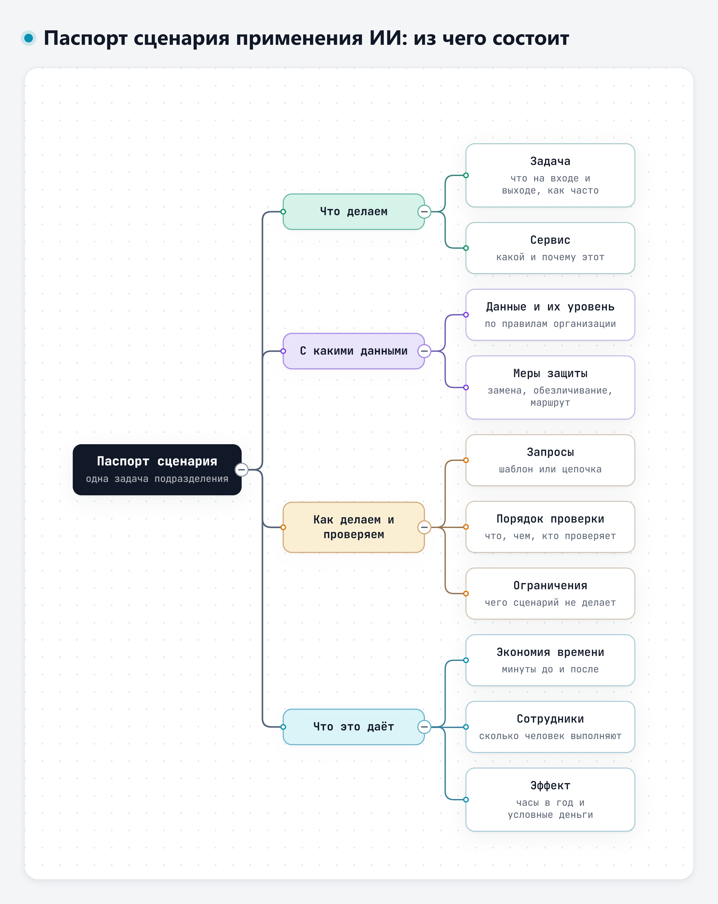
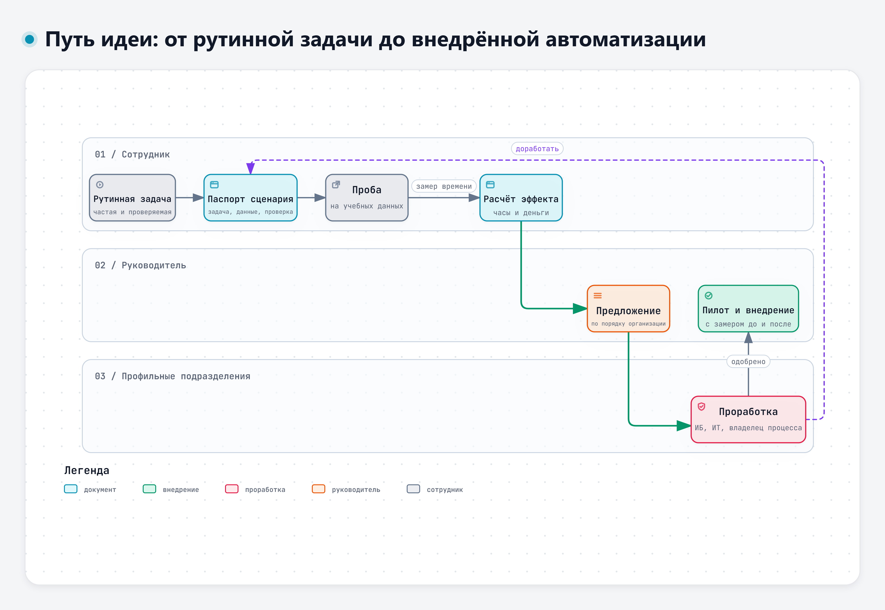

# Тема 5.2. Свой рабочий сценарий с ИИ

К концу курса вы подготовите сценарий решения своей рабочей задачи. Сегодня каждый собирает сценарий для одной рутинной работы своего подразделения: что отдаём модели, в каком сервисе, с какими данными, как проверяем и сколько времени это сэкономит. Описание сценария называется паспортом. Паспорт пригодится и после курса: с ним можно прийти к руководителю и в подразделения, которые отбирают задачи для автоматизации.

## 1. Как перенести приёмы курса в свою работу

За четыре дня у вас накопился набор инструментов. Сценарий собирается из них, нового почти ничего не нужно.

| Что было на курсе | Где | Как используется в сценарии |
|---|---|---|
| Карточка задачи: исходные данные – ожидаемый результат – критерии приёмки – ограничения | Тема 1.1 | Первый раздел паспорта |
| Шаблон запроса из шести частей | Тема 1.2 | Запросы сценария |
| Чек-лист проверки ответа | Тема 1.2 | Порядок проверки |
| Маршруты данных: внешний сервис, после обезличивания и согласования, только внутренний, нельзя | Тема 2.1 | Выбор сервиса и меры защиты |
| Требование ссылаться на пункт документа | Тема 2.2 | Проверяемость ответа |
| Контрольный пример и независимый пересчёт | Тема 4.1 | Проверка расчётов |
| Выборочная проверка выводов по исходной таблице | Тема 4.2 | Проверка анализа данных |
| Выбор инструмента для задачи | Тема 5.1 | Раздел «Сервис» |

### Цепочки и шаблоны запросов

Один большой запрос «разберись с замечанием» работает хуже, чем три коротких по шагам: сопоставить с пунктами ТЗ, перечислить причины, оформить черновик. Каждый шаг проще проверить, и ошибку видно там, где она появилась. Шаблоны запросов для повторяющейся работы стоит сохранить в файл: тогда сценарий повторяет и коллега, и вы через месяц.

### Какие задачи брать

А. Субботин на отраслевом ИИ-митапе (ноябрь 2026) показывал шесть задач, с которыми справляется даже не самая сильная модель: протокол совещания, ответ на обращение, разбор почты, проверка документа, сводка для руководителя, поиск по документам. Общее у них он сформулировал так: «Везде простая задача, понятный образец и человек на выходе» [39]. Это хороший фильтр и для инженерных задач:

- задача повторяется, лучше несколько раз в неделю;
- у результата есть образец: таблица, форма, шаблон письма;
- результат можно проверить по документу, расчёту или измерению;
- на выходе стоит человек, который принимает результат.

Задачи, где нужное знание есть только в голове у опытного сотрудника, для сценария подходят плохо. Модель такое знание не додумает, а придумает.

### Свежий пример: как отбирают задачи для ИИ в «Кофемании»

11 ноября 2026 года на онлайн-конференции форума All-over-IP директор департамента ИТ сети ресторанов «Кофемания» Н. Галкин рассказал, как компания решает, где ИИ нужен, а где нет [55]. Отрасль другая, но вопросы те же, что у инженерной службы: какую задачу брать, что купить, а что сделать самим, кто принимает решение.

**Сначала стратегия и данные.** Принцип отбора со слайда доклада: «Если инициатива не укладывается строго в пересечение бизнес-целей, готовности ИТ-контура и качества данных, её не будет в разработке» [55]. По словам докладчика, перед первыми проектами с ИИ компания почти год строила хранилище данных и чистила данные. Его формулировка: «Автоматизировать хаос бесполезно» [55].

**Матрица из шести критериев.** Каждую идею оценивают по шести критериям, до 5 баллов за каждый [55]:

| Критерий | Что оценивают |
|---|---|
| Стандартизация и правила | есть ли регламенты и документы, на которые модель может опираться |
| Рутинность и повторяемость | много ли однотипных операций |
| Потребность в когнитивных функциях | нужно ли понимать контекст, пересказывать, составлять текст |
| Критичность ошибок | чем дороже ошибка, тем ниже балл; балл выше, если можно поставить проверку человеком |
| Интегрируемость | можно ли подключиться к системам, где лежат данные |
| Зрелость данных | актуальны ли данные и базы знаний |

Решение по сумме: 24–30 баллов – внедряют, 15–23 – сначала дорабатывают данные или подключения, меньше 15 – отказываются и используют роботов и скрипты [55]. Заголовок слайда: матрица «учит говорить „нет“».

Сумма баллов не отменяет правил курса. Если результат нельзя проверить, данные нельзя отправлять в выбранный сервис или итог уходит дальше без человека, задача не подходит, сколько бы баллов она ни набрала.

**Функция целиком, а не кусками.** По опыту компании, эффект даёт либо процесс, заново построенный с учётом ИИ, либо законченная функция, которую выделили из процесса целиком. Частичные замены, по словам Н. Галкина, «не работают»: людям добавляются проверки и лишняя работа [55]. Для паспорта сценария это значит: берите законченную операцию с понятным входом и результатом.

**Что получилось.** Числа – по слайдам и выступлению докладчика, это данные самой компании:

| Проект | Что делает ИИ | Кто решает |
|---|---|---|
| Сверка справочников двух кадровых систем перед переходом на новую | ищет дубли, сопоставляет названия должностей, выдаёт отчёт о несоответствиях; на слайде – 10 000 часов ручной чистки, которые были заложены в план миграции | человек правит данные |
| Приёмка товара в ресторанах | сравнивает заказ, накладную (в том числе сфотографированную) и данные учётных систем, предупреждает о расхождении или блокирует приёмку; на слайде – точность сопоставления номенклатуры 94 % (в подписи того же слайда – 91 %), приёмка вдвое быстрее, ошибок на 30 % меньше | «Решения в любом случае всегда остаются за человеком» |
| Подсказки официанту | до трёх подсказок с аргументом для гостя | официант |
| Прогноз продаж и автозаказ | прогноз на три дня, разбор по технологическим картам, черновик заказа; на слайде – средняя ошибка прогноза (MAPE) 7,5 % на пятой версии модели | повар просматривает и правит заказ |

**Журнал «кто точнее».** В автозаказе повар может поправить заказ, а компания ведёт журнал правок и сравнивает, кто точнее, человек или машина [55]. Такой журнал пригодится и в вашем пилоте: видно, где ошибается модель и где правка человека была лишней.

**Не гнаться за последними процентами.** Прогноз дальше трёх дней делать не стали: каждый лишний день, по оценке докладчика, «фактически удваивает трудозатраты» [55].

**Разворот проекта.** Подсказки официанту начинались с бота-рекомендателя для самих гостей. Гости предпочли живое общение с официантом, и тот же ИИ стал помощником официанта [55]. В этом проекте помощник сотруднику оказался полезнее сервиса для клиента.

**Каждой задаче своя модель.** Для сверки должностей, по словам докладчика, использовали «Алису», для прогнозов – модели, развёрнутые у себя, для приложения – модель партнёра, развёрнутая в его локальном контуре [55].

### Что говорят исследования об экономии времени

Измерений эффекта от генеративного ИИ на рабочих местах уже много, и картина неоднородная.

В эксперименте с 453 специалистами, которые писали типовые рабочие тексты, доступ к чат-сервису сократил время и улучшил качество [1]:

> «Our results show that ChatGPT substantially raised productivity: The average time taken decreased by 40% and output quality rose by 18%.»
>
> Перевод: «Наши результаты показывают, что ChatGPT заметно повысил производительность: среднее время выполнения сократилось на 40 %, а качество результата выросло на 18 %.» – Noy, Zhang, 2023 [1]

В исследовании работы службы поддержки по данным 5172 сотрудников рост производительности оказался скромнее и заметно различался между сотрудниками [2]:

> «Access to AI assistance increases worker productivity, as measured by issues resolved per hour, by 15% on average, with substantial heterogeneity across workers.»
>
> Перевод: «Доступ к ИИ-помощнику повышает производительность, измеренную числом решённых обращений в час, в среднем на 15 %, при заметных различиях между сотрудниками.» – Brynjolfsson, Li, Raymond, 2025 [2]

У разработчиков в трёх полевых экспериментах на 4867 человек число выполненных задач выросло примерно на четверть, и сильнее всего – у менее опытных [4]:

> «Notably, less experienced developers had higher adoption rates and greater productivity gains.»
>
> Перевод: «Примечательно, что менее опытные разработчики чаще начинали пользоваться инструментом и получали больший прирост производительности.» – Cui и соавт., 2026 [4]

Оценка экономии «на глаз» может оказаться ошибочной. Опытные разработчики решали задачи в хорошо знакомых им проектах, половину задач – с ИИ, половину без [5]:

> «Before starting tasks, developers forecast that allowing AI will reduce completion time by 24%. After completing the study, developers estimate that allowing AI reduced completion time by 20%. Surprisingly, we find that allowing AI actually increases completion time by 19%--AI tooling slowed developers down.»
>
> Перевод: «Перед началом разработчики прогнозировали, что ИИ сократит время выполнения на 24 %. После исследования они оценили сокращение в 20 %. Неожиданно оказалось, что с ИИ время выполнения на самом деле выросло на 19 %: инструменты ИИ замедлили разработчиков.» – Becker и соавт., 2025, препринт arXiv [5]

Выборка небольшая, 16 человек, но вывод для паспорта прямой: экономию нужно замерять, а не угадывать. Ощущение «стало быстрее» может не совпадать с секундомером.

### Иллюзия выигрыша: почему ощущение расходится с секундомером

В препринте 2026 года Юй (Yu) и соавторы из Стэнфордского и других университетов сравнили ожидаемую экономию времени с той, которую измерили при работе с чат-ботом [91]. Они описали три эксперимента, в сумме размеры выборок составили 2691 [91]. Задачи были короткие, каждую без помощи можно сделать меньше чем за пять минут: сложить два числа, назвать пять олимпийских призёров, поправить предложение, пересказать короткий текст одним предложением. Во втором эксперименте собирали прогнозы – сколько займёт задача самостоятельно и с чат-ботом – и отдельно измеряли время выполнения тех же задач без помощи или с чат-ботом на модели GPT-4o; 307 человек вошли в обе выборки: они и прогнозировали время, и выполняли задания [91].

> «On average, people predicted AI assistance to save time by 55.7 seconds when it only saved 7.5 seconds.»
>
> Перевод: «В среднем люди предсказывали, что помощь ИИ сэкономит 55,7 секунды, а на деле она экономила лишь 7,5 секунды». – Yu и соавт., 2026, препринт arXiv [91]

Экономия в 7,5 секунды – это разница средних. По всем задачам вместе статистически значимого сокращения времени авторы не обнаружили (β = 6,17, p = 0,07) [91].

Без чат-бота средний прогноз был близок к среднему измеренному времени: 99 и 93,7 секунды соответственно. Для работы с чат-ботом средний прогноз составил 43,3 секунды, а фактическое время оказалось почти вдвое больше, 86,2 секунды [91]. Время ушло в основном на то, чтобы составить запрос и прочитать ответ. На самых простых вариантах задач с чат-ботом выходило даже дольше, чем без него: 70,2 секунды против 60,2 [91]. В третьем эксперименте участники, выполнившие первые два задания с чат-ботом, выбрали его в 44,5 % случаев на двух последующих лёгких заданиях. У тех, кто сначала работал самостоятельно, эта доля составила 27,7 %. В итоговом опросе первая группа слабее соглашалась с тем, что самостоятельно задания можно выполнить быстрее [91].

Ограничения работы называют сами авторы: задачи простые и короткие, участники набраны через интернет-платформу, и это препринт [91]. На операцию в 50 минут эти цифры напрямую не переносятся. Правило для паспорта из них следует простое: время «после» включает и составление запроса, и чтение ответа. А шаг, который вы сами делаете за минуту, стоит проверить секундомером, прежде чем отдавать его модели.

Ближе всего к нашей аудитории исследование 2026 года со 128 сотрудниками международной промышленной компании. Они выполняли три вида умственной работы с ИИ и без него [6]:

> «Results show that GenAI consistently increases efficiency across tasks. However, its impact on quality is task-contingent: quality increases for knowledge packaging and creation but declines for knowledge acquisition.»
>
> Перевод: «Результаты показывают, что генеративный ИИ стабильно ускоряет работу во всех задачах. Но его влияние на качество зависит от задачи: качество растёт при оформлении и создании материалов и падает при получении новых знаний.» – Bottesch и соавт., 2026, препринт arXiv [6]

Иначе говоря, оформить отчёт или письмо по готовым данным модель помогает хорошо, а там, где нужно разобраться в новом, качество может упасть. Похожий вывод дал эксперимент на задачах консультантов: внутри границы возможностей модели работа ускорялась, за её пределами правильных решений становилось меньше [3]. В полевом эксперименте с 7137 сотрудниками 66 компаний помощник, встроенный в почту и офисные программы, сэкономил тем, кто им пользовался, около двух часов в неделю на почте, но состав работы почти не изменил [7]. А у опытных дизайнеров на этапе исполнения работа с ИИ заняла больше времени без выигрыша в творческом результате, потому что подход модели расходился с их отработанными приёмами [8].

Что из этого берём в паспорт:

1. Время «после» включает проверку результата. Без неё экономия всегда выглядит больше, чем есть.
2. Время замеряется на нескольких одинаковых операциях до и после, а не оценивается по памяти. Сравнивают одинаковые единицы: полную операцию так, как её делают сейчас (если ИИ уже используется, то с ним, и это отмечают), с той же полной операцией по сценарию. Пока полного замера нет, расчёт называют предварительной оценкой.
3. Выигрыш зависит от человека: новичку и опытному сотруднику модель помогает по-разному.
4. Если задача требует разобраться в новом, проверка нужна особенно тщательная.

### Не потерять собственный навык

К. Овчинников на митапе говорил о парадоксе надзора: проверить работу ИИ может только тот, кто умеет делать её сам [43]. Исследователи называют две долгосрочные опасности [29]:

> «Deskilling occurs when users lose competence in delegated domains through lack of practice. Overreliance occurs when users accept AI outputs uncritically, amplifying errors rather than correcting them.»
>
> Перевод: «Утрата навыков происходит, когда пользователи перестают практиковаться в работе, которую передали модели, и теряют в ней компетентность. Чрезмерное доверие – когда пользователи некритично принимают результат ИИ и усиливают ошибки вместо того, чтобы их исправлять.» – Noessel, 2026 [29]

Поэтому в хорошем сценарии инженер продолжает делать ту часть работы, которая требует его квалификации: решает, оценивает, проверяет. Модель берёт на себя поиск, сопоставление, черновик.

## 2. Паспорт сценария

Паспорт сценария – описание одной задачи, которую вы решаете с ИИ. Он нужен, чтобы сценарий можно было повторить, проверить и оценить.



Интерактивная версия схемы – файл `08-Схемы/d5-pasport.html`.

Девять разделов паспорта (полный шаблон – документ 5-2 дополнения к кейсу):

1. **Задача.** Вход, выход, кто выполняет, как часто. Сюда переносится карточка задачи.
2. **Сервис.** Какой сервис и почему. Если на учёбе вы пробовали в одном сервисе, а в работе нужен другой, укажите оба.
3. **Запросы.** Полный текст шаблона или цепочки запросов.
4. **Данные и их уровень.** Какие документы и сведения, какой у них маршрут по правилам организации.
5. **Меры защиты.** Что заменяется перед отправкой, что не отправляется никогда, где хранится результат.
6. **Порядок проверки.** Что проверяется, чем, кем и сколько это занимает.
7. **Ограничения.** Где сценарий не работает и чего не делает ни при каких условиях.
8. **Ожидаемый эффект.** Минуты на операцию до и после, число операций, число сотрудников, расчёт в часах и деньгах.
9. **Что дальше.** Личный приём, распространение на службу или предложение на автоматизацию.

Несколько правил заполнения.

**Одна задача – один паспорт.** «Работа с документацией» – не задача. «Извлечение требований из ТЗ в таблицу для проверки протокола испытаний» – задача.

**Проверка – конкретно.** «Проверяю результат» не годится. Годится: «сверяю каждое число таблицы с протоколом, пункты – с ТЗ, расчёт тока повторяю в таблице, на это уходит 15 минут».

**Ограничения – честно.** У каждого сценария они есть. Если вы их не нашли, значит, ещё не пробовали сценарий на трудном примере.

**Укажите, кто принимает результат.** В паспорте видно, кто принимает результат и что именно он решает. Исследователи, изучавшие, как специалисты сохраняют контроль над текстом, который пишет модель, свели практику к короткому протоколу проверок [32]:

> «We derive a nine-step checklist that specifies what practices to apply, and when, to keep AI-assisted text reliable, traceable, and accountable.»
>
> Перевод: «Мы составили чек-лист из девяти шагов, который определяет, какие приёмы и когда применять, чтобы текст, подготовленный с помощью ИИ, был надёжным, его происхождение можно было проследить, а ответственность за него была определена.» – Taş, Memmert, Bittner, 2026 [32]

Если сценарий описывает агента, а не чат, добавьте правило из вебинара П. Гагарина о разработке с агентами: мелкие решения агент принимает сам, но каждое записывает с причиной, а при расхождении плана с реальностью останавливается и спрашивает человека. Его формулировка: «Человека дёргаем по делу, а каждое авто-решение он увидит списком» [45].

### Пример: первичный разбор замечаний по испытаниям

Полный пример паспорта – документ 5-3 дополнения к кейсу [47]. Кратко:

- **Задача:** по замечанию испытаний составить таблицу соответствия пунктам ТЗ, перечень возможных причин и проверок, черновик записи. Около 20 замечаний в месяц на инженера.
- **Сервис:** на учёбе – разрешённый сервис на учебном кейсе; в работе – внутренний чат, если он есть.
- **Запросы:** цепочка из трёх запросов по шаблону темы 1.2.
- **Данные:** протоколы и ТЗ – конструкторская документация и результаты испытаний, по таблице темы 2.1 только внутренний сервис.
- **Проверка:** числа – по протоколу, пункты – по ТЗ, расчёты – в таблице, причины – по опыту инженера. Около 15 минут.
- **Ограничения:** решение о соответствии и закрытии замечания не принимается моделью.
- **Эффект:** 50 минут до, 30 минут после (вместе с проверкой).

## 3. Что делать со сценарием дальше

### Три пути

1. **Личный приём.** Сценарий экономит время вам, и этого достаточно. Паспорт помогает не забыть, как он устроен.
2. **Распространить на службу.** Если задачу делают несколько человек, шаблоны запросов и порядок проверки передаются коллегам. Руководитель видит, сколько времени это даёт службе.
3. **Предложение на автоматизацию.** Если эффект заметный, а сценарий требует подключения к системам, конструктора агентов или внутреннего сервиса, которого пока нет, оформляется предложение по порядку, принятому в организации.



Интерактивная версия схемы – файл `08-Схемы/d5-put-idei.html`.

### Как считать эффект

Предложение на автоматизацию держится на трёх числах: сколько минут экономится на одной операции, сколько таких операций в месяц и сколько сотрудников их выполняют.

```
Э_ч   = (t_до − t_после) × N × n × M / 60
Э_руб = (Э_ч − З_ч) × С
```

Здесь t_до и t_после – минуты на одну и ту же полную операцию, причём t_после включает проверку; N – операций в месяц на сотрудника; n – число сотрудников; M – рабочих месяцев в году (в учебном примере 11; в своей задаче период обосновывают); З_ч – часы на подготовку и поддержку сценария; С – стоимость часа работы. Ставку для расчёта в организации даёт экономическая служба, на курсе используем условную.

Пример из документа 5-3: (50 − 30) × 20 × 6 × 11 / 60 = 440 ч в год. Минус 16 ч на подготовку и 22 ч на поддержку – 402 ч. При условной ставке 1200 руб./ч это 482 400 руб. в год.

Типичные ошибки расчёта, которые разберём на практике:

- в «после» забыли время проверки;
- время «до» взято для полной операции, а время «после» – для короткой пробы;
- минуты перевели в часы с ошибкой;
- период M не обоснован или отпуска учтены дважды: в учебном примере M = 11, а если в своей задаче число операций в месяц уже усреднено по году с отпусками, вычитать отпуска ещё раз не нужно;
- не учли время на подготовку сценария и его поддержку;
- освободившееся время выдали за сокращение штата.

Последний пункт стоит обсудить отдельно. Освободившиеся часы – это время, которое уходит на другую работу: на испытания, на разбор сложных случаев, на то, до чего раньше не доходили руки. В. Филатов на вебинаре о качестве программ в эпоху генеративного ИИ советовал вкладывать сэкономленное время в улучшение контроля качества [48]. Для инженерной службы это хороший ориентир.

### Когда задачу не стоит отдавать автоматике

Сценарий, где ИИ помогает человеку, и автоматизация, где результат идёт дальше без человека, – разные вещи. Для автоматизации нужны все четыре условия:

1. есть точная проверка результата: формула, допуск, сверка со списком;
2. ошибка обходится недорого и её можно исправить;
3. правильность не зависит от знаний, которые есть только в головах сотрудников;
4. результат не уходит наружу от имени сотрудника без его прочтения.

Если хотя бы одного условия нет, это помощник под присмотром человека, а не автоматизация. Письма заказчикам, заключения о соответствии, документы, которые подписывает инженер, – черновик можно, итог без человека нельзя.

### Как готовится предложение

Порядок предложения и отбора задач для автоматизации в каждой организации свой. Обычно в предложении есть:

- паспорт сценария;
- результат пробы: на каких материалах пробовали, сколько операций, что получилось;
- замер времени до и после;
- расчёт эффекта;
- что нужно от других подразделений: доступ к системе, внутренний сервис, конструктор агентов, согласование маршрута данных.

Дальше предложение прорабатывают профильные подразделения: защита информации смотрит на данные и маршрут, ИТ – на инструмент и подключения, владелец процесса – на пользу. С. Скидан на митапе советовал запускать новый сценарий поэтапно и заранее записывать, что именно должно улучшиться, и проверять это до и после запуска [42]. Тот же подход годится и для службы: пилот на нескольких сотрудниках, замер, потом решение.

На конференции форума All-over-IP в ноябре 2026 года о том же предупреждали участники дискуссии [58]. М. Васильев (НИУ ВШЭ): бывает, что прототип «за неделю накодили… а потом год коллеги пытаются довести это до промышленной эксплуатации». Р. Ахметзянов (Лемана Тех) назвал частые причины, по которым такие инициативы не дают обещанного: не проведён аудит процесса и данных и не расписано, кто за что отвечает.

### Перед подключением любого ИИ-инструмента

Если ваше предложение дойдёт до подключения нового инструмента, в организации обычно согласуют такие вопросы. Список полезно знать и тому, кто предлагает:

1. какой инструмент, кто его поставщик, какая версия;
2. какая модель и на каких условиях она работает: хранение данных, обучение на них (условия цитируются из документов, а не пересказываются по памяти);
3. где обрабатываются данные;
4. что именно уходит в инструмент;
5. могут ли туда попасть пароли и персональные данные и как это исключается технически;
6. где работает агент, если он есть;
7. на кого оформлен доступ;
8. что записывается в журнал и кто его видит;
9. какие права у инструмента: чтение – да, изменение и отправка – только по отдельному решению;
10. кто отвечает за инцидент и как откатить изменения;
11. срок пилота и условия, при которых его останавливают.

### Сценарий без привязки к одной модели

Модель, на которой собран сценарий, не вечная. В документации Anthropic сказано, что старые модели регулярно снимают с поддержки: компания заранее объявляет дату отключения, а после отключения запросы к модели перестают работать. Клиентов, у которых публично выпущенная модель используется в действующем приложении, Anthropic предупреждает не меньше чем за 60 дней до её отключения. Даты отключения в этой документации относятся к платформам под управлением Anthropic, у партнёрских платформ, например Amazon Bedrock, свои сроки [94]. Совет оттуда же:

> «To help measure the performance of replacement models on your tasks, consider thorough testing of your applications with the new models well before the retirement date.»
>
> Перевод: «Чтобы оценить, как модели-замены справляются с вашими задачами, стоит тщательно проверить свои приложения на новых моделях задолго до даты отключения». – Anthropic, Model deprecations [94]

Новая версия модели может вести себя иначе, чем прежняя. Чэнь, Захария и Цзоу сравнили мартовскую и июньскую версии GPT-4 2023 года. Модель просили определить, простое число или составное, и рассуждать по шагам. При таком запросе мартовская версия отвечала верно в 84 % случаев, июньская – в 51 %, а GPT-3.5 на этой задаче за те же месяцы стала лучше [92]. Вывод авторов:

> «Overall, our findings show that the behavior of the "same" LLM service can change substantially in a relatively short amount of time, highlighting the need for continuous monitoring of LLMs.»
>
> Перевод: «В целом наши результаты показывают, что поведение „одного и того же“ сервиса на языковой модели может заметно измениться за сравнительно короткое время, поэтому языковые модели нужно постоянно отслеживать». – Chen, Zaharia, Zou, 2024 [92]

Ответы могут ухудшиться и без смены модели. В 2025 году Anthropic опубликовала разбор трёх сбоев своей инфраструктуры, из-за которых качество ответов Claude временами падало. Об ухудшении начали сообщать пользователи, а в разборе сказано: «The evaluations we ran simply didn't capture the degradation users were reporting» – «проверки, которые мы проводили, просто не уловили ухудшения, о котором сообщали пользователи» [95].

Отсюда практика для паспорта. В разделе «Сервис» стоит указать не только сервис, но и модель, её версию (если сервис её показывает) и дату пробы. После смены модели заново прогоняют контрольный набор – пять–десять примеров с известным правильным результатом, один из них с подвохом (упражнение 2 в разделе «Ещё упражнения по желанию» практики 5.2). Результаты двух версий сравнивают не только по общему итогу, а на каждом примере набора: Эхтерхофф и соавторы в 2024 году показали на открытых моделях (Llama, Phi, Vicuna) с адаптерами, обученными под конкретную задачу, что после обновления модели появляются ошибки на примерах, которые прежняя версия решала верно, и это видно, даже когда в среднем новая модель лучше [93]. Такую потерю стоит отметить в паспорте рядом с конкретным примером: какой ответ раньше проходил проверку и где теперь появилась ошибка. Например, при переходе с Phi 1.5 на Phi 2 доля верно решённых школьных задач по математике (набор GSM8K) выросла с 30,02 % до 48,18 %, а у 5,88 % примеров набора верный ответ прежней модели сменился неверным [93]. Если в программе модель меняется в настройках (такие программы – в теме 5.1), смена модели означает повторную пробу по набору, а не новый сценарий с нуля.

## 4. Итоговая аттестация

По программе итоговая аттестация – профессиональный зачёт из двух частей: итоговый проект и тестирование на Платформе [46]. Итоговый проект – рабочая тетрадь курса: разделы 1–4 с результатами модулей и раздел 5 – паспорт вашего сценария, доработанный по обратной связи (порядок шагов – ниже). Тест – тот же, что на входном контроле: 30 вопросов по всему курсу, до 60 баллов. Ещё до 40 баллов – за практику: по 8 за обязательную практическую работу каждого модуля, результаты которой вошли в итоговый проект. Подробности – в файле «Итоговая аттестация» в папке дня.

Порядок завершения курса:

1. 25.11 на практике 5.2 группа и преподаватель дают обратную связь по паспорту.
2. Тетрадь с паспортом, доработанным по этой обратной связи, сдаётся как контрольная точка модуля 5.
3. Преподаватель проверяет контрольную точку и даёт обратную связь по ней.
4. Тетрадь с доработанным паспортом (или тот же файл, если замечаний нет) загружается как итоговый проект, тест проходится на Платформе.

Сроки каждого шага – в заданиях на Платформе. В паспорте и приложениях итоговой работы – только учебные или придуманные данные.

## Что запомнить

- Сценарий собирается из приёмов курса: карточка задачи, шаблон запроса, маршруты данных, чек-лист проверки.
- Время «после» считается вместе с проверкой и замеряется, а не угадывается.
- Паспорт описывает одну задачу, конкретную проверку и честные ограничения.
- Эффект: (t_до − t_после) × N × n × M / 60, минус затраты, ставка условная.
- Помощник под присмотром человека и автоматизация без человека – разные вещи.

## Источники

Нумерация общая для всех материалов дня.

**Научные публикации**

- [1] Noy S., Zhang W. Experimental evidence on the productivity effects of generative artificial intelligence // Science. 2023. https://doi.org/10.1126/science.adh2586
- [2] Brynjolfsson E., Li D., Raymond L. Generative AI at Work // The Quarterly Journal of Economics. 2025. Vol. 140, № 2. P. 889–942. https://doi.org/10.1093/qje/qjae044
- [3] Dell'Acqua F., McFowland E., et al. Navigating the Jagged Technological Frontier: Field Experimental Evidence of the Effects of Artificial Intelligence on Knowledge Worker Productivity and Quality // Organization Science. 2026. https://doi.org/10.1287/orsc.2025.21838
- [4] Cui K., Demirer M., et al. The Effects of Generative AI on High-Skilled Work: Evidence from Three Field Experiments with Software Developers // Management Science. 2026. https://doi.org/10.1287/mnsc.2025.00535
- [5] Becker J., Rush N., et al. Measuring the Impact of Early-2025 AI on Experienced Open-Source Developer Productivity. 2025. Препринт arXiv. https://doi.org/10.48550/arXiv.2507.09089
- [6] Bottesch S., Schwenke C., et al. Faster, Higher, Stronger? The Impact of GenAI on Knowledge Work Productivity - Evidence from the Field. 2026. Препринт arXiv. https://doi.org/10.48550/arXiv.2607.25922
- [7] Dillon E., Jaffe S., et al. Shifting Work Patterns with Generative AI. 2025. Препринт SSRN. https://doi.org/10.2139/ssrn.5250761
- [8] Hou J., Wang L., et al. The Double-Edged Roles of Generative AI in the Creative Process: Experiments on Design Work // Information Systems Research. 2025. https://doi.org/10.1287/isre.2024.0937
- [29] Noessel C. Deskilling and overreliance: Two long‐term risks of AI assistance, and what designers can do about them // AI Magazine. 2026. https://doi.org/10.1002/aaai.70096
- [32] Taş E., Memmert L., Bittner E. A. C. Episodic oversight in generative AI workflows: A nine-step protocol for preserving human agency (OP-9) // Electronic Markets. 2026. https://doi.org/10.1007/s12525-026-00915-x
- [91] Yu S., Cheng M., Jabbar A., Sucholutsky I., Collins K. M., Jurafsky D., Hawkins R. D. The efficiency-gain illusion: People underestimate the rate of AI use and overestimate its benefits on simple tasks. 2026. Препринт arXiv. https://doi.org/10.48550/arXiv.2605.22687
- [92] Chen L., Zaharia M., Zou J. How Is ChatGPT's Behavior Changing Over Time? // Harvard Data Science Review. 2024. https://doi.org/10.1162/99608f92.5317da47
- [93] Echterhoff J. M., Faghri F., et al. MUSCLE: A Model Update Strategy for Compatible LLM Evolution // Findings of the Association for Computational Linguistics: EMNLP 2024. 2024. https://doi.org/10.18653/v1/2024.findings-emnlp.430

**Официальные страницы разработчиков**

- [94] Anthropic. Model deprecations. Страница открыта 23.11.2026. https://platform.claude.com/docs/en/about-claude/model-deprecations
- [95] Anthropic. A postmortem of three recent issues. 17.09.2025. Страница открыта 23.11.2026. https://www.anthropic.com/research/a-postmortem-of-three-recent-issues

**Выступления и вебинары**

- [39] Субботин А. Платформы для совместной работы с ИИ-агентами. Доклад на ИИ-митапе ЦГУ, 06.11.2026 (презентация доклада).
- [42] Скидан С. Как создать Агента-оператора. Доклад на ИИ-митапе ЦГУ, 06.11.2026 (презентация доклада).
- [43] Овчинников К. Инженер после AI. Доклад на ИИ-митапе ЦГУ, 06.11.2026 (презентация доклада).
- [45] Гагарин П. Разработка с агентами: от постановки задачи до деплоя. Вебинар учебного центра «МАСКОМ», 28.07.2026 (презентация вебинара).
- [48] Филатов В. Искусственный автор, привычный контроль. Вебинар учебного центра «МАСКОМ» и PVS-Studio «Качество и безопасность ПО в эпоху GenAI», 28.08.2026 (выступление на вебинаре).
- [55] Галкин Н. Доклад о встраивании ИИ в бизнес-процессы на примере «Кофемании». Онлайн-конференция «Данные для AI и автоматизации: как собрать управляемый контур данных предприятия», форум All-over-IP & AI 2026, 11.11.2026 (презентация доклада).
- [58] Дискуссия «От данных к бизнес-результату: как выстроить системную работу с данными» (Р. Ахметзянов, Н. Галимова, М. Кулагин, М. Васильев); онлайн-конференция «Данные для AI и автоматизации: как собрать управляемый контур данных предприятия», форум All-over-IP & AI 2026, 11.11.2026.

**Учебные материалы**

- [46] Дополнительная профессиональная программа повышения квалификации «Искусственный интеллект для инженеров», 56 ак. ч: тематический план и описание программы (раздел «Итоговая аттестация»).
- [47] Учебный кейс ЭС-24 (первый день) и дополнение к нему для пятого дня.

Полный список источников дня – в файле «Источники дня» в папке дня.

---

<!-- author-block -->
**Автор курса**

Виталий Пиков

- Архитектор информационной безопасности
• РБПО • DevSecOps • AppSec
- Лектор и автор образовательных программ по ИБ и РБПО

Телефон: +7 (963) 782-92-78 ·
E-mail: vitaly@pikov.expert ·
Сайт: https://pikov.expert ·
Telegram: @UnderLineSecurity
