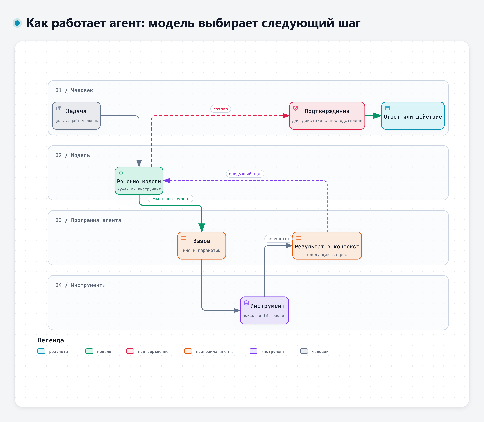

# От чата к агенту

Дополнительный материал для тех, кто уже работает с ИИ и хочет понять, что стоит за словом «агент». Здесь – основы, подробно агентов разберём в модуле 5.

## 1. Четыре сценария использования

Условно выделим четыре ступени использования сервисов на языковых моделях. Ступени могут пересекаться: в окне обычного чата иногда работает агентный цикл, а поиск по документам выполняет программа, а не модель. Но в целом на каждой следующей ступени модель получает больше возможностей, и вместе с ними растёт цена ошибки.

| Ступень | Что делает модель | Пример |
|---|---|---|
| Чат | Отвечает на текст, который вы написали | Вопрос о причинах просадки напряжения |
| Чат с файлами и поиском | Читает загруженный файл или результаты поиска в интернете | Сводка по загруженному техническому заданию |
| Помощник по документам | Ищет ответ в подключённой базе документов организации и опирается на найденное | Вопрос о порядке испытаний, ответ со ссылкой на внутренний стандарт |
| Агент | Сам решает, какой инструмент вызвать, вызывает его, получает результат и продолжает работу | Проверка комплекта документов: агент получает файлы, сверяет их с требованиями, готовит перечень расхождений |

На первых трёх ступенях поиск и чтение документов идут по заданному сценарию, а решения о дальнейших действиях принимает человек. На четвёртой следующий шаг выбирает модель, и её вывод превращается в действие.

## 2. Что такое агент

В отчёте NIST о состязательном машинном обучении (2025) агент описан так: программная система, которая многократно обращается к модели, обрабатывает её ответы (например, выбирает функцию и вызывает её с нужными входными данными) и возвращает результат модели в следующем запросе. У агента могут быть инструменты: просмотр веб-страниц, выполнение программ. Бывают и дополнительные возможности, например память и планирование [11].

> «An increasingly common use of GenAI models is constructing an (often LLM-based) AGENT, a software system that iteratively prompts a model, process its outputs – such as to select and call a function with specified inputs – and provides the results back to the model as a part of its next prompt.»
>
> Перевод: «Всё чаще генеративные модели используют для построения агента (как правило, на основе большой языковой модели) – программной системы, которая многократно обращается к модели, обрабатывает её ответы (например, чтобы выбрать и вызвать функцию с заданными входными данными) и возвращает результаты модели как часть следующего запроса.» – NIST AI 100-2e2025, раздел 3.5 [11]

В руководствах OWASP по безопасности агентных систем агентный ИИ рассматривается как развитие автономных систем. Большие языковые модели заметно расширили его возможности, а вместе с ними и риски [12].

Агент отличается от чата не качеством ответа, а тем, что модель сама выбирает следующее действие.

## 3. Как агент работает: цикл «подумал – сделал – посмотрел»

Основная схема описана в работе о подходе ReAct [13]. Модель чередует рассуждения и действия. Рассуждение помогает составить и уточнить план, а действие позволяет обратиться к внешнему источнику, например к базе знаний, и получить недостающие сведения.

> «reasoning traces help the model induce, track, and update action plans as well as handle exceptions, while actions allow it to interface with external sources, such as knowledge bases or environments, to gather additional information.»
>
> Перевод: «Цепочки рассуждений помогают модели выстраивать, отслеживать и обновлять план действий, а также обрабатывать исключения, а действия позволяют ей обращаться к внешним источникам, например к базам знаний или среде, чтобы собрать дополнительные сведения.» – Yao и соавт., 2022, препринт arXiv [13]

Интерактивная версия схемы – файл `diagrams/d1-cikl-agenta.html`.
По шагам это выглядит так:

1. Пользователь ставит задачу.
2. Модель решает, нужен ли инструмент, и если нужен, какой и с какими параметрами.
3. Программа агента вызывает инструмент: поиск по документам, запрос в учётную систему, расчёт.
4. Результат возвращается модели и добавляется к контексту.
5. Модель решает: задача решена или нужен ещё шаг.
6. Когда шагов больше не нужно, модель пишет ответ пользователю.

На вопрос «Сколько раз вызывалась модель, чтобы ответить пользователю?» ответ почти всегда «больше одного». В журнале работы агента это хорошо видно: сначала модель возвращает не текст, а указание вызвать инструмент. Затем в диалог добавляется результат инструмента, и только после этого появляется ответ.

## 4. Пример: помощник с базой знаний

Представим корпоративного помощника, к которому подключены поиск по внутренней базе документов и поиск задач в системе учёта. Каждый инструмент включается отдельным переключателем.

- На вопрос «Как у нас положено хранить пароли от служебных систем?» помощник сначала ищет по базе документов, находит стандарт и отвечает по нему.
- На вопрос «Как лучше провести планёрку?» он отвечает сразу, без инструментов: задача не требует внутренних данных.

Полезность такого помощника зависит от модели, включённых инструментов и документов, которые ему разрешено читать. Выключите поиск по базе, и ответ про хранение паролей будет взят из общих знаний модели, а не из вашего стандарта.

## 5. Почему с агентами осторожнее

- **Ошибка становится действием.** Если чат ошибся, ошибку видит человек. Если ошибся агент, он может успеть отправить письмо, изменить запись или запустить расчёт с неверными данными.
- Агенту нужно ровно столько прав, сколько требует задача. Лучше инструменты с узкими функциями. Если агенту доступно выполнение команд, его ограничивают правами учётной записи, изоляцией и списком разрешённых ресурсов. Инструкции модели такие ограничения не заменяют.
- **Чужой текст может управлять агентом.** Агент читает документы, письма, веб-страницы. Если в них спрятана команда, модель может принять её за задание. В отчёте NIST прямо сказано: враждебные данные, попавшие в контекст, например из ненадёжных источников, могут заставить агента выполнить действия злоумышленника [11]. Подробнее – в теме 2.1.

> «Adversarial inputs into this context, such as from interactions with untrusted resources, could hijack the agent into performing adversary-specified actions instead, leading to potential security or safety violations.»
>
> Перевод: «Враждебные данные, попавшие в этот контекст, например при работе с ненадёжными источниками, могут перехватить управление агентом и заставить его вместо предусмотренных действий выполнять действия, заданные злоумышленником, что может привести к нарушениям защищённости системы или безопасности её функционирования.» – NIST AI 100-2e2025, раздел 3.1.1 [11]

- **Подтверждение действий.** Для действий с последствиями нужен шаг подтверждения человеком. Где именно его ставить, решается для каждой задачи отдельно: лишние подтверждения тоже стоят времени.

## 6. Упражнение для желающих

Опишите на одной странице агента, который помогал бы разбирать замечания по испытаниям, как в учебном кейсе ЭС-24:

- какие данные он получает на вход;
- какие инструменты ему нужны (поиск по ТЗ, расчёт, запрос в журнал испытаний);
- что он делает сам, а что предлагает на подтверждение;
- как проверяется его результат;
- каких прав у него быть не должно.

Это задел для модуля 5, где мы будем говорить о конструкторах агентов и о том, что поручать модели, а что оставить точным проверкам.

## Источники

- [11] NIST AI 100-2e2025. Adversarial Machine Learning: A Taxonomy and Terminology of Attacks and Mitigations. 2025, разделы 3.1.1 и 3.5. https://doi.org/10.6028/NIST.AI.100-2e2025
- [12] OWASP GenAI Security Project. Agentic AI – Threats and Mitigations. 2025. https://genai.owasp.org/resource/agentic-ai-threats-and-mitigations/
- [13] Yao S., Zhao J., et al. ReAct: Synergizing Reasoning and Acting in Language Models. 2022. https://doi.org/10.48550/arXiv.2210.03629

---

<!-- author-block -->
**Автор курса**

Виталий Пиков

- Архитектор информационной безопасности
• РБПО • DevSecOps • AppSec
- Лектор и автор образовательных программ по ИБ и РБПО

Телефон: +7 (963) 782-92-78 ·
E-mail: vitaly@pikov.expert ·
Сайт: https://pikov.expert ·
Telegram: @UnderLineSecurity
