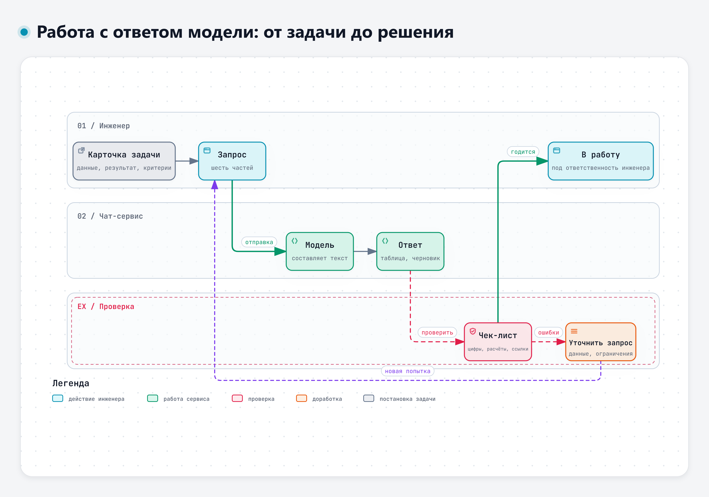

# Тема 1.2. Запросы к языковой модели для инженерных задач

Модель отвечает на тот вопрос, который ей задали. Если в запросе нет исходных данных, она подставит типовые. Если не сказано, в каком виде нужен ответ, получится связный текст на полторы страницы, из которого цифры придётся выписывать руками. Поэтому исходные данные, ограничения и нужный вид ответа лучше указать сразу.

## 1. Из чего состоит хороший запрос

Удобно держать в голове шесть частей. Не в каждом запросе нужны все, но если ответ не устраивает, сначала стоит проверить, какой из них не хватило.

| Часть | Что написать | Пример для учебного узла ЭС-24 |
|---|---|---|
| Контекст | Кто вы и о чём речь | «Я инженер-электрик, разбираю замечания по испытаниям системы электроснабжения 24 В грузового автомобиля» |
| Задача | Что нужно получить | «Предложи возможные причины замечания З-2 и способы их проверить» |
| Исходные данные | Факты, на которые модель должна опираться | Описание узла, пункт 4.3 ТЗ, текст замечания с цифрами |
| Ограничения | Чего делать не надо, что считать заданным | «Генератор и батареи исправны, их не рассматривай. Не предлагай замену узлов без проверки» |
| Формат ответа | Как оформить | «Таблица: причина – как проверить – чем измерить – ожидаемый результат» |
| Критерии проверки | По чему вы поймёте, что ответ годится | «Отдельно объясни превышение 40 мА и снижение тока с 85 до 62 мА. Допускай сочетание нескольких причин и укажи, какие измерения их различат» |

Критерии проверки задают модели понятную цель и помогают вам оценить ответ.

## 2. Приёмы, которые помогают

**Давать все исходные данные сразу.** Модель не знает вашего узла. Если данных не хватает, она подставит типовые предположения, которые могут оказаться неподходящими. Цифры из замечаний и номера пунктов ТЗ лучше вставить в запрос, чем пересказывать.

**Разбивать задачу на шаги.** Вместо «разберись с замечанием» можно попросить по очереди: сначала сравнить измеренное с требованием, потом перечислить причины, потом план проверки. Каждый шаг проще проверить. На этом приёме построены методы декомпозиции задачи, которые описаны в исследованиях: сначала план или более простые подзадачи, затем выполнение по пунктам [8], [14].

> «The key idea in this strategy is to break down a complex problem into a series of simpler subproblems and then solve them in sequence.»
>
> Перевод: «Основная идея этого подхода – разбить сложную задачу на ряд более простых подзадач и решать их последовательно.» – Zhou и соавт., 2022, препринт arXiv [14]

> «Despite the success of Zero-shot-CoT, it still suffers from three pitfalls: calculation errors, missing-step errors, and semantic misunderstanding errors.»
>
> Перевод: «Несмотря на успех рассуждения по шагам без примеров, у него остаются три слабых места: ошибки в вычислениях, пропущенные шаги и ошибки понимания смысла.» – Wang и соавт., 2023, препринт arXiv [8]

**Показать образец.** Одна заполненная строка таблицы объясняет формат лучше абзаца описания. Модель повторит структуру, единицы измерения и уровень подробности.

**Просить таблицу.** Таблицу проще сверить с документом, чем сплошной текст. Если ответ будет использоваться дальше, сразу назовите столбцы.

**Разрешить модели задавать вопросы.** Фраза «если данных не хватает, сначала задай мне уточняющие вопросы» меняет поведение: вместо догадок модель спрашивает про температуру, режим измерения, комплектацию.

**Просить ссылку на источник внутри ваших данных.** «Для каждого вывода укажи пункт ТЗ или номер замечания, на который опираешься». Ссылку на пункт легко проверить, и выдуманный пункт сразу заметен.

**Дорабатывать запрос по ответу.** Первый ответ редко бывает окончательным. Если модель ушла не туда, лучше уточнить запрос в том же диалоге: «не рассматривай генератор, сосредоточься на потребителях стоянки». Не нужно начинать всё заново. Когда диалог запутался, полезно открыть новый чат и сразу дать полный исправленный запрос.

### Фразы, которые задают границы ответа

К. Мокевнин в книге «Agentic Design Patterns» собрал короткие фразы, которые программисты вписывают в постоянные инструкции агента [21]. Они написаны для работы с кодом, но хорошо переносятся на инженерные запросы. По сути это и есть граничные условия для модели.

| Фраза из книги | Как сказать модели в инженерной задаче | Что меняется |
|---|---|---|
| «Предпочитайте проверку источников знаниям модели из обучения» | «Опирайся на приложенный документ, а не на общие знания. Если в документе этого нет, так и скажи» | Меньше выдуманных пунктов, значений и стандартов |
| «Явно называйте допущения, которые меняют поведение решения» | «Перечисли допущения, от которых зависит результат» | Видно, где модель додумала за вас |
| «Сообщайте, что проверено и что проверить не удалось» | «Отдельно напиши, что ты сверил с документом, а что нет» | Понятно, что проверять в первую очередь |
| «Найди и исправь причину ошибки» | «Ищи причину замечания, а не способ его закрыть» | Ответ про физику узла, а не про формулировку |
| «Предпочитай зрелые, поддерживаемые библиотеки самописным реализациям» | «Сначала предложи стандартные и покупные решения, потом – своё» | Меньше изобретения того, что уже есть |
| «Сохраняйте границы поставленной задачи» | «Не меняй то, о чём не просили» | При правке ТЗ или письма не переписаны соседние пункты |

Фразы не заменяют исходных данных и проверки: модель может написать «сверено» и ошибиться. Но они делают её работу видимой, и проверять становится проще.

## 3. Чего опасаться в самом запросе

**Неверная посылка.** Если в вопрос заложено ошибочное утверждение, модель обычно принимает его и развивает дальше. В исследовании каждый клинический вопрос дополнили одной выдуманной деталью. Модели подхватывали её в 50–82 % ответов в зависимости от модели и способа запроса. Дополнительная инструкция опираться только на подтверждённые сведения и прямо говорить о неопределённости снижала долю таких ответов в среднем с 66 до 44 %, но не до нуля [5]. Похожая картина описана для юридических вопросов: модели часто некритично соглашаются с неверными допущениями пользователя [6].

> «While prompt engineering reduces errors, it does not eliminate them.»
>
> Перевод: «Составление запросов уменьшает число ошибок, но не устраняет их.» – Omar и соавт., 2025 [5]

> «we show that LLMs hallucinate at least 58% of the time, struggle to predict their own hallucinations, and often uncritically accept users’ incorrect legal assumptions.»
>
> Перевод: «Мы показываем, что языковые модели галлюцинируют как минимум в 58 % случаев, плохо предсказывают собственные галлюцинации и часто некритично принимают неверные юридические допущения пользователей.» – Dahl и соавт., 2024 [6]

Вывод для инженера: допущения нужно писать как допущения («предположим, что генератор исправен»), а не как факты. Полезно отдельно попросить: «если какие-то из моих исходных данных противоречат друг другу или физике, скажи об этом».

**Лишнее в запросе.** Длинная переписка, вставленная целиком, мешает больше, чем помогает. Модель может зацепиться за случайную фразу. Оставляйте то, что относится к задаче.

**Служебные сведения.** С первого занятия правило одно: в сервисы отправляются только учебные и открытые материалы. Подробно о том, что и куда можно передавать, – в теме 2.1.

## 4. Как меняется работа с запросами в новых моделях

П. Гагарин в вебинаре о разработке с агентами (28.07.2026) описал три ступени работы с моделями [20]. Первая – инженерия запроса: как сформулировать один вопрос, какую роль, примеры и формат задать. Вторая – инженерия контекста: «не как спросить, а что показать модели», то есть какие документы и данные ей дать. Третья – инженерия цикла: не один ответ, а управляемый процесс со стадиями, проверками и границами для человека. Для инженера отсюда простой вывод. Хорошая формулировка важна, но ещё важнее, какие исходные данные получила модель и как проверяется результат.


Несколько лет назад заметный прирост давали примеры решений с промежуточными шагами [7] и даже простая приписка «давай рассуждать пошагово» [15]. Модель расписывала шаги и реже ошибалась в задачах с вычислениями. Сейчас во многих сервисах есть отдельный режим рассуждения, в котором модель сама строит цепочку шагов. В работе 2025 года на медицинских вопросах сравнивали несколько техник запроса с рассуждением по шагам. Усложнённые варианты не дали статистически значимого преимущества перед более простыми, сильнее влияли модель и тип данных [9]. Это одно исследование в одной области, переносить его на инженерные задачи нужно осторожно.

> «We explore how generating a chain of thought -- a series of intermediate reasoning steps -- significantly improves the ability of large language models to perform complex reasoning.»
>
> Перевод: «Мы исследуем, как построение цепочки рассуждений – последовательности промежуточных шагов – значительно улучшает способность больших языковых моделей выполнять сложные рассуждения.» – Wei и соавт., 2022, препринт arXiv [7]

> «Complex prompting techniques do not significantly enhance performance compared to simpler approaches.»
>
> Перевод: «Сложные техники составления запросов не дают значимого улучшения по сравнению с более простыми подходами.» – Jeon, Kim, 2025 [9]

Что из этого следует на практике:

- искать «волшебную фразу» – не лучшая трата времени;
- полнота исходных данных, понятная задача и формат ответа по-прежнему важны;
- проверка результата нужна при любом запросе и в любой модели.

На практическом занятии посмотрим на это сами: отправим одну и ту же задачу коротким и подробным запросом и сравним ответы. Одно сравнение – это демонстрация, а не доказательство.

## 5. Шаблон запроса

Шаблон можно копировать и заполнять:

```
Контекст: я [должность], работаю с [узел/документ].
Задача: [что нужно получить].
Исходные данные:
[вставить текст, цифры, пункты]
Ограничения: [что считать заданным, чего не делать].
Формат ответа: [таблица со столбцами ... / список / не более N строк].
Проверка: для каждого вывода укажи, на какой пункт исходных данных он опирается.
Опирайся только на исходные данные. Если чего-то в них нет, так и скажи.
Перечисли допущения, от которых зависит результат.
В конце отдельно: что ты сверил с исходными данными, а что проверить не удалось.
Если данных не хватает или они противоречат друг другу, сначала задай вопросы.
```

## 6. Чек-лист проверки ответа



Интерактивная версия схемы – файл `diagrams/d1-rabota-s-otvetom.html`.

Перед тем как использовать ответ в работе:

1. Цифры совпадают с исходными данными? Сверьте каждую, которую модель взяла из запроса.
2. Расчёты сходятся? Повторите все расчёты, от которых зависит решение. Проверьте единицы измерения.
3. Ссылки на пункты документа существуют и говорят то, что утверждает модель?
4. Нет ли утверждений, которых не было в исходных данных? Отметьте каждое. Подтвердите его источником, расчётом или измерением, а неподтверждённое не используйте как основание для решения.
5. Физика и здравый смысл: не противоречит ли вывод тому, что вы знаете об узле?
6. Ответ решает поставленную задачу, а не соседнюю?
7. Что модель пропустила? Сравните с тем, что вы сами ожидали увидеть.

Свой вариант чек-листа вы соберёте на практике. Его стоит держать под рукой до конца курса.

## Источники

Нумерация общая для тем 1.1 и 1.2.

**Научные публикации**

- [5] Omar M., Sorin V., et al. Multi-model assurance analysis showing large language models are highly vulnerable to adversarial hallucination attacks during clinical decision support // Communications Medicine. 2025. https://doi.org/10.1038/s43856-025-01021-3
- [6] Dahl M., Magesh V., et al. Large Legal Fictions: Profiling Legal Hallucinations in Large Language Models // Journal of Legal Analysis. 2024. https://doi.org/10.1093/jla/laae003
- [7] Wei J., Wang X., et al. Chain-of-Thought Prompting Elicits Reasoning in Large Language Models. 2022. https://doi.org/10.48550/arXiv.2201.11903
- [8] Wang L., Xu W., et al. Plan-and-Solve Prompting: Improving Zero-Shot Chain-of-Thought Reasoning by Large Language Models. 2023. https://doi.org/10.48550/arXiv.2305.04091
- [9] Jeon S., Kim H.-G. A comparative evaluation of chain-of-thought-based prompt engineering techniques for medical question answering // Computers in Biology and Medicine. 2025. https://doi.org/10.1016/j.compbiomed.2025.110614
- [14] Zhou D., Schärli N., et al. Least-to-Most Prompting Enables Complex Reasoning in Large Language Models. 2022. https://doi.org/10.48550/arXiv.2205.10625
- [15] Kojima T., Gu S. S., et al. Large Language Models are Zero-Shot Reasoners. 2022. https://doi.org/10.48550/arXiv.2205.11916
- [20] Гагарин П. Разработка с агентами: от постановки задачи до деплоя. Вебинар учебного центра «МАСКОМ», 28.07.2026 (презентация вебинара).

**Практические руководства**

- [21] Мокевнин К. Agentic Design Patterns. Приложение «Фразы для AGENTS.md» (книга о паттернах агентного программирования, при поддержке Хекслета и Праксора; дата не указана, страница открыта 11.11.2026). https://mokevnin.github.io/agentic-coding-design-patterns/ru/agents-md-phrases.html

Работы [7], [8], [14] и [15] доступны на arXiv. Полный список источников дня – в файле «Источники» в папке дня.

---

<!-- author-block -->
**Автор курса**

Виталий Пиков

- Архитектор информационной безопасности
• РБПО • DevSecOps • AppSec
- Лектор и автор образовательных программ по ИБ и РБПО

Телефон: +7 (963) 782-92-78 ·
E-mail: vitaly@pikov.expert ·
Сайт: https://pikov.expert ·
Telegram: @UnderLineSecurity
