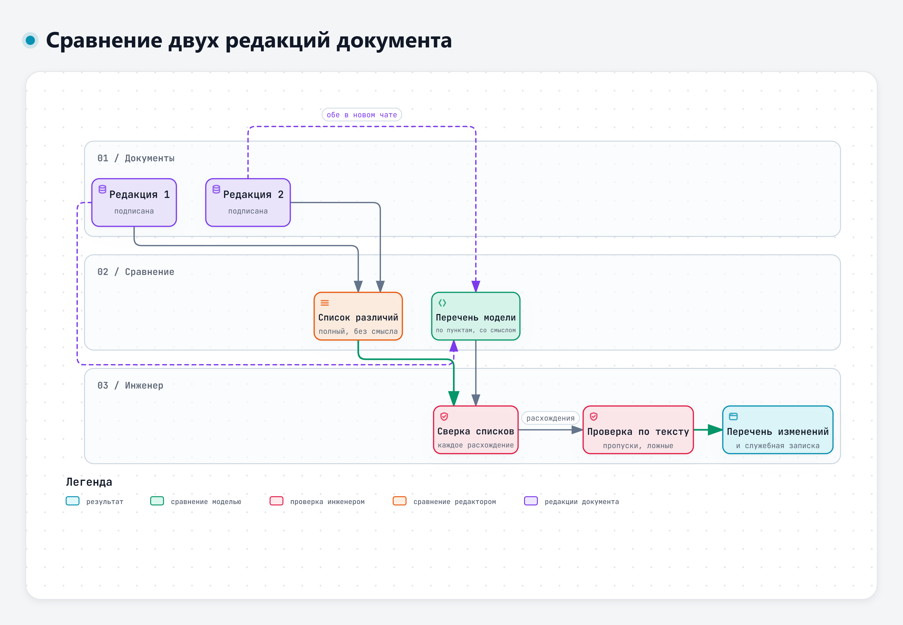
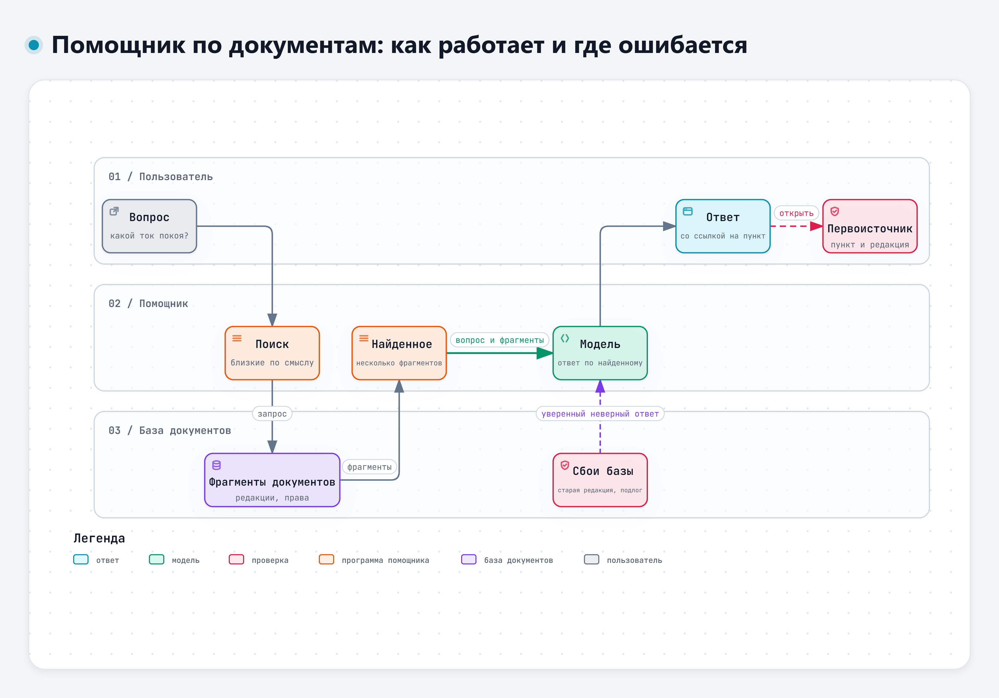

# Тема 2.2. Работа с технической документацией

Инженер много времени тратит на документы: прочитать ТЗ, выписать требования, сравнить новую редакцию со старой, ответить на вопрос «что там сказано про ток покоя», написать служебную записку. С этим языковые модели помогают заметно. Но в документах ошибки модели особенно опасны: они выглядят как текст документа. Сегодня разберём, что модель делает с документами хорошо, где она пропускает и путает и как требовать от неё ссылку на пункт, которую можно проверить.

Правило темы 2.1 действует и здесь: в разрешённые внешние сервисы – только учебные и открытые документы. Рабочую документацию – по маршруту, который разрешают правила организации.

## 1. Что ИИ делает с документами

| Задача | Что получаете | Где модель полезна | Что проверять всегда |
|---|---|---|---|
| Сводка | Короткий пересказ документа или раздела | Быстро понять, о чём 40 страниц | Не потеряно ли главное, нет ли выводов, которых в документе нет |
| Извлечение требований | Таблица «пункт – требование – параметр – значение» | Перенести требования в проверочный перечень | Каждую строку по тексту, особенно числа, допуски и условия |
| Сравнение версий | Перечень изменений между редакциями | Найти, что поменялось, и объяснить, что это значит | Полноту: не пропущены ли изменения. Ложные изменения |
| Ответы на вопросы по тексту | Ответ со ссылкой на пункт | Найти нужное место в длинном документе | Есть ли такой пункт и говорит ли он то, что утверждает модель |
| Черновики писем, записок, отчётов | Связный текст по вашим данным | Первый вариант за минуты | Каждое утверждение – по документу. Лишние слова и выдуманные причины |

А. Субботин на отраслевом ИИ-митапе (ноябрь 2026) показывал, что для таких задач часто хватает и не самой сильной модели. Под перечнем задач на слайде указано: «Везде простая задача, понятный образец и человек на выходе». Про поиск по документам на слайде было так: «Поиск по документам: Модель находит ответ во внутренних документах и показывает, откуда он. Человек проверяет источник» [39].

В машиностроении такие помощники уже пробуют. В статье 2024 года описан помощник по документам требований автомобилестроительной отрасли, работающий на локальных моделях. Авторы пишут, что такой подход заметно упрощает анализ требований и работу со сложными документами [29].

Но на сложной инженерной документации результаты скромнее. Исследователи MIT и Autodesk собрали набор вопросов по правилам студенческих соревнований Formula SAE, чертежам и CAD-моделям и проверили на нём несколько моделей [17].

> «The MLLMs tested, while promising, struggle to reliably retrieve relevant rules from the Formula SAE documentation, face challenges in recognizing technical components in CAD images, and encounter difficulty in analyzing engineering drawings.»
>
> Перевод: «Проверенные мультимодальные модели выглядят многообещающе, но не могут надёжно находить нужные правила в документации Formula SAE, с трудом распознают технические компоненты на изображениях CAD-моделей и испытывают затруднения при анализе чертежей». – Doris и соавт., 2024, препринт arXiv [17]

Обзор применения моделей в инженерии требований приходит к сдержанному выводу: обработку естественного языка давно считают перспективной для инженерии требований, но существенной пользы она пока не показала [18].

Вывод: модель хорошо делает черновую работу с документом, а инженер проверяет результат. Модель ускоряет работу с документом, но читать его всё равно нужно.

## 2. Ограничения и как с ними работать

### Объём документа

У сервисов есть пределы. По справке GigaChat, запрос – до 4000 символов, PDF – до 20 МБ или первые 50 страниц, один новый файл – один новый чат. Алиса AI принимает в одном сообщении один файл DOC, DOCX, PDF или TXT до 100 МБ [34], [35]. Если документ длиннее, сервис может обработать только начало и не сказать об этом.

Учебные документы курса тоже упираются в эти пределы: программа испытаний из домашнего задания длиннее 4000 символов. Если документ вместе с запросом не помещается в одно сообщение, отправьте его частями в одном чате с припиской «пока ничего не делай, дождись задания», а запрос – последним сообщением. Другой путь – загрузить документ файлом, если сервис принимает файлы.

Даже когда документ целиком помещается, модель читает его неравномерно. В исследовании 2024 года проверили, как модели находят нужные сведения в длинном тексте [14].

> «In particular, we observe that performance is often highest when relevant information occurs at the beginning or end of the input context, and significantly degrades when models must access relevant information in the middle of long contexts, even for explicitly long-context models.»
>
> Перевод: «В частности, мы видим, что качество обычно выше всего, когда нужные сведения находятся в начале или в конце входного текста, и заметно падает, когда модели нужно найти их в середине длинного текста. Так происходит даже с моделями, специально рассчитанными на длинный контекст». – Liu и соавт., 2024 [14]

Практический приём: длинный документ отдавать частями (раздел за разделом) и просить ответ по каждой части отдельно.

### Пропуски и искажения при извлечении

Частые ошибки при извлечении – пропуск данных, перенос значения в неверное поле и искажение значения. Их соотношение зависит от задачи и модели, а выдуманные значения встречаются реже, чем принято думать. Систематический обзор 2026 года собрал 27 исследований, где модели извлекали данные из научных статей и их результаты сравнивали с работой людей [20].

> «Omissions were the dominant error type (60-74%), with hallucination rates of only 0.08-6%, challenging widespread fabrication concerns.»
>
> Перевод: «Основным видом ошибок были пропуски (60–74 %), а доля выдуманных значений составляла лишь 0,08–6 %, что расходится с распространённым мнением о выдумках как главной проблеме». – Shankar и соавт., 2026 [20]

Там же: категориальные и текстовые данные извлекались надёжнее (74–96 %), чем числовые (47–88 %) [20]. Для инженера это важно: в ТЗ и программах испытаний главное именно числа. По выводу авторов, модели стоит использовать как помощника при двойном извлечении данных с проверкой человеком, а не как самостоятельный инструмент [20].

В крупном исследовании 2026 года одна из универсальных моделей извлекала данные из 664 статей, всего больше 23 тысяч ячеек [21]. Ошибок оказалось немного, но преобладал среди них другой вид, чем в обзоре: 57,1 % – значение записано не в то поле, 23,2 % – значение пропущено. Общая доля ошибок – 6,6 %. Вывод авторов: результаты модели нужно тщательно проверять.

Похожая картина с таблицами. Модели понимают структуру таблицы, но неверно берут значения или пропускают строки [22].

Исследования выполнены на медицинских и научных текстах, не на ТЗ. Переносить проценты на инженерные документы нельзя, а вид ошибок – можно: пропуск строки, значение не в той графе, потерянное условие измерения.

Как с этим работать:

- просить таблицу с фиксированными столбцами, включая «условия» и «пункт»;
- явно разрешить «не указано» для пустых граф, чтобы модель не досочиняла;
- сверить число строк в таблице с числом пунктов в документе;
- проверить по тексту каждую строку с числом.

### Путаница версий

У технического документа может быть несколько редакций. Модель легко смешивает их: в одном чате была редакция 1, потом вы вставили редакцию 2, и в ответе значения из обеих. Или модель знает какой-то вариант документа из обучения и отвечает по нему, а не по тексту, который вы дали.

Исследование 2026 года проверило модели на официальных документах, которые много раз изменялись [23]. Лучшая точность составила 68,5 %, а обнаружить, что предоставленная редакция к вопросу не относится, модели смогли лишь в 26,7 % случаев.

> «Models are more likely to find correct versions than to reject incorrect ones, and they tend to follow a confident parametric answer over the supplied authoritative text.»
>
> Перевод: «Модели чаще находят правильную редакцию, чем отвергают неправильную, и склонны уверенно отвечать на основе сведений, усвоенных при обучении, а не предоставленного официального текста». – Sobhani и соавт., 2026, препринт arXiv [23]

Для сравнения редакций есть исследование на инженерно-нормативном документе: годовые редакции авиационных норм за 2000–2025 годы сравнивали обычной программой построчного сравнения и двумя моделями [19]. Средняя полнота обнаружения существенных изменений составила от 73,2 до 90,9 %, то есть часть изменений пропущена. Вывод авторов – сочетать оба способа.

> «The results show that deterministic comparison is required for coverage and traceability, while LLM-based comparison can provide a semantic layer for prioritizing meaningful revisions and identifying reference fragments.»
>
> Перевод: «Результаты показывают, что для полноты и прослеживаемости нужно детерминированное сравнение, а сравнение с помощью модели может добавить смысловой уровень: выделить значимые изменения и найти связанные с ними фрагменты». – Myhovych, Kunytsia, 2026 [19]

Интерактивная версия схемы – файл `diagrams/d2-sravnenie-redakciy.html`.

Практический порядок сравнения редакций:

1. Для сравнения открыть один новый чат и передать в него обе редакции, явно подписав каждую: «Редакция 1:», «Редакция 2:».
2. Если доступна функция сравнения в текстовом редакторе, сначала построить список различий ею. Она не пропустит изменение, хотя и не объяснит его смысл.
3. Попросить модель сравнить по пунктам: «для каждого пункта: без изменений / изменён / новый / удалён; что было – что стало».
4. Сверить перечень модели со списком различий из редактора. Каждое расхождение проверить по тексту.
5. Отдельно проверить «ложные изменения»: модель могла назвать изменением перефразировку без смены смысла.

### Неточные цитаты и ссылки на пункт

Модель может сослаться на пункт, которого нет, или на правильный пункт с неправильным содержанием. В исследовании 2023 года проверили ответы моделей со ссылками на источники: даже у лучших моделей на одном из наборов вопросов ответ в половине случаев не полностью подтверждался приведёнными ссылками [16].

Для документов в формате PDF похожую проверку сделали в 2026 году: модели должны были не только ответить, но и указать область страницы, где написан ответ [24].

> «Auditing 20 MLLMs reveals a pervasive Attribution Hallucination: models frequently produce the right answer while citing the wrong region.»
>
> Перевод: «Проверка 20 мультимодальных моделей выявила повсеместную галлюцинацию указания источника: модели часто дают правильный ответ, но ссылаются не на то место документа». – Ma и соавт., 2026, препринт arXiv [24]

Правильный ответ со ссылкой не на тот пункт тоже опасен. Следующий человек откроет указанный пункт, не найдёт там нужного и потеряет доверие ко всему документу. Или найдёт похожее и решит, что всё сходится.

Как требовать ссылку и проверять её:

- в запросе: «для каждого утверждения укажи номер пункта и приведи дословную фразу из него в кавычках»;
- в запросе: «если в документе нет ответа, напиши: в документе не найдено»;
- при проверке: найти дословную фразу в документе поиском (Ctrl+F). Не нашлась – цитата неточная или выдуманная;
- проверить, что найденная фраза действительно стоит в указанном пункте и говорит то, что утверждает модель.

Дословную цитату проверяет поиск. Пересказ так не проверишь.

## 3. Корпоративные помощники по документам: RAG

Во многих организациях появляются помощники, которые отвечают на вопросы по внутренней базе документов: стандартам, инструкциям, регламентам. Чаще всего они устроены по схеме поиска с дополнением контекста, RAG (retrieval-augmented generation, генерация с дополнением найденным). Сам подход описан в работе 2020 года [12].

Проще говоря, у модели две памяти: то, что она усвоила при обучении, и внешняя база документов, в которой программа ищет подходящие фрагменты перед ответом.

Интерактивная версия схемы – файл `diagrams/d2-rag.html`.

Как это работает по шагам:

1. Документы организации заранее разбиты на фрагменты и проиндексированы.
2. Пользователь задаёт вопрос.
3. Программа ищет в базе фрагменты, близкие к вопросу по смыслу.
4. Найденные фрагменты добавляются к вопросу, и модель составляет ответ по ним.
5. Хороший помощник показывает, из какого документа и пункта взят ответ.

Примеры таких решений показывали на отраслевом ИИ-митапе (ноябрь 2026). С. Скидан рассказывал, как в контактном центре банка ответы агента строятся по единой базе знаний вместо готовых шаблонов [40]. В. Малаканов показывал помощника, у которого поиск находит несколько статей, отдельная небольшая модель оценивает, какие подходят, и только потом большая модель пишет ответ со списком источников [41].

### Где RAG ошибается

А. Морозов на том же митапе сформулировал главное ограничение так (дословно со слайда): RAG отвечает не «истиной», а тем, что нашёл в вашей базе [38]. Если в базе устаревшая редакция, ответ будет по ней. Если поиск нашёл не тот фрагмент, ответ будет уверенным и неверным.

Исследователи из Австралии разобрали три внедрения RAG в разных областях (научные исследования, образование, биомедицина) и выделили семь мест, где такие системы дают сбой [13]. Два их главных вывода:

> «The two key takeaways arising from our work are: 1) validation of a RAG system is only feasible during operation, and 2) the robustness of a RAG system evolves rather than designed in at the start.»
>
> Перевод: «Из нашей работы следуют два главных вывода: 1) проверить систему RAG можно только в ходе эксплуатации; 2) устойчивость системы RAG складывается со временем, а не закладывается в проект с самого начала». – Barnett и соавт., 2024 [13]

Опаснее всего «тихие» сбои, когда ответ выглядит нормально [25].

> «A response may look fluent and relevant even when the retrieved evidence is outdated, the needed passage has been truncated, the citation no longer points to the supporting source, or the system has silently used a fallback path without retrieval.»
>
> Перевод: «Ответ может выглядеть связным и уместным, даже если найденные сведения устарели, нужный фрагмент обрезан, ссылка больше не указывает на подтверждающий источник или система незаметно перешла на резервный путь, без поиска». – Tanhaei, 2026 [25]

Есть и злонамеренный вариант. Если в базу можно подложить документ, можно подменить ответ. В исследовании 2024 года для этого хватало нескольких подложных текстов на базу из миллионов [15].

> «Our results show PoisonedRAG could achieve a 90% attack success rate when injecting five malicious texts for each target question into a knowledge database with millions of texts.»
>
> Перевод: «Наши результаты показывают, что PoisonedRAG добивается 90 % успешных атак, если добавить пять вредоносных текстов на каждый целевой вопрос в базу знаний из миллионов текстов». – Zou и соавт., 2024, препринт arXiv [15]

В перечне рисков OWASP это описано как один из сценариев внедрения команд: злоумышленник меняет документ в хранилище, и когда по запросу находится изменённый фрагмент, ответ модели вводит в заблуждение [32].

Что из этого следует для пользователя корпоративного помощника:

- ответ помощника – указатель на документ, а не сам документ. Для решения открывайте первоисточник;
- проверяйте редакцию и дату документа, на который сослался помощник;
- если помощник ответил без ссылки или ссылка ведёт не туда, считайте ответ непроверенным;
- о неверных ответах сообщайте владельцам помощника: по выводу Barnett и соавт., качество RAG доводится в эксплуатации [13].

В исследовании DesignQA модели, которым дали весь документ правил, почти всегда отвечали лучше, чем те, которым система поиска подобрала нужные страницы. Но и стоило это больше чем в десять раз [17]. RAG – компромисс между полнотой и ценой.

## 4. Сканы и изображения

Многие сервисы принимают изображения. По справке GigaChat – до 15 МБ, Алиса AI – одно изображение до 20 МБ в сообщении [34], [35]. Модель читает текст, таблицы и надписи на фото, снимке экрана или скане. Удобно, но распознанное нужно проверять.

Набор тестов OCRBench собрал 29 наборов данных для проверки распознавания текста мультимодальными моделями [26].

> «Furthermore, our study reveals both the strengths and weaknesses of these models, particularly in handling multilingual text, handwritten text, non-semantic text, and mathematical expression recognition.»
>
> Перевод: «Кроме того, наше исследование выявляет сильные и слабые стороны этих моделей, особенно в работе с многоязычным текстом, рукописным текстом, текстом без смысловой связности и в распознавании математических выражений». – Liu и соавт., 2024 [26]

«Текст без смысловой связности» – это как раз обозначения, коды, серийные номера и наборы чисел. Модель плохо читает то, что нельзя угадать по смыслу. В более новом и сложном наборе тестов большинство моделей набрали меньше половины баллов [27].

Ещё один вид сбоя – модель повторяет распознанный фрагмент по нескольку раз [28].

На что смотреть при проверке распознанного:

- знаки «±», «−», «≤», верхние индексы (мин⁻¹), единицы «А·ч», «Н·м»;
- десятичные запятые и точки, пропущенные нули;
- похожие символы: «З» и «3», «О» и «0», латинские и русские буквы в обозначениях;
- строки таблицы: все ли на месте, не сдвинулись ли значения в соседний столбец;
- объединённые ячейки и заголовки, перенесённые на другую страницу.

Полезная строка в запросе: «если символ читается неуверенно, поставь после него [?]». Модель не всегда честно отмечает неуверенность, но иногда помогает найти сомнительные места.

На снимке экрана может оказаться больше данных, чем вы хотели отправить. Соседняя вкладка, имя пользователя, VIN в углу окна диагностической программы. Перед отправкой посмотрите на картинку целиком.

## 5. Черновики писем, служебных записок и отчётов

При подготовке черновика модель быстро предлагает структуру и связный текст. Чтобы черновик был полезен, дайте модели всё, на чём он должен строиться: результаты анализа, перечень изменений, номера пунктов. И скажите, чего не делать: «не добавляй причин и выводов, которых нет в моих данных».

Что проверить в черновике:

- каждое утверждение подтверждается вашими данными или документом;
- нет выдуманных причин («изменения внесены по требованию заказчика»), если вы их не называли;
- номера пунктов и значения совпадают с документом;
- нет лишних слов: «в целях повышения эффективности», «комплексный подход». Их лучше вычеркнуть сразу;
- адресат, дата, подпись не придуманы моделью.

## 6. Что такое проверяемое требование

Всё, что мы делали с ТЗ выше, исходит из того, что требования в нём написаны хорошо. Так бывает не всегда. Перед извлечением требований или сравнением редакций полезно проверить сами формулировки: можно ли по ним сказать «выполнено» или «не выполнено». Языковая модель умеет искать слабые места в формулировках, но и здесь проверяет результат инженер.

### Проверка – главный признак требования

В авторском курсе В. А. Пикова по техническим заданиям (https://tz.pikov.expert) это сформулировано так: «У каждого требования должен быть способ проверки. Проверка может быть тестом, демонстрацией, измерением, анализом или инспекцией. Без проверки это не требование, а пожелание» [46]. Там же дана короткая формула готовности: «Если требование нельзя одинаково понять, реализовать, проверить и принять, оно еще не готово для ТЗ» [46].

Для инженера-испытателя это знакомо: у каждого пункта ТЗ должен быть пункт программы испытаний, в котором заранее известно, какой результат означает «годен». Критерий приёмки – однозначный признак выполнения. Для измеряемой величины это допуск или предел и условия проверки, для остального – то, что увидит проверяющий: смазка нанесена, предохранитель отдельный, маркировка на месте.

### Кодекс качества требований: 10 критериев

В том же курсе собран кодекс качества требований из десяти критериев [46]. Коротко:

| № | Критерий | Что проверять |
|---|---|---|
| 1 | Требование как требование | Формулировка задаёт обязанность («должен»), а не описывает состояние или пожелание |
| 2 | Атомарность | Один пункт – одна функция, одно свойство или одно ограничение |
| 3 | Однозначность | Одна трактовка у заказчика, разработчика и испытателя; термины определены |
| 4 | Проверяемость | Есть объективный способ проверки: тест, демонстрация, измерение, анализ, инспекция |
| 5 | Реализуемость | Выполнимо при заданных технологиях, сроках, бюджете и ограничениях |
| 6 | Обоснованность | Есть источник: цель, сценарий, нормативный документ, ограничение |
| 7 | Полнота и неизбыточность | Нет пробелов; одно и то же не повторяется в нескольких местах |
| 8 | Непротиворечивость | Требования не конфликтуют между собой |
| 9 | Трассируемость | Есть постоянный номер и связь с источником, проверкой и протоколом |
| 10 | Приоритизация | Указано, насколько требование важно |

О слове «и» в курсе есть точное наблюдение: «Сложное требование с несколькими “и” часто прячет несколько разных работ, разных владельцев и разные способы проверки» [46]. Но не каждое «и» делает требование составным. В п. 4.9 редакции 2 ТЗ ЭС-24 «фары дальнего света, обогрев зеркал и отопитель кабины» – это условия одного измерения, а требование одно: напряжение не ниже 27,0 В.

### Что говорят стандарты

Похожий набор свойств есть в ГОСТ 34.602-2020, п. 3.4: «Требования должны обладать следующими характеристиками: единичность, непротиворечивость, актуальность, выполнимость, проверяемость, однозначность. Требования по возможности должны быть максимально детализированы» [43]. Этот стандарт относится к ТЗ на автоматизированные системы, а не к ТЗ на узел автомобиля. Для инженерного ТЗ его формулировки – удобная опора, а не обязательная норма (вывод автора курса).

Там же, в п. 5.3, – правило для числовых значений (с оговоркой «как правило»): «Значения показателей, норм и требований указывают, как правило, с предельными отклонениями или максимальным и минимальным значениями». Если значение пока установить нельзя, стандарт предлагает запись о порядке его установления и согласования: «Окончательное требование (значение) уточняется... и согласовывается ...» [43].

Об изменениях ТЗ в стандарте сказано: «Изменения к ТЗ на АС оформляют дополнением. Дополнение является неотъемлемой частью ТЗ на АС» (п. 3.5). Титульный лист дополнения оформляют как у ТЗ, но с наименованием «Дополнение № ... к ТЗ на АС» (п. 5.6). В дополнении указывают основание и содержание изменения (п. 5.7), номера пунктов основного ТЗ и слова «заменить», «дополнить», «исключить», «изложить в новой редакции» (п. 5.8) [43]. В учебном кейсе мы для простоты выпустили редакцию 2 целиком, взамен редакции 1. В вашей организации порядок изменения ТЗ задают её правила.

Для конструкторских документов действует ГОСТ Р 2.105-2019. Его п. 5.2.2 начинается так: «Текст документа должен быть кратким, четким и не допускать различных толкований». Дальше перечислены слова для двух видов положений: «При изложении обязательных требований в тексте применяют слова: «должен», «следует», «необходимо», «требуется», «разрешается только», «не допускается», «запрещается», «не должен», «не следует», «не подлежит», «не могут быть» и т. п. При изложении других положений применяют слова: «могут быть», «как правило», «при необходимости», «допускается», «разрешается» и т. п.» [44].

Два вывода для проверки ТЗ. Первый: проверьте, установлена ли обязанность и однозначно ли определены условия её применения. Формулировки «как правило» и «при необходимости» могут требовать уточнения исключений или условий: когда именно «необходимо», кто это решает. Такое место нужно пометить и решить, так ли задумано. Второй: тот же пункт разрешает повествовательную форму, «например «применяют», «указывают» и т. п.» [44]. Поэтому фраза «Измеряется через 60 мин после выключения зажигания» в п. 4.3 – не дефект, хотя слова «должен» в ней нет.

Если вы будете сами заказывать работы в области ИИ, пригодится ГОСТ Р 71752-2024. Его п. 4.5 требует, чтобы для каждого требования ТЗ «должны предусматриваться: – отчетность о выполнении требования; – проверка соответствия результата установленному требованию, например путем проведения валидации, верификации, испытаний, экспертизы или иными способами проверки соответствия» [45].

### Плохо и хорошо на примере ЭС-24

| Критерий | Плохо | Хорошо |
|---|---|---|
| Проверяемость, однозначность | «Система электроснабжения должна надёжно обеспечивать пуск двигателя в зимний период.» | П. 4.4 редакции 2: «После стоянки 14 суток при температуре окружающего воздуха до −30 °C двигатель должен запускаться штатным стартером без внешнего источника питания не более чем с трёх попыток продолжительностью до 10 с каждая.» |
| Проверяемость (число без допуска и условий) | «Напряжение, которое поддерживает регулятор, – 28,2 В.» | П. 4.2 редакции 2: «Напряжение, которое поддерживает регулятор при температуре +25 °C, – 28,2 ± 0,2 В.» |
| Атомарность | «Система должна обеспечивать контроль напряжения бортовой сети, защиту цепей от короткого замыкания и сигнализацию разряда батарей.» | Три отдельных пункта, у каждого своё значение и свой способ проверки. Значения задаёт разработчик ТЗ |
| Требование как требование | «Желательно предусмотреть индикацию разряда аккумуляторных батарей.» | Либо обязанность со значением и условием («… должен включаться при напряжении ниже [значение] В»), либо прямо записанное необязательное положение |

Первый пример полезно сравнить с самим кейсом. В редакции 1 п. 4.4 говорил только «должен запускаться» и не задавал, сколько попыток допустимо. Замечание З-1 («запустился только со второй попытки») по этому пункту формально не оценить и по другой причине: стоянка была 9 суток при −18…−22 °C, а не 14 суток в условиях п. 4.4. Но даже при совпадении условий редакция 1 не позволила бы сказать, годен ли пуск со второй попытки. В редакции 2 критерий появился.

### Как помогает ИИ и что проверяет инженер

Модель удобно использовать как первый фильтр: она быстро размечает расплывчатые слова («надёжно», «быстро», «в полном объёме»), составные формулировки, числа без допуска и условий, пожелания вместо обязанностей. Исследования показывают, где этот фильтр работает, а где нет.

В исследовании 2026 года модель оценивала качество требований к условной технической системе по критериям INCOSE, а результат сравнивали с оценкой экспертов [48].

> «More specifically, LLMs perform poorly in detecting issues that require SE judgement, such as correctness, necessity, and boundedness, and exhibit more reliable performance in detecting linguistically explicit issues such as ambiguity and Verifiability.»
>
> Перевод: «Точнее, модели плохо находят проблемы, для которых нужно суждение системного инженера, – правильность, необходимость, ограниченность, – и надёжнее находят проблемы, видные по формулировке: неоднозначность и проверяемость». – Shefa и соавт., 2026 [48]

Там же отмечено, что модель заметно лучше избегала ложных тревог, чем надёжно находила настоящие проблемы: главная её слабость в этой работе – пропуски. Вывод авторов: модели из коробки пока не годятся для самостоятельной оценки качества требований, но могут помогать экспертам [48].

На промышленной спецификации программного обеспечения точность находок модели оказалась невысокой: из того, что она назвала дефектом, дефектом действительно было меньше двух третей [47].

> «Quantitatively, we find that while LLMs excel in identifying incomplete requirements (precision 0.61), their performance is less impressive in detecting inconsistencies (precision 0.43) and ambiguities (precision 0.39).»
>
> Перевод: «В количественном выражении: модели лучше всего находят неполные требования (точность 0,61), а противоречия (точность 0,43) и неоднозначности (точность 0,39) – заметно хуже». – Mahbub и соавт., 2024 [47]

Те же авторы отмечают, что модель не умеет сопоставлять места по всему документу и слабо понимает специальный контекст [47]. Для поиска противоречий между пунктами это существенно.

Ложные тревоги – отдельная проблема. Авторы работы 2026 года о поиске неоднозначностей так пишут о существующих автоматических средствах и многих новых подходах на основе ИИ, которые смотрят на требование как на отдельную фразу:

> «These methods can identify potentially ambiguous requirements but at the cost of substantial false-positive rates, burdening engineers with large volumes of false alarms.»
>
> Перевод: «Эти методы находят потенциально неоднозначные требования, но ценой большой доли ложных срабатываний, которые ложатся на инженеров большим объёмом ложных тревог». – Poulsen и соавт., 2026 [49]

По их результатам, сведения о проекте помогают модели отличать действительно неоднозначные требования от приемлемых [49]. Отсюда практический приём: давать модели не одну фразу, а описание узла и соседние пункты.

Бывает и обратное: модель находит слишком мало. В повторении эксперимента по инспекции требований модель сравнивали с людьми-проверяющими [50].

> «We found that LLMs (a) report only a limited number of deficits despite having enough tokens, which (b) do not vary much across prompts. They (c) rarely match the sample solution.»
>
> Перевод: «Мы обнаружили, что модели (а) сообщают лишь об ограниченном числе недостатков, хотя объёма ответа им хватает, (б) мало меняют результат при разных запросах и (в) редко совпадают с эталонным решением». – Seifert и соавт., 2024 [50]

Исследования выполнены на требованиях к программному обеспечению, к космическому телескопу и к условной технической системе, а не к электрооборудованию автомобиля. Проценты переносить нельзя. Переносится вывод: у модели бывают и ложные находки, и пропуски.

Порядок работы:

1. Дать модели перечень критериев, описание узла и пункты ТЗ. Попросить для каждой находки номер пункта, дословное слово или фразу и название нарушенного критерия.
2. Запретить модели придумывать числа: где значения нет, пусть пишет «[значение задаёт разработчик]».
3. Каждую находку проверить. Ложные срабатывания встречаются часто: повествовательная форма («измеряется»), «и» в перечне условий, «допускается» в пункте, который действительно что-то разрешает.
4. Пройти пункты самому по короткой проверке (gate) из курса автора: «Есть ID. Есть источник. Формулировка задает обязанность. Термины определены. Требование атомарно. Есть критерий приемки. Есть метод проверки. Нет конфликта с другими требованиями» [46]. Так находятся пропуски модели.

Полный разбор десяти критериев, проверка и готовые запросы – в дополнительном материале дня «Проверяемые требования: кодекс качества и работа с ИИ» (папка «07-Дополнительно»).

## Что запомнить

- Модель хорошо делает черновую работу с документом: сводку, таблицу требований, перечень изменений, черновик. Проверяет результат инженер.
- Частые ошибки при извлечении – пропуск и значение не в той графе. Сверяйте число строк и каждую строку с числом.
- Версии путаются. Подписывайте редакции, сравнивайте обе в одном новом чате и сверяйте со списком различий редактора.
- Требуйте номер пункта и дословную цитату. Проверяйте цитату поиском по документу.
- RAG отвечает тем, что нашёл в базе. Ответ помощника – указатель на первоисточник.
- Распознанное с изображения проверяется по исходнику: числа, знаки, единицы.
- Требование готово, если его можно одинаково понять, реализовать, проверить и принять. Модель помогает найти непроверяемые и составные формулировки, а её находки, ложные срабатывания и пропуски проверяет инженер.

## Источники

Нумерация общая для всех материалов второго дня.

**Научные публикации**

- [12] Lewis P., Perez E., et al. Retrieval-Augmented Generation for Knowledge-Intensive NLP Tasks. 2020. Препринт arXiv. https://doi.org/10.48550/arXiv.2005.11401
- [13] Barnett S., Kurniawan S., et al. Seven Failure Points When Engineering a Retrieval Augmented Generation System // Proceedings of the IEEE/ACM 3rd International Conference on AI Engineering - Software Engineering for AI. 2024. https://doi.org/10.1145/3644815.3644945
- [14] Liu N. F., Lin K., et al. Lost in the Middle: How Language Models Use Long Contexts // Transactions of the Association for Computational Linguistics. 2024. https://doi.org/10.1162/tacl_a_00638
- [15] Zou W., Geng R., et al. PoisonedRAG: Knowledge Corruption Attacks to Retrieval-Augmented Generation of Large Language Models. 2024. Препринт arXiv, версия v3 от 13.08.2024 (название и цитата – по этой версии). https://doi.org/10.48550/arXiv.2402.07867
- [16] Gao T., Yen H., et al. Enabling Large Language Models to Generate Text with Citations. 2023. Препринт arXiv. https://doi.org/10.48550/arXiv.2305.14627
- [17] Doris A. C., Grandi D., et al. DesignQA: A Multimodal Benchmark for Evaluating Large Language Models' Understanding of Engineering Documentation. 2024. Препринт arXiv. https://doi.org/10.48550/arXiv.2404.07917
- [18] Norheim J., Rebentisch E., et al. Challenges in applying large language models to requirements engineering tasks // Design Science. 2024. https://doi.org/10.1017/dsj.2024.8
- [19] Myhovych A., Kunytsia A. COMPARATIVE ANALYSIS OF ENGINEERING DOCUMENTATION USING DETERMINISTIC AND LLM-BASED METHODS // Journal of Rocket-Space Technology. 2026. https://doi.org/10.15421/452571
- [20] Shankar R., Lim A., Qian X. Performance of large language models in data extraction for evidence synthesis: A systematic review // Journal of Biomedical Informatics. 2026. https://doi.org/10.1016/j.jbi.2026.105086
- [21] Fan S., Chen M., et al. Evaluating data extraction error by a large language model from randomised controlled trials: a large-scale empirical study // BMJ Evidence-Based Medicine. 2026. https://doi.org/10.1136/bmjebm-2025-114044
- [22] Yang Y., Zhu Q., et al. When LLMs Read Tables Carelessly: Measuring and Reducing Data Referencing Errors // Proceedings of the 64th Annual Meeting of the Association for Computational Linguistics (Volume 1: Long Papers). 2026. https://doi.org/10.18653/v1/2026.acl-long.762
- [23] Sobhani M., Sayeedi M. F. A., et al. Time Present and Time Past: Benchmarking Large Language Models on Temporally Evolving Document Understanding. 2026. Препринт arXiv. https://doi.org/10.48550/arXiv.2608.08512
- [24] Ma D., Li J., et al. CiteVQA: Benchmarking Evidence Attribution for Trustworthy Document Intelligence. 2026. Препринт arXiv. https://doi.org/10.48550/arXiv.2605.12882
- [25] Tanhaei M. Silent-failure detection in RAG pipelines: A controlled fault-injection study of multi-layer quality gates // Results in Engineering. 2026. https://doi.org/10.1016/j.rineng.2026.113085
- [26] Liu Y., Li Z., et al. OCRBench: on the hidden mystery of OCR in large multimodal models // Science China Information Sciences. 2024. https://doi.org/10.1007/s11432-024-4235-6
- [27] Fu L., Kuang Z., et al. OCRBench v2: An Improved Benchmark for Evaluating Large Multimodal Models on Visual Text Localization and Reasoning. 2024. Препринт arXiv. https://doi.org/10.48550/arXiv.2501.00321
- [28] Yang Z., Tang J., et al. CC-OCR: A Comprehensive and Challenging OCR Benchmark for Evaluating Large Multimodal Models in Literacy // 2025 IEEE/CVF International Conference on Computer Vision (ICCV). 2025. https://doi.org/10.1109/ICCV51701.2025.02019
- [29] Uygun Y., Momodu V. Local large language models to simplify requirement engineering documents in the automotive industry // Production & Manufacturing Research. 2024. https://doi.org/10.1080/21693277.2024.2375296
- [47] Mahbub T., Dghaym D., Shankarnarayanan A., et al. Can GPT-4 Aid in Detecting Ambiguities, Inconsistencies, and Incompleteness in Requirements Analysis? A Comprehensive Case Study // IEEE Access. 2024. Vol. 12. https://doi.org/10.1109/access.2024.3464242
- [48] Shefa J., Iyer A., Topcu T. G. The Tale of the Broken Clock: How LLMs Evaluate Requirement Quality and Where They Fail // INCOSE International Symposium. 2026. Vol. 36. https://doi.org/10.1002/iis2.70245
- [49] Poulsen V. V., Guertler M., Eisenbart B., et al. Context-aware large language models for ambiguity detection in requirements // Proceedings of the Design Society. 2026. Vol. 6. https://doi.org/10.1017/pds.2026.10607
- [50] Seifert D., Jöckel L., Trendowicz A., et al. Can Large Language Models (LLMs) Compete with Human Requirements Reviewers? – Replication of an Inspection Experiment on Requirements Documents // Product-Focused Software Process Improvement (PROFES 2024). Lecture Notes in Computer Science. Springer, 2024. https://doi.org/10.1007/978-3-031-78386-9_3

**Нормативные документы** (тексты сверены по официальным изданиям; каталожные страницы открыты 10.11.2026)

- [43] ГОСТ 34.602-2020. Информационные технологии. Комплекс стандартов на автоматизированные системы. Техническое задание на создание автоматизированной системы. Введён в действие приказом Росстандарта от 19.11.2021 № 1522-ст с 01.01.2022. Текст в справочной системе: https://meganorm.ru/mega_doc/norm/gost_gosudarstvennyj-standart/0/gost_34_602-2020_mezhgosudarstvennyy_standart.html (вторичный источник)
- [44] ГОСТ Р 2.105-2019. Единая система конструкторской документации. Общие требования к текстовым документам. Утверждён приказом Росстандарта от 29.04.2019 № 175-ст. Текст с изменениями № 1 и 2 в справочной системе: https://meganorm.ru/mega_doc/norm/gost-r_gosudarstvennyj-standart/0/gost_r_2_105-2019_natsionalnyy_standart_rossiyskoy.html (вторичный источник)
- [45] ГОСТ Р 71752-2024. Искусственный интеллект. Техническое задание. Требования к содержанию. Утверждён приказом Росстандарта от 28.10.2024 № 1548-ст. Карточка в каталоге стандартов: https://meganorm.ru/Index/83/83933.htm (вторичный источник)

**Материалы автора курса**

- [46] Пиков В. А. Авторский курс по техническим заданиям: слайды блока «Кодекс качества требований» (критерии 1–10, проверка перед передачей в разработку), методические материалы курса. https://tz.pikov.expert

**Отраслевые перечни** (открыты 10.11.2026)

- [32] OWASP Top 10 for LLM Applications 2025. LLM01:2025 Prompt Injection. https://github.com/OWASP/www-project-top-10-for-large-language-model-applications/blob/main/2_0_vulns/LLM01_PromptInjection.md

**Сервисы** (страницы открыты 10.11.2026)

- [34] GigaChat. Пользовательское соглашение; справка: частые вопросы, документы, изображения. https://developers.sber.ru/docs/ru/policies/gigachat/agreement ; https://giga.chat/help ; https://giga.chat/help/articles/faq ; https://giga.chat/help/articles/work-with-docs ; https://giga.chat/help/articles/gigachat-load-picture
- [35] Алиса AI. Условия использования; справка: чат, режим «Эксперт», файлы; политика конфиденциальности Яндекса. https://yandex.ru/legal/alice_chat/ ; https://alice.yandex.ru/support/ru/assistant/chat-alice ; https://alice.yandex.ru/support/ru/assistant/chat/intellect ; https://alice.yandex.ru/support/ru/assistant/chat/files ; https://yandex.ru/legal/confidential/

**Выступления и вебинары**

- [38] Морозов А. «AI в безопасности и безопасность в AI». Доклад на ИИ-митапе ЦГУ, 06.11.2026.
- [39] Субботин А. «Платформы для совместной работы с ИИ-агентами». Доклад на ИИ-митапе ЦГУ, 06.11.2026 (презентация доклада).
- [40] Скидан С. «Как создать Агента-оператора». Доклад на ИИ-митапе ЦГУ, 06.11.2026 (презентация доклада).
- [41] Малаканов В. «Код, Jev, LLM, WebMCP». Доклад на ИИ-митапе ЦГУ, 06.11.2026 (презентация доклада).

Полный список источников дня – в файле «Источники дня» в папке дня.

---

<!-- author-block -->
**Автор курса**

Виталий Пиков

- Архитектор информационной безопасности
• РБПО • DevSecOps • AppSec
- Лектор и автор образовательных программ по ИБ и РБПО

Телефон: +7 (963) 782-92-78 ·
E-mail: vitaly@pikov.expert ·
Сайт: https://pikov.expert ·
Telegram: @UnderLineSecurity
