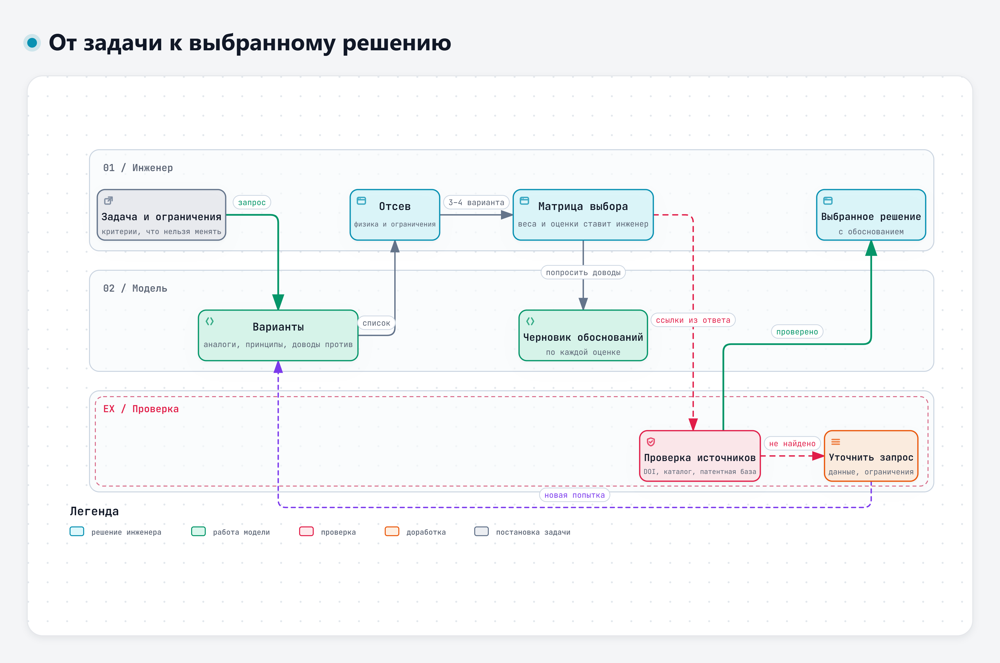
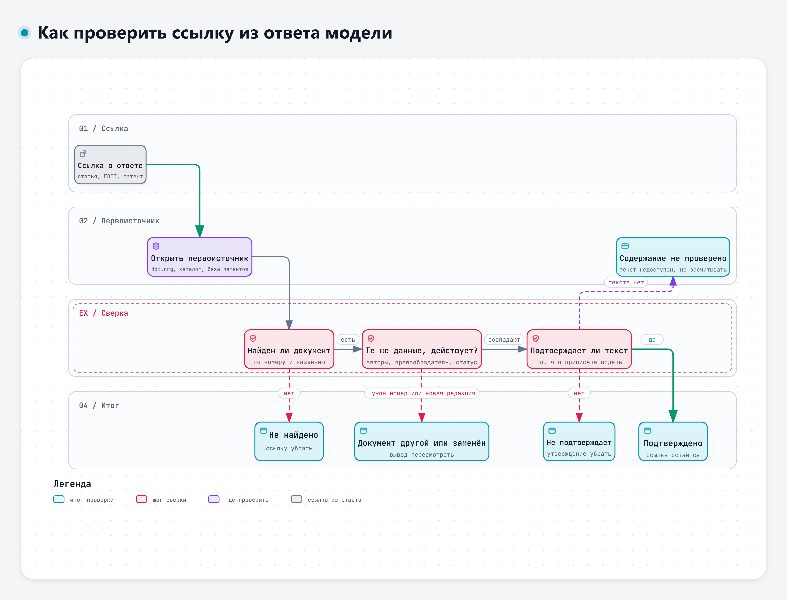

# Тема 3.1. Поиск и сравнение технических решений

Языковая модель хорошо придумывает варианты и плохо отвечает за выбор. За минуту она выдаст десять способов решить конструкторскую задачу, среди них будут дельные, банальные и физически невозможные. Ссылки на стандарты и патенты в таком ответе выглядят одинаково убедительно, и настоящие, и выдуманные. Сегодня разберём, как использовать модель для поиска вариантов, сохранив за инженером выбор решения.

Сквозной пример – задача К-1 из дополнения к учебному кейсу: как не допустить глубокого разряда батарей ЭС-24 на стоянке до 14 суток при −25 °C. Она выросла из замечаний З-1 и З-2. Требования ТЗ здесь и дальше в днях 3–5 – по редакции 1 из кейса первого дня.



Интерактивная версия схемы – файл `diagrams/d3-put-k-resheniyu.html`.

## 1. Модель как помощник в поиске идей

### Что модель умеет хорошо

Конструктор, который ищет решение, обычно перебирает знакомые варианты. Модель видела в обучающих текстах множество решений из разных отраслей и быстро вспоминает то, что инженер мог не держать в голове: аналоги из соседних областей, другие принципы действия, типовые схемы.

Это проверяли экспериментально. В исследовании 2023 года модель решала 12 задач концептуального проектирования, а её решения сравнивали с решениями, собранными у множества людей. Эксперты оценили решения модели как в среднем более осуществимые и полезные, а решения людей – как более новые [1].

> «Expert evaluations indicate that the LLM-generated solutions have higher average feasibility and usefulness while the crowdsourced solutions have more novelty.»
>
> Перевод: «Экспертные оценки показывают, что решения языковой модели в среднем более осуществимы и полезны, а решения, собранные у множества людей, отличаются большей новизной.» – Ma и соавт., 2023, препринт arXiv [1]

Это результат одного эксперимента на 12 задачах, и переносить его на любую задачу нельзя. Но направление полезное: в этом эксперименте варианты модели оказались в среднем осуществимее, а самые новые идеи чаще давали люди. Если нужна широта, полезно просить модель о разных принципах действия, а не об «оптимальном решении».

Широту можно увеличить приёмами запроса. В работе 2025 года модели давали несколько профессиональных ролей. Разнообразие идей росло, когда роли задавались в отдельных запросах или по очереди, с доработкой идей от роли к роли [6]. В другом исследовании две разные модели дорабатывали идеи друг друга, повышая новизну и разнообразие исходного набора [5].

> «The results of these studies indicate that the collaboration between two LLMs improves the novelty and variety of the initial design concepts generated by an individual LLM.»
>
> Перевод: «Результаты этих исследований показывают, что совместная работа двух языковых моделей повышает новизну и разнообразие исходных концепций, порождённых одной моделью.» – Xiao, Zhang, McAdams, 2026 [5]

Попросите варианты у GigaChat, потом дайте его список Алисе AI с вопросом «что здесь упущено и что не сработает». Или в одном сервисе задайте подряд три роли: «конструктор электрооборудования», «специалист по сервису», «технолог сборки».

### Где модель ошибается

В эксперименте, описанном в работе 2025 года, модель целиком вела команду на 48-часовом конкурсе прототипов: придумывала идеи и принимала все конструкторские решения, а люди только выполняли её указания. Команда заняла второе место из шести. Сильнее всего модель проявила себя в генерации идей, но были и характерные сбои [3].

> «However, the LLM prematurely abandoned promising concepts when facing minor difficulties, added unnecessary complexity to designs, and experienced design fixation.»
>
> Перевод: «Однако модель преждевременно отказывалась от перспективных концепций при небольших трудностях, излишне усложняла конструкции и зацикливалась на одном решении.» – Ege и соавт., 2025 [3]

Авторы того же исследования советуют оставлять главные решения за человеком, просить модель рассматривать альтернативы и давать ей конкретные задачи на уровне подсистемы [3]. Для нашей задачи это значит: не «как улучшить электрооборудование грузовика», а «как не допустить разряда батарей на стоянке при таких-то ограничениях». А. Субботин в докладе на ИИ-митапе (ноябрь 2026) сформулировал похожее правило для работы с агентами: «Сначала описать работу, потом звать агента. Кривой процесс агент не исправит, а просто сделает быстрее» [46]. При поиске решений модель ускорит работу даже по плохо поставленной задаче, но саму постановку не исправит.

Есть и ошибки, которые на вид не отличить от хороших идей: решение, которое нарушает закон сохранения энергии или прямо противоречит ограничению задачи. В учебном ответе модели по задаче К-1 такие есть, их разберём на практике.

### Противоречия в требованиях

Многие конструкторские задачи упираются в противоречие: улучшаешь одно, ухудшается другое. В задаче К-1 их несколько. Чтобы батареи не разряжались, хочется обесточить всё на стоянке, но тахограф и охранная система должны работать всю стоянку. Чтобы был запас заряда, хочется поставить батареи большей ёмкости, но ёмкость не меняется по условию, а масса ограничена двумя килограммами.

Для работы с противоречиями есть теория решения изобретательских задач (ТРИЗ). Её приёмы сильны, но требуют опыта. Исследователи пробуют поручить модели сам ход рассуждения по ТРИЗ: в системе AutoTRIZ модель получает формулировку задачи, проходит шаги метода и выдаёт отчёт с решениями. Систему проверяли на учебных примерах и на задаче о терморегулировании батарейного блока [2]. Авторы прямо называют слабость обычного диалога с моделью при поиске идей.

> «However, the lack of transparency and limited control over reasoning steps during ideation often leads to divergent and insufficiently specific results, requiring multiple heuristic attempts by users to achieve desired outcomes.»
>
> Перевод: «Однако из-за непрозрачности и слабого контроля над шагами рассуждения при генерации идей результаты часто получаются разбросанными и недостаточно конкретными, и пользователю приходится делать несколько пробных попыток, чтобы получить нужное.» – Jiang и соавт., 2025 [2]

Работающий приём для чата: сначала попросить модель сформулировать противоречие явно, а уже потом искать варианты. Например: «Сформулируй противоречия в требованиях к задаче К-1 в виде "нужно А, но тогда страдает Б". Для каждого противоречия предложи два-три принципа, как его обойти». Так модель меньше уходит в общие советы.

В системе iDesignGPT модель сначала уточняет постановку задачи, собирает сведения и рассматривает возможные решения, а затем оценивает их. В исследовании 2026 года начинающим конструкторам с такой системой было легче, чем без неё [4]. Мысль та же, что и в теме 1.2: качество ответа задаёт порядок работы.

### Приём «доводы против»

Модель охотно хвалит свои идеи. Полезно с самого начала просить обратное: для каждого варианта – доводы против, условия, при которых он не сработает, и места, где модель не уверена. Такой запрос превращает список идей в материал для проверки:

```
Для задачи К-1 (текст ниже) предложи 6–8 вариантов решения с разными
принципами действия. Для каждого варианта:
- как он работает, одной-двумя фразами;
- какие ограничения задачи он может нарушить;
- два довода против;
- что нужно измерить или посчитать, чтобы убедиться, что он работает.
Отдельным списком перечисли варианты, которые ты считаешь неработоспособными,
и объясни почему. Источники не приводи.
```

Просить ссылки на этом шаге рано: они пригодятся для двух-трёх отобранных вариантов, и проверять их удобнее отдельно.

## 2. Сравнение вариантов и матрица выбора

### Как устроена матрица

Матрица выбора – таблица, где по строкам критерии, по столбцам варианты. Каждому критерию назначают вес, каждому варианту – оценку по каждому критерию. Взвешенная сумма даёт итог. В задаче К-1 семь критериев: масса, стоимость, технологичность, надёжность, ремонтопригодность, влияние на пуск и совместимость с потребителями стоянки.

У матрицы три уязвимых места.

1. **Шкала.** Нужно заранее договориться, что значит 5 и что значит 1, особенно для массы и стоимости, где «больше» – хуже. В задаче К-1 у всех критериев 5 означает «лучше».
2. **Веса.** Их сумма должна быть равна 1, а распределение отражает приоритеты задачи. Веса определяет инженер или команда, а не модель.
3. **Обоснование оценок.** Оценка без обоснования – мнение. Каждая оценка должна опираться на расчёт, измерение, опыт или хотя бы явное допущение.

Перед матрицей стоит сделать отсев. Вариант, который нарушает жёсткое ограничение или физику, в матрицу не попадает, сколько бы баллов он ни набрал по остальным критериям. Матрица сравнивает допустимые варианты, а не все подряд.

Удобно формулировать критерии так, чтобы их можно было проверить. В вебинаре П. Гагарина о разработке с агентами есть формула для постановки задач: «Критерий успеха = сценарий + результат», а «"Код написан" - не критерий» [42]. Для инженерной задачи это значит: не «надёжность пуска», а «после 14 суток стоянки при −25 °C двигатель запускается штатным стартером с первой попытки». Такой критерий можно проверить испытанием.

### Что делает модель, а что инженер

Модель полезна в начале и в конце этой работы. В начале она помогает собрать и структурировать критерии и не забыть очевидное. В конце пишет черновики обоснований для оценок, которые поставил инженер. Исследования подтверждают именно такое разделение.

В работе 2026 года модель извлекала критерии и их веса для метода анализа иерархий из записанных обсуждений инженерной команды. Веса основных критериев оказались близки к полученным вручную, но согласованность оценок менялась. Авторы делают вывод, что результат модели должен дополнять суждение эксперта, а не заменять его [7].

В другом эксперименте два чат-сервиса, ChatGPT и DeepSeek, сопровождали все этапы многокритериального выбора по методу DEX. С описанием критериев и сбором данных о вариантах они справлялись хорошо, а вот методические шаги выполняли нестабильно [8].

> «However, at the current stage of development, the support for the whole multi-criteria decision-making process is still lacking, mainly due to occasionally inconsistent and erroneous execution of methodological steps.»
>
> Перевод: «Однако на нынешнем этапе развития поддержки всего процесса многокритериального выбора всё ещё недостаточно, главным образом из-за того, что методические шаги время от времени выполняются непоследовательно и с ошибками.» – Bohanec, Rajkovič, Rajkovič, 2025 [8]

Авторы предлагают гибридную схему: модель готовит основу, специализированная программа ведёт расчёт [8]. Похоже рассуждает автор разбора 2026 года: пересказать документы и сделать выбор – разные задачи [9].

> «However, summarisation and decision making are different tasks: summarisation is primarily epistemic compression, whereas choice is normative aggregation.»
>
> Перевод: «Однако пересказ и принятие решения – разные задачи: пересказ – это прежде всего сжатие знания, а выбор – нормативное агрегирование.» – Danielson, 2026 [9]

Проще говоря, при выборе нужно объединить оценки с учётом предпочтений и весов критериев, и простого пересказа документов для этого недостаточно.

Систематический обзор 2026 года по 63 публикациям о моделях в многокритериальном выборе отмечает, что такая связка автоматизирует работу и помогает с неструктурированными данными, но остаётся склонной к смещениям, плохо объяснимой и чувствительной к формулировке запроса [11]. В исследовании выбора материалов рекомендации моделей заметно расходились с выбором экспертов [10].

Для занятия правило такое: веса и оценки ставите вы, а модель проверяет таблицу на противоречия, пишет обоснования и задаёт неудобные вопросы.

### Почему оценкам модели нельзя доверять напрямую

Если попросить модель саму оценить варианты, на результат влияет то, что к качеству решения отношения не имеет. Исследователи, изучавшие модели в роли судьи, описали несколько таких смещений [12].

> «Position bias is when an LLM exhibits a propensity to favor certain positions over others.»
>
> Перевод: «Смещение по позиции – это склонность модели отдавать предпочтение одним позициям перед другими.» – Zheng и соавт., 2023 [12]

В той же работе описано смещение в пользу более длинных ответов: модель-судья предпочитает многословный вариант, даже если он не лучше короткого [12]. Систематическое исследование 2025 года подтвердило, что смещение по позиции не случайно и зависит от модели и задачи [13]. Для матрицы выбора это значит, что вариант, описанный первым и подробнее остальных, может получить лишние баллы. Проверка простая: переставьте варианты местами, сократите описания до одинаковой длины и спросите ещё раз в новом чате. Если итог поменялся, оценки модели не годятся даже как черновик.

### Матрица – не автомат

Матрица помогает думать, но не решает за вас. Если два варианта отличаются на 0,1 балла при оценках по пятибалльной шкале, это в пределах точности самих оценок. В таких случаях полезно:

- **проверить устойчивость** – поменять веса в разумных пределах и посмотреть, сменится ли лидер;
- **вернуться к ограничениям** – посчитать, выполняет ли лидер требование с запасом (в задаче К-1 есть энергобаланс в таблице Д-2);
- **записать обоснование выбора словами** – почему выбран именно этот вариант и что придётся проверить испытанием.

Как это выглядит на числах. Возьмём условный пример с тремя критериями: влияние на пуск (вес 0,5), стоимость (0,3), масса (0,2). Вариант А получил оценки 4, 4 и 5, вариант Б – 5, 2 и 4. Итог – сумма произведений «вес × оценка»:

- А: 0,5 × 4 + 0,3 × 4 + 0,2 × 5 = 2,0 + 1,2 + 1,0 = 4,2;
- Б: 0,5 × 5 + 0,3 × 2 + 0,2 × 4 = 2,5 + 0,6 + 0,8 = 3,9.

Лидирует А. Теперь проверим устойчивость: перенесём 0,1 веса со стоимости на влияние на пуск (0,6; 0,2; 0,2). Получится А – 4,2, Б – 4,2, ничья. Перенесём ещё 0,1 (0,7; 0,1; 0,2) – и впереди Б: 4,5 против 4,2. Выбор зависит от того, насколько пуск важнее стоимости. Значит, решать надо не арифметикой, а расчётом или испытанием по влиянию на пуск.

В докладе В. Малаканова на отраслевом ИИ-митапе (ноябрь 2026) матрица выбора сравнивала способы обработки вопросов пользователей. Рядом с таблицей стояла оговорка, что реальная стоимость и эффект зависят от проекта, а цифры производителя были прямо помечены как его собственные данные [44]. Так и нужно подавать результат: что измерено, что оценено, на чьих данных.

## 3. Проверка источников

### Модель может выдумать стандарт, патент или статью

Так устроена сама технология. Модель составляет правдоподобный текст, и библиографическая ссылка для неё – такой же текст: фамилия, название, год, номер. В исследовании 2026 года четыре модели работали без доступа к источникам и сгенерировали больше 17 тысяч ссылок на научные работы. Ни у одной модели доля ссылок, существование которых подтвердила автоматическая проверка, не превысила 47,5 %, при этом оформление оставалось безупречным [14]. Ещё 36–61 % ссылок проверка не смогла ни подтвердить, ни опровергнуть [14]. Это результат одного эксперимента с четырьмя моделями, а не норма для любого сервиса.

> «Across 17,443 generated citations, no model exceeds a citation-level existence rate of 0.475; Temporal and Combo conditions produce the steepest drops while outputs remain format-compliant (well-formed bibliographic fields).»
>
> Перевод: «Из 17 443 сгенерированных ссылок ни у одной модели доля существующих работ не превышает 0,475. Сильнее всего она падает при ограничении по годам и при сочетании ограничений, а оформление ссылок при этом остаётся правильным (поля библиографического описания заполнены как положено).» – Zhao, Tang, Qian, 2026, препринт arXiv [14]

В отдельной проверке 2023 года из 35 ссылок, которые выдал чат-сервис, настоящими оказались две, остальные были похожи на реальные работы или собраны из нескольких реальных [16]. Выдуманные ссылки уже проникают в научные публикации: аудит 111 миллионов ссылок в 2,5 миллиона работ дал консервативную оценку почти в 147 тысяч несуществующих ссылок только за 2025 год [15].

С патентами то же самое. Модели неплохо пересказывают текст патента, который им дали, но с выводами о замысле изобретения справляются хуже, и авторы исследования 2026 года подчёркивают необходимость контроля человеком [19]. Систематический обзор 129 работ о моделях в патентной сфере приходит к тому же выводу [20].

> «[…] LLMs are best positioned as assistive tools requiring human oversight rather than autonomous replacements […]»
>
> Перевод: «[…] языковым моделям лучше всего подходит роль вспомогательных инструментов под контролем человека, а не автономной замены […]» – Jiang и соавт., 2026 [20]

### Выдуманные пакеты: когда ошибка становится атакой

Самый наглядный пример цены выдуманной ссылки – из программирования. Модель, которая пишет программу, может сослаться на библиотеку, которой не существует. В исследовании 2024 года на 576 тысячах фрагментов кода доля таких ссылок составила не меньше 5,2 % у коммерческих моделей и 21,7 % у открытых [17]. Злоумышленник может зарегистрировать библиотеку с выдуманным именем и положить в неё вредоносный код. Этот сценарий разбирал А. Морозов в докладе на ИИ-митапе (ноябрь 2026) [48].

Исследователи 2026 года проверили сценарий на практике: зарегистрировали 107 выдуманных моделями пакетов в открытом реестре и полгода наблюдали. Около трети установок сделали разработчики. Поиск в интернете не помог [18].

> «In our evaluated setting, tool-augmented generation, specifically using web search, fails to mitigate this threat.»
>
> Перевод: «В рассмотренных условиях генерация с использованием инструментов, а именно поиска в интернете, эту угрозу не устраняет.» – Huang и соавт., 2026 [18]

Больше того, в этой работе поиск даже повысил долю повторяющихся выдуманных названий с 11,2 до 17,3 % [18]. Для инженера вывод общий: режим поиска в интернете снижает риск устаревших сведений, но не гарантирует, что ссылка настоящая и что найденная страница говорит то, что ей приписано.

### Как проверять ссылку

Ссылка в ответе модели – это гипотеза, пока вы не открыли документ. Проверка занимает несколько минут.



Интерактивная версия схемы – файл `diagrams/d3-proverka-istochnika.html`.

| Что в ответе | Где проверять | Что сверить |
|---|---|---|
| Научная статья с DOI | Открыть адрес вида https://doi.org/… | Ведёт ли DOI на эту статью: название, авторы, год, журнал |
| Статья без DOI | Поиск по точному названию в научных базах | Есть ли статья с таким названием и такими авторами |
| ГОСТ, ГОСТ Р | Каталоги стандартов, официальный сайт Росстандарта | Обозначение, название, статус: действует или заменён, чем заменён |
| Патент | Реестры ФИПС, Google Patents | Номер, название, правообладатель, класс МПК |
| Цифра «по данным работы» | Сам текст работы | Есть ли такая цифра и в каком контексте |

Проверка идёт по шагам. Существует ли документ? Совпадают ли его данные с тем, что написала модель: название, авторы или правообладатель, год? Действует ли он или заменён? Подтверждает ли его текст то, что модель ему приписала? Отсюда возможные итоги:

- **подтверждено** – документ найден, данные совпадают, текст подтверждает утверждение;
- **не найдено** – документа нет ни по номеру, ни по названию;
- **документ другой** – номер существует, но принадлежит другому документу;
- **заменён** – документ был, но действует новая редакция, и вывод надо сверить по ней;
- **не подтверждает** – документ настоящий, но приписанного утверждения в нём нет;
- **содержание не проверено** – документ найден, но полный текст недоступен. Так и пишите, ссылку подтверждённой не считайте.

Самые коварные – «документ другой» и «не подтверждает»: номер «проходит проверку», если смотреть только на то, существует ли он.

Поэтому мало убедиться, что номер стандарта или патента есть в реестре. Надо прочитать название, правообладателя или область применения и сравнить с тем, что приписала модель. В учебном ответе модели из дополнения к кейсу есть ссылки с разными итогами, их разбор – на практике.

Отдельный случай – стандарты, которые модель называет действующими. Модель училась на текстах прошлых лет и может не знать о новой редакции. Например, ГОСТ Р 51901.12-2007 о методе анализа видов и последствий отказов с 1 января 2022 года заменён ГОСТ Р 27.303-2021 [36], [37]. Если ответ модели опирается на заменённый стандарт, вывод придётся проверить по действующему.

### Информированный скептицизм

Для такого отношения к ответам модели есть название – «информированный скептицизм» (Informed Skepticism). Так его назвали авторы концептуальной работы 2026 года о проверке кода, написанного моделями [22]. Они считают, что привычного «доверяй, но проверяй» уже мало.

> «Because these AI mistakes are so good at faking, the old "trust, but verify" approach is no longer enough.»
>
> Перевод: «Ошибки ИИ так хорошо маскируются, что прежнего подхода "доверяй, но проверяй" уже недостаточно.» – Faker, Toker, 2026 [22]

Подход держится на трёх опорах: понимать, как ошибаются модели; оценивать риск по тому, где будет использован результат; выбирать способ проверки под этот риск [22]. Работа написана о программном коде, но переносится на конструкторскую работу почти дословно. Ссылка в пояснительной записке к выбору решения требует другой проверки, чем ссылка в рабочей переписке.

Почему это нужно проговаривать отдельно? В эксперименте 2024 года людям давали советы и сообщали, что совет подготовил ИИ. Одно это знание заставляло людей следовать совету, даже когда он противоречил имеющимся сведениям и их собственной оценке [21]. Модель пишет уверенно и гладко, и инженер, который устал или торопится, рискует принять это за проверенный результат.

## 4. Что из этого следует для работы

| Шаг | Что делает модель | Что решает инженер |
|---|---|---|
| Постановка | Помогает сформулировать противоречия и вопросы к задаче | Задаёт ограничения и критерии успеха |
| Варианты | Предлагает варианты с разными принципами действия и доводы против | Отсеивает то, что нарушает физику и ограничения |
| Матрица | Проверяет таблицу на противоречия, пишет черновики обоснований | Назначает веса и ставит оценки |
| Источники | Подсказывает, где искать | Открывает каждый документ и сверяет содержание |
| Решение | Готовит черновик пояснительной записки | Выбирает и отвечает за выбор |

К. Овчинников в докладе на ИИ-митапе (ноябрь 2026) говорил о парадоксе надзора: проверить работу ИИ может только тот, кто умеет делать её сам [47]. Для выбора технических решений это особенно заметно. Чтобы увидеть, укладывается ли вариант в энергобаланс стоянки, нужно самому посчитать ампер-часы за 336 ч. Модель может предложить вариант, который на этом простом расчёте не выдерживает проверки, и не заметить этого.

## Что запомнить

- Модель хороша для широты поиска: аналоги, принципы действия, доводы против. В эксперименте 2023 года самые новые идеи чаще давали люди.
- Сначала отсев по физике и ограничениям, потом матрица. Недопустимый вариант не спасают баллы.
- Веса и оценки ставит инженер. Сумма весов равна 1, у каждой оценки есть обоснование. Небольшой сдвиг весов может сменить лидера – проверяйте.
- Оценки модели зависят от порядка и длины описаний. Переставьте варианты и спросите ещё раз.
- Каждая ссылка – гипотеза, пока документ не открыт. Номер может существовать и принадлежать другому документу.
- Режим поиска не гарантирует настоящих ссылок.

## Источники

Нумерация общая для всех материалов третьего дня. Полный список – в файле «Источники» в папке дня.

**Научные публикации**

- [1] Ma K., Grandi D., McComb C., Goucher-Lambert K. Conceptual Design Generation Using Large Language Models. 2023. Препринт arXiv. https://doi.org/10.48550/arXiv.2306.01779
- [2] Jiang S., Li W., Qian Y., et al. AutoTRIZ: Automating engineering innovation with TRIZ and large language models // Advanced Engineering Informatics. 2025. https://doi.org/10.1016/j.aei.2025.103312
- [3] Ege D. N., Øvrebø H. H., Stubberud V., et al. ChatGPT as an inventor: eliciting the strengths and weaknesses of current large language models against humans in engineering design // Artificial Intelligence for Engineering Design, Analysis and Manufacturing. 2025. https://doi.org/10.1017/s0890060425000010
- [4] Liu S., Shen Y., Zhang Y., et al. iDesignGPT enhances conceptual design via large language model agentic workflows // Nature Communications. 2026. https://doi.org/10.1038/s41467-026-68672-1
- [5] Xiao S., Zhang G., McAdams D. A. Collaboration Between Two Large Language Models for Design Concept Generation // Journal of Mechanical Design. 2026. https://doi.org/10.1115/1.4072235
- [6] Feng W. B., Hélie S., Panchal J. H. Enhancing design concept diversity: multi-persona prompting strategies for large language models // Design Science. 2025. https://doi.org/10.1017/dsj.2025.10037
- [7] Piñones E., Nikulin C., Briede Westermeyer J. C. SUPPORTING DECISION MAKING IN ENGINEERING DESIGN BY ANALIZING TEAM DISCUSSIONS WITH LANGUAGE MODELS // DYNA. 2026. https://doi.org/10.52152/d11565
- [8] Bohanec M., Rajkovič U., Rajkovič V. An Experimental Evaluation of Large Language Models in Supporting the DEX Multi-Criteria Decision-Making Process // Informatica. 2025. https://doi.org/10.31449/inf.v49i4.12884
- [9] Danielson M. Using LLMs for Multi-Criteria Decision Analysis: The Swedish Nord-Syd Case // Electronics. 2026. https://doi.org/10.3390/electronics15194519
- [10] Grandi D., Jain Y. P., Groom A., et al. Evaluating Large Language Models for Material Selection. 2024. Препринт arXiv. https://doi.org/10.48550/arXiv.2405.03695
- [11] Sahoo S. K., Choudhury B. B., Dhal P. R., et al. Large Language Models in Multi Criteria Decision Making: A Systematic Review, Taxonomy, and Future Research Agenda // Applied Research Advances. 2026. https://doi.org/10.65069/ara21202614
- [12] Zheng L., Chiang W.-L., Sheng Y., et al. Judging LLM-as-a-Judge with MT-Bench and Chatbot Arena // Advances in Neural Information Processing Systems 36. 2023. https://doi.org/10.52202/075280-2020
- [13] Shi L., Ma C., Liang W., et al. Judging the Judges: A Systematic Study of Position Bias in LLM-as-a-Judge // Proceedings of IJCNLP-AACL 2025. https://doi.org/10.18653/v1/2025.ijcnlp-long.18
- [14] Zhao C., Tang Y., Qian Y. Do Deployment Constraints Make LLMs Hallucinate Citations? An Empirical Study across Four Models and Five Prompting Regimes. 2026. Препринт arXiv. https://doi.org/10.48550/arXiv.2603.07287
- [15] Zhao Z., Wang Y., Stuart T., et al. LLM hallucinations in the wild: Large-scale evidence from non-existent citations. 2026. Препринт arXiv. https://doi.org/10.48550/arXiv.2605.07723
- [16] McGowan A., Gui Y., Dobbs M., et al. ChatGPT and Bard exhibit spontaneous citation fabrication during psychiatry literature search // Psychiatry Research. 2023. https://doi.org/10.1016/j.psychres.2023.115334
- [17] Spracklen J., Wijewickrama R., Sakib A. H. M. N., et al. We Have a Package for You! A Comprehensive Analysis of Package Hallucinations by Code Generating LLMs. 2024. Препринт arXiv. https://doi.org/10.48550/arXiv.2406.10279
- [18] Huang Z., Liu C., Wang Z., et al. Package Hallucinations as Phantoms in Open Source Software Supply Chains: An Empirical Security Analysis // ACM Transactions on Software Engineering and Methodology. 2026. https://doi.org/10.1145/3830237
- [19] Jiang P., Wang Y., Han J. Can large language models understand engineering design patents? An exploratory study // Proceedings of the Design Society. 2026. https://doi.org/10.1017/pds.2026.10593
- [20] Jiang P., Arena A. P., Sorce S., Atherton M. Large language models in the patent lifecycle: A systematic review // World Patent Information. 2026. https://doi.org/10.1016/j.wpi.2026.102506
- [21] Klingbeil A., Grützner C., Schreck P. Trust and reliance on AI – An experimental study on the extent and costs of overreliance on AI // Computers in Human Behavior. 2024. https://doi.org/10.1016/j.chb.2024.108352
- [22] Faker O., Toker S. Informed Skepticism: Navigating The Code Hallucination Dilemma // 2026 5th International Informatics and Software Engineering Conference (IISEC). 2026. https://doi.org/10.1109/iisec69317.2026.11418436

**Нормативные и официальные документы**

- [36] ГОСТ Р 27.303-2021 (МЭК 60812:2018). Надежность в технике. Анализ видов и последствий отказов. Карточка в каталоге стандартов: https://meganorm.ru/Index/75/75897.htm ; текст приказа Росстандарта от 21.09.2021 № 987-ст: https://pravo.ppt.ru/prikaz/rosstandart/n-987-st-261679 (вторичные источники)
- [37] ГОСТ Р 51901.12-2007 (МЭК 60812:2006). Менеджмент риска. Метод анализа видов и последствий отказов. Карточка в каталоге стандартов: https://meganorm.ru/Index/44/44254.htm (вторичный источник)

**Выступления и вебинары**

- [42] Гагарин П. Разработка с агентами: от постановки задачи до деплоя. Вебинар 2 по ИИ, УЦ «МАСКОМ» и PVS-Studio, 28.07.2026 (презентация доклада).
- [44] Малаканов В. Код, Jev, LLM, WebMCP. Доклад на ИИ-митапе ЦГУ, 06.11.2026 (презентация доклада).
- [46] Субботин А. Платформы для совместной работы с ИИ-агентами. Доклад на ИИ-митапе ЦГУ, 06.11.2026 (презентация доклада).
- [47] Овчинников К. Инженер после AI. Доклад на ИИ-митапе ЦГУ, 06.11.2026 (презентация доклада).
- [48] Морозов А. AI в безопасности и безопасность в AI. Доклад на ИИ-митапе ЦГУ, 06.11.2026 (презентация доклада).

**Учебные материалы**

Учебный кейс ЭС-24 и его дополнение к третьему дню составлены для курса. Узел условный, значения подобраны для упражнений.

---

<!-- author-block -->
**Автор курса**

Виталий Пиков

- Архитектор информационной безопасности
• РБПО • DevSecOps • AppSec
- Лектор и автор образовательных программ по ИБ и РБПО

Телефон: +7 (963) 782-92-78 ·
E-mail: vitaly@pikov.expert ·
Сайт: https://pikov.expert ·
Telegram: @UnderLineSecurity
