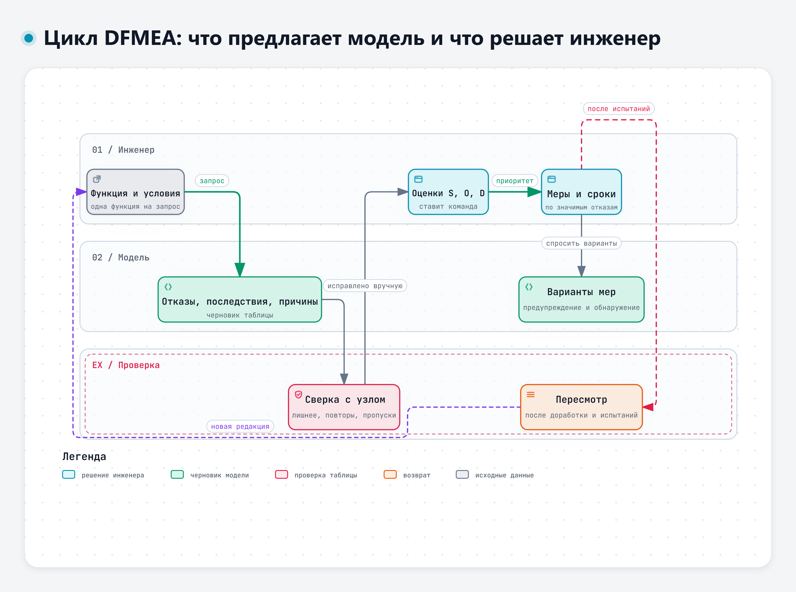
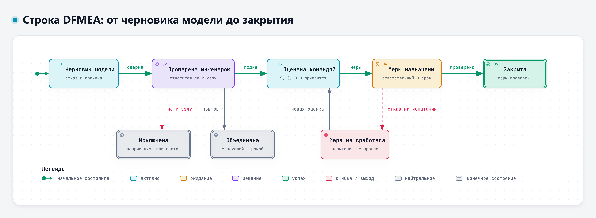

# Тема 3.2. Анализ потенциальных отказов конструкции

Анализ видов и последствий отказов конструкции, DFMEA, – работа, где языковая модель приносит пользу быстро и так же быстро может навредить. Перечислить двадцать возможных отказов для узла она сможет за минуту. Половина из них будет общей, несколько – не про ваш узел, а оценки значимости и вероятности окажутся уверенными и ничем не подкреплёнными. Сегодня разбираем, как получить от модели полезный черновик и что в нём должен решать только инженер.

Пример – функция Ф-1 учебного узла ЭС-24: обеспечить пуск двигателя после стоянки до 14 суток при температуре до −25 °C (документ 3.4 дополнения к кейсу; ТЗ – редакция 1).

## 1. Что такое DFMEA

### Логика метода

FMEA (Failure Mode and Effects Analysis) – анализ видов и последствий отказов. Его применяют к конструкции (DFMEA, D – design) и к процессу изготовления (PFMEA). Цель – до выпуска конструкции найти, как она может не выполнить свою функцию, что из этого последует и что сделать заранее.

Цепочка всегда одна и та же.

1. **Функция.** Что узел должен делать, с количественным требованием. Для Ф-1 – пуск после 14 суток стоянки при −25 °C.
2. **Вид отказа.** Как функция может не выполниться: двигатель не запускается, запускается не с первой попытки, запускается только от внешнего источника.
3. **Последствие.** Что увидит водитель или сервис: автомобиль не выходит на линию, нужен внешний источник пуска или эвакуация.
4. **Причина.** Почему это может случиться в конструкции: повышенный ток покоя, ослабление клеммы, разбаланс батарей в последовательной цепочке.
5. **Меры предупреждения.** Что в конструкции уже снижает вероятность причины: расчёт энергобаланса, выбор компонента, требование к моменту затяжки в документации.
6. **Меры обнаружения.** Как причину выявят до выпуска: расчёт, испытание на стоянку в климатической камере, измерение тока покоя.
7. **Оценки и приоритет.** Значимость последствия (S), возникновение причины (O), обнаружение (D) – и решение команды, с чего начинать.



Интерактивная версия схемы – файл `diagrams/d3-cikl-dfmea.html`.

### Документы, на которые опирается метод

В России метод описан в ГОСТ Р 27.303-2021 «Надежность в технике. Анализ видов и последствий отказов». Стандарт введён в действие с 1 января 2022 года и разработан на основе международного стандарта МЭК 60812:2018. Он заменил ГОСТ Р 51901.12-2007 [36], [37]. Область применения по карточке стандарта в каталоге:

> «В настоящем стандарте приведено описание планирования, выполнения, документирования и поддержки применения метода анализа видов и последствий отказов (FMEA), включая анализ видов, последствий и критичности отказов (FMECA).» – ГОСТ Р 27.303-2021, область применения [36]

В автомобильной отрасли широко используется руководство AIAG & VDA FMEA Handbook. Его первое издание вышло в июне 2019 года: американская ассоциация AIAG и немецкая ассоциация VDA свели свои прежние руководства в одно [35]. Руководство платное, его содержание мы не пересказываем. Из открытого объявления AIAG видно две вещи. Первая – работа делится на семь шагов.

> «The 7-Step Approach includes Planning & Preparation, Structure Analysis, Function Analysis, Failure Analysis, Risk Analysis, Optimization, and Results Documentation.»
>
> Перевод: «Подход из семи шагов включает планирование и подготовку, анализ структуры, анализ функций, анализ отказов, анализ риска, оптимизацию и документирование результатов.» – AIAG, 2019 [35]

Вторая – вместо приоритетного числа риска (ПЧР, по-английски RPN) в руководстве введена методика приоритета действий (Action Priority, AP) со своими таблицами [35]. В научной литературе это описывают так же.

> «The Automotive Industry Action Group (AIAG) and Verband der Automobilindustrie (VDA) have created an FMEA handbook that defines action priority (AP) depending on the combination of severity, occurrence, and detection numbers.»
>
> Перевод: «Ассоциация AIAG и ассоциация VDA выпустили руководство по FMEA, в котором приоритет действий (AP) определяется сочетанием оценок значимости, возникновения и обнаружения.» – Fabis-Domagala, Domagala, 2022 [33]

Какой документ и какие шкалы применяются у вас, определяют правила вашей организации. На занятии мы пользуемся учебной шкалой из дополнения к кейсу (документ 3.5). Она составлена для курса и не воспроизводит шкалы стандартов или отраслевых руководств.

| Оценка | S – значимость последствия | O – возникновение причины | D – обнаружение до выпуска конструкции |
|---|---|---|---|
| 9–10 | Угроза безопасности людей | Причина почти наверняка проявится в эксплуатации | Ни расчёт, ни испытание причину не выявят |
| 5–8 | Автомобиль не выполняет задачу, нужен внешний источник или эвакуация | Причина проявляется у заметной части автомобилей | Выявится только на поздних испытаниях |
| 1–4 | Неудобство, автомобиль выполняет задачу | Причина маловероятна | Надёжно выявляется расчётом или ранней проверкой |

### Почему от ПЧР отходят

Классический ПЧР – произведение трёх оценок: S × O × D. У этого показателя давно известные недостатки [32].

> «In the application of the traditional FMECA, the RPN is determined to rank the failure modes; however, the method has been criticized several times for having many drawbacks and weaknesses, such as the presence of gaps in the range of admissible values, the duplicates value provided by different combinations of the base factors, and the high sensitivity to small changes.»
>
> Перевод: «В традиционном анализе видов, последствий и критичности отказов виды отказов ранжируют по ПЧР, однако метод не раз критиковали за многочисленные недостатки: пропуски в диапазоне возможных значений, одинаковые значения при разных сочетаниях исходных оценок и сильную чувствительность к небольшим изменениям.» – Ciani, Guidi, Patrizi, 2019 [32]

Пример из учебной шкалы: S = 9, O = 2, D = 5 и S = 3, O = 6, D = 5 дают одинаковые 90. Но в первом случае речь может идти о безопасности, а во втором – о неудобстве. Поэтому на занятии мы ПЧР не считаем и разбираем строки с высокой значимостью первыми.

Ещё одна особенность метода: все оценки субъективны и зависят от опыта команды [33]. Модель это не исправит: оценки – инженерное решение, за которым стоят знания об узле, данные испытаний и эксплуатации.

## 2. Чем помогает ИИ, а что решает только инженер

### Сильная сторона модели – перечень

Исследователи проверяли модели на разных этапах FMEA и пришли к сходным выводам. В работе 2024 года по оценке рисков потребительских товаров специалисты по безопасности продукции оценивали ответы чат-сервиса на шести изделиях [24].

> «We found that ChatGPT generally performed better at divergent thinking tasks such as brainstorming potential failure modes and risk mitigations.»
>
> Перевод: «Мы обнаружили, что ChatGPT в целом лучше справлялся с задачами на расходящееся мышление, например с перебором возможных видов отказов и мер снижения риска.» – Collier, Gruss, Abrahams, 2024 [24]

> «However, there were errors and inconsistencies in some of the results, and the guidance provided was perceived as overly generic, occasionally outlandish, and not reflective of the depth of knowledge held by a subject matter expert.»
>
> Перевод: «Однако в части результатов были ошибки и несогласованность, а рекомендации воспринимались как слишком общие, иногда странные и не отражающие глубины знаний специалиста в предметной области.» – Collier, Gruss, Abrahams, 2024 [24]

Авторы делают вывод, что модели могут помогать в генерации идей, а эксперты переключаются на критический разбор того, что предложила модель [24]. Это и есть наш порядок работы на практике: модель даёт черновик, инженер его чистит и дополняет.

Более свежий пример – исследование 2026 года, где специалисты применяли четыре модели к FMEA программного комплекса для планирования лучевой терапии. Модели вместе предложили 190 видов отказов. После исключения неприменимых и повторяющихся видов отказов осталось 79 уникальных. Часть отказов, найденных моделями, специалисты сочли правдоподобными и ранее не учтёнными [25]. То есть модель действительно расширяет перечень, но больше половины её строк пришлось убрать.

### Слабая сторона – оценки

В том же исследовании модели сами ставили оценки, а эксперты потом переоценивали те же строки [25].

> «On average, LLMs assigned higher severity (7.3 vs 4.1), similar occurrence (2.8 vs 3.3), and lower detectability (5.4 vs 2.8) scores, producing higher mean RPNs (110 vs 36).»
>
> Перевод: «В среднем модели ставили более высокую значимость (7,3 против 4,1), сходную оценку возникновения (2,8 против 3,3) и более низкую обнаруживаемость (5,4 против 2,8 балла), из-за чего средний ПЧР получался выше (110 против 36).» – Nair и соавт., 2026 [25]

Модели в этой работе завышали значимость почти вдвое. Если бы команда приняла такие оценки, она бы тратила силы не на те строки. Вывод авторов прямой.

> «However, expert oversight remains essential for validating and prioritizing risks.»
>
> Перевод: «Однако контроль со стороны экспертов остаётся обязательным для проверки рисков и определения их приоритета.» – Nair и соавт., 2026 [25]

В автомобильном исследовании 2026 года модели строили FMEA по архитектурным схемам. Компоненты и сигналы со схем они распознавали хорошо, точность оценок S, O и D относительно эталона, составленного экспертом, – от 70 до 90 %. Но надёжно придумывать новые меры обнаружения модели не умели [29].

> «Key limitations include sensitivity to diagram complexity and quality, as inadequately designed diagrams markedly affect output precision along with the inability of LLMs to create new detection measures reliably.»
>
> Перевод: «К основным ограничениям относятся чувствительность к сложности и качеству схем – плохо составленные схемы заметно снижают точность – и неспособность моделей надёжно предлагать новые меры обнаружения.» – Diwakaruni, Krishnamurthy, 2026 [29]

Работа 2025 года сравнивала документы системной инженерии, подготовленные моделями и экспертами. По формальным метрикам их нельзя было различить. При внимательном разборе нашлись серьёзные дефекты [30].

> «We characterize these as: premature requirements definition, unsubstantiated numerical estimates, and propensity to overspecify.»
>
> Перевод: «Мы описываем их так: преждевременное определение требований, ничем не подкреплённые численные оценки и склонность к избыточной детализации.» – Topcu и соавт., 2025 [30]

«Ничем не подкреплённые численные оценки» – точное описание столбцов S, O и D в черновике, который модель заполнила сама.

### Что решает только инженер

Из исследований складывается одна и та же схема разделения работы.

| Модель может | Решает только инженер или команда |
|---|---|
| Перечислить возможные виды отказов, причины и последствия | Какие строки относятся к узлу, а какие нет |
| Найти повторы и предложить объединение | Значимость последствия S |
| Предложить варианты мер предупреждения и обнаружения | Возникновение причины O: по данным испытаний и эксплуатации |
| Задать вопросы о том, чего не хватает в исходных данных | Обнаружение D: что реально выявят принятые методы |
| Взглянуть со стороны: «что ещё могли упустить» | Приоритет и выбор мер, ответственные и сроки |

В работах по автоматизации FMEA человек участвует на каждом шаге [26], [27], а в конце эксперт проверяет результат [31], [34].

> «LLMs improve and accelerate FMEA with human in the loop.»
>
> Перевод: «Языковые модели улучшают и ускоряют FMEA, когда в работе участвует человек.» – El Hassani и соавт., 2024 [26]

> «Experimental results demonstrate that GenAI enhances FMEDA completeness and consistency, while a human-in-the-loop remains integral to validate correctness.»
>
> Перевод: «Результаты экспериментов показывают, что генеративный ИИ повышает полноту и согласованность анализа видов, последствий и диагностики отказов, но участие человека остаётся обязательным для проверки правильности.» – Ayache и соавт., 2026 [34]

Есть соблазн попросить модель проверить собственную таблицу. Это полезно как дополнительный взгляд, но не как проверка. В исследовании 2024 года модель проверяла собственный программный код [23].

> «ChatGPT often erroneously predicts its generated incorrect code as correct, its vulnerable completed code as non-vulnerable, and its failed program repairs as successful during its self-verification.»
>
> Перевод: «При самопроверке ChatGPT часто ошибочно признаёт свой неверный код правильным, уязвимый код – безопасным, а неудачные исправления – успешными.» – Yu и соавт., 2024 [23]

Для таблицы DFMEA это значит: проверяет её человек. Вторая модель или та же модель в новом чате может дать дополнительные замечания по запросу «найди в таблице строки, которые не относятся к узлу, и пропущенные причины». Но это не независимая проверка: каждое замечание инженер сверяет с кейсом, расчётами и документами.

### Почему так легко согласиться с моделью

Таблица модели выглядит законченной: пустых ячеек нет, оценки расставлены, вывод сформулирован. В эксперименте 2024 года людям, узнавшим, что совет дал ИИ, было достаточно этого знания, чтобы следовать совету вопреки собственной оценке и имеющимся сведениям [21]. Поэтому порядок работы на практике такой: оценки S, O и D в черновике модели сначала стираем, потом ставим заново.

## 3. Как получить конкретный ответ вместо общих слов

### Исходные данные об узле

Модель не знает ваш узел. Без описания она выдаст список для «автомобиля вообще», с системами и компонентами, которых в вашем узле нет. Всё, что известно об узле, нужно дать в запросе:

- **состав узла и границы анализа** – что входит в узел, что смежное (документ 3.4);
- **требования** – пункты ТЗ, на которых держится функция;
- **условия эксплуатации** – температура, стоянки, вибрация, влага и реагенты;
- **известные данные** – учебные замечания и замеры (З-1, З-2, таблица Д-1).

Где в ТЗ искать исходные данные для анализа отказов, подсказывает ГОСТ 34.602-2020. Он относится к ТЗ на автоматизированные системы, а не на узел автомобиля, но перечень сведений годится как образец. В требованиях к функциям при необходимости указывают «перечень и критерии отказов для каждой функции, по которой задаются требования по надежности» (п. 4.6.2). В требования к надёжности включают «перечень аварийных ситуаций, по которым должны быть регламентированы требования к надежности, и значения соответствующих показателей» (п. 4.6.4.3). В требованиях по сохранности информации приводят перечень событий: «аварий, отказов технических средств (в том числе – потеря питания) и т. п., при которых должна быть обеспечена сохранность информации в АС» (п. 4.6.4.9) [49]. Для DFMEA это три вопроса к ТЗ: что считается отказом функции, какие аварийные ситуации названы, какие события (например, потеря питания) должен пережить узел. В учебном ТЗ ЭС-24 отдельного раздела о надёжности нет, и критерий отказа функции Ф-1 приходится выводить из п. 4.4. В редакции 1 он неполон: сказано «должен запускаться», но не сказано, со скольких попыток. Если критерия отказа в ТЗ нет, это вопрос к составителю ТЗ, а не место для догадки модели.

### Отдельный запрос по каждой функции

Если попросить DFMEA «для системы электроснабжения», ответ смешает все функции, и половина строк окажется ни к чему. Разбирайте одну функцию за раз. Для каждой функции сначала запросите виды отказов, затем причины каждого из них, а отдельным шагом – меры. Так легче проверить каждый шаг.

```
Ты помогаешь составить черновик DFMEA. Узел – система электроснабжения 24 В
грузового автомобиля, описание ниже. Разбираем только функцию:
«обеспечить пуск двигателя после стоянки до 14 суток при −25 °C».
Границы анализа: батареи, выключатель массы, блок предохранителей и реле,
генератор с регулятором, силовые провода и соединения. Стартер – смежная система,
потребители учитываются только как нагрузка.

[описание узла, пп. 4.3–4.5 ТЗ (редакция 1), замечания З-1, З-2, З-4, таблица Д-1]

Шаг 1. Перечисли виды отказа этой функции.
Шаг 2. Для каждого вида отказа – возможные причины в пределах узла.
В одной строке одна причина.
Шаг 3. Для каждой причины укажи, на какие из моих данных она опирается.
Если причина не следует из данных, пометь её «предположение».
Оценки S, O, D не ставь. Если данных не хватает, задай вопросы.
Ответ – таблицей: вид отказа – последствие – причина – на что опирается.
```

Обратите внимание на строку «оценки S, O, D не ставь». Модель охотно их поставит, если не запретить, и вы потом потратите время на то, чтобы от них избавиться.

В докладе С. Скидана на ИИ-митапе (ноябрь 2026) для ИИ-агента в контактном центре были описаны стоп-условия: «Нет данных, конфликт или риск» – значит, передать человеку [45]. Для черновика DFMEA это хорошее правило: если для строки нет основания в исходных данных, модель должна сказать об этом, а не дописывать правдоподобную причину.

### Сведения о реальных отказах и рекламациях

Самые ценные данные для DFMEA – статистика отказов, рекламации, результаты испытаний предыдущих изделий. Именно они дают основание для оценок O и D. Но это служебные сведения. Передавать их в ИИ-сервис можно только тем путём, который разрешают правила вашей организации: например, во внутренний сервис, если он есть и разрешён для таких данных. Во внешние сервисы реальные отказы и рекламации не отправляются, даже обезличенные, если правила этого прямо не разрешают. На занятии используем только учебные данные кейса.

Исследователи, которые строят системы автоматизации FMEA, приходят к тому же с другой стороны: надёжные результаты получаются, когда модель работает по проверенной базе документов организации и под контролем эксперта [28], [31]. Это задача для внутренних решений, о которых пойдёт речь в модуле 5.

### Детерминированные проверки для таблицы

А. Цымлов на вебинаре о проверке кода, написанного агентами, сформулировал правило так: «Вероятностный генератор + детерминированные проверки = надёжная система» [43]. Модель – генератор вариантов. Её таблицу нужно проверить независимо от модели, по заранее составленному списку.

Для DFMEA такие проверки удобно записать как инварианты – утверждения, которые должны выполняться для каждой строки:

1. Каждая причина относится к элементу внутри границ анализа или явно помечена как граница.
2. В строке одна причина.
3. Значимость S определяется последствием, а не причиной: у строк с одинаковым последствием S одинакова.
4. Вид отказа – это невыполнение именно анализируемой функции, а не другой.
5. Нет компонентов и систем, которых в узле нет.
6. Физика не нарушена: каждый элемент работает в том режиме, о котором идёт речь в функции.
7. Меры конкретны: не «испытания», а какое испытание, с каким критерием.

Хороший тест для меры обнаружения похож на «оракул» из программирования: можно ли заранее сказать, какой результат испытания будет означать «причина есть», а какой – «нет»? Например, «ток покоя через 30 мин после выключения зажигания не более 40 мА по п. 4.3» – оракул есть. «Провести испытания» – оракула нет.



Интерактивная версия схемы – файл `diagrams/d3-stroka-dfmea.html`.

## 4. Меры по наиболее значимым отказам

После исправления таблицы и выставления оценок команда выбирает строки для работы и назначает меры. Модель здесь снова полезна как генератор вариантов, но с той же оговоркой: мера должна быть конкретной, проверяемой и не противоречить ограничениям узла. Для функции Ф-1 в задаче К-1 мы уже искали конструктивные решения – реле отключения головного устройства, отключение нагрузки по напряжению. Для строки «глубокий разряд из-за повышенного тока покоя» это кандидаты в рекомендуемые действия. В столбец текущих мер они попадут, только когда войдут в конструкцию и пройдут проверку.

Хорошая мера отвечает на четыре вопроса:

1. Что меняется в конструкции или документации?
2. Какую причину она предупреждает или какой вид отказа позволяет обнаружить?
3. Как будет проверено, что мера сработала?
4. Кто и когда это сделает?

Чтобы DFMEA стал планом работы, укажите ответственных и сроки.

Вот одна разобранная строка для функции Ф-1. Оценки S, O и D в ней не проставлены: их на практике ставит команда.

| Столбец | Содержание |
|---|---|
| Вид отказа | Двигатель не запускается после 14 суток стоянки |
| Последствие | Нужен внешний источник пуска |
| Причина | Ток покоя выше допустимого (З-2): 85 мА через 30 мин превышает 40 мА по п. 4.3 редакции 1. Замер 62 мА через 2 ч используется для оценки энергобаланса: отдельного требования ТЗ для этого момента нет, но 62 мА больше допустимого среднего ≈ 39,6 мА (таблица Д-2). Больше всего берёт головное устройство (таблица Д-1) |
| Текущие меры предупреждения | Расчёт энергобаланса стоянки (таблица Д-2): допустимый средний ток ≈ 39,6 мА. Расчёт есть, но конструкция его пока не выполняет |
| Текущие меры обнаружения | Замер тока покоя через 30 мин после выключения зажигания, критерий не более 40 мА (п. 4.3 редакции 1) |
| Рекомендуемые действия | Реле, отключающее головное устройство после выключения зажигания (вариант из задачи К-1); после доработки повторить замер с учётом собственного потребления реле |
| Ответственный, срок | Конструктор электрооборудования; срок назначает команда |

В текущие меры записано только то, что уже есть в документах. Если документы о мере молчат, пишут «не установлено», и тогда оценка O или D – допущение. Предложение из задачи К-1 стоит в рекомендуемых действиях, пока его не выполнили и не проверили.

## Что запомнить

- DFMEA идёт от функции: функция, вид отказа, последствие, причина, меры, оценки, действия.
- Модель хорошо расширяет перечень отказов и мер, но в черновике будут лишние, повторяющиеся и пропущенные строки.
- S, O и D ставит команда. Оценки модели в черновике стираем.
- Текущие меры – только из документов, иначе «не установлено». Предложения модели – в рекомендуемые действия.
- Запрос – по одной функции, с описанием узла, границ, требований и условий эксплуатации.
- Сведения о реальных отказах и рекламациях – только по маршруту, разрешённому правилами организации. На занятии – учебные данные.
- Таблицу проверяем по списку инвариантов, меры обнаружения – по наличию оракула.

## Источники

Нумерация общая для всех материалов третьего дня. Полный список – в файле «Источники» в папке дня.

**Научные публикации**

- [21] Klingbeil A., Grützner C., Schreck P. Trust and reliance on AI – An experimental study on the extent and costs of overreliance on AI // Computers in Human Behavior. 2024. https://doi.org/10.1016/j.chb.2024.108352
- [23] Yu X., Liu L., Hu X., et al. Fight Fire With Fire: How Much Can We Trust ChatGPT on Source Code-Related Tasks? // IEEE Transactions on Software Engineering. 2024. https://doi.org/10.1109/tse.2024.3492204
- [24] Collier Z. A., Gruss R. J., Abrahams A. S. How good are large language models at product risk assessment? // Risk Analysis. 2024. https://doi.org/10.1111/risa.14351
- [25] Nair S. S., Court L., Douglas R., et al. Use of Large Language Models to Enhance Failure Mode and Effects Analysis: A Case Study // Advances in Radiation Oncology. 2026. https://doi.org/10.1016/j.adro.2026.102060
- [26] El Hassani I., Masrour T., Kourouma N., et al. Integrating large language models for improved failure mode and effects analysis (FMEA): a framework and case study // Proceedings of the Design Society. 2024. https://doi.org/10.1017/pds.2024.204
- [27] El Hassani I., Masrour T., Kourouma N., Tavčar J. AI-driven FMEA: integration of large language models for faster and more accurate risk analysis // Design Science. 2025. https://doi.org/10.1017/dsj.2025.7
- [28] Bahr L., Wehner C., Wewerka J., et al. Knowledge graph enhanced retrieval-augmented generation for failure mode and effects analysis // Journal of Industrial Information Integration. 2025. https://doi.org/10.1016/j.jii.2025.100807
- [29] Diwakaruni S. S. K., Krishnamurthy A. AI Powered Failure Mode and Effect Analysis in Safety Critical Industry // SAE Technical Paper Series. 2026. https://doi.org/10.4271/2026-01-0106
- [30] Topcu T. G., Husain M., Ofsa M., Wach P. Trust at Your Own Peril: A Mixed Methods Exploration of the Ability of Large Language Models to Generate Expert‐Like Systems Engineering Artifacts and a Characterization of Failure Modes // Systems Engineering. 2025. https://doi.org/10.1002/sys.21810
- [31] Charan K. V., Singh M., Redhu S., Soni G. A framework for automating failure modes and effects analysis (FMEA) using large language models (LLMs) and retrieval-augmented generation (RAG) // International Journal of System Assurance Engineering and Management. 2026. https://doi.org/10.1007/s13198-026-03171-6
- [32] Ciani L., Guidi G., Patrizi G. A Critical Comparison of Alternative Risk Priority Numbers in Failure Modes, Effects, and Criticality Analysis // IEEE Access. 2019. https://doi.org/10.1109/access.2019.2928120
- [33] Fabis-Domagala J., Domagala M. A Concept of Risk Prioritization in FMEA of Fluid Power Components // Energies. 2022. https://doi.org/10.3390/en15176180
- [34] Ayache M., Nardi A., Singh A. R., et al. Evaluating Generative AI for Functional Safety Analysis of Integrated Circuits // 2026 IEEE 32nd International Symposium on On-Line Testing and Robust System Design (IOLTS). 2026. https://doi.org/10.1109/iolts69666.2026.11633655

**Нормативные и официальные документы**

- [35] AIAG. It's Here...Claim Your Copy of the New AIAG & VDA FMEA Handbook Today! Объявление о выходе руководства, 03.06.2019. https://blog.aiag.org/its-here...claim-your-copy-of-the-new-aiag-vda-fmea-handbook-today ; страница руководства: https://www.aiag.org/training-and-resources/manuals/details/FMEAAV-1
- [36] ГОСТ Р 27.303-2021 (МЭК 60812:2018). Надежность в технике. Анализ видов и последствий отказов. Карточка в каталоге стандартов: https://meganorm.ru/Index/75/75897.htm ; текст приказа Росстандарта от 21.09.2021 № 987-ст: https://pravo.ppt.ru/prikaz/rosstandart/n-987-st-261679 (вторичные источники)
- [37] ГОСТ Р 51901.12-2007 (МЭК 60812:2006). Менеджмент риска. Метод анализа видов и последствий отказов. Карточка в каталоге стандартов: https://meganorm.ru/Index/44/44254.htm (вторичный источник)
- [49] ГОСТ 34.602-2020. Информационные технологии. Комплекс стандартов на автоматизированные системы. Техническое задание на создание автоматизированной системы. Введён в действие приказом Росстандарта от 19.11.2021 № 1522-ст с 01.01.2022. Цитаты сверены по официальному изданию; текст в справочной системе: https://meganorm.ru/mega_doc/norm/gost_gosudarstvennyj-standart/0/gost_34_602-2020_mezhgosudarstvennyy_standart.html (вторичный источник)

**Выступления и вебинары**

- [43] Цымлов А. Агенты пишут код, а кто его проверяет? Вебинар 3 цикла «Качество и безопасность ПО в эпоху GenAI», УЦ «МАСКОМ» и PVS-Studio, 28.08.2026 (презентация доклада).
- [45] Скидан С. Как создать Агента-оператора. Доклад на ИИ-митапе ЦГУ, 06.11.2026 (презентация доклада).

**Учебные материалы**

Учебный кейс ЭС-24 и его дополнение к третьему дню составлены для курса. Узел условный, значения подобраны для упражнений.

---

<!-- author-block -->
**Автор курса**

Виталий Пиков

- Архитектор информационной безопасности
• РБПО • DevSecOps • AppSec
- Лектор и автор образовательных программ по ИБ и РБПО

Телефон: +7 (963) 782-92-78 ·
E-mail: vitaly@pikov.expert ·
Сайт: https://pikov.expert ·
Telegram: @UnderLineSecurity
