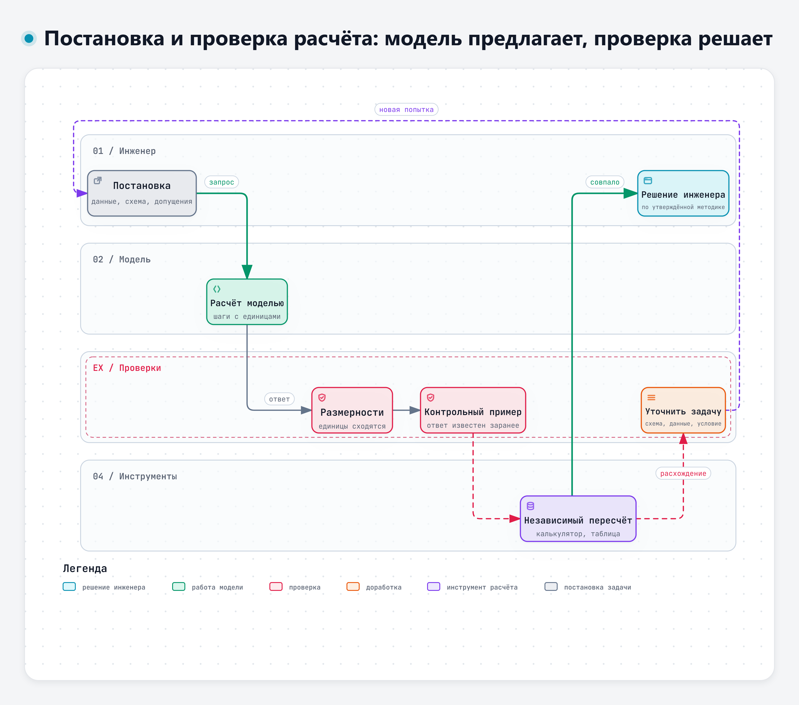
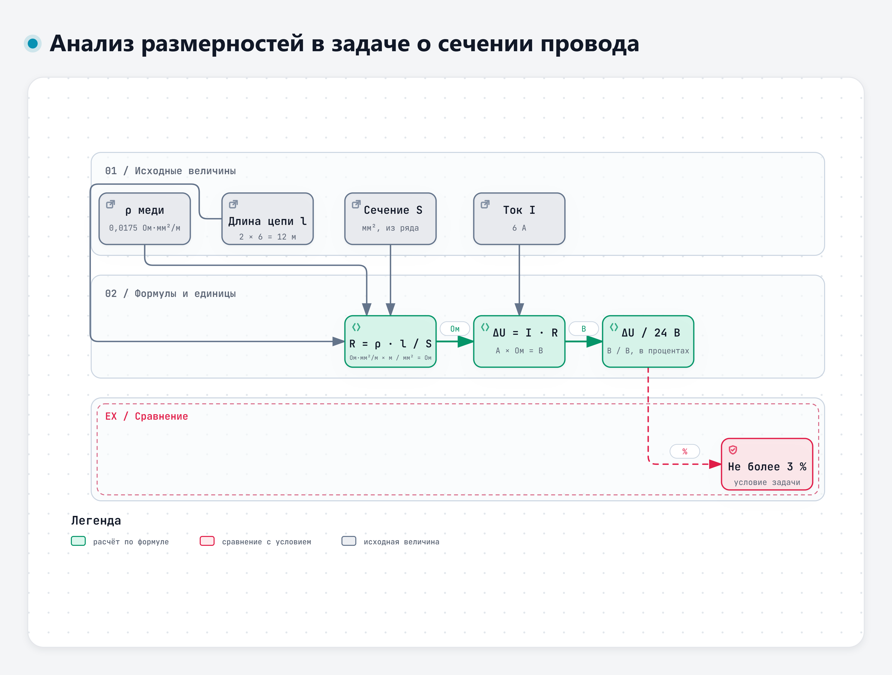

# Тема 4.1. Инженерные расчёты с помощью ИИ

Модель хорошо объясняет формулу и плохо считает по ней. Модели поручаем объяснение методики, выбор расчётной схемы, составление перечня допущений и черновика формулы для таблицы; арифметику оставляем калькулятору, таблице или утверждённой расчётной программе, окончательное решение – инженеру.

Сквозной пример лекции – цепь фар дальнего света учебного узла ЭС-24: какое сечение провода нужно, чтобы падение напряжения не превысило заданного. Условие – в дополнении к учебному кейсу, раздел 1.

## 1. Что модель делает хорошо

**Объясняет формулы и методики.** Спросите модель, откуда берётся формула падения напряжения в проводе, и она толково расскажет: сопротивление провода пропорционально длине и обратно пропорционально сечению, R = ρ · l / S, а падение напряжения по закону Ома равно ΔU = I · R. Расскажет, что ρ зависит от материала и температуры, что для двухпроводной цепи длина l – это прямой и обратный провод вместе. Для инженера, который давно не открывал учебник по электротехнике, это быстрый способ вспомнить методику.

**Помогает выбрать расчётную схему.** Провод можно считать по одной длине или по двум, ток – постоянным или с пусковым броском, температуру – нормальной или рабочей. Хороший запрос заставляет модель перечислить варианты схемы и сказать, какие данные нужны для каждого. В нашей задаче это вопрос, как возвращается ток: по отдельному проводу к точке массы у блока или через раму. Для второго варианта нужно сопротивление рамы и контактов, которого в условии нет, и правильный ответ модели – спросить о нём, а не подставить ноль.

**Перечисляет допущения и проверяет единицы.** Модель может выписать все величины с единицами и проверить, сходятся ли они в формуле. Это полезно, но и это нужно проверять: о том, как модели обращаются с единицами, – в разделе 4.

Работа 2026 года сравнила два способа решать инженерные уравнения: модель сама выдаёт число или модель составляет уравнение, а численное решение выполняет классический метод Ньютона. Во втором случае средняя относительная ошибка снизилась на 67,9–81,8 % в зависимости от модели [8]. Авторы делают вывод, который хорошо описывает всю тему.

> «These findings establish that contemporary LLMs excel at symbolic manipulation and domain knowledge retrieval but struggle with precision-critical iterative arithmetic, suggesting their optimal deployment as intelligent interfaces to classical numerical solvers rather than standalone computational engines.»
>
> Перевод: «Эти результаты показывают, что современные языковые модели хорошо выполняют символьные преобразования и находят сведения по предметной области, но испытывают трудности с итерационными арифметическими вычислениями, требующими точности. Поэтому их лучше применять как умный интерфейс к классическим численным методам, а не как самостоятельное вычислительное средство». – Kodathala, Vunnam, 2026, препринт arXiv [8]

## 2. Почему модель ошибается в вычислениях

Модель составляет текст, а не выполняет арифметику так, как калькулятор. Число в ответе – тоже текст, и иногда оно правдоподобно, но неверно. Исследования последних лет показывают несколько закономерностей, которые прямо касаются инженерных расчётов.

**Арифметика внутри задачи хуже, чем отдельно.** Модели хорошо решают голый пример «36 × 6», но ошибаются чаще, когда то же действие встроено в текст задачи.

> «Moreover, while models demonstrate high accuracy on standalone arithmetic tasks, their performance deteriorates substantially when computations are embedded within word problems.»
>
> Перевод: «Кроме того, хотя модели показывают высокую точность на отдельных арифметических примерах, их результаты заметно ухудшаются, когда вычисления встроены в текстовые задачи». – Shrestha, Kim, Ross, 2025, препринт arXiv [1]

Инженерная задача – всегда текстовая задача: в ней есть условие, единицы, оговорки. Значит, к ней этот вывод относится напрямую.

**Ошибки чаще в исполнении, чем в методе.** В проверке 2025 года пять сильных систем решали 500 практических расчётных задач из финансов, физики, медицины и статистики. Верных ответов – от 45 до 63 % [2]. Разбор ошибок показал, что модели чаще выбирают правильный путь решения, но ошибаются на последнем шаге.

> «[…] the majority of incorrect responses originated from calculation errors (33.4%) and precision or rounding issues (34.7%), indicating that even when models follow an appropriate reasoning path, they frequently fail in the final numerical execution or rounding stage.»
>
> Перевод: «[…] большинство неверных ответов возникло из-за ошибок вычисления (33,4 %) и ошибок точности или округления (34,7 %). Это говорит о том, что даже когда модель идёт правильным путём рассуждения, она часто ошибается на последнем этапе – при выполнении вычисления или округлении». – Herambourg и соавт., 2025, препринт arXiv [2]

В той же работе на неверный выбор метода или формулы пришлось 13,4 % ошибок, на неверное допущение – 11,8 %, на неверную подстановку параметров – 4,7 % [2]. Эти цифры получены на одном наборе задач для одного поколения моделей; считать их постоянными нельзя. Важен вывод: правильный ход решения не гарантирует правильного числа.

**Верный ответ бывает получен неверным путём.** Такую ошибку не видно по итоговому числу.

> «[…] all models exhibit errors in spatial reasoning, strategic planning, and arithmetic, sometimes producing correct answers through flawed logic.»
>
> Перевод: «[…] все модели допускают ошибки в пространственных рассуждениях, планировании решения и арифметике, иногда получая правильный ответ с помощью ошибочной логики». – Boye, Moëll, 2025, препринт arXiv [3]

Отсюда правило: проверять нужно шаги, а не только ответ. Если ответ совпал с ожидаемым, это ещё не значит, что метод верен и сработает на других числах.

**Инженерные задачи даются хуже общих.** Работа 2026 года сравнила ответы моделей на общие математические задачи и на инженерные: расчёт напряжений, выбор сечения, оптимизация при противоречивых ограничениях. На инженерных задачах результаты стабильно ниже, а среди типичных сбоев названы многошаговые численные расчёты [4]. Работа по оценке решений из курса анализа электрических цепей проверяла ответы по пяти признакам, среди которых отдельно – арифметические ошибки и единицы измерения [14]. Это хорошая подсказка и для нас: арифметику и единицы проверяют отдельно от метода.

**Подсказки в запросе помогают, но не спасают.** Исследователи проверяли, справится ли модель с расчётами из фармакокинетики – там много экспонент. Пошаговое рассуждение и разбиение задачи на части снизили число ошибок, но не убрали их [5].

**Модели различаются.** В проверке 2026 года три модели считали дозировки лекарств по 90 стандартным задачам. Две модели, в том числе DeepSeek, решили все задачи верно, у третьей верных ответов было 83,3 %, а на сложных задачах – 53,3 % [7]. Это не повод доверять «лучшей» модели: на других задачах порядок может быть другим. Авторы делают вывод, который годится и для инженерного расчёта.

> «All AI-assisted calculations should be independently verified by qualified clinicians, particularly for high-alert medications and complex dosing protocols, before clinical application.»
>
> Перевод: «Все расчёты, выполненные с помощью ИИ, должны независимо проверяться квалифицированными врачами до применения в лечении, особенно для препаратов повышенного риска и сложных схем дозирования». – Farajalla и соавт., 2026 [7]

Замените «врачей» на «инженеров», а «препараты повышенного риска» – на расчёты, от которых зависит безопасность, и получите правило нашего курса.

## 3. Постановка расчётной задачи

В первый день мы составляли карточку задачи: исходные данные, ожидаемый результат, критерии приёмки, ограничения. Для расчёта карточка становится подробнее. Чем точнее поставлена задача, тем меньше модели приходится додумывать, а всё, что она додумывает, – возможная ошибка.

| Что указать | Пример для цепи фар |
|---|---|
| Исходные данные с единицами | I = 6 А; L = 6 м; ρ = 0,0175 Ом·мм²/м; сеть 24 В |
| Расчётная схема | Двухпроводная цепь, длина провода l = 2L; возврат через раму не рассматривается |
| Допущения | Ток постоянный и не зависит от напряжения; температура провода 20 °C; сопротивление контактов не учитывается |
| Диапазоны и граничные условия | Ряд сечений 0,75–4,0 мм²; допустимое падение не более 3 % от 24 В; предохранитель не больше допустимого тока провода |
| Формат результата | Таблица шагов: величина – формула – подстановка с единицами – результат с единицами; отдельной строкой – все допущения |
| Что делать, если данных не хватает | Перечислить недостающие данные и не подставлять значения от себя |

Две строки из этой таблицы особенно полезны.

**Формат «подстановка с единицами».** Когда модель пишет не «S = 0,0175 × 12 × 6 / 0,72», а «S = 0,0175 Ом·мм²/м × 12 м × 6 А / 0,72 В», ошибку в единицах видно сразу. Кроме того, такую строку легко пересчитать на калькуляторе.

**Запрет додумывать.** Строка «если данных не хватает, перечисли их» работает так же, как в первый день с пунктами ТЗ: модель реже подставляет придуманное значение. Но реже не значит никогда, поэтому каждое число в ответе сверяется с условием.

Интерактивная версия схемы – файл `diagrams/d4-proverka-rascheta.html`.

## 4. Расчётная схема и единицы измерения

**Расчётная схема решает больше, чем арифметика.** Ошибка в схеме даёт неверный ответ при безупречных вычислениях. В нашей задаче типичная ловушка – посчитать провод по длине 6 м, забыв обратный провод. Тогда минимальное сечение получается 0,875 мм², выбирают 1,0 мм², а на деле падение напряжения будет 5,25 % при допустимых 3 %. Модель, которой не сказали прямо, как устроена цепь, может выбрать любую из схем. Поэтому схему задаёт инженер, а от модели требуется назвать, какую схему она приняла.

**Анализ размерностей – самая дешёвая проверка.** Подставьте в формулу единицы вместо чисел и посмотрите, что получится:

- R = ρ · l / S: (Ом·мм²/м) × м / мм² = Ом. Сходится;
- ΔU = I · R: А × Ом = В. Сходится;
- S_min = ρ · l · I / ΔU: (Ом·мм²/м) × м × А / В = Ом·мм²·А / В = мм², потому что Ом × А = В. Сходится.

Если в ответе модели сопротивление цепи записано в «Ом/м», а сечение получилось в «мм²/А», значит, где-то перепутана формула или подстановка. Отдельная ловушка – смешение кратных единиц: ρ меди в Ом·м (около 1,7 · 10⁻⁸) с сечением в мм² даёт ошибку в миллион раз. Такая ошибка заметна по порядку величины: сечение провода фар не бывает ни микроскопическим, ни в квадратный метр.

Интерактивная версия схемы – файл `diagrams/d4-razmernosti.html`.

**Модели обращаются с единицами по признакам, а не через пересчёт.** Исследование 2026 года проверяло, как модели сравнивают величины с разными единицами, например 110 см и 1,2 м. Точность падает, когда значения близки, а сами ошибки систематические [13].

> «The results suggest that LMs compare quantities through a bag of heuristics over numerals and units, rather than first converting both expressions to an exact shared-scale representation.»
>
> Перевод: «Результаты показывают, что языковые модели сравнивают величины с помощью набора эвристик по числам и единицам, а не переводят сначала оба выражения в точное представление в одних единицах». – Sasaki и соавт., 2026, препринт arXiv [13]

Для инженера вывод простой. Если в задаче есть миллиамперы и амперы, сутки и часы, миллиметры и метры, попросите модель сначала перевести всё в одни единицы и показать этот перевод отдельной строкой. Затем проверьте перевод сами.

**Справочное значение – тоже допущение.** Удельное сопротивление отожжённой меди по международному стандарту при 20 °C – 0,017241 Ом·мм²/м, температурный коэффициент сопротивления – 0,00393 на градус [30]. В учебной задаче принято округлённое 0,0175. Это близко к стандартному значению: разница 1,5 %, что соответствует нагреву провода всего на 4 °C. Если провод в жгуте под капотом нагревается сильнее, удельное сопротивление растёт, и это нужно учитывать отдельно. Тот же справочник напоминает, чем таблица отличается от измерения.

> «When accuracy is important, the electrical engineer does not consult the wire table, but makes actual measurements of samples of the copper used.»
>
> Перевод: «Когда важна точность, инженер-электрик не обращается к таблице проводов, а измеряет образцы той меди, которая используется». – Copper wire tables, NBS Handbook 100, 1966 [30]

Для значения, которое модель «вспомнила», тоже нужно найти и открыть источник.

## 5. Контроль: как проверять расчёт модели

Проверка расчёта складывается из нескольких независимых приёмов. Каждый ловит свой вид ошибки, поэтому одного обычно мало.

**Контрольный пример.** Перед тем как доверить модели или формуле свою задачу, дайте им задачу с заранее известным ответом. Для нашей формулы годится пример, который считается в уме: ток 10 А, длина цепи 10 м, сечение 1 мм², ρ = 0,0175. Сопротивление – 0,175 Ом, падение – 1,75 В. Если формула или модель дают другое число, дальше можно не смотреть. Удачный контрольный пример у вас уже есть – это любая прошлая задача, решение которой проверено.

В разработке программ для того же служат тесты. В. Филатов на вебинаре по проверке кода, написанного с ИИ, привёл слова Э. Дейкстры: «Тестирование может показать наличие дефектов в программе, но не доказать их отсутствие» [36]. С контрольным примером так же: совпадение на одном примере не доказывает, что расчёт верен всегда, а расхождение сразу показывает ошибку.

**Независимый пересчёт.** Повторите расчёт другим способом и другим инструментом: калькулятором, в электронной таблице, в утверждённой расчётной программе вашей организации, вручную. «Независимый» – значит, не той же моделью и не в том же чате. Просьба «проверь себя» к модели – это не независимая проверка.

> «In the context of reasoning, our research indicates that LLMs struggle to self-correct their responses without external feedback, and at times, their performance even degrades after self-correction.»
>
> Перевод: «В задачах на рассуждение наше исследование показывает, что языковые модели с трудом исправляют свои ответы без внешней обратной связи, а иногда после самоисправления их результаты даже ухудшаются». – Huang и соавт., ICLR 2024 [11]

Обзор 2024 года пришёл к тому же выводу: модели хорошо исправляют собственные ошибки при наличии надёжной внешней обратной связи, например результата вычисления или проверки [12]. Для нас такой обратной связью служат калькулятор, таблица и контрольный пример.

**Анализ размерностей** – см. раздел 4. Он ловит ошибки в формуле и в подстановке единиц, но не ловит арифметику: 1,26 / 0,72 = 1,57 мм² по единицам выглядит безупречно.

**Порядок величины и граничные случаи.** Прикиньте ответ и проверьте его обратным умножением: 0,72 × 2 = 1,44 больше 1,26, значит, частное меньше 2; 0,72 × 1,7 = 1,224 меньше 1,26, значит, частное больше 1,7. Ответ 1,57 в эти границы не попадает: 0,72 × 1,57 ≈ 1,13, а не 1,26. Проверьте предельные случаи: если длину удвоить, падение напряжения должно удвоиться; если сечение увеличить, падение должно уменьшиться. Формула, которая ведёт себя иначе, неверна.

**Сверка каждого числа с условием.** Модель может подставить «похожее» значение из контекста. В нашем учебном ответе модель посчитала проценты от 28,2 В – это напряжение регулятора из п. 4.2 ТЗ (редакция 1), к задаче о проводах оно не относится. В условии сказано «3 % от 24 В». Такую ошибку не поймают ни размерности, ни порядок величины, только сверка.

**Почему проверять каждый шаг.** Ошибки в расчёте могут маскировать друг друга. В учебном ответе модели, который мы разберём на практике, арифметическая ошибка дала 1,57 мм², «почти» совпавшие с 1,5 мм², а подстановка 28,2 В вместо 24 В спрятала то, что 1,5 мм² условию не удовлетворяет. Ответ получился гладким и согласованным, хотя неверен в главном.

## 6. Пусть считает инструмент

Модель составляет выражение или пишет код; вычисления выполняет программа. Исследователи проверили эту идею ещё в 2022 году: тогда вышел препринт, а в 2023 году работа опубликована в материалах конференции ICML.

> «While LLMs seem to be adept at this sort of step-by-step decomposition, LLMs often make logical and arithmetic mistakes in the solution part, even when the problem is decomposed correctly.»
>
> Перевод: «Хотя языковые модели, похоже, хорошо разбивают задачу на шаги, при решении они часто допускают логические и арифметические ошибки, даже если разбиение выполнено правильно». – Gao и соавт., ICML 2023 [9]

Когда модель писала программу, а вычисление выполнял интерпретатор Python, точность на наборах математических задач была выше, чем у гораздо более крупных моделей, которые считали сами [9]. Близкий подход «программа вместо рассуждения» дал прирост в среднем около 12 % по сравнению с пошаговым рассуждением [10]. В медицине модели с доступом к специальным калькуляторам ошибались в 5,5 и 13 раз реже, чем без них [6].

Что это значит на практике:

- в некоторых чат-сервисах есть режим, в котором модель пишет и выполняет код. Есть ли он в сервисе, который разрешён вам, и как он называется, проверим на практике. Если модель показывает код и результат его выполнения, проверять нужно и код, и то, что он считает именно вашу задачу;
- если такого режима нет, тот же принцип вы реализуете сами: модель даёт формулу, вы считаете по ней в калькуляторе или в таблице;
- во многих организациях есть утверждённые расчётные программы и методики. Модель может помочь понять методику и подготовить исходные данные, но сам расчёт нужно выполнять по утверждённой методике в принятой программе.

А. Цымлов на вебинаре по разработке с ИИ сформулировал этот принцип одной строкой: «Вероятностный генератор + детерминированные проверки = надёжная система» [35]. Модель – вероятностный генератор: она предлагает. Калькулятор, таблица и контрольный пример – детерминированные проверки: они дают один и тот же результат при тех же данных. Близкую позицию высказал С. Скидан на отраслевом ИИ-митапе (ноябрь 2026): в его докладе утверждается, что языковая модель, регулярные выражения и правила работают лучше вместе, чем по отдельности [34].

## 7. Подсказка ИИ не заменяет утверждённый расчёт

Расчёт, на основании которого принимается решение о конструкции, оформляется по утверждённой в организации методике, выполняется в принятых инструментах и проверяется в установленном порядке. Ответ модели в этот порядок не встраивается сам по себе. Он может стать черновиком, подсказкой, вторым мнением или способом быстро найти ошибку в своём расчёте, но ответственность остаётся на инженере, который подписывает документ.

Опасность в том, что гладкий ответ с формулами и таблицей выглядит как готовый расчёт. Склонность принимать предложение автоматической системы без достаточной проверки называют предвзятостью автоматизации. Систематический обзор 40 исследований показал, что она проявляется не только при многозадачности, но и в отдельных задачах с высокой сложностью проверки [17].

Обзор 2025 года, посвящённый современным системам ИИ, приходит к выводу, что объяснения в ответе системы сами по себе предвзятость не снимают, а помогает активная самостоятельная проверка [18].

Есть и обратная сторона. К. Овчинников на отраслевом ИИ-митапе (ноябрь 2026) показал на слайде парадокс надзора: «Проверить агента может только тот, кто умеет сам. А новичок сразу попадает в роль эксперта: проверяет код за ИИ, не успев накопить свой опыт» [32]. Для расчётов это значит: проверить расчёт модели может тот, кто умеет считать сам. Поэтому методику и порядок величин инженер должен знать без модели.

## 8. Формулы для электронных таблиц

Если на рабочем месте есть табличный редактор (Excel, Р7-Офис, LibreOffice), модель может написать формулы для расчёта, который вы делаете регулярно. Проверенную формулу используют для повторных расчётов в пределах проверенных условий. Вычисления выполняет табличный редактор; правильность формулы, входных данных и ссылок на ячейки проверяет инженер.

Как просить формулу:

1. Опишите расположение данных: в каком столбце какая величина, с какой строки начинаются данные, какие единицы.
2. Укажите редактор и язык интерфейса: от этого зависят названия функций и разделитель аргументов. В русском интерфейсе Excel функция условия называется ЕСЛИ, а аргументы разделяются точкой с запятой [31]. В других редакторах проверьте по справке.
3. Попросите формулу для каждой ячейки отдельно и пояснение, что она считает.
4. Дайте контрольные значения или попросите модель предложить пример, который вы пересчитаете в уме.

Как проверять:

- введите контрольную строку и сравните результат с ожидаемым;
- измените одно исходное значение и посмотрите, меняется ли результат так, как должен (удвоили длину – удвоилось падение);
- проверьте ссылки на ячейки: формула, скопированная вниз, должна ссылаться на свою строку, а постоянные величины – на одну и ту же ячейку;
- проверьте граничные случаи: пустая ячейка, ноль, отрицательное значение.

Исследования формул, которые модели пишут для таблиц, дают знакомую картину. На простых задачах формулы верны, а когда сведений мало или задача сложна, точность падает [15].

> «Our findings reveal that while LLMs exhibit proficiency in straightforward tasks, they often falter in complex, multi step operations, frequently producing plausible yet incorrect outputs.»
>
> Перевод: «Наши результаты показывают, что языковые модели уверенно справляются с простыми задачами, но часто сбиваются на сложных многошаговых операциях и нередко выдают правдоподобные, но неверные результаты». – Thorne, 2025, препринт arXiv [16]

Готовая раскладка формул для задачи о проводе и контрольные значения – в дополнении к кейсу, раздел 3.

## Что запомнить

- Модели – объяснение формул, выбор схемы, перечень допущений, черновик формулы. Арифметика и итог – калькулятору, таблице, утверждённой программе.
- Расчётную задачу ставят полностью: данные с единицами, схема, допущения, диапазоны, формат «подстановка с единицами», запрет додумывать.
- Проверка – контрольный пример, независимый пересчёт другим инструментом, анализ размерностей, порядок величины, сверка каждого числа с условием.
- «Проверь себя» той же модели – не проверка.
- Ответ модели не заменяет утверждённый инженерный расчёт. Подпись под расчётом ставит инженер.

## Источники

Нумерация общая для всех материалов четвёртого дня.

**Научные публикации**

- [1] Shrestha S., Kim M., Ross K. W. Mathematical Reasoning in Large Language Models: Assessing Logical and Arithmetic Errors across Wide Numerical Ranges. 2025. Препринт arXiv. https://doi.org/10.48550/arXiv.2502.08680
- [2] Herambourg C., Siuda D., et al. The ORCA Benchmark: Evaluating Real-World Calculation Accuracy in Large Language Models. 2025. Препринт arXiv. https://doi.org/10.48550/arXiv.2511.02589
- [3] Boye J., Moëll B. Large Language Models and Mathematical Reasoning Failures. 2025. Препринт arXiv. https://doi.org/10.48550/arXiv.2502.11574
- [4] Mysior M., Iniotakis C. Evaluating large language models on text-based engineering design tasks: performance gaps and failure modes // Research in Engineering Design. 2026. https://doi.org/10.1007/s00163-026-00504-1
- [5] Shin E., Ramanathan M. Evaluation of prompt engineering strategies for pharmacokinetic data analysis with the ChatGPT large language model // Journal of Pharmacokinetics and Pharmacodynamics. 2024. Vol. 51, No. 2. P. 101–108. https://doi.org/10.1007/s10928-023-09892-6
- [6] Goodell A. J., Chu S. N., et al. Large language model agents can use tools to perform clinical calculations // npj Digital Medicine. 2025. Vol. 8. Art. 163. https://doi.org/10.1038/s41746-025-01475-8
- [7] Farajalla F., Rasras M., et al. Accuracy and hallucinations in AI-generated medication dosing calculations: a sequential explanatory mixed-methods evaluation // Scientific Reports. 2026. https://doi.org/10.1038/s41598-026-69321-9
- [8] Kodathala S. V., Vunnam R. Can Large Language Models Solve Engineering Equations? A Systematic Comparison of Direct Prediction and Solver-Assisted Approaches. 2026. Препринт arXiv. https://doi.org/10.48550/arXiv.2601.01774
- [9] Gao L., Madaan A., et al. PAL: Program-aided Language Models // Proceedings of the 40th International Conference on Machine Learning (ICML 2023). PMLR. 2023. Vol. 202. P. 10764–10799. https://proceedings.mlr.press/v202/gao23f.html (препринт arXiv 2022: https://doi.org/10.48550/arXiv.2211.10435)
- [10] Chen W., Ma X., et al. Program of Thoughts Prompting: Disentangling Computation from Reasoning for Numerical Reasoning Tasks // Transactions on Machine Learning Research. 2023. Препринт arXiv 2022: https://doi.org/10.48550/arXiv.2211.12588 (сведения о публикации в TMLR – на странице https://arxiv.org/abs/2211.12588)
- [11] Huang J., Chen X., et al. Large Language Models Cannot Self-Correct Reasoning Yet // International Conference on Learning Representations (ICLR 2024). 2024. P. 32808–32824. https://proceedings.iclr.cc/paper_files/paper/2024/hash/8b4add8b0aa8749d80a34ca5d941c355-Abstract-Conference.html (препринт arXiv 2023: https://doi.org/10.48550/arXiv.2310.01798)
- [12] Kamoi R., Zhang Y., et al. When Can LLMs Actually Correct Their Own Mistakes? A Critical Survey of Self-Correction of LLMs // Transactions of the Association for Computational Linguistics. 2024. Vol. 12. P. 1417–1440. https://doi.org/10.1162/tacl_a_00713
- [13] Sasaki M., Kamoda G., et al. Language Models Compare Quantities Using Number-specific and Unit-specific Heuristics. 2026. Препринт arXiv. https://doi.org/10.48550/arXiv.2606.03982
- [14] Chen L., Qin Z., et al. Benchmarking Large Language Models on Homework Assessment in Circuit Analysis // International Journal of Artificial Intelligence in Education. 2025. Vol. 35, No. 5. P. 3294–3355. https://doi.org/10.1007/s40593-025-00501-w
- [15] Thorne S. Experimenting with ChatGPT for Spreadsheet Formula Generation: Evidence of Risk in AI Generated Spreadsheets. 2023. Препринт arXiv. https://doi.org/10.48550/arXiv.2309.00095
- [16] Thorne S. Large Language Models for Spreadsheets: Benchmarking Progress and Evaluating Performance with FLARE. 2025. Препринт arXiv. https://doi.org/10.48550/arXiv.2506.17330
- [17] Lyell D., Coiera E. Automation bias and verification complexity: a systematic review // Journal of the American Medical Informatics Association. 2017. Vol. 24, No. 2. P. 423–431. https://doi.org/10.1093/jamia/ocw105
- [18] Romeo G., Conti D. Exploring automation bias in human–AI collaboration: a review and implications for explainable AI // AI & SOCIETY. 2025. https://doi.org/10.1007/s00146-025-02422-7

**Нормативные и официальные документы**

- [30] Copper wire tables. National Bureau of Standards Handbook 100. Washington, 1966. https://doi.org/10.6028/NBS.HB.100 (PDF: https://nvlpubs.nist.gov/nistpubs/Legacy/hb/nbshandbook100.pdf)
- [31] Справка Microsoft Excel. Функция ЕСЛИ. https://support.microsoft.com/ru-ru/office/функция-если-69aed7c9-4e8a-4755-a9bc-aa8bbff73be2

**Выступления и вебинары**

- [32] Овчинников К. «Инженер после AI». Доклад на ИИ-митапе ЦГУ, 06.11.2026 (презентация доклада).
- [34] Скидан С. «Как создать Агента-оператора». Доклад на ИИ-митапе ЦГУ, 06.11.2026 (презентация доклада).
- [35] Цымлов А. Доклад на вебинаре 3 по ИИ УЦ «МАСКОМ» и PVS-Studio, 28.08.2026 (слайды «slajdy-2026-08-28»).
- [36] Филатов В. «Искусственный автор, привычный контроль». Доклад на вебинаре 3 по ИИ УЦ «МАСКОМ» и PVS-Studio, 28.08.2026 (презентация доклада).

**Учебные материалы**

Учебный кейс ЭС-24 и дополнение к нему составлены для курса. Узел условный, значения подобраны для упражнений.

Полный список источников дня – в файле «Источники» в папке дня.

---

<!-- author-block -->
**Автор курса**

Виталий Пиков

- Архитектор информационной безопасности
• РБПО • DevSecOps • AppSec
- Лектор и автор образовательных программ по ИБ и РБПО

Телефон: +7 (963) 782-92-78 ·
E-mail: vitaly@pikov.expert ·
Сайт: https://pikov.expert ·
Telegram: @UnderLineSecurity
