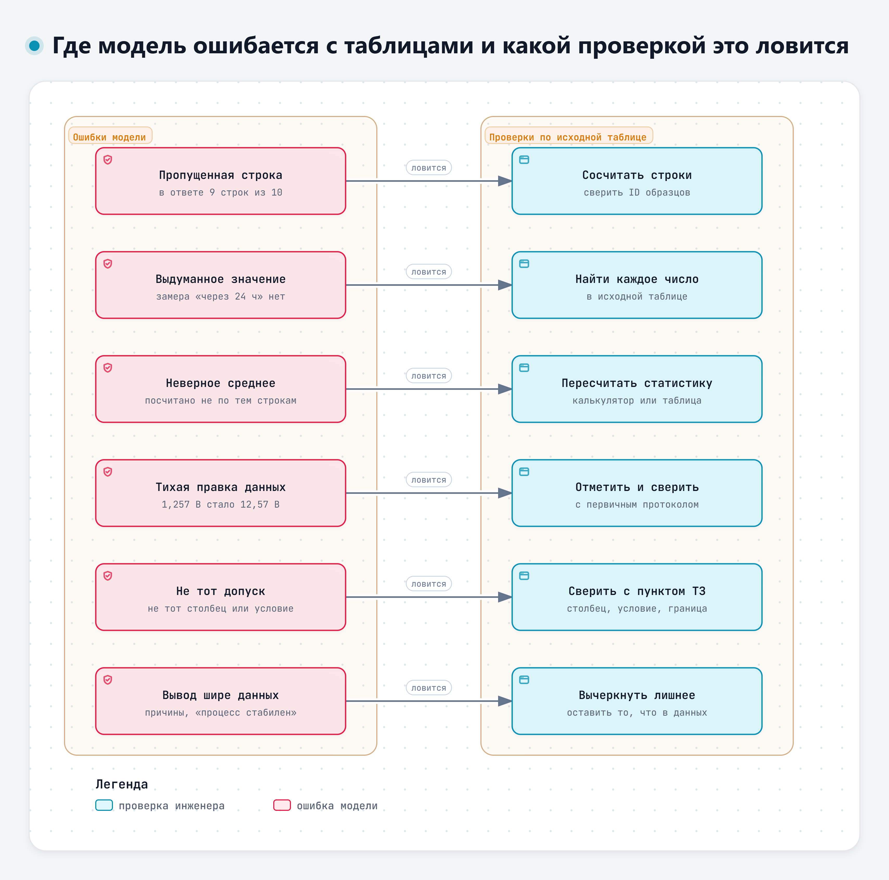
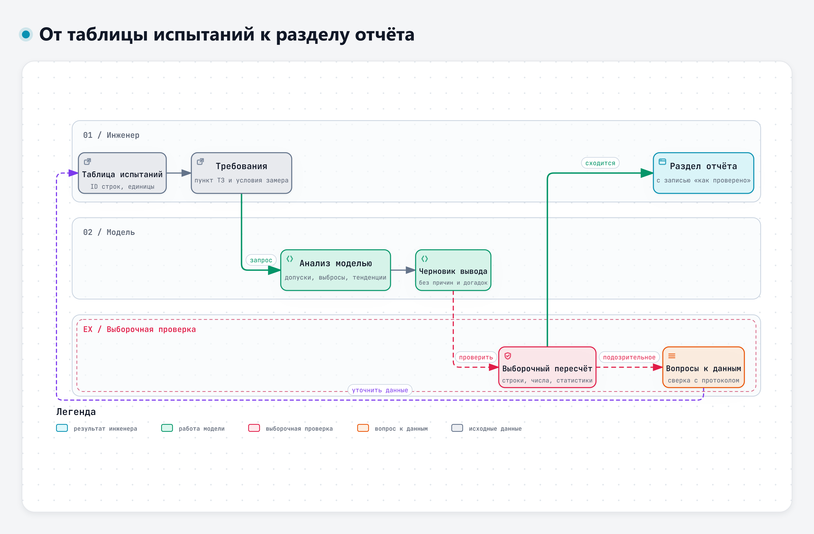

# Тема 4.2. Анализ результатов испытаний и измерений

Таблица результатов испытаний – удобный материал для модели. Она быстро опишет данные, найдёт значения за допуском, сравнит серии, предложит график и напишет черновик вывода. И в той же таблице она может пропустить строку, придумать значение, которого нет, посчитать среднее не по тем данным и молча «поправить» подозрительное число. Разберём, как использовать модель при анализе таблицы и проверять её ответ перед включением в отчёт.

Сквозной пример – учебная таблица испытаний 1 из дополнения к кейсу: ток покоя и напряжение батарей на десяти образцах узла ЭС-24.

## 1. Как передать модели таблицу

**Правило данных остаётся прежним.** Учебные таблицы используем в сервисах, выбранных для занятия с учётом правил доступа. Реальные результаты испытаний – только в сервис, который соответствует уровню данных по правилам вашей организации: об этом подробно говорили в теме 2.1. Если такого сервиса нет, отрабатывайте приёмы на учебных таблицах, а со своими данными работайте в разрешённых инструментах.

**Вставка текстом – основной способ.** Таблицу из редактора можно скопировать и вставить в окно чата. Надёжнее всего формат, где каждая строка – отдельная строка текста, а столбцы разделены одним и тем же знаком, например точкой с запятой. В дополнении к кейсу таблицы даны и в таком виде. Несколько правил:

- в заголовке каждого столбца – величина и единица: «Ток через 30 мин, мА», а не «I1»;
- у каждой строки – свой идентификатор образца. По нему потом проверяется, не пропала ли строка;
- отдельной строкой перед таблицей – условия испытаний и применимые требования с номерами пунктов;
- десятичный знак один на всю таблицу.

**Паспорт таблицы.** В больших компаниях условия передачи данных между командами записывают в «дата-контракт»: что за объект, его структура, владелец, кто разбирает сбои, как часто обновляется. Н. Галимова («Билайн») на онлайн-конференции форума All-over-IP в ноябре 2026 года объясняла, зачем это нужно, когда данные начинают читать агенты: «дата контракт не гарантирует правильность решения агента, но он снижает риски на стороне данных» [39]. Для таблицы испытаний хватит короткого паспорта в несколько строк над таблицей: чья таблица и какая версия, что в каждом столбце и в каких единицах, когда обновлялась, к кому идти с вопросом. Модели он даёт контекст, а вам – уверенность, что разбирается нужная версия.

**Загрузка файла – если сервис её поддерживает.** По справке GigaChat анализирует прикреплённые файлы DOCX, PDF и TXT [37]. Алиса AI принимает в одном сообщении один файл DOC, DOCX, PDF или TXT до 100 МБ [38]. Форматы электронных таблиц (XLSX, CSV) в этих разделах справки не названы, поэтому таблицу из редактора надёжнее вставить текстом или сохранить в TXT. Как поведёт себя сервис с файлом таблицы на деле, проверим на практике.

**Ограничения по объёму.** В GigaChat допустимый объём запроса – 4000 символов, а для более длинного текста справка советует перенести его в файл TXT или PDF; ответ сервиса тоже ограничен примерно 4000 символами [37]. Учебная таблица 1 вместе с запросом укладывается в этот предел. Таблица из сотен строк – уже нет, и дело не только в лимите: в длинном тексте модель хуже использует то, что находится в середине.

> «In particular, we observe that performance is often highest when relevant information occurs at the beginning or end of the input context, and significantly degrades when models must access relevant information in the middle of long contexts, even for explicitly long-context models.»
>
> Перевод: «В частности, мы наблюдаем, что модели обычно работают лучше всего, когда нужные сведения находятся в начале или конце входного текста; если сведения находятся в середине длинного текста, результаты заметно ухудшаются, даже у моделей, специально рассчитанных на длинный контекст». – Liu и соавт., 2024 [21]

Исследование проводилось на ответах по набору документов и на поиске значения по ключу, а не на инженерных таблицах. Но оно указывает на риск: сведения из середины длинного ввода модель может использовать хуже. Поэтому полноту обработки таблицы проверяют по идентификаторам строк. Большую таблицу разбивают на части с сохранением идентификаторов или считают статистику в табличном редакторе, а модели дают уже итоги.

**Форма подачи влияет на результат.** Исследования показывают, что ответы моделей по таблицам зависят от формата ввода, порядка содержимого и разметки [19], а одна и та же таблица в другой раскладке может дать заметно худший результат [20].

> «We discover that structural variance of tables presenting the same content reveals a notable performance decline, particularly in symbolic reasoning tasks.»
>
> Перевод: «Мы обнаружили, что при изменении структуры таблиц с тем же содержанием результаты заметно ухудшаются, особенно в задачах с символьными рассуждениями». – Liu, Wang, Chen, NAACL 2024 [20]

Практический вывод: одна строка – один образец, один столбец – одна величина, без объединённых ячеек и многоэтажных заголовков.

## 2. Что может модель

**Описать данные.** Сколько образцов, какие величины, в каких пределах, есть ли пропуски. Это быстрый способ увидеть таблицу целиком, особенно чужую.

**Найти отклонения от допусков.** Если в запросе указан пункт требований, к какому столбцу он относится и при каких условиях измерения, модель отметит строки за допуском. Здесь стоит проверить, к тому ли столбцу и к тем ли условиям модель применила допуск. В таблице 1 требование 40 мА (п. 4.3 ТЗ, редакция 1) относится к замеру через 30 мин, а для замера через 2 ч требований в ТЗ нет.

**Найти выбросы.** Модели умеют замечать значения, которые выбиваются из ряда. В исследовании 2024 года модели без дополнительного обучения находили выбросы в наборах табличных данных [27].

> «That is, without extra distribution-specific model fitting, they can discover hidden outliers in a batch of data, demonstrating their ability to identify low-density data regions.»
>
> Перевод: «Иными словами, без дополнительной подгонки под конкретное распределение они могут находить скрытые выбросы в наборе данных, что показывает их способность выделять области с низкой плотностью данных». – Li и соавт., 2024, препринт arXiv [27]

Но не всякие. Проверка на временных рядах показала, что модели замечают явные аномалии, а тонкие – не обязательно [28].

> «Our results suggest that while LLMs can understand trivial time series anomalies, we have no evidence that they can understand more subtle real-world anomalies.»
>
> Перевод: «Наши результаты говорят о том, что языковые модели способны распознавать простые аномалии во временных рядах, но у нас нет данных о том, что они распознают более тонкие аномалии реальных данных». – Zhou, Yu, 2024, препринт arXiv [28]

В таблице 1 два выброса разного рода. О-07 выделяется по всем величинам и при этом выходит за допуски: образец не соответствует требованиям, и нужно выяснить причину несоответствия. О-05, батарея № 2: записано 1,257 В при остальных значениях около 12,5 В – скорее всего, потерян знак при записи. Модель должна отметить оба случая и объяснить разницу, а решение о том, что делать с каждым, принимает инженер.

**Сравнить серии и найти тенденции.** Ток через 2 ч у всех образцов ниже, чем через 30 мин; в таблице 2 при +25 °C напряжение регулятора ниже, чем при −25 °C, у всех восьми генераторов. Такие закономерности модель называет быстро. Объяснять их причины по одной таблице модель не может: это гипотезы, которые проверяются отдельно. А по ячейке с подозрительным значением тенденцию не оценивают, пока значение не сверено с протоколом.

**Предложить вид графика.** Для таблицы 1 – точечный график по образцам с линией допуска; для таблицы 2 – линии «напряжение от температуры» для каждого генератора с отметкой допуска при +25 °C. Модель также может написать формулы для построения графика в табличном редакторе.

**Сформулировать черновик вывода.** Черновик вывода полезен, но из-за гладкого изложения его легко принять целиком. О том, как его проверять, – в разделе 4.

**А считает ли модель?** Здесь данные исследований не так однозначны, как кажется. В проверке 2025 года ChatGPT на модели GPT-4 с выполнением кода на Python считал средние, стандартные отклонения, медианы и межквартильный размах по медицинскому набору данных. Верным авторы засчитывали значение, которое отклоняется от контрольного не больше чем на 1 %; контрольные значения посчитаны в Python, SAS и R. По описательной статистике этому критерию удовлетворили все попытки [25]. Это результат одного исследования и одной модели, а не свойство любого сервиса с выполнением кода.

> «For descriptive statistics, it provided accurate means, SDs, medians, and IQRs across all trials.»
>
> Перевод: «При расчёте описательной статистики он во всех попытках получил точные средние, стандартные отклонения, медианы и межквартильные размахи». – Ruta и соавт., 2025 [25]

Со статистическими критериями было иначе: доля попыток, где статистика критерия и p-значение уложились в тот же 1 %, зависела от подробности запроса – 32,5 % при простом запросе, 81,3 % при более подробном и 92,5 % при самом подробном. Авторы предупреждают, что без контроля человека обойтись нельзя [25].

> «However, its application requires careful prompt construction and human oversight to ensure accuracy.»
>
> Перевод: «Однако для точных результатов нужны тщательно составленный запрос и контроль человека». – Ruta и соавт., 2025 [25]

Другая проверка 2025 года была посвящена собственным числовым навыкам моделей и показала слабые места в базовой арифметике, поиске чисел в тексте и сравнении величин [24].

> «However, their performance on numerical reasoning tasks, such as basic arithmetic, numerical retrieval, and magnitude comparison, remains surprisingly poor.»
>
> Перевод: «Однако их результаты в задачах с числами, таких как простая арифметика, поиск чисел и сравнение величин, остаются на удивление слабыми». – Li и соавт., Findings of ACL 2025 [24]

Итог для практики: выполняет ли сервис вычисления кодом или пишет числа как текст, по ответу не всегда видно, а проверок именно наших сервисов на таблицах испытаний в открытых источниках не найдено. Поэтому любые числа, которые пойдут в отчёт, пересчитываются по исходной таблице.

## 3. Где модель ошибается с таблицами

Ниже – виды ошибок, которые стоит искать при разборе таблиц. Пять из них заложены в учебный ответ модели по таблице 1, который мы разберём на практике, шестой – «не тот допуск» – ждёт в таблице 2 домашнего задания.

**Пропущенная строка.** Модель пишет «проанализировано 10 образцов», а в её таблице девять. Пропущенной может оказаться как раз строка с отклонением, и тогда вывод о соответствии ложный. В учебном ответе пропал О-04 с током 41,6 мА.

**Выдуманное значение.** Модель добавляет величину, которой в таблице нет: замер «через 24 ч», температуру, время перехода блоков в спящий режим. Обычно такие значения правдоподобны и хорошо встраиваются в текст.

**Неверное среднее и отклонение.** Среднее посчитано не по всем строкам, с ошибкой в арифметике или по другому определению. В таблице 1 среднее по всем десяти образцам – 40,37 мА, без О-07 – 35,44 мА, без О-04 и О-07 – 34,68 мА. Все три числа «правильные», но для разных наборов строк, и в отчёте должно быть сказано, по какому набору считали. Стандартное отклонение бывает выборочным (деление на n − 1) и по генеральной совокупности (деление на n); в Excel это разные функции, СТАНДОТКЛОН.В и СТАНДОТКЛОН.Г [31]. Если число модели не совпало с вашим, сначала выясните, какое отклонение она считала. По смыслу стандартное отклонение показывает, насколько в среднем значения отходят от среднего: чем оно больше, тем сильнее разброс. Межквартильный размах – ширина средней половины ряда, от первого квартиля до третьего; на него, как и на медиану, один выброс почти не влияет.

**Тихая правка данных.** Модель «исправляет» подозрительное значение без пометки: 1,257 В превращается в 12,57 В. Возможно, исправление верное, но это решение инженера, а не модели. В отчёте такое значение помечается и сверяется с первичным протоколом.

**Не тот допуск.** Требование, заданное для одних условий, применено к другим: допуск напряжения регулятора при +25 °C – ко всем температурам, допуск тока покоя через 30 мин – к замеру через 2 ч.

**Вывод шире данных.** «Процесс стабилен», «причина – переход блоков в спящий режим», «рекомендуется исключить образец из выборки». Эти выводы не следуют из таблицы.

Исследования подтверждают, что таблицы – трудный материал для моделей, особенно неполные и «грязные».

> «For instance, applications such as business intelligence demand not only multi-step numerical reasoning with tables but also robustness to incomplete or inconsistent information.»
>
> Перевод: «Например, такие применения, как бизнес-аналитика, требуют не только многошаговых вычислений по таблицам, но и устойчивости к неполным или противоречивым данным». – Tian и соавт., 2026 [22]

Среди выводов той же работы: таблицы низкого качества создают серьёзный риск для надёжности рассуждений современных моделей [22]. В другой работе причинами слабых результатов на сложных табличных задачах названы сложные вопросы, зашумлённые данные и ограниченные вычислительные способности моделей; авторы предлагают сначала чистить таблицу, а вычисления выполнять кодом [29].

> «Complex reasoning over tabular data is crucial in real-world data analysis, yet large language models (LLMs) often underperform due to complex queries, noisy data, and limited numerical capabilities.»
>
> Перевод: «Сложные рассуждения по таблицам необходимы при анализе данных на практике, однако языковые модели часто справляются с ними плохо из-за сложных запросов, зашумлённых данных и ограниченных вычислительных способностей». – Jiang и соавт., 2025 [29]

На наборе задач по таблицам из промышленных сценариев даже сильнейшая из проверенных моделей заметно уступала людям [23]. А в проверке ответов на статистические вопросы модель не упоминала условия применимости статистических методов [26].

> «Assumptions necessary for the application of specific statistical tests were not included.»
>
> Перевод: «Допущения, необходимые для применения конкретных статистических критериев, не были указаны». – Ordak, 2023 [26]

Для испытаний это значит: если модель предлагает статистический критерий или говорит о «значимом» различии серий, спросите, какие условия у этого критерия и выполняются ли они на ваших данных. По десяти образцам с одним сильным выбросом многие привычные критерии применять нельзя без оговорок.

Интерактивная версия схемы – файл `diagrams/d4-oshibki-tablic.html`.

## 4. Проверка выводов по исходной таблице

Пересчитывать всё заново не нужно, иначе модель не сэкономит время. Достаточно выборочной проверки, которая устроена так, чтобы поймать каждый вид ошибки из раздела 3.

1. **Число строк и идентификаторы.** Сосчитайте строки в ответе модели и сравните со своей таблицей. Проверьте, что каждый идентификатор образца на месте. Это ловит пропуски.
2. **Каждое число из вывода – в таблице.** Пройдите по тексту вывода и для каждого числа найдите, откуда оно. Если числа в таблице нет и оно не вычислено из неё, это выдумка. Так ловятся «58 мА через 24 ч» и «90 мин».
3. **Пересчёт двух-трёх статистик.** Среднее, наибольшее и наименьшее значение, число значений за допуском – в табличном редакторе или на калькуляторе. В Excel: СРЗНАЧ для среднего, СЧЁТЕСЛИ для числа значений за допуском, например `=СЧЁТЕСЛИ(B2:B11;">40")` [31]. Ловит неверные средние и подсчёты.
4. **Каждое «вне допуска» и каждое «соответствует».** Сверьте с пунктом требований: тот ли столбец, те ли условия, та ли граница, строгое ли неравенство. Ловит неверный допуск.
5. **Подозрительные значения.** Найдите в исходной таблице значения, которые сильно отличаются от соседних, и посмотрите, что о них сказала модель. Если модель их «исправила» или пропустила молча, это ошибка.
6. **Формулировки выводов.** Вычеркните из вывода всё, что не следует из таблицы: причины, прогнозы, оценки «стабильно» и «надёжно».

Запишите в отчёт, что именно проверено. Строка вида «пересчитаны среднее и максимум тока через 30 мин, число образцов вне допуска по п. 4.3 и п. 4.5, сверены все числа вывода с протоколом» стоит больше, чем «результаты проверены».

Интерактивная версия схемы – файл `diagrams/d4-tablica-k-vyvodu.html`.

## 5. Честная подача результатов

Таблица из десяти образцов – маленькая выборка. От выводов отказываться не нужно: укажите объём выборки и ограничения, а причины эффекта называйте только после проверки.

Хороший пример такой подачи показал В. Малаканов на отраслевом ИИ-митапе (ноябрь 2026). Его команда подбирала порог срабатывания поиска по замеру на десяти вопросах и прямо написала на слайде, что выборка маленькая и полученное значение – ориентир [33]. Тот же приём годится для протокола испытаний: «по десяти образцам», «по однократному замеру», «предварительно».

С. Скидан в докладе на том же митапе привёл данные своей команды об изменении эффективности классификатора запросов: 94 % в октябре 2024 года, 40 % в апреле 2026 года, 85 % в июне 2026 года [34]. Методика измерения в докладе не раскрыта, поэтому цифры стоит воспринимать как иллюстрацию, а не как установленный факт. Мысль докладчика: однажды измеренный результат нужно оценивать повторно. Для испытаний это значит, что вывод по одной серии относится к этой серии.

В том же докладе обсуждалось, за счёт чего получен эффект. Показав рост автоматизации, докладчик оговорил на слайде, что это общий результат развития нескольких сервисов, а не только агентов [34]. В отчёте по испытаниям так же: если после доработки ток покоя снизился, это результат доработки только тогда, когда остальные условия испытаний не менялись.

Отдельная ловушка – среднее. В таблице 1 среднее по всем десяти образцам – 40,37 мА, выше 40 мА, хотя у восьми образцов из десяти ток в допуске. Медиана – 35,2 мА.

Медиана – значение в середине упорядоченного ряда: половина значений не больше неё, половина не меньше. Найти её вручную просто. Расположите десять значений тока по возрастанию: 31,5; 32,7; 33,9; 34,2; 35,0; 35,4; 36,8; 37,9; 41,6; 84,7. При чётном числе значений медиана – среднее двух средних, пятого и шестого: (35,0 + 35,4) / 2 = 35,2 мА. В Excel то же даёт функция МЕДИАНА, например `=МЕДИАНА(B2:B11)`, где B2:B11 – десять ячеек с током через 30 мин [31]. Выброс О-07 медиану почти не сдвигает, а среднее поднимает выше 40 мА.

Требование ТЗ проверяется у каждого образца, а среднее с одним сильным выбросом плохо описывает серию. В отчёте лучше привести и среднее, и медиану, и наибольшее значение и назвать образцы вне допуска поимённо.

## 6. Раздел технического отчёта

Модель хорошо пишет черновик раздела, если дать ей структуру и запретить выходить за данные. Удобная структура раздела «Результаты испытаний»:

1. **Объект и условия испытаний:** что испытывали, сколько образцов, какие замеры, при каких условиях.
2. **Применимые требования:** пункты ТЗ с допусками и условиями, к которым они относятся.
3. **Результаты:** таблица или ссылка на протокол; основные статистики с указанием, по каким образцам они посчитаны.
4. **Несоответствия:** поимённо, с измеренным значением и требованием.
5. **Вопросы к данным:** подозрительные значения и пропуски, что с ними предлагается сделать.
6. **Выводы:** только то, что следует из таблицы, с оговоркой об объёме выборки.
7. **Как проверено:** что пересчитано и сверено.

Запрос к модели строится так же, как в первый день: роль, данные, задача, формат, ограничения. Ограничения здесь главные: «не добавляй значений, которых нет в таблице», «не объясняй причины», «подозрительные значения не исправляй, а перечисли отдельно», «если по таблице нельзя оценить требование, так и напиши». Пример запроса – в файле практики.

Обзор работ о предвзятости автоматизации показывает, что склонность соглашаться с системой сильнее там, где проверка сложна [17]. Выборочный пересчёт из раздела 4 делает проверку простой, и тогда соглашаться с моделью приходится только там, где она права.

## Что запомнить

- Таблицу модели дают текстом: одна строка – один образец, заголовки с единицами, идентификаторы строк, условия и требования перед таблицей. Реальные результаты – только в сервис, соответствующий уровню данных.
- Модель быстро описывает данные, находит явные отклонения и выбросы, предлагает графики и черновик вывода.
- Типичные ошибки: пропущенная строка, выдуманное значение, неверное среднее, тихая правка, не тот допуск, вывод шире данных.
- Проверка выборочная, но по каждому виду ошибки: строки, числа, две-три статистики, каждое «вне допуска», подозрительные значения, формулировки.
- Маленькая выборка – ориентир. Объём, ограничения и способ проверки пишутся в отчёте.

## Источники

Нумерация общая для всех материалов четвёртого дня.

**Научные публикации**

- [17] Lyell D., Coiera E. Automation bias and verification complexity: a systematic review // Journal of the American Medical Informatics Association. 2017. Vol. 24, No. 2. P. 423–431. https://doi.org/10.1093/jamia/ocw105
- [19] Sui Y., Zhou M., et al. Table Meets LLM: Can Large Language Models Understand Structured Table Data? A Benchmark and Empirical Study // Proceedings of the 17th ACM International Conference on Web Search and Data Mining. 2024. P. 645–654. https://doi.org/10.1145/3616855.3635752
- [20] Liu T., Wang F., Chen M. Rethinking Tabular Data Understanding with Large Language Models // Proceedings of the 2024 Conference of the North American Chapter of the Association for Computational Linguistics: Human Language Technologies (NAACL 2024). Vol. 1: Long Papers. 2024. P. 450–482. https://doi.org/10.18653/v1/2024.naacl-long.26 (препринт arXiv 2023: https://doi.org/10.48550/arXiv.2312.16702)
- [21] Liu N. F., Lin K., et al. Lost in the Middle: How Language Models Use Long Contexts // Transactions of the Association for Computational Linguistics. 2024. Vol. 12. https://doi.org/10.1162/tacl_a_00638
- [22] Tian S.-Y., Zhou Z., et al. TabularMath: Understanding Math Reasoning over Tables with Large Language Models // Findings of the Association for Computational Linguistics: ACL 2026. P. 15469–15498. https://doi.org/10.18653/v1/2026.findings-acl.759
- [23] Wu X., Yang J., et al. TableBench: A Comprehensive and Complex Benchmark for Table Question Answering // Proceedings of the AAAI Conference on Artificial Intelligence. 2025. Vol. 39, No. 24. P. 25497–25506. https://doi.org/10.1609/aaai.v39i24.34739 (препринт arXiv 2024: https://doi.org/10.48550/arXiv.2408.09174)
- [24] Li H., Chen X., et al. Exposing Numeracy Gaps: A Benchmark to Evaluate Fundamental Numerical Abilities in Large Language Models // Findings of the Association for Computational Linguistics: ACL 2025. 2025. P. 20004–20026. https://doi.org/10.18653/v1/2025.findings-acl.1026 (препринт arXiv: https://doi.org/10.48550/arXiv.2502.11075)
- [25] Ruta M. R., Gaidici T., et al. ChatGPT for Univariate Statistics: Validation of AI-Assisted Data Analysis in Healthcare Research // Journal of Medical Internet Research. 2025. Vol. 27. e63550. https://doi.org/10.2196/63550
- [26] Ordak M. ChatGPT’s Skills in Statistical Analysis Using the Example of Allergology: Do We Have Reason for Concern? // Healthcare. 2023. Vol. 11, No. 18. Art. 2554. https://doi.org/10.3390/healthcare11182554
- [27] Li A., Zhao Y., et al. Anomaly Detection of Tabular Data Using LLMs. 2024. Препринт arXiv; по сведениям на странице arXiv, работа принята на семинар Anomaly Detection with Foundation Models. https://doi.org/10.48550/arXiv.2406.16308
- [28] Zhou Z., Yu R. Can LLMs Understand Time Series Anomalies? 2024. Препринт arXiv, цитата приведена по версии 3 от 11.03.2025. https://doi.org/10.48550/arXiv.2410.05440. Доработанная версия опубликована: International Conference on Learning Representations (ICLR 2025). 2025. P. 1858–1896. https://proceedings.iclr.cc/paper_files/paper/2025/hash/05774fb74e863308c4b460c9f49f6918-Abstract-Conference.html
- [29] Jiang C., Yu F., et al. TabDSR: Decompose, Sanitize, and Reason for Complex Numerical Reasoning in Tabular Data // Findings of the Association for Computational Linguistics: EMNLP 2025. P. 3172–3196. https://doi.org/10.18653/v1/2025.findings-emnlp.169

**Официальные документы и справка**

- [31] Справка Microsoft Excel: функции СРЗНАЧ, МЕДИАНА, СТАНДОТКЛОН.В, СТАНДОТКЛОН.Г, СЧЁТЕСЛИ, ЕСЛИ. https://support.microsoft.com/ru-ru/office/срзнач-функция-срзнач-047bac88-d466-426c-a32b-8f33eb960cf6 ; https://support.microsoft.com/ru-ru/excel/functions/median-function ; https://support.microsoft.com/ru-ru/office/функция-стандотклон-в-7d69cf97-0c1f-4acf-be27-f3e83904cc23 ; https://support.microsoft.com/ru-ru/office/функция-стандотклон-г-6e917c05-31a0-496f-ade7-4f4e7462f285 ; https://support.microsoft.com/ru-ru/office/функция-счётесли-e0de10c6-f885-4e71-abb4-1f464816df34 ; https://support.microsoft.com/ru-ru/office/функция-если-69aed7c9-4e8a-4755-a9bc-aa8bbff73be2

**Сервисы** (страницы открыты 10.11.2026)

- [37] GigaChat. Справка: частые вопросы; работа с документами. https://giga.chat/help/articles/faq ; https://giga.chat/help/articles/work-with-docs
- [38] Алиса AI. Справка: файлы в чате. https://alice.yandex.ru/support/ru/assistant/chat/files

**Выступления и вебинары**

- [33] Малаканов В. «Код, Jev, LLM, WebMCP». Доклад на ИИ-митапе ЦГУ, 06.11.2026 (презентация доклада).
- [34] Скидан С. «Как создать Агента-оператора». Доклад на ИИ-митапе ЦГУ, 06.11.2026 (презентация доклада).
- [39] Галимова Н. «Архитектура доверия: дата-контракты». Доклад; онлайн-конференция «Данные для AI и автоматизации: как собрать управляемый контур данных предприятия», форум All-over-IP & AI 2026, 11.11.2026 (презентация доклада).

**Учебные материалы**

Учебный кейс ЭС-24 и дополнение к нему составлены для курса. Узел условный, значения подобраны для упражнений.

Полный список источников дня – в файле «Источники» в папке дня.

---

<!-- author-block -->
**Автор курса**

Виталий Пиков

- Архитектор информационной безопасности
• РБПО • DevSecOps • AppSec
- Лектор и автор образовательных программ по ИБ и РБПО

Телефон: +7 (963) 782-92-78 ·
E-mail: vitaly@pikov.expert ·
Сайт: https://pikov.expert ·
Telegram: @UnderLineSecurity
