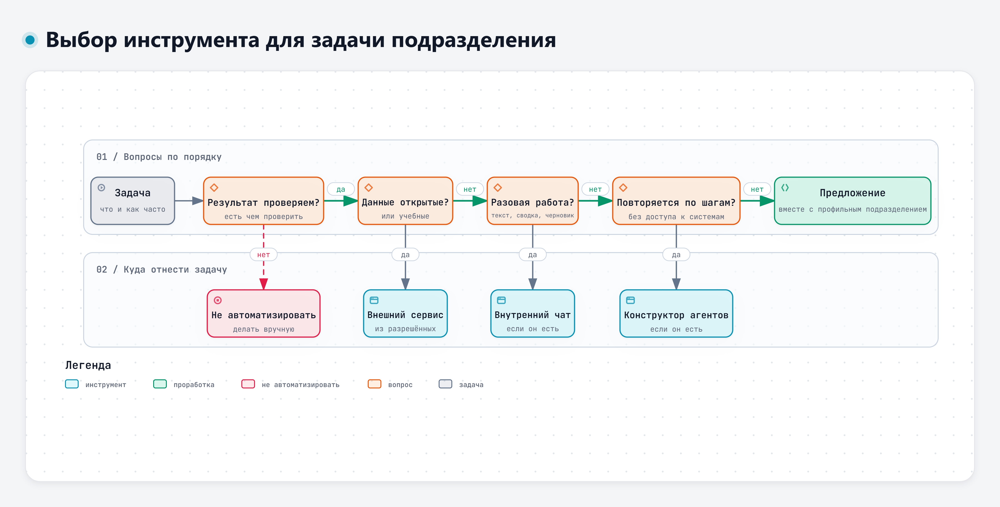

# Практика к теме 5.1. Инструменты для задач подразделения

**Время:** 3 академических часа (08:45–10:15 и 10:25–11:10).
**Что понадобится:** доступ к двум разрешённым сервисам (если второй не открывается – комплект преподавателя: полный текст запроса и ответ второго сервиса на него), основной файл учебного кейса ЭС-24 (ТЗ – редакция 1, п. 4.1–4.6) и дополнение к нему для пятого дня, список задач, выбранных к модулю 5 (задание выдавалось заранее).
**Правило:** в сервисы отправляем только материалы учебного кейса. Свои задачи описываем общими словами, без названий изделий, заказчиков, внутренних номеров и фамилий.

## Задание 1. Одна задача в разных инструментах (35 мин)

Задача из кейса: по замечанию З-2 получить перечень проверок, чтобы найти потребитель с повышенным током покоя.

**1а. Один запрос в двух инструментах (12 мин).** Составьте запрос по шаблону из темы 1.2: разделы 1 и 2 основного файла кейса, текст З-2, формат ответа таблицей. Отправьте один и тот же текст в два разных разрешённых сервиса, каждый раз в новом чате. Запишите сервис, модель (если сервис её показывает) и дату.

Если второй сервис у вас не открывается, возьмите у преподавателя заранее подготовленный комплект: полный текст запроса вместе с данными кейса и ответ на него другого сервиса с указанием сервиса, модели и даты. Отправьте в доступный вам сервис именно этот текст запроса, без изменений, и сравнивайте ответы на него. Если сравнить свой запрос с ответом на запрос преподавателя, различаются сразу и сервис, и постановка задачи, и разницу ответов нельзя приписать сервису.

**1б. Тот же вопрос без данных (8 мин).** В одном из двух сервисов в новом чате задайте вопрос без исходных данных: «Почему ток покоя грузовика выше нормы и как найти причину?» Он покажет, что дают модели исходные данные.

Заполните таблицу.

| Критерий | Сервис 1, запрос по шаблону | Сервис 2, запрос по шаблону | Вопрос без данных |
|---|---|---|---|
| Использованы 85 мА, 62 мА, 40 мА и п. 4.3 | | | |
| Проверки выполнимы в мастерской | | | |
| Есть выдуманные пункты или числа | | | |
| Сколько минут ушло на запрос и чтение ответа | | | |
| Сколько минут нужно на проверку ответа | | | |

**1в. Как это делали бы внутренние инструменты (15 мин, обсуждение с преподавателем).** Преподаватель показывает схемы «Модель и харнес» и «Агент-советчик» и разбирает вопросы:

- что изменилось бы, если ТЗ и протоколы лежали бы в помощнике по документам и модель находила бы пункт сама;
- какие шаги цепочки из документа 5-3 (запросы 1–3) можно было бы собрать в конструкторе агентов, а какие оставить формуле в таблице;
- что агенту разрешить сразу, а что только с подтверждением инженера.

Если в вашей организации есть внутренний чат или конструктор агентов, расскажите группе, как бы вы решили эту задачу в нём. Рабочие материалы и снимки экрана внутренних систем не показываем.

**Результат:** заполненная таблица и вывод в две-три строки: чем различались ответы двух инструментов, какой инструмент и какой способ запроса вы взяли бы для этой задачи и почему.

## Задание 2. Выбор инструмента для задач подразделения (60 мин)

### 2а. На учебном перечне (25 мин)

Откройте документ 5-1 дополнения к кейсу. Закройте три последних столбца («Маршрут данных», «Инструмент» и «Почему так») листом бумаги или скопируйте таблицу без них. Для каждой из 12 задач:

1. Определите маршрут данных: можно в разрешённый внешний сервис; можно после обезличивания и согласования; только во внутренний сервис; нельзя.
2. Пройдите схему «Выбор инструмента для задачи подразделения» по порядку вопросов.
3. Запишите инструмент: разрешённый внешний сервис; внутренний чат на локальных моделях, если он есть; конструктор агентов, если он есть; предложение на проработку вместе с профильным подразделением; не автоматизировать.

Интерактивная версия схемы – файл `diagrams/d5-vybor-instrumenta.html`.

Потом откройте закрытые столбцы и сравните. Если ответы различаются, запишите, какой вариант лучше обоснован и почему.

### 2б. На своих задачах (35 мин)

Возьмите задачи, которые вы выбрали к модулю 5, и дополните список до 5–8 задач своего подразделения. Заполните таблицу.

| № | Задача (общими словами) | Как часто | Какие данные | Маршрут данных | Инструмент | Чем проверить результат | Минут на задачу сейчас |
|---|---|---|---|---|---|---|---|
| 1 | | | | | | | |
| 2 | | | | | | | |

Подсказки:

- Маршрут данных определяют правила вашей организации. Если не знаете, к какой категории относятся сведения, так и пишите: «уточнить у подразделения по защите информации». Это нормальный ответ.
- Если внутреннего чата или конструктора в организации нет или вы о них не знаете, задачи с внутренними данными отнесите к «предложению на проработку».
- Отметьте звёздочкой одну задачу для итоговой работы: частая, с образцом результата, с понятной проверкой.

**Результат:** таблица своих задач с выбранной задачей для итоговой работы.

## Задание 3. Агент-советчик: кто что делает (30 мин)

Задача: первичный разбор замечания З-2 агентом. Разложите шаги по исполнителям.

| Шаг | Модель | Точная проверка (программа, формула) | Человек |
|---|---|---|---|
| Найти пункт ТЗ, к которому относится замечание | | | |
| Сравнить 85 мА с допуском | | | |
| Перечислить возможные причины | | | |
| Перевести ток в амперы, время в часы и посчитать расход заряда Q = I × t, А·ч, при постоянном токе | | | |
| Проверить, что номер пункта существует в ТЗ | | | |
| Составить черновик записи в перечень замечаний | | | |
| Перенести запись в рабочий перечень | | | |
| Решить, закрывать ли замечание | | | |

Для двух последних строк ответьте: можно ли отменить это действие одной кнопкой? Нужно ли подтверждение и что именно должен увидеть инженер, когда подтверждает?

Затем запишите три стоп-условия для такого агента: когда он должен остановиться и передать вопрос инженеру.

**Результат:** заполненная таблица и три стоп-условия.

## Обсуждение (10 мин)

- Чем различались ответы двух инструментов в задании 1, какой вы бы взяли в работу и сколько времени уходит на проверку?
- Где в задании 2 мнения в группе разошлись сильнее всего?
- Какие задачи своего подразделения вы отнесли к «не автоматизировать» и почему?

## Дополнительно, для тех, кто уже работает с ИИ

1. **Описать ИИ-агента (для тех, кто программирует).** По образцу документа 5-5 дополнения к кейсу опишите агента для одной инженерной задачи своего подразделения: что он делает, какие данные получает, какие инструменты и права у него есть, чего у него нет, где нужно подтверждение человека, при каких условиях он останавливается, как проверяется его результат (не меньше четырёх контрольных случаев, один из них – с посторонней строкой-командой в документе). Агент рассчитан на внутреннюю инфраструктуру организации, а не на личные сервисы и учётные записи. Объём – одна-две страницы.
2. **Харнес для слабой модели.** Напишите инструкцию для задачи 2 из документа 5-1 так, чтобы с ней справилась простая модель: шаги, образец одной строки таблицы, запреты, что делать, если пункт не найден. Проверьте инструкцию в двух разных сервисах и сравните, насколько различаются ответы.
3. **Контрольный набор.** Составьте 10 вопросов по разделу 4 ТЗ кейса (редакция 1) с заранее известными ответами. Задайте их в двух сервисах и посчитайте, сколько ответов верны. Такой набор пригодится, когда вы будете выбирать модель или проверять сценарий после её смены.
4. **Цепочка из трёх запросов.** Выполните задачу задания 1 цепочкой запросов 1–3 из документа 5-3 дополнения к кейсу, по очереди в одном диалоге. Сравните с одним запросом по шаблону: точнее ли таблица соответствия и сколько минут ушло на проверку.

---

<!-- author-block -->
**Автор курса**

Виталий Пиков

- Архитектор информационной безопасности
• РБПО • DevSecOps • AppSec
- Лектор и автор образовательных программ по ИБ и РБПО

Телефон: +7 (963) 782-92-78 ·
E-mail: vitaly@pikov.expert ·
Сайт: https://pikov.expert ·
Telegram: @UnderLineSecurity
