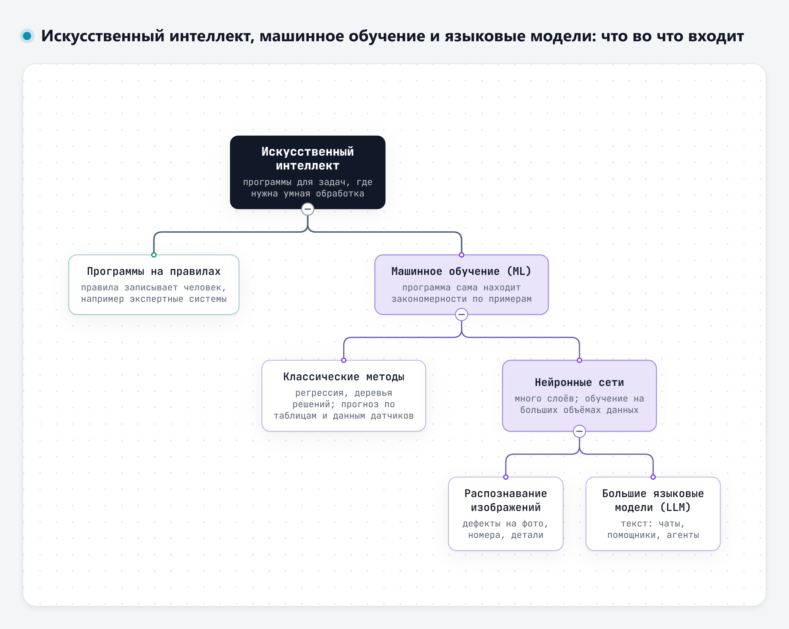
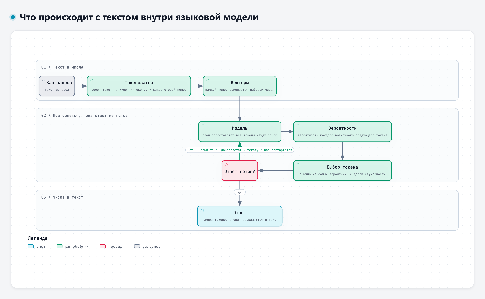
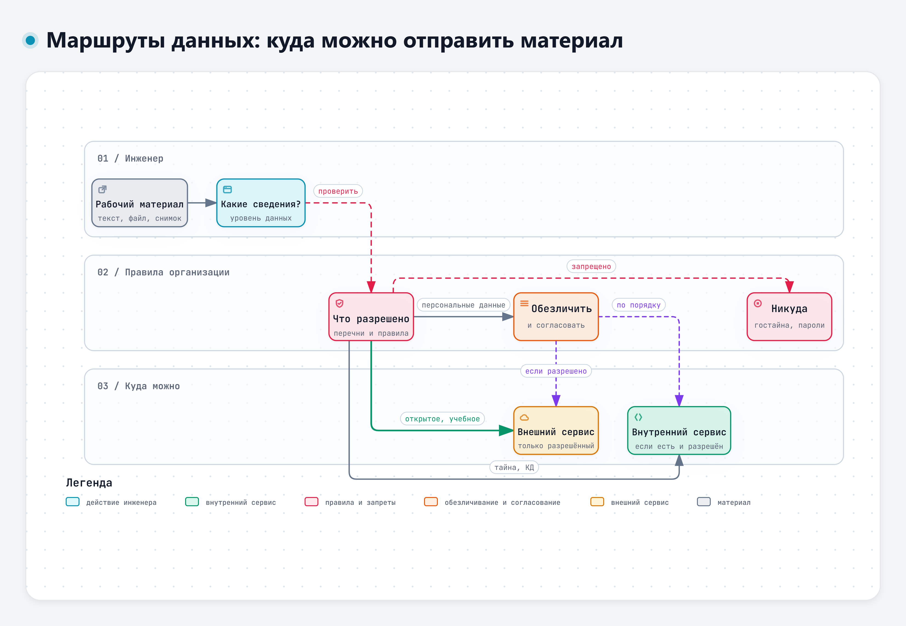
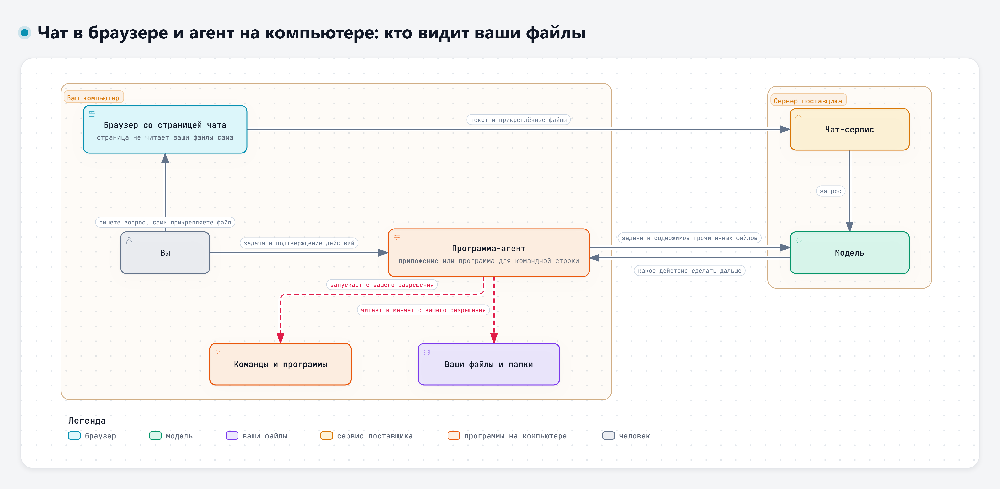
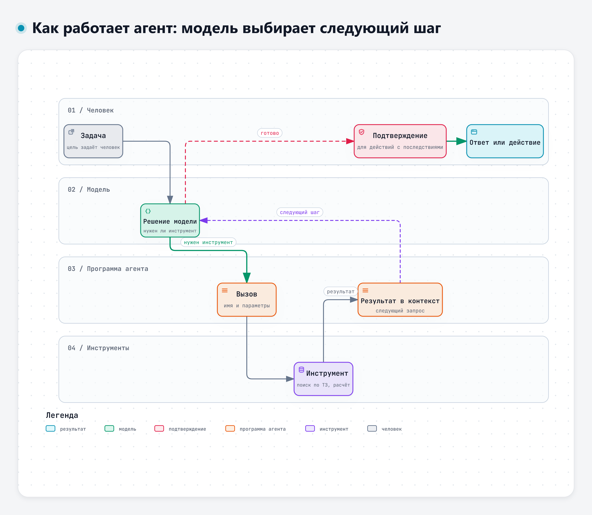
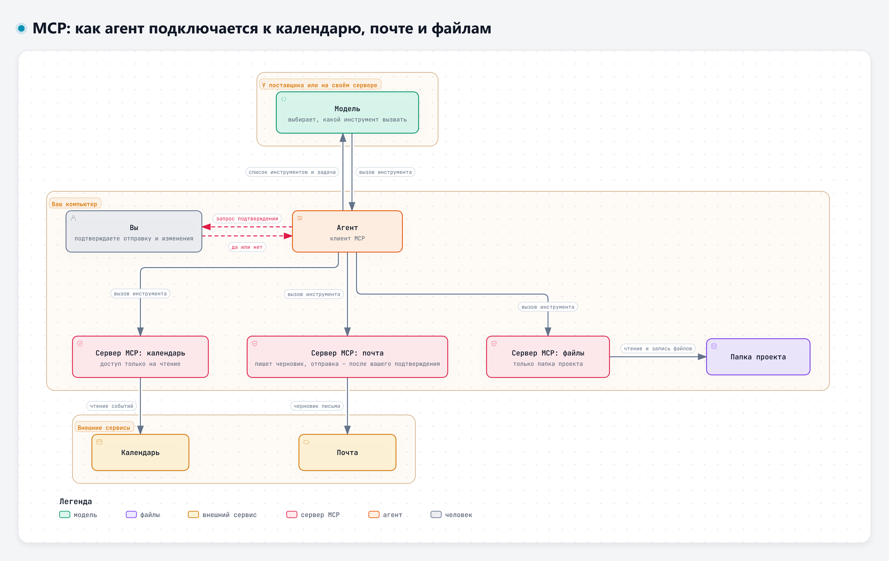
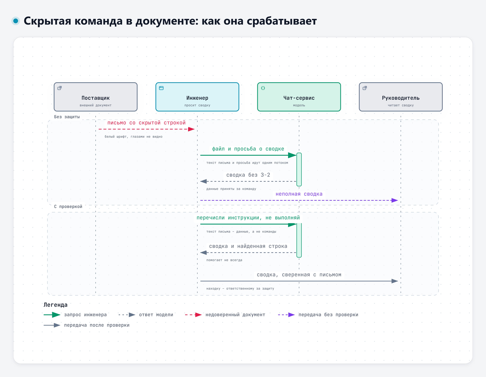
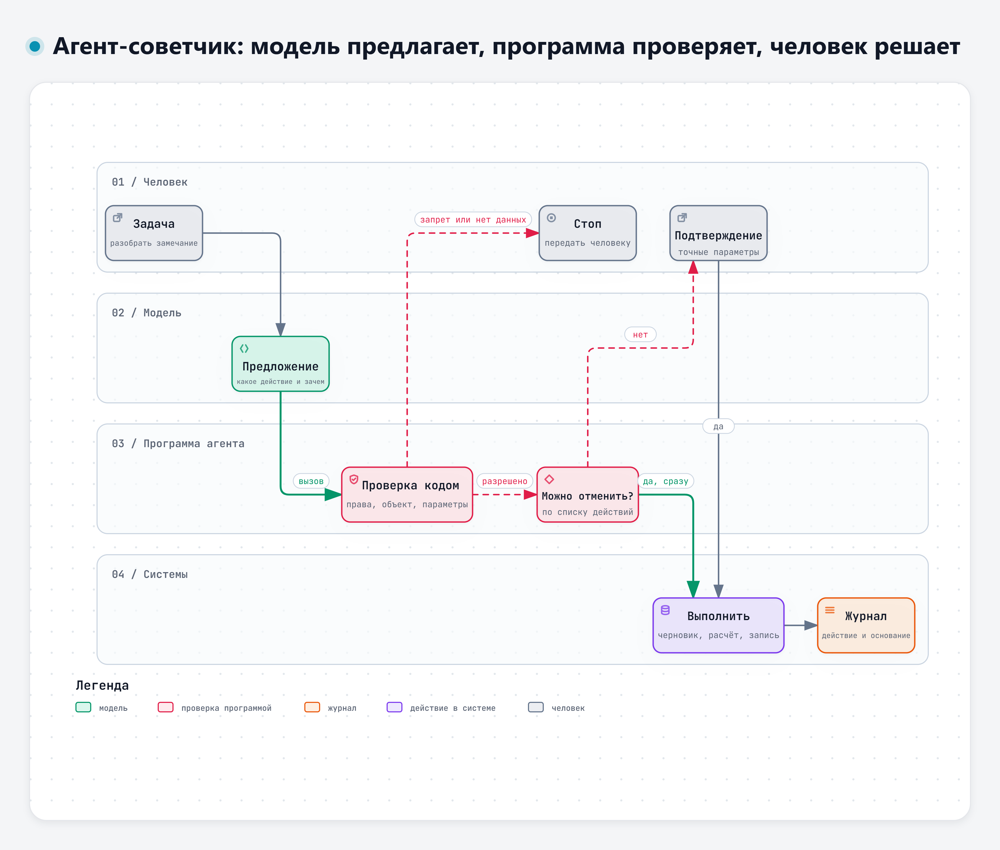
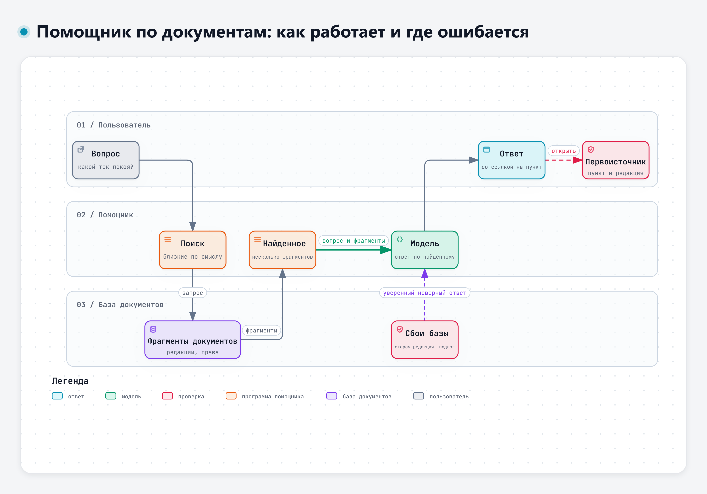

# Частые вопросы об ИИ и языковых моделях

Ответы на вопросы, которые чаще всего задают о машинном обучении, языковых моделях и агентах. Вопросы идут от простого к сложному: сначала – что такое модель и токен, в конце – агенты, подключение к сервисам и своя база знаний. Каждый ответ начинается с короткой версии, ниже – подробности и ссылки на источники. Сведения о сервисах, ценах и условиях приведены на 15.11.2026, они меняются часто. Незнакомые слова объяснены в [глоссарии](glossary.html).

## 1. ИИ, машинное обучение и языковые модели

### 1. Что такое машинное обучение (ML) и что такое большая языковая модель (LLM)? Это одно и то же? <a id="q01"></a>

**Коротко.** Нет, но одно входит в другое. Машинное обучение – подход, при котором программа не получает правила от человека, а сама подбирает их по примерам. Большая языковая модель – один из результатов такого подхода: огромная нейронная сеть, обученная на текстах. Любая языковая модель – это машинное обучение, но не всякое машинное обучение – языковая модель.

В России термины ИИ закреплены в национальном стандарте ГОСТ Р 71476-2024, он действует с 1 января 2025 года [1]. Машинное обучение там определено как «процесс оптимизации параметров модели с помощью вычислительных методов таким образом, чтобы поведение модели отражало данные и/или опыт» [1]. Проще: модель подстраивают под примеры, пока она не начнёт давать нужный результат.

Нейронная сеть по тому же стандарту – сеть из слоёв нейронов, соединённых связями с регулируемыми весами [1]. Большая языковая модель – нейронная сеть с миллиардами параметров, обученная на огромном объёме текстов предсказывать продолжение текста. Отдельного термина «большая языковая модель» в стандарте нет [1].



Интерактивная версия схемы – файл `08-Схемы/faq-ml-llm.html`.

Посмотреть, как маленькая нейронная сеть учится распознавать цифры, можно в браузере, в лаборатории «Цифра. Слой за слоем»: https://neural-network-digit-recognition.pikov.expert/ [2].

### 2. Когда применяют машинное обучение, а когда – языковую модель? <a id="q02"></a>

**Коротко.** Если данные – числа и таблицы (замеры, показания датчиков, журналы испытаний) и нужен прогноз, класс или группировка, это задача классического машинного обучения. Если нужно работать с текстом – прочитать, пересказать, сравнить, составить, ответить на вопрос по документу, – это задача для языковой модели. Многие рабочие системы сочетают оба подхода.

Стандарт называет типичные задачи машинного обучения: классификация, регрессия, ранжирование, кластеризация и понижение размерности [1]. Справочник библиотеки scikit-learn описывает их на примерах: классификация отвечает, к какой категории относится объект; регрессия предсказывает числовое значение; кластеризация объединяет похожие объекты в группы [3].

| Задача | Чем решать |
|---|---|
| Предсказать отказ узла по току, напряжению и температуре | Классическое машинное обучение |
| Найти на фото дефект сварного шва | Нейронная сеть для изображений |
| Сравнить техническое задание с протоколом испытаний и найти расхождения | Языковая модель |
| Составить черновик письма поставщику по таблице замечаний | Языковая модель |

Точный расчёт лучше не поручать языковой модели: в многошаговых вычислениях она ошибается. Разумная схема – модель предлагает и объясняет, а считает и проверяет программа (темы 1.1 и 5.1 курса).

### 3. Что нужно купить, скачать или открыть, чтобы начать? <a id="q03"></a>

**Коротко.** Покупать ничего не нужно. Для языковой модели достаточно браузера и учётной записи в сервисе. На работе – в том сервисе, который разрешён в организации. Для классического машинного обучения бесплатны и язык Python, и библиотека scikit-learn, и среда Jupyter. Платить имеет смысл позже: за подписку с большими лимитами или за видеокарту, если модели нужно запускать у себя (вывод автора).

Языковая модель:

- чат в браузере – на курсе это GigaChat и Алиса AI (тема 1.1);
- программный доступ для своих программ, например GigaChat API: на странице тарифов для частных лиц указан бесплатный режим Freemium – 365 млн токенов на 12 месяцев; страница оговаривает, что это тарифы для действующих клиентов, а новые клиенты с 1 сентября 2026 года оплачивают работу с моделями на платформе cloud.ru [4];
- модель на своём компьютере – программы Ollama, LM Studio и другие (вопрос 24).

Классическое машинное обучение:

- Python – бесплатный язык с открытой лицензией, в том числе для коммерческого использования [5];
- scikit-learn – открытая библиотека «простых и эффективных инструментов для анализа данных» [3];
- Jupyter – среда, где код, таблицы и графики лежат в одном документе; попробовать её можно прямо в браузере [6].

Рабочие данные – только в разрешённые сервисы. Почему это правило строгое, разбирается в теме 2.1.

## 2. Что такое модель

Модель – это файлы с числами, и от их размера зависит, где модель может работать.

### 4. Что такое модель: файл, программа или сервис? Можно ли её увидеть? <a id="q04"></a>

**Коротко.** Сама модель – это файлы с миллиардами чисел, которые подобрали при обучении; их называют параметрами или весами. Чтобы модель работала, нужна программа, которая загружает эти файлы и считает по ним ответ. В чат-сервисе файлы лежат на серверах поставщика, и вы видите только окно чата. Открытые модели можно скачать и увидеть сами файлы.

Пример – открытая модель OpenAI gpt-oss-20b. В её карточке на Hugging Face указано 21 млрд параметров, а веса лежат в трёх файлах примерно по 4–5 ГБ [7]. Форматы файлов называются safetensors и GGUF; второй хранит вместе с числами описание модели и подходит для программ Ollama, LM Studio, GPT4All и llama.cpp [8], [9]. Есть и российские открытые модели: например, YandexGPT 5 Lite на 8 млрд параметров выложена в том числе в формате GGUF [10].

У закрытых моделей размер обычно не раскрывают. В техническом отчёте о GPT-4 OpenAI прямо пишет, что не приводит подробностей архитектуры, включая размер модели [11]. У Anthropic на странице прозрачности числа параметров нет ни у одной модели [12].

Как посмотреть своими глазами:

- открыть страницу модели на Hugging Face и вкладку с файлами;
- поставить Ollama или LM Studio и скачать небольшую модель – она займёт несколько гигабайт на диске;
- увидеть устройство маленькой нейронной сети изнутри – в лаборатории «Цифра. Слой за слоем» [2].

### 5. Почему моделей так много и что означают цифры в названиях? <a id="q05"></a>

**Коротко.** Разработчики выпускают линейки: большая модель умнее, но медленнее и дороже, маленькая – быстрее и дешевле. И обновляют их несколько раз в год. Цифры в названии чаще всего означают номер поколения или размер модели в миллиардах параметров. Остальные слова подсказывают назначение.

Примеры по описаниям разработчиков:

- **Claude (Anthropic).** В 2024 году Anthropic перечисляла линейки Haiku, Sonnet и Opus «по возрастанию возможностей» [13]; в 2026 году над Opus появился класс Fable и Mythos [14]. Номер в названии – поколение и версия внутри него: Claude Sonnet 5, Claude Opus 5.5. Обновлённая версия выходит под новым идентификатором [15].
- **GigaChat (Сбер).** GigaChat 2 Lite – «быстрая и легкая модель для простых повседневных задач», Pro – для ресурсоёмких задач, Max – «для самых сложных и масштабных задач» [16].
- **YandexGPT (Яндекс).** Lite – где важна скорость ответа, Pro – для сложных задач, например ответов на вопросы по документации [17].
- **Qwen (Alibaba).** В названии Qwen3-235B-A22B: 235 млрд параметров всего и 22 млрд активных при обработке каждого токена [18]. У версий Qwen3-235B-A22B-…-2507 вариант Instruct работает только без рассуждения, а Thinking – только с рассуждением [19], [20].

Буква B после числа – миллиарды параметров (billion): 8B – 8 миллиардов. Смысл некоторых частей названий разработчики не объясняют, тогда его лучше не угадывать.

### 6. Почему модель не запустить на домашнем компьютере, ноутбуке или планшете и зачем нужны очень дорогие компьютеры? <a id="q06"></a>

**Коротко.** Все веса модели должны поместиться в память, а для быстрой работы – в память видеокарты. На каждый токен модель считает по своим весам. У игровых видеокарт 12–32 ГБ памяти, а крупные модели занимают сотни гигабайт. Поэтому их запускают на серверах, где стоит несколько ускорителей по 80–141 ГБ. Небольшие открытые модели в сжатом виде работают и на домашнем компьютере, лучше – с хорошей видеокартой.

Объём памяти у современных устройств NVIDIA: игровые RTX 5070 – 12 ГБ, RTX 5070 Ti – 16 ГБ, RTX 5090 – 32 ГБ [21], [22]; серверные H100 – 80 или 94 ГБ, H200 – 141 ГБ [23], [24]; система DGX B200 из восьми ускорителей – 1440 ГБ на всех [25]. Цены серверных ускорителей NVIDIA на своих страницах не публикует.

Простая оценка (вывод автора): в обычном виде один параметр занимает 2 байта. Значит, модели на 235 млрд параметров нужно около 470 ГБ только под веса – это несколько серверных ускорителей. На каждый токен обычная модель выполняет примерно по две операции на каждый параметр [26]. У моделей со «смесью экспертов» на токен работает только часть параметров: у Qwen3-235B-A22B – 22 млрд из 235 млрд [18].

Выручает сжатие – квантование: параметры хранят в 3–4 битах вместо 16. В исследовании 2022 года так удалось уменьшить модели в несколько раз почти без потери точности и впервые запустить модель на 175 млрд параметров на одной видеокарте [27]. Но в другой работе ни один из проверенных способов не сохранил при 4 битах исходное качество полностью [28]. Сжатые модели и раздают для домашних программ: формат GGUF с уровнем Q4_K – около 4,5 бита на параметр [9].

Что работает дома:

- программа LM Studio для Windows рекомендует хотя бы 16 ГБ оперативной памяти и 4 ГБ видеопамяти [29];
- открытая модель gpt-oss-20b, по описанию в каталоге Ollama, запускается на системах с 16 ГБ памяти [30];
- в исследовании 2026 года рабочая станция с одной потребительской видеокартой выдавала 29–65 токенов в секунду на задачах помощника по документам и программам [31].

Без видеокарты модель можно запустить на процессоре: так умеет, например, GPT4All [32]. На ноутбуке без отдельной видеокарты и на планшете памяти и мощности меньше, поэтому там работают только маленькие модели, и те медленно (вывод автора).

## 3. Токены: как модель читает текст

### 7. Что такое токен и как посмотреть, на какие токены делятся слова? <a id="q07"></a>

**Коротко.** Токен – кусочек текста, с которым работает модель: короткое слово целиком, часть длинного слова, знак препинания. Модель читает и пишет текст токенами, и всё считается в токенах: длина запроса, объём «памяти» диалога, лимиты, цена. Посмотреть деление можно в бесплатных онлайн-токенизаторах.

Пример. Слово «непредсказуемость» токенизатор моделей Qwen 2.5 делит на 8 токенов: «н», «еп», «ред», «с», «каз», «у», «ем», «ость». Английское «unpredictability» – на 3: «un», «predict», «ability» [33]. У каждого семейства моделей свой словарь, поэтому то же русское слово у GPT-4o занимает 6 токенов, а у GPT-4 – 8 [34], [35].

Где посмотреть самому:

- [Токенизатор OpenAI](https://platform.openai.com/tokenizer) – раскрашивает токены и считает их для словарей моделей OpenAI; 15.11.2026 открывался без входа, «непредсказуемость» на словаре GPT-5.x – 6 токенов [36];
- [Tiktokenizer](https://tiktokenizer.vercel.app/) – показывает токены и их номера для словарей моделей OpenAI; 15.11.2026 открывался без входа и принимал русский текст [34];
- [The Tokenizer Playground](https://huggingface.co/spaces/Xenova/the-tokenizer-playground) на Hugging Face – раскрашивает токены; словарь выбирается из списка: GPT-4, Llama 3, Mistral, Gemma и другие; 15.11.2026 открывался без входа и принимал русский текст [35].

Посчитать токены программно можно и у российских сервисов: у GigaChat API для этого есть отдельный запрос [37], у Yandex AI Studio – бесплатный метод, для которого нужна учётная запись в облаке [38].

Ориентиры от разработчиков: для английского текста токен – примерно 4 символа или три четверти слова [36]; у GigaChat – в среднем 3–4 символа [37]; у Anthropic размер токена зависит от модели и языка [39].

### 8. Почему на русский текст уходит больше токенов, чем на английский? <a id="q08"></a>

**Коротко.** Словарь токенов составляют по большим массивам текстов, и английского в них больше всего. Частые английские слова попадают в словарь целиком, а русские чаще режутся на части. К тому же у русских слов много форм: «модель», «модели», «моделью» – разные цепочки букв. В итоге тот же смысл по-русски стоит больше токенов.

Замер 15.11.2026. Взят официальный текст Всеобщей декларации прав человека, статьи 1–30, с сайта ООН – по-русски и по-английски [40]. Русский вариант короче по числу слов (1343 против 1420), но токенов в нём больше у всех четырёх проверенных открытых моделей [33]:

| Модель | Русский текст, токенов | Английский текст, токенов | Во сколько раз больше |
|---|---|---|---|
| Qwen 3.5, 9 млрд параметров | 2209 | 1627 | 1,36 |
| Gemma 3, 4 млрд | 2266 | 1620 | 1,40 |
| gpt-oss, 20 млрд | 2308 | 1608 | 1,44 |
| DeepSeek-R1, 14 млрд, на основе Qwen 2.5 | 2957 | 1630 | 1,81 |

На английское слово пришлось 1,13–1,15 токена, на русское – 1,64–2,20 [33].

Исследования подтверждают это на десятках языков. Число токенов у одного и того же текста в переводе на разные языки может различаться до 15 раз, и разрыв остаётся даже у словарей, обученных на многих языках [41]. Что считать токеном, зависит от данных, на которых обучали модель, и носители многих языков платят за доступ к модели больше, а ответы получают хуже [42]. Больше всего токенов тратят языки с нелатинским письмом и богатыми окончаниями [43].

Разработчики моделей с упором на русский язык подстраивают под него словарь. Т-Банк пишет, что его модели T-lite и T-pro быстрее генерируют русский текст за счёт оптимизированного токенизатора [44], [45]. В таблице-примере Яндекса модель YandexGPT Pro укладывает в токен в среднем 5,39 символа русского текста, а DeepSeek – 4,04 [38].

Что это значит на практике (вывод автора):

- через программный доступ русский запрос стоит дороже английского того же смысла;
- лимиты подписки расходуются быстрее;
- в контекстное окно помещается меньше русского текста.

### 9. Что происходит с токенами дальше и что получает модель на вход? <a id="q09"></a>

**Коротко.** Модель получает не буквы, а номера токенов. Каждый номер она заменяет длинным набором чисел – вектором – и прогоняет эти наборы через десятки слоёв. На выходе – вероятности для следующего токена. Модель выбирает один, дописывает его к тексту и повторяет, пока ответ не закончится.

По шагам:

1. Токенизатор режет текст на токены и заменяет каждый его номером в словаре. В словаре моделей Qwen 2.5 – 151 676 токенов вместе со служебными [33].
2. Каждый номер превращается в вектор. У четырёх моделей, проверенных на компьютере автора, это от 2560 до 5120 чисел на токен [33].
3. Слои модели сопоставляют все токены друг с другом. Этот механизм называется вниманием; на нём построен трансформер [46] – архитектура современных языковых моделей.
4. На выходе модель получает вероятности для следующего токена и выбирает один [47].
5. Выбранный токен добавляется к тексту, и всё повторяется.



Интерактивная версия схемы – файл `08-Схемы/faq-put-teksta.html`.

На входе модель получает то, что сервис собрал для текущего запроса: инструкции, доступную часть диалога, приложенные материалы или найденные в них фрагменты. Объём этого входа ограничен контекстным окном. Например, у моделей Claude окно – 1 млн токенов, по оценке Anthropic это около 555 тыс. слов [48]. На каждый токен модель делает работу, пропорциональную числу задействованных параметров [26], поэтому длинный диалог и большая модель – это больше вычислений.

### 10. Почему модель на один и тот же вопрос отвечает по-разному? <a id="q10"></a>

**Коротко.** Модель выбирает следующий токен с долей случайности, чтобы текст был разнообразнее, поэтому два ответа на один вопрос расходятся. Даже если случайность отключить, ответы всё равно могут различаться: сервер считает одновременно много запросов, и порядок вычислений немного меняется от раза к разу.

В исследовании, где ChatGPT писал программы, доля задач, в которых ответы на одинаковый запрос ни разу не совпали по результатам тестов, – от 47,56 до 75,76 % в зависимости от набора. Отказ от случайного выбора (температура 0) разброс уменьшил, но не убрал [47]. Anthropic в своей документации предупреждает о том же: даже при температуре 0 ответы не полностью детерминированы [39].

Лаборатория Thinking Machines показала это на опыте: 1000 ответов модели Qwen3-235B на один запрос при температуре 0 дали 80 разных текстов. Главная причина в том, что нагрузка на сервер, а значит, и размер пакета запросов меняются непредсказуемо [49]. Исследователи системного программного обеспечения объясняют механизм так же: вычисления с плавающей точкой дают немного разный результат при разном порядке сложения, а порядок зависит от того, сколько запросов сервер обрабатывает вместе [50].

На новых моделях пользователь всё чаще не может управлять случайностью: в новой версии API Anthropic параметр температуры убран совсем [51], а у моделей Gemini начиная с 3.6 Flash он игнорируется [52]. Поэтому исследователи советуют считать ответ модели выборкой из множества возможных, а не точным измерением [53].

Что делать: если факт важен, задайте вопрос ещё раз в новом чате и сравните. Если ответы противоречат друг другу, модель, скорее всего, сочиняет [54]. Совпадение проверку не заменяет: модель может уверенно повторять одну и ту же ошибку (тема 1.1).

## 4. Текст и изображения

### 11. Почему одни модели работают только с текстом, а другие – и с изображениями? <a id="q11"></a>

**Коротко.** Чтобы модель «видела», к ней добавляют отдельный блок – кодировщик изображений – и дообучают на парах «картинка и текст». Модель, которую так не учили, принять картинку не может. Многие современные модели принимают изображения, но есть и чисто текстовые.

В типичной схеме кодировщик превращает картинку в векторы, а связующий блок переводит их в то же пространство, где модель держит токены текста [55], [56]. После этого картинка для модели – ещё одна последовательность токенов рядом с вашим текстом.

Кто что принимает по описаниям разработчиков:

- все текущие модели Claude и последние модели OpenAI принимают текст и изображения [48], [57];
- модели GigaChat распознают текстовые документы, изображения и аудио [58];
- Алиса AI отвечает на вопросы о том, что изображено на фото; в одном сообщении – одно изображение до 20 МБ [59];
- у DeepSeek в программном доступе изображения принимает модель deepseek-flash, а deepseek-v4-pro – нет [60];
- открытая модель gpt-oss работает только с текстом [30].

### 12. Как изображение превращается в токены? <a id="q12"></a>

**Коротко.** Картинку режут на квадратики, и каждый квадратик кодировщик превращает в вектор – как токен текста. Чем больше картинка, тем больше квадратиков и токенов она занимает. Поэтому большая фотография может стоить больше токенов, чем страница текста.

Приём предложили в 2020 году в модели ViT: трансформер получает изображение как последовательность фрагментов [61]; в ViT фрагменты были по 14×14 или 16×16 пикселей [62].

У коммерческих сервисов свои правила подсчёта:

- Anthropic: квадраты 28×28 пикселей; изображение 1000×1000 пикселей стоит 1296 токенов [63];
- OpenAI у новых моделей считает квадраты 32×32 пикселя [64];
- у Gemini 3 и 4 картинка стоит от 280 до 2240 токенов в зависимости от выбранного разрешения [65];
- GigaChat тратит на изображение не больше 1792 токенов [58], DeepSeek – не больше 1024 [66].

Для сравнения: в одной из открытых исследовательских моделей картинка 672 пикселя занимает 2880 визуальных токенов [56].

## 5. Промпт: как ставить задачу модели

### 13. Что такое промпт и так ли он важен? Может, достаточно сказать своими словами? <a id="q13"></a>

**Коротко.** Промпт – всё, что модель получает на входе: задача, условия, примеры, приложенные файлы. Своими словами говорить можно и нужно, но модель не знает того, чего вы не написали. Важна не «волшебная формула», а полнота: что сделать, для кого, из каких данных, в каком виде нужен результат и как вы его проверите.

Разработчики советуют одно и то же разными словами. Anthropic предлагает представлять модель «блестящим, но новым сотрудником», которому не хватает контекста, и проверять промпт так: дать его коллеге, который не знает задачи; если коллега запутается, запутается и модель [67]. Сбер в руководстве по GigaChat советует составлять однозначные запросы, давать актуальные данные и приводить примеры [68]. Яндекс в справке Алисы AI предлагает определить цель, задать контекст, указать формат ответа и включать примеры [69].

Формулировка влияет на ответ сильнее, чем кажется. В одном исследовании модель меняла решение даже от лишнего пробела в конце запроса; более крупные модели оказались устойчивее [70]. В работе на открытых моделях уже один пример в запросе почти всегда заметно снижал эту чувствительность [71].

Как составлять запрос по шагам – тема 1.2 курса.

### 14. Промпт-инженерия умерла или нет? <a id="q14"></a>

**Коротко.** Не умерла, но изменилась (вывод автора). Новые и более крупные модели устойчивее к мелким изменениям формулировки, поэтому «волшебные фразы» значат всё меньше. А умение ясно поставить задачу и дать модели нужные материалы никуда не делось. Разработчики говорят шире – об инженерии контекста: что положить модели на вход, чтобы она справилась.

Anthropic в 2025 году назвала инженерию контекста естественным продолжением промпт-инженерии: работа с моделями всё меньше сводится к поиску правильных слов и всё больше – к подбору того, что модель видит [72]. Руководства по промптам на 15.11.2026 публикуют Anthropic, OpenAI, Google, Сбер и Яндекс [73], [74], [75], [68], [69]. В этих руководствах заявлений о том, что промпт-инженерия больше не нужна, нет.

Значительная часть «чувствительности к формулировке» в прежних работах объяснялась способом проверки ответов, и современные модели устойчивее к шаблонам запросов, чем считалось [76]. Но и они меняют ответ от небольших изменений формулировки [70].

### 15. Почему одна модель понимает задачу, а другая – нет? <a id="q15"></a>

**Коротко.** Модели обучали на разных текстах и разными способами. Они отличаются размером, а русский язык и вашу предметную область каждая знает по-своему. Формулировки, которой хватает одной модели, может не хватить другой. Поэтому запрос проверяют на той модели, с которой предстоит работать.

Различаются модели и по языкам. У Llama 3.1, например, русского нет в списке поддерживаемых языков [77], а Qwen3 поддерживает 119 языков, включая русский [18]. Как модели справляются именно с русским, показывает открытый рейтинг MERA: новые версии представляет Альянс в сфере искусственного интеллекта, в разработке участвовали Сбер, Яндекс, Сколтех, МТС, ВШЭ и Российская академия наук [78], [79], [80].

В курсе этот вопрос разбирается через «харнес» (тема 5.1): инструкции стоит писать так, чтобы с ними справилась и более простая модель, тогда смена модели не ломает работу.

## 6. Модели, цены и подписки

### 16. Чем отличаются модели одного разработчика, например Claude Fable 5.2 и Claude Sonnet 5? <a id="q16"></a>

**Коротко.** Это модели разного класса. Claude Fable 5.2 – самая сильная модель Anthropic, открытая всем клиентам. Она рассчитана на сложные рассуждения и долгую самостоятельную работу агентов. Sonnet – средний класс, «лучшее сочетание скорости и интеллекта». Fable в четыре раза дороже за токен.

По документации Anthropic на 15.11.2026 [48], [81], [82]:

| | Claude Fable 5.2 | Claude Sonnet 5 / Sonnet 5.5 |
|---|---|---|
| Назначение | Сложные рассуждения и долгая работа агентов | Лучшее сочетание скорости и интеллекта |
| Цена программного доступа, долларов за 1 млн токенов | 8 на входе, 40 на выходе | 2 на входе, 10 на выходе |
| Статус | Текущая модель | Sonnet 5 вышла 30.06.2026 и уже заменена версией 5.5 |

Anthropic советует при выборе модели «соблюдать баланс возможностей, скорости и стоимости», а если не уверены – начинать с Claude Opus 5.5. Часто выгоднее не менять модель, а настроить уровень усилий (вопрос 18) [81], [48].

У российских разработчиков линейки устроены так же: GigaChat 2 Lite, Pro и Max, YandexGPT Lite и Pro (вопрос 5). Модели Anthropic, OpenAI и Google в России официально недоступны (вопрос 21).

### 17. Почему модели стоят по-разному? <a id="q17"></a>

**Коротко.** Большая модель на каждый токен делает больше вычислений, и это дороже. У Claude токен ответа стоит в 5 раз дороже токена вопроса, у Alice AI LLM – в 2,4 раза, у YandexGPT и GigaChat цена одна. Официально свою ценовую политику разработчики не объясняют, но картина у всех похожая.

На каждый токен обычная модель выполняет примерно по две операции на каждый параметр [26]. Отсюда вывод автора: модель в десять раз больше требует примерно в десять раз больше вычислений на токен, а значит, и больше оборудования; у моделей со «смесью экспертов» считать нужно по активной части. Прямого объяснения разницы в ценах на страницах Anthropic нет, есть только совет брать простую модель для простых задач, а самую сильную – для самых сложных [82].

Цены программного доступа на 15.11.2026:

| Модель | Вход | Выход |
|---|---|---|
| Claude Haiku 5.5 | 0,10 $ за 1 млн токенов | 0,50 $ |
| Claude Sonnet 5.5 | 2 $ | 10 $ |
| Claude Opus 5.5 | 4 $ | 20 $ |
| Claude Fable 5.2 | 8 $ | 40 $ |
| GigaChat Lite / Pro / Max (для организаций, с НДС) | 0,065 / 0,5 / 0,65 ₽ за 1000 токенов | |
| YandexGPT Lite / Pro 5.1 (с НДС) | 0,2 / 0,8 ₽ за 1000 токенов | 0,2 / 0,8 ₽ |
| Alice AI LLM (с НДС) | 0,5 ₽ за 1000 токенов | 1,2 ₽ |

Источники: [82], [83], [84]. У GigaChat в таблице одна цена за 1000 токенов без деления на вход и выход [83]. У Haiku 5.5 запрос длиннее 100 тыс. токенов стоит в пять раз дороже [82].

Почему ответ дороже вопроса (вывод автора): входной текст модель обрабатывает целиком за один проход, а ответ пишет по одному токену, и на каждый нужен свой проход.

### 18. Что такое уровень усилий (effort) и режим рассуждения и почему на максимуме уходит так много токенов? <a id="q18"></a>

**Коротко.** В режиме рассуждения модель перед ответом пишет для себя промежуточные шаги, а уровень усилий задаёт, сколько она на это тратит. Эти «мысли» – тоже токены, и они оплачиваются как ответ, даже если вы их не видите. На максимуме модель рассуждает почти без ограничений, поэтому токенов уходит в разы больше, а выигрыш в качестве бывает не всегда.

Anthropic описывает параметр effort так: он управляет тем, сколько токенов модель тратит на ответ. Уровни – от low («самый экономный, заметная экономия токенов при некотором снижении возможностей») до max («абсолютный максимум возможностей без ограничений на расход токенов») [85]. Токены рассуждения оплачиваются как выходные, даже если сам текст рассуждения не возвращается [86]. У OpenAI так же: токены рассуждения не видны, но занимают контекстное окно и оплачиваются как выходные [87].

Больше рассуждений обычно даёт лучший результат на трудных задачах. Исследования 2024–2025 годов показали, что на части задач дополнительные вычисления «на подумать» во время ответа дают больше, чем увеличение самой модели [88], [89]. Но отдача падает: на больших бюджетах прирост качества уменьшается, а модель начинает «передумывать» и отказываться от правильных ответов [90]; слишком длинные цепочки рассуждений в некоторых областях даже ухудшают результат [91]. Документация Claude Code предупреждает: уровень max может давать убывающую отдачу и склонен к лишним рассуждениям, его стоит проверить, прежде чем ставить по умолчанию [92].

Практический вывод автора: для повседневной работы хватает среднего или высокого уровня, максимум – для действительно трудных задач.

### 19. Чем различаются подписки? <a id="q19"></a>

**Коротко.** Обычно есть бесплатный уровень с небольшими лимитами и несколько платных: чем дороже, тем больше объём работы, сильнее модели и больше функций, например агенты для работы с файлами. Отдельно продаются планы для организаций – с администрированием и условием не обучать модели на данных клиента.

Примеры на 15.11.2026 (цены в долларах США в месяц, без налогов):

| Сервис | Бесплатно | Платные планы |
|---|---|---|
| Claude (Anthropic) | Есть, с лимитами на каждые 5 часов и на неделю | Pro – 20 (17 при оплате за год), Max – 100 (в 5 раз больше Pro), Ultra – 200 (в 10 раз больше Pro за неделю); для организаций – Team и Enterprise [93] |
| ChatGPT (OpenAI) | Есть | Go – 8, Plus – 20, Pro – от 100 (100, 200 или 500), Business – 25 за пользователя (20 при оплате за год) [94] |
| Gemini (Google) | Есть | Plus – 4,99, Pro – 19,99, Ultra – 99,99 или 199,99 [95] |
| Алиса AI (Яндекс) | Есть; в режиме рассуждения «Эксперт» – ограниченное число запросов в день (тема 1.1) | Опция «Алиса Плюс» – 199 ₽ в месяц: без ограничений на ответы с рассуждением и создание изображений, бессрочное хранение переписки; нужна мультиподписка, работает в России и Беларуси [96] |

Что ещё различается:

- у Claude чат и Claude Code расходуют один общий лимит [97];
- в ChatGPT программа-агент Codex входит во все планы, но с разным объёмом [94];
- у бизнес-планов другие условия хранения и использования данных (вопрос 22).

Зарубежные подписки в России официально недоступны (вопрос 21).

### 20. Зачем придумали лимиты с окном в пять часов? <a id="q20"></a>

**Коротко.** Окно в пять часов – способ распределить общий объём работы во времени: на каждые пять часов приходится своя часть, а сверху действует недельный лимит. Зачем окно именно такой длины, разработчики официально не объясняют. Сами они говорят о нехватке вычислительных мощностей и о равном доступе для всех пользователей.

Как это устроено по справке разработчиков:

- Claude: период начинается с первого сообщения и полностью обновляется через пять часов; есть и недельные лимиты [97]; у подтверждённых аккаунтов Ultra пятичасового лимита нет [93];
- Codex и ChatGPT Work: для планов Plus и Business приведены оценки числа сообщений на каждые пять часов, могут действовать и недельные лимиты; на 15.11.2026 у планов Pro пятичасового лимита нет [94];
- Gemini: лимит обновляется каждые пять часов, пока не исчерпан недельный [95].

Объяснения разработчиков: Anthropic может менять лимиты, «чтобы управлять мощностями и обеспечить справедливый доступ для всех пользователей» [97]; в мае 2026 года она удвоила пятичасовые лимиты Claude Code и связала это с новыми вычислительными мощностями [98]. Google пишет, что лимиты должны обеспечить хорошую работу для всех и могут меняться из-за ограничений мощностей [99]. По сообщению TechCrunch, недельные лимиты 2025 года Anthropic ввела против круглосуточной фоновой работы Claude Code и оценивала, что они затронут менее 5 % подписчиков [100] (вторичный источник).

Вывод автора: без окна одна длинная сессия могла бы израсходовать недельный объём за несколько часов, а сервер в часы пик был бы перегружен.

### 21. Какие есть известные поставщики и где купить подписку? <a id="q21"></a>

**Коротко.** В России доступны GigaChat от Сбера и Алиса AI от Яндекса, у них есть бесплатный режим. Программный доступ продаётся через GigaChat API и Yandex AI Studio. Из зарубежных крупнейшие – OpenAI (ChatGPT), Anthropic (Claude) и Google (Gemini), но в их списках поддерживаемых стран России нет. Для работы годятся только сервисы, разрешённые в вашей организации.

Российские сервисы:

- GigaChat (Сбер) – чат и GigaChat API; для организаций оплата по факту использования, минимум 600 ₽ в месяц с НДС [83];
- Алиса AI (Яндекс) – чат, опция «Алиса Плюс» [96]; программный доступ к моделям Яндекса – Yandex AI Studio [84].

Зарубежные:

- OpenAI, Anthropic и Google: Россия не входит в списки стран, где доступны их сервисы [101], [102], [103]. OpenAI прямо предупреждает, что доступ из других стран может привести к блокировке учётной записи [102]. Обходные пути на курсе не обсуждаются (тема 5.1);
- DeepSeek (Китай) и Qwen (Alibaba) – открытые чаты, данные хранятся в Китае и Сингапуре и могут использоваться для обучения (тема 1.1);
- есть и другие: Mistral, Grok от xAI, Kimi от Moonshot, Microsoft Copilot, Perplexity [104], [105], [106], [107], [108].

Личная подписка не даёт права работать в сервисе с рабочими документами: что можно, определяют правила организации, а использование ИИ в обход правил называют теневым (тема 2.1).

## 7. Данные: облако или свой компьютер

### 22. Если я покупаю подписку, мои данные идут на обучение? Могут ли они утечь? Какие обязательства у продавца? <a id="q22"></a>

**Коротко.** Зависит от сервиса и плана. У личных подписок OpenAI и Anthropic данные могут идти на обучение, если вы не отказались в настройках. У их планов для организаций и программного доступа данные по умолчанию на обучение не идут. У других сервисов – по их собственным условиям. Срок хранения зависит от сервиса и от того, какие это данные: история, удалённые чаты, журналы. Обязательства продавца записаны в его условиях и политике конфиденциальности.

Условия на 15.11.2026:

- **Anthropic, личные планы Free, Pro, Max (и Claude Code в них).** Компания может использовать ваши запросы и ответы для обучения, если вы не отказались в настройках [109]. В сообщении об изменении условий в августе 2025 года компания написала: если разрешить обучение, данные хранятся до пяти лет, если нет – остаётся прежний срок 30 дней; удалённый диалог для обучения не используется [110].
- **Anthropic, коммерческие продукты и программный доступ.** «Anthropic не может обучать модели на контенте клиента» [111].
- **OpenAI.** В личных планах ChatGPT от обучения можно отказаться, а в Business и Enterprise данные на обучение не идут [112]. Данные программного доступа с 1 марта 2023 года не используются для обучения, журналы проверки злоупотреблений по умолчанию хранятся до 30 дней, исключения описаны в документации [113].
- **Google Gemini.** При включённой истории активности Google использует её, в том числе для обучения генеративных моделей; часть диалогов читают люди-проверяющие, и Google просит не вводить конфиденциальные сведения. Временные чаты хранятся 72 часа, история по умолчанию – 18 месяцев, проверенные людьми диалоги – до трёх лет [114].
- **GigaChat.** Соглашение запрещает передавать в запросах персональные данные пользователя и третьих лиц [115].
- **Алиса AI.** Яндекс вправе использовать запросы для улучшения своих сервисов; отказаться можно в настройках Яндекс ID [116]. Без «Алисы Плюс» история хранится 14 дней [117].
- **Yandex AI Studio.** По умолчанию данные запросов сохраняются; отдельный заголовок запроса выключает их использование для улучшения сервиса [118].

Как сервис хранит и защищает данные, описано в его политике конфиденциальности. Если данные попали в обучение, есть ещё один риск: модель может запомнить их часть, и исследователи умеют извлекать такие фрагменты запросами (тема 2.1). Поэтому правило курса простое: в облачные сервисы – только то, что не жалко опубликовать.

### 23. Как не отдать облачным моделям персональные данные из своих файлов, например из Excel? <a id="q23"></a>

**Коротко.** Лучший способ – не отправлять. Если без модели не обойтись, уберите или замените всё, что указывает на людей: фамилии, телефоны, адреса, номера документов – и косвенные признаки. Ещё надёжнее работать с такими файлами в локальной модели или во внутреннем сервисе организации. И помните: обезличивание не даёт права отправлять документ – это решают правила организации.

Закон № 152-ФЗ считает персональными данными любую информацию, относящуюся к прямо или косвенно определённому или определяемому человеку [119]. Если такие данные передаются иностранной организации на территорию иностранного государства, это трансграничная передача [119]. До подачи уведомления оператор обязан получить от получателя сведения о мерах защиты данных, а до начала передачи – уведомить уполномоченный орган по защите прав субъектов персональных данных [120]. Личная подписка сама по себе не обеспечивает выполнения этих обязанностей оператора (вывод автора), поэтому персональные данные во внешние сервисы не отправляются (тема 2.1).



Интерактивная версия схемы – файл `../День-02-2026-11-18/08-Схемы/d2-marshruty.html`.

Если таблицу всё же нужно обработать моделью, а маршрут разрешён:

1. Удалите лишние столбцы: модели для расчёта или сводки редко нужны фамилии и телефоны.
2. Замените прямые признаки кодами: «Сотрудник 1», «Поставщик А». Таблицу соответствия храните у себя.
3. Обобщите косвенные признаки: точные даты – до месяца, редкие должности – до группы.
4. Проверьте имя файла, свойства документа и примечания: там тоже бывают фамилии.

Обезличивание не всесильно: модели хорошо угадывают человека по косвенным признакам (тема 2.1).

Автоматизировать поиск персональных данных можно и у себя на компьютере. Библиотека Natasha извлекает из русского текста имена, места и организации и работает на обычном процессоре [121]; у spaCy есть модели для русского языка с распознаванием таких сущностей [122]. Microsoft Presidio в стандартной настройке рассчитан на английский, и даже его авторы не гарантируют, что он найдёт всё [123], [124]. В организациях эту работу делают шлюзы безопасности ИИ (тема 5.1).

### 24. Есть ли программы, которые работают с моделью прямо на компьютере? <a id="q24"></a>

**Коротко.** Да. Бесплатные программы Ollama, LM Studio, Jan и GPT4All скачивают открытую модель и запускают её у вас, без отправки текста поставщику. Нужны хорошая видеокарта или много памяти, и локальная модель обычно слабее лучших облачных. Есть открытые модели с хорошим русским – от Сбера, Яндекса, Т-Банка и Alibaba.

Программы (по описаниям разработчиков на 15.11.2026):

- **Ollama** – бесплатная, с открытой лицензией MIT, для Windows, macOS и Linux. «При локальной работе мы не видим ваши запросы и данные»; облачные функции можно отключить и работать только локально [125], [126];
- **LM Studio** – с июля 2025 года бесплатна и дома, и на работе; обходится без интернета, если модели скачаны заранее; «ничто из того, что вы вводите в LM Studio, не покидает ваше устройство» [127], [128];
- **Jan** – открытая альтернатива ChatGPT, «работает на 100 % офлайн» [129];
- **GPT4All** – локальный чат-бот, «данные не покидают ваш компьютер», работает и без видеокарты [32];
- **llama.cpp** – открытая библиотека и программы для запуска моделей на разном оборудовании [130].

Открытые модели с русским языком:

- GigaChat 3.1 Lightning (Сбер): 10 млрд параметров, из них 1,8 млрд активных, лицензия MIT, есть версия в формате GGUF [131];
- YandexGPT 5 Lite (Яндекс): 8 млрд параметров; по лицензии при достижении 10 млн выходных токенов в месяц для продолжения работы нужно обратиться в Яндекс [10];
- T-lite и T-pro 2.1 (Т-Банк): построены на Qwen 3, лицензия Apache 2.0, словарь оптимизирован под русский [44], [45];
- Qwen3 (Alibaba): поддерживает 119 языков, включая русский, лицензия Apache 2.0 [18].

Две оговорки. Локальная модель сама по себе не гарантирует конфиденциальность: запросы могут оседать в журналах и памяти программ, которые её обслуживают. А открытые модели часто уступают лучшим закрытым. Обе оговорки разбираются в теме 5.1 курса. Сколько памяти нужно – в вопросе 6.

## 8. От чата к агенту: программы на компьютере

### 25. Почему чат на сайте, например ChatGPT или Алиса AI, не может обратиться к моему компьютеру? <a id="q25"></a>

**Коротко.** Страница сайта работает внутри браузера, а браузер нарочно не пускает сайты к вашим файлам и программам. Файл попадает в чат, только когда вы сами выбрали его в окне или перетащили. Сама модель находится на серверах поставщика и видит только то, что вы отправили.

Это защита, а не недоработка: иначе любой открытый сайт мог бы прочитать ваши документы. В справочнике MDN правило сформулировано так: веб-приложение получает доступ к файлам, когда пользователь сам их предоставляет – через поле выбора файла или перетаскиванием [132]. Даже расширенный механизм доступа к файлам в Chrome не меняет файл на диске без явного разрешения пользователя [133].



Интерактивная версия схемы – файл `08-Схемы/faq-chat-i-agent.html`.

### 26. Зачем для работы с файлами на компьютере ставить отдельную программу или CLI? <a id="q26"></a>

**Коротко.** Чтобы модель могла сама читать документы, создавать файлы и запускать программы, нужен посредник, который работает на вашем компьютере. Он получает от модели указание «прочитай файл» или «создай документ», выполняет его у вас и возвращает результат модели. CLI – такая программа для командной строки; бывают и обычные приложения с окнами.

Примеры по описаниям разработчиков:

- Claude Code (Anthropic) читает файлы проекта, правит их и выполняет команды; работает в терминале, в редакторе кода, в приложении для компьютера и в браузере [134];
- Codex CLI (OpenAI) работает на компьютере пользователя: смотрит код, меняет его, запускает команды [135];
- Qwen Code – открытый агент для терминала [136];
- GigaCode CLI и GigaCode Desktop (Сбер) – терминальный агент, который находит и открывает файлы, вносит изменения и запускает тесты, и приложение с агентом для офисных и технических задач [137];
- SourceCraft CLI (Яндекс) – командная строка со встроенными агентами, которые изучают проект, вносят изменения и запускают команды [138].

Такие программы спрашивают разрешение. В ручном режиме Claude Code начинает с чтения и спрашивает перед правкой файлов и запуском команд [139]. Codex работает в песочнице и выходит за её границы только с согласия пользователя; доступ в сеть у него по умолчанию выключен [140]. Режим Cowork в приложении Claude для компьютера видит только подключённые вами папки и всегда спрашивает перед безвозвратным удалением файлов [141].

Облачные сервисы OpenAI, Anthropic и Google, с которыми работают их программы-агенты, в России официально недоступны (вопрос 21). Для рабочих задач подходят только инструменты, разрешённые в вашей организации.

### 27. Что такое агент и как сделать своего? <a id="q27"></a>

**Коротко.** Агент – программа, в которой модель сама решает, что сделать дальше: найти, прочитать, посчитать, записать. Она вызывает инструмент, смотрит на результат и продолжает, пока задача не решена. Простого агента можно получить без программирования: поставить программу-агента, дать ей отдельную рабочую папку и описать задачу.

Anthropic различает две схемы. В цепочке шаги заранее заданы программой, а в агенте модель сама управляет ходом работы и выбором инструментов [142]. OpenAI формулирует похоже: агент самостоятельно выполняет задачи от вашего имени, а обычный чат-бот агентом не считается [143].



Интерактивная версия схемы – файл `../День-01-2026-11-16/08-Схемы/d1-cikl-agenta.html`.

С чего начать:

1. Выбрать инструмент, разрешённый в организации. Во многих организациях есть конструктор агентов, где программировать не нужно (тема 5.1).
2. Завести отдельную папку и положить в неё копии нужных документов, а не оригиналы.
3. Написать файл-инструкцию: кто вы, какую работу делает агент, по каким правилам (вопрос 32).
4. Начать с режима, в котором агент спрашивает разрешение на каждое изменение.
5. Проверять результат, как работу нового сотрудника.

Anthropic советует начинать с самого простого решения и усложнять, только когда это нужно [142]. Если задача укладывается в три одинаковых шага, хватит шаблона запросов, агент не нужен (тема 5.1).

### 28. Что такое скилл, как его написать и чем хороший скилл отличается от плохого? <a id="q28"></a>

**Коротко.** Скилл, или навык, – папка с инструкцией для агента в файле SKILL.md, а если нужно – ещё и с шаблонами и скриптами. Он учит агента одной работе: оформить отчёт по стандарту, разобрать протокол, собрать презентацию. Пока скилл не нужен, агент держит в памяти только его название и описание, а инструкцию загружает, когда задача подходит.

Anthropic называет скиллы многоразовыми ресурсами в виде файлов, которые превращают агента общего назначения в специалиста. Загрузка идёт по частям: название и описание – всегда, это около 100 токенов на скилл; текст SKILL.md – когда скилл сработал; остальные файлы – по необходимости [144]. С декабря 2025 года формат открыт как стандарт Agent Skills [145]; по страницам разработчиков его поддерживают Claude Code, Codex и Gemini CLI [146], [147], [148].

Самый простой скилл выглядит так:

```
---
name: svodka-protokola
description: Готовит сводку протокола испытаний по шаблону отдела. Применять, когда просят кратко изложить или разобрать протокол испытаний.
---
# Сводка протокола испытаний
1. Найди в протоколе объект, условия и результаты испытаний.
2. Сверь результаты с требованиями из приложенного ТЗ.
3. Заполни шаблон template.md, спорное отметь «[проверить]».
```

Поле name – до 64 знаков, description – до 1024; в описании должно быть и что делает скилл, и когда его применять [144].

| Хороший скилл | Плохой скилл |
|---|---|
| Одна понятная работа | «Помогает с документами» |
| Описание говорит, когда его применять | Описание общее, агент не понимает, когда его брать |
| Короткий: Anthropic советует держать SKILL.md в пределах 500 строк [149] | Длинная простыня, которая повторяет общеизвестное |
| Проверен на реальных задачах: Anthropic советует сначала составить проверки, хотя бы три сценария, а потом писать подробную инструкцию [149] | Не проверялся |
| Написан вами или получен из надёжного источника [144] | Скачан из неизвестного места вместе со скриптами |

## 9. MCP: подключение агента к сервисам

### 29. Что такое MCP, зачем он нужен и как им пользоваться? <a id="q29"></a>

**Коротко.** MCP (Model Context Protocol) – общий стандарт подключения агента к внешним данным и сервисам: файлам, почте, календарю, базам, системам учёта. Разработчики стандарта сравнивают его с разъёмом USB-C: один разъём для разных устройств. Вы подключаете к агенту сервер MCP нужного сервиса, и агент получает его инструменты.

Спецификация называет MCP открытым протоколом, который соединяет приложения на языковых моделях с внешними источниками данных и инструментами [150]. Участников три: приложение, в котором работает агент; клиент внутри него; сервер, который открывает доступ к сервису и описывает его инструменты [150], [151]. Протокол предложила Anthropic, а 9 декабря 2025 года передала его фонду Agentic AI Foundation при Linux Foundation [152]. По сайту протокола его поддерживают Claude, ChatGPT, Visual Studio Code, Cursor и другие программы [151].



Интерактивная версия схемы – файл `08-Схемы/faq-mcp.html`.

Как пользоваться: в настройках программы-агента добавляют сервер MCP – команду запуска или адрес, разрешают доступ, и в списке инструментов агента появляются, например, «прочитать события календаря» или «создать черновик письма». Готовые эталонные серверы есть для файлов, Git, загрузки веб-страниц, памяти и времени, остальные – в общем реестре [153].

Осторожность. Спецификация требует получать явное согласие пользователя перед вызовом любого инструмента и предупреждает, что инструменты – это выполнение произвольного кода, а сам протокол обеспечить эти правила не может [150]. OpenAI не советует подключать сервер MCP, если вы не знаете того, кто его сделал, и не доверяете ему [154]. Anthropic сторонние серверы на безопасность не проверяет [139].

### 30. Как дать агенту доступ к почте и календарю, чтобы он делал только нужное? <a id="q30"></a>

**Коротко.** Давать минимум прав: календарь – только на чтение, почта – чтение и черновики, а отправку оставить себе. Отправку, удаление, приглашения агент делает только после вашего подтверждения. Это задаётся в настройках самого агента: права доступа к почте сами по себе отправку не запрещают. И помнить: письмо от постороннего может содержать скрытую команду для агента.

Права задаются при подключении. У почты Google чтение и отправка – разные разрешения: «просматривать письма и настройки» и «отправлять письма от вашего имени»; полный доступ позволяет ещё и безвозвратно удалять. Отдельного разрешения «только черновики» нет: разрешение на черновики описано как «управлять черновиками и отправлять письма» [155]. Поэтому запрет отправки обеспечивают настройки агента: инструмент, который умеет только создавать черновик, или обязательное подтверждение перед отправкой. У календаря есть разрешения от «видеть занятость» до «изменять, делиться и удалять все календари» [156]. Google советует выбирать самое узкое разрешение [155].

В перечне рисков OWASP для приложений на языковых моделях (2025) есть пункт «избыточная самостоятельность». Пример оттуда же: почтовому помощнику нужно только читать письма, а выбранное разработчиком расширение умеет их ещё и отправлять [157]. Меры – подключать только минимально нужные функции и требовать одобрения человека для действий с серьёзными последствиями [157], [158]. ChatGPT, например, требует ручного подтверждения перед любыми действиями записи через MCP [154].

Чужое письмо – отдельный риск. Команды, спрятанные в данных, которые приложение получает в ходе работы, могут управлять его поведением [159]. В испытании агентов с инструментами почты агент на GPT-4 поддавался таким атакам в 24 % случаев [160]. В открытом соревновании 2026 года уязвимыми оказались все 13 проверенных моделей, доля успешных атак – от 0,5 до 8,5 % [161].



Интерактивная версия схемы – файл `../День-02-2026-11-18/08-Схемы/d2-skrytaya-komanda.html`.

Порядок подключения:

1. Сначала – тестовый ящик и тестовый календарь.
2. Календарь – только чтение. У почты – инструменты чтения и создания черновиков, без отправки.
3. Отправка, удаление, приглашения – только после вашего «да».
4. Журнал действий агента включён, и вы его просматриваете.
5. Доступ отзывается, когда больше не нужен.

## 10. Несколько агентов

### 31. Что такое оркестрация агентов, как её настроить и как не дать агентам натворить лишнего – например, полезть на Госуслуги? <a id="q31"></a>

**Коротко.** Оркестрация – это когда ведущий агент делит задачу на части, раздаёт их другим агентам и собирает результат. Каждому агенту дают ровно те инструменты и права, которые нужны для его части. Агент не может сделать то, на что у него нет инструмента и доступа: без вашего входа в личный кабинет он туда не попадёт. Поэтому учётные данные агентам не дают, а всё необратимое – только после подтверждения человека.

Anthropic описывает схему «ведущий и исполнители»: центральная модель делит задачу, раздаёт части исполнителям и сводит их результаты [142]. В исследовательской системе Anthropic такая команда агентов на внутреннем тесте оказалась на 90,2 % лучше одиночного агента. Но токенов она расходует примерно в 15 раз больше, чем обычный чат. Там же сказано, что задачи, где всем агентам нужен общий контекст и много зависимостей между ними, для нескольких агентов пока не подходят [162].

Как это настраивается. В Claude Code помощники-субагенты – это файлы с описанием: у каждого своя инструкция, свой список разрешённых инструментов и свой режим разрешений [163]. У OpenAI похожая схема: менеджер вызывает специализированных агентов как инструменты, и узкие агенты работают лучше универсального [143].

Чтобы агенты не натворили лишнего:

- только нужные инструменты и папки, так советует и OWASP [157];
- никаких паролей и входов в личные кабинеты – Госуслуги, банк, рабочие системы; правило курса: пароли и учётные данные – ни в какой сервис (тема 2.1);
- подтверждение человека для отправки, удаления, оплаты, изменения записей; OpenAI предлагает оценивать риск каждого инструмента и для необратимых действий оставлять контроль человеку [143];
- изоляция: Anthropic советует держать непроверенное содержимое и запуск скриптов в виртуальной машине, но признаёт, что полной защиты нет [139];
- не полагаться на настройки по умолчанию: песочница Claude Code по умолчанию выключена, а на Windows без подсистемы WSL2 не работает [164]; режим без вопросов разработчики разрешают только в изолированной среде [165].



Интерактивная версия схемы – файл `../День-05-2026-11-25/08-Схемы/d5-agent-sovetchik.html`.

## 11. Своя база знаний

### 32. Что такое RAG и Obsidian и как собрать базу знаний о себе, чтобы агент понимал с полуслова и готовил документы? <a id="q32"></a>

**Коротко.** RAG – способ, при котором программа перед ответом находит нужные фрагменты в вашей базе документов, и модель отвечает по ним, а не по памяти. Obsidian – бесплатная программа для заметок, которая хранит их обычными файлами Markdown в папке на вашем диске. Связка простая: заметки о себе, проектах и правилах лежат в папке, агент читает их как контекст, а по большому архиву ищет.

RAG предложили в 2020 году: модель дополняют поиском по внешней базе текстов [166]. Обзор 2026 года называет его ответом на три слабости моделей – выдуманные факты, устаревшие знания и нехватку знаний предметной области [167]. В курсе такой помощник по документам разбирается в теме 2.2.



Интерактивная версия схемы – файл `../День-02-2026-11-18/08-Схемы/d2-rag.html`.

Заметки в Obsidian – обычные текстовые файлы Markdown в хранилище, а хранилище – это просто папка на вашем диске [168]. Программа бесплатна, данные хранятся на устройстве, и, по словам разработчиков, телеметрию она не собирает [169].

Как собрать базу знаний для агента:

1. Папка с заметками в Markdown: о себе (должность, задачи, реквизиты для документов), о проектах, шаблоны документов, правила оформления, словарь терминов.
2. Файл-инструкция для агента в корне папки. Claude Code читает файл CLAUDE.md в начале каждой сессии как контекст, а не как жёсткие правила, и советует держать его в пределах 200 строк [170]. Открытый формат AGENTS.md понимают Codex, Gemini CLI, VS Code, Cursor и другие программы [171].
3. Агент работает в этой папке: читает нужные заметки, а по большому архиву ищет.
4. Чат-сервисы делают похожее сами: проекты с базой знаний и память у Claude [172], [173], память у ChatGPT [174]. Тогда заметки хранятся у поставщика. У Codex на компьютере память своя, локальная [174], но прочитанное агентом всё равно уходит в запросе к модели.

Чего в такую базу не класть: пароли, персональные данные других людей, сведения работодателя, если правила организации этого не разрешают. Если модель работает в облаке, всё, что агент прочитал, уходит поставщику (вопрос 22).

## Источники

Нумерация общая для всей страницы, номер – по первому упоминанию.

### Научные публикации

Препринты отмечены; остальные работы прошли рецензирование. Ссылки – через doi.org.

- [11] OpenAI. GPT-4 Technical Report, раздел 2. 2023. Технический отчёт, препринт arXiv. https://doi.org/10.48550/arXiv.2303.08774
- [26] Kaplan J., McCandlish S. и соавт. Scaling Laws for Neural Language Models. 2020. Препринт arXiv. https://doi.org/10.48550/arXiv.2001.08361
- [27] Frantar E., Ashkboos S. и соавт. GPTQ: Accurate Post-Training Quantization for Generative Pre-trained Transformers. 2022. Препринт arXiv. https://doi.org/10.48550/arXiv.2210.17323
- [28] Yao Z., Wu X. и соавт. Exploring Post-training Quantization in LLMs from Comprehensive Study to Low Rank Compensation // AAAI 2024. https://doi.org/10.1609/aaai.v38i17.29908
- [31] Curington I., Lano K. Reusing obsolete windows 10 PCs for on-premises large language model inference // Frontiers in Computer Science. 2026. https://doi.org/10.3389/fcomp.2026.1911927
- [41] Petrov A., La Malfa E. и соавт. Language Model Tokenizers Introduce Unfairness Between Languages // NeurIPS 2023. https://doi.org/10.52202/075280-1608
- [42] Ahia O., Kumar S. и соавт. Do All Languages Cost the Same? Tokenization in the Era of Commercial Language Models // Proceedings of EMNLP 2023. https://doi.org/10.18653/v1/2023.emnlp-main.614
- [43] Teklehaymanot H. K., Nejdl W. Tokenization Disparities as Infrastructure Bias: How Subword Systems Create Inequities in LLM Access and Efficiency // International Conference on Foundation and Large Language Models (FLLM). 2025. https://doi.org/10.1109/fllm67465.2025.11390956
- [46] Vaswani A., Shazeer N. и соавт. Attention Is All You Need // NeurIPS 2017. https://doi.org/10.48550/arXiv.1706.03762
- [47] Ouyang S., Zhang J. M. и соавт. An Empirical Study of the Non-Determinism of ChatGPT in Code Generation // ACM Transactions on Software Engineering and Methodology. 2024. https://doi.org/10.1145/3697010
- [49] He H. (Thinking Machines Lab). Defeating Nondeterminism in LLM Inference. 2025. Публикация лаборатории без рецензирования. https://doi.org/10.64434/tml.20250910
- [50] Gond R., Kamath A. K. и соавт. LLM-42: Enabling Determinism in LLM Inference with Verified Speculation // ACM SIGOPS Symposium on Operating Systems Principles (SOSP). 2026. https://doi.org/10.1145/3830418.3843901
- [53] Coqueret G., Llull J. и соавт. Randomness in large language models: What researchers need to know (and report). 2026. Препринт arXiv. https://doi.org/10.48550/arXiv.2607.24372
- [54] Farquhar S., Kossen J. и соавт. Detecting hallucinations in large language models using semantic entropy // Nature. 2024. https://doi.org/10.1038/s41586-024-07421-0
- [55] Liu H., Li C. и соавт. Visual Instruction Tuning // NeurIPS 2023. https://doi.org/10.52202/075280-1516
- [56] Tong S., Brown E. и соавт. Cambrian-1: A Fully Open, Vision-Centric Exploration of Multimodal LLMs // NeurIPS 2024. https://doi.org/10.52202/079017-2771
- [61] Dosovitskiy A., Beyer L. и соавт. An Image is Worth 16x16 Words: Transformers for Image Recognition at Scale // ICLR 2021. https://doi.org/10.48550/arXiv.2010.11929
- [62] Yuan L., Chen Y. и соавт. Tokens-to-Token ViT: Training Vision Transformers from Scratch on ImageNet // ICCV 2021. https://doi.org/10.1109/iccv48922.2021.00060
- [70] Salinas A., Morstatter F. The Butterfly Effect of Altering Prompts: How Small Changes and Jailbreaks Affect Large Language Model Performance // Findings of ACL 2024. https://doi.org/10.18653/v1/2024.findings-acl.275
- [71] Chatterjee A., Renduchintala H. S. V. N. S. K. и соавт. POSIX: A Prompt Sensitivity Index For Large Language Models // Findings of EMNLP 2024. https://doi.org/10.18653/v1/2024.findings-emnlp.852
- [76] Hua A., Tang K. и соавт. Flaw or Artifact? Rethinking Prompt Sensitivity in Evaluating LLMs // EMNLP 2025. https://doi.org/10.18653/v1/2025.emnlp-main.1006
- [80] Fenogenova A. и соавт. MERA: A Comprehensive LLM Evaluation in Russian // Proceedings of ACL 2024 (Volume 1: Long Papers). https://doi.org/10.18653/v1/2024.acl-long.534
- [88] Snell C., Lee J. и соавт. Scaling LLM Test-Time Compute Optimally can be More Effective than Scaling Model Parameters. 2024. Препринт arXiv. https://doi.org/10.48550/arXiv.2408.03314
- [89] Muennighoff N., Yang Z. и соавт. s1: Simple test-time scaling // EMNLP 2025. https://doi.org/10.18653/v1/2025.emnlp-main.1025
- [90] Zhou S., Ling R. и соавт. When More Thinking Hurts: Overthinking in LLM Test-Time Compute Scaling. 2026. Препринт arXiv. https://doi.org/10.48550/arXiv.2604.10739
- [91] Yang W., Ma S. и соавт. Towards Thinking-Optimal Scaling of Test-Time Compute for LLM Reasoning // NeurIPS 2025. https://doi.org/10.52202/085713-1452
- [159] Greshake K., Abdelnabi S. и соавт. Not What You've Signed Up For: Compromising Real-World LLM-Integrated Applications with Indirect Prompt Injection // ACM Workshop on Artificial Intelligence and Security (AISec). 2023. https://doi.org/10.1145/3605764.3623985
- [160] Zhan Q., Liang Z. и соавт. InjecAgent: Benchmarking Indirect Prompt Injections in Tool-Integrated Large Language Model Agents // Findings of ACL 2024. https://doi.org/10.18653/v1/2024.findings-acl.624
- [161] Dziemian M., Lin M. и соавт. How Vulnerable Are AI Agents to Indirect Prompt Injections? Insights from a Large-Scale Public Competition. 2026. Препринт arXiv. https://doi.org/10.48550/arXiv.2603.15714
- [166] Lewis P., Perez E. и соавт. Retrieval-Augmented Generation for Knowledge-Intensive NLP Tasks // NeurIPS 2020. https://doi.org/10.48550/arXiv.2005.11401
- [167] Wu S., Xiong Y. и соавт. Retrieval-augmented generation for natural language processing: a survey // Artificial Intelligence Review. 2026. https://doi.org/10.1007/s10462-026-11605-7

### Нормативные документы и стандарты

- [1] ГОСТ Р 71476-2024 (ИСО/МЭК 22989:2022) «Искусственный интеллект. Концепции и терминология искусственного интеллекта». Введён 01.01.2025. Карточка стандарта; текст в системе ГАРАНТ. https://protect.gost.ru/gost/details/5718a44b-69aa-4491-b85f-1e08596edeb2 ; https://www.garant.ru/files/7/7/1799577/natsionalniy_standart_rf_gost_r_71476_2024_iso_mek_22989_2022_iskusstvenniy_inte.pdf
- [119] Федеральный закон от 27.07.2006 № 152-ФЗ «О персональных данных» (ред. от 26.07.2026), ст. 3 «Основные понятия». КонсультантПлюс. https://www.consultant.ru/document/cons_doc_LAW_61801/4f41fe599ce341751e4e34dc50a4b676674c1416/
- [120] Федеральный закон от 27.07.2006 № 152-ФЗ «О персональных данных» (ред. от 26.07.2026), ст. 12 «Трансграничная передача персональных данных». КонсультантПлюс. https://www.consultant.ru/document/cons_doc_LAW_61801/e4ebbe1780de623c7cf32a59ca82a7bb523a25dd/

### Документация и страницы разработчиков и сервисов

Страницы открыты 15.11.2026. Цены, тарифы и условия меняются часто: перед решением сверяйте их на самих страницах.

- [4] Сбер. Тарифы GigaChat API для физлиц (обновлено 07.10.2026). https://developers.sber.ru/docs/ru/gigachat/tariffs/individual-tariffs
- [7] OpenAI. gpt-oss-20b: карточка модели и файлы на Hugging Face. https://huggingface.co/openai/gpt-oss-20b ; https://huggingface.co/openai/gpt-oss-20b/tree/main
- [10] Яндекс. YandexGPT-5-Lite-8B-instruct: карточка модели и лицензионное соглашение на Hugging Face. https://huggingface.co/yandex/YandexGPT-5-Lite-8B-instruct ; https://huggingface.co/yandex/YandexGPT-5-Lite-8B-instruct/raw/main/LICENSE
- [12] Anthropic. Transparency Hub. https://www.anthropic.com/transparency
- [13] Anthropic. Introducing the next generation of Claude, 04.03.2024. https://www.anthropic.com/news/claude-3-family
- [14] Anthropic. Claude Fable 5 и Claude Mythos 5, 09.06.2026. https://www.anthropic.com/news/claude-fable-5-mythos-5
- [15] Anthropic. Model IDs and versions. https://platform.claude.com/docs/en/about-claude/models/model-ids-and-versions
- [16] Сбер. Модели GigaChat. https://developers.sber.ru/docs/ru/gigachat/models
- [17] Yandex Cloud. Блог: YandexGPT 4, 23.10.2024. https://yandex.cloud/ru/blog/posts/2024/10/yandex-gpt-4-0
- [18] Qwen Team. Qwen3: Think Deeper, Act Faster, 29.04.2025. https://qwenlm.github.io/blog/qwen3/
- [19] Qwen. Qwen3-235B-A22B-Instruct-2507, карточка модели. https://huggingface.co/Qwen/Qwen3-235B-A22B-Instruct-2507
- [20] Qwen. Qwen3-235B-A22B-Thinking-2507, карточка модели. https://huggingface.co/Qwen/Qwen3-235B-A22B-Thinking-2507
- [21] NVIDIA. GeForce RTX 5070 Family. https://www.nvidia.com/en-us/geforce/graphics-cards/50-series/rtx-5070-family/
- [22] NVIDIA. GeForce RTX 5090. https://www.nvidia.com/en-us/geforce/graphics-cards/50-series/rtx-5090/
- [23] NVIDIA. H100 Tensor Core GPU. https://www.nvidia.com/en-us/data-center/h100/
- [24] NVIDIA. H200 Tensor Core GPU. https://www.nvidia.com/en-us/data-center/h200/
- [25] NVIDIA. DGX B200. https://www.nvidia.com/en-us/data-center/dgx-b200/
- [36] OpenAI. Key concepts, раздел Tokens; веб-токенизатор OpenAI. https://developers.openai.com/api/docs/concepts ; https://platform.openai.com/tokenizer
- [37] Сбер. GigaChat API: подсчёт токенов (обновлено 17.07.2026). https://developers.sber.ru/docs/ru/gigachat/guides/counting-tokens
- [38] Yandex AI Studio. Токены; оценка размера запроса в токенах. https://aistudio.yandex.ru/docs/ru/ai-studio/concepts/generation/tokens ; https://aistudio.yandex.ru/docs/ru/ai-studio/operations/generation/evaluate-request
- [39] Anthropic. Glossary. https://platform.claude.com/docs/en/about-claude/glossary
- [44] Т-Банк. T-lite-it-2.1, карточка модели на Hugging Face. https://huggingface.co/t-tech/T-lite-it-2.1
- [45] Т-Банк. T-pro-it-2.1, карточка модели на Hugging Face. https://huggingface.co/t-tech/T-pro-it-2.1
- [48] Anthropic. Models overview. https://platform.claude.com/docs/en/models/overview
- [51] Anthropic. API versions. https://platform.claude.com/docs/en/api/versioning
- [52] Google. Gemini API reference: generateContent. https://aistudio.google.com/api-reference/generate-content
- [57] OpenAI. Models. https://developers.openai.com/api/docs/models
- [58] Сбер. GigaChat API: работа с файлами. https://developers.sber.ru/docs/ru/gigachat/guides/working-with-files
- [59] Алиса AI. Справка: файлы и изображения в чате. https://alice.yandex.ru/support/ru/assistant/chat/files
- [60] DeepSeek API. Models & Pricing. https://api-docs.deepseek.com/quick_start/pricing
- [63] Anthropic. Vision. https://platform.claude.com/docs/en/build-with-claude/vision
- [64] OpenAI. Images and vision. https://developers.openai.com/api/docs/guides/images-vision
- [65] Google. Gemini API: media resolution. https://aistudio.google.com/docs/media-resolution
- [66] DeepSeek API. Vision. https://api-docs.deepseek.com/guides/vision
- [67] Anthropic. Prompting best practices. https://platform.claude.com/docs/en/build-with-claude/prompt-engineering/claude-prompting-best-practices
- [68] Сбер. Промпт-инжиниринг для GigaChat (обновлено 02.02.2026). https://developers.sber.ru/docs/ru/gigachat/prompts-hub/prompt-engineering
- [69] Алиса AI. Справка: как писать запросы. https://alice.yandex.ru/support/ru/assistant/chat/how-write-prompts
- [72] Anthropic. Effective context engineering for AI agents, 29.09.2025. https://www.anthropic.com/engineering/effective-context-engineering-for-ai-agents
- [73] Anthropic. Prompt engineering overview. https://platform.claude.com/docs/en/build-with-claude/prompt-engineering/overview
- [74] OpenAI. Prompt engineering. https://developers.openai.com/api/docs/guides/prompt-engineering
- [75] Google. Gemini API: prompting strategies. https://aistudio.google.com/docs/prompting-strategies
- [77] Meta. Llama-3.1-8B-Instruct, карточка модели. https://huggingface.co/meta-llama/Llama-3.1-8B-Instruct
- [78] MERA – бенчмарк для русскоязычных моделей, сайт. https://mera.a-ai.ru/
- [79] MERA, репозиторий проекта. https://github.com/MERA-Evaluation/MERA
- [81] Anthropic. Choosing a model. https://platform.claude.com/docs/en/about-claude/models/choosing-a-model
- [82] Anthropic. Pricing (цены в долларах США). https://platform.claude.com/docs/en/about-claude/pricing
- [83] Сбер. Тарифы GigaChat API для юрлиц (обновлено 07.10.2026). https://developers.sber.ru/docs/ru/gigachat/tariffs/legal-tariffs
- [84] Yandex AI Studio. Правила тарификации. https://aistudio.yandex.ru/docs/ru/ai-studio/pricing
- [85] Anthropic. Effort. https://platform.claude.com/docs/en/build-with-claude/effort
- [86] Anthropic. Thinking. https://platform.claude.com/docs/en/build-with-claude/thinking
- [87] OpenAI. Reasoning models. https://developers.openai.com/api/docs/guides/reasoning
- [92] Claude Code. Model configuration, раздел Adjust effort level. https://code.claude.com/docs/en/model-config
- [93] Claude. Pricing (тарифы, цены без налогов). https://claude.com/pricing
- [94] OpenAI. Pricing: планы ChatGPT и Codex (цены в долларах США). https://learn.chatgpt.com/docs/pricing
- [95] Google. Gemini subscriptions (цены для США). https://gemini.google/us/subscriptions/?hl=en
- [96] Алиса AI. Справка: опция «Алиса Плюс». https://alice.yandex.ru/support/ru/assistant/alice-plus
- [97] Claude Help Center. How do usage and length limits work? https://support.claude.com/en/articles/11647753-how-do-usage-and-length-limits-work
- [98] Anthropic. Новость об увеличении лимитов, 06.05.2026. https://www.anthropic.com/news/higher-limits-spacex
- [99] Google. Gemini Apps limits & feature availability. https://support.google.com/gemini/answer/16275805
- [100] TechCrunch. Anthropic unveils new rate limits to curb Claude Code power users, 28.07.2025. Вторичный источник (публикация СМИ). https://techcrunch.com/2025/07/28/anthropic-unveils-new-rate-limits-to-curb-claude-code-power-users/
- [101] Anthropic. Supported countries and regions. https://www.anthropic.com/supported-countries
- [102] OpenAI. Supported countries and territories. https://developers.openai.com/api/docs/supported-countries
- [103] Google. Where you can use the Gemini web app. https://support.google.com/gemini/answer/13575153?hl=en
- [104] Mistral AI. Pricing. https://mistral.ai/pricing
- [105] xAI. Grok: подписки. https://docs.x.ai/x-subscription/grok-bot
- [106] Kimi (Moonshot AI). https://www.kimi.com/
- [107] Microsoft. Microsoft 365 Copilot для частных лиц: тарифы. https://www.microsoft.com/en-us/microsoft-365-copilot/pricing/individuals
- [108] Perplexity Pro. https://www.perplexity.ai/pro
- [109] Anthropic. Privacy Policy (действует с 10.09.2026). https://www.anthropic.com/legal/privacy
- [110] Anthropic. Updates to Consumer Terms and Privacy Policy, 28.08.2025. https://www.anthropic.com/news/updates-to-our-consumer-terms
- [111] Anthropic. Commercial Terms of Service. https://www.anthropic.com/legal/commercial-terms
- [112] OpenAI. ChatGPT pricing: личные и бизнес-планы. https://chatgpt.com/pricing ; https://chatgpt.com/pricing/?type=team
- [113] OpenAI. Your data (программный доступ). https://developers.openai.com/api/docs/guides/your-data
- [114] Google. Gemini Apps Privacy Hub (обновлено 26.10.2026). https://support.google.com/gemini/answer/13594961?hl=en
- [115] Сбер. Пользовательское соглашение об использовании сервиса GigaChat (обновлено 22.06.2026), пп. 7.1, 7.2.1. https://developers.sber.ru/docs/ru/policies/gigachat/agreement
- [116] Яндекс. Условия использования сервиса «Алиса AI» (опубликованы 10.09.2026), п. 6.6. https://yandex.ru/legal/alice_chat/
- [117] Алиса AI. Справка: чат с Алисой. https://alice.yandex.ru/support/ru/assistant/chat-alice
- [118] Yandex AI Studio. Отключить логирование запросов. https://aistudio.yandex.ru/docs/ru/ai-studio/operations/disable-logging.html
- [131] Сбер. GigaChat 3.1 Lightning (GigaChat3.1-10B-A1.8B), карточка модели на Hugging Face. https://huggingface.co/ai-sage/GigaChat3.1-10B-A1.8B
- [132] MDN Web Docs. File API. https://developer.mozilla.org/en-US/docs/Web/API/File_API
- [133] Chrome for Developers. The File System Access API. https://developer.chrome.com/docs/capabilities/web-apis/file-system-access
- [134] Claude Code. Overview. https://code.claude.com/docs/en/overview
- [135] OpenAI. Codex CLI: документация и репозиторий. https://learn.chatgpt.com/docs/codex/cli ; https://github.com/openai/codex
- [136] Qwen Code, репозиторий. https://github.com/QwenLM/qwen-code
- [137] Сбер. GigaCode CLI и GigaCode Desktop. https://gitverse.ru/features/gigacode/
- [138] Яндекс. SourceCraft CLI: быстрый старт. https://sourcecraft.dev/portal/docs/ru/sourcecraft/operations/cli-quickstart
- [139] Claude Code. Security. https://code.claude.com/docs/en/security
- [140] OpenAI. Codex: песочница, согласования и безопасность. https://learn.chatgpt.com/docs/sandboxing ; https://learn.chatgpt.com/docs/agent-approvals-security
- [141] Claude Help Center. Getting started with Cowork. https://support.claude.com/en/articles/13345190-getting-started-with-cowork
- [142] Anthropic. Building effective agents, 19.12.2024. https://www.anthropic.com/engineering/building-effective-agents
- [143] OpenAI. A practical guide to building agents (PDF). https://cdn.openai.com/business-guides-and-resources/a-practical-guide-to-building-agents.pdf
- [144] Anthropic. Agent Skills: overview. https://platform.claude.com/docs/en/agents-and-tools/agent-skills/overview
- [145] Agent Skills. Открытый стандарт. https://agentskills.io
- [146] Claude Code. Skills. https://code.claude.com/docs/en/skills
- [147] OpenAI. Build skills (ChatGPT и Codex). https://learn.chatgpt.com/docs/build-skills
- [148] Gemini CLI. Agent Skills. https://geminicli.com/docs/cli/skills/
- [149] Anthropic. Skill authoring best practices. https://platform.claude.com/docs/en/agents-and-tools/agent-skills/best-practices
- [150] Model Context Protocol. Specification. https://modelcontextprotocol.io/specification/latest
- [151] Model Context Protocol. What is MCP? https://modelcontextprotocol.io/docs/getting-started/intro
- [152] Anthropic. Donating the Model Context Protocol and establishing the Agentic AI Foundation, 09.12.2025. https://www.anthropic.com/news/donating-the-model-context-protocol-and-establishing-of-the-agentic-ai-foundation
- [153] Model Context Protocol. Example servers. https://modelcontextprotocol.io/examples
- [154] OpenAI. MCP. https://developers.openai.com/api/docs/mcp/
- [155] Google. Gmail API: choose scopes. https://developers.google.com/workspace/gmail/api/auth/scopes
- [156] Google. Calendar API: authentication and scopes. https://developers.google.com/workspace/calendar/api/auth
- [157] OWASP GenAI Security Project. LLM06:2025 Excessive Agency. https://genai.owasp.org/llmrisk/llm062025-excessive-agency/
- [158] OWASP GenAI Security Project. LLM01:2025 Prompt Injection. https://genai.owasp.org/llmrisk/llm01-prompt-injection/
- [162] Anthropic. How we built our multi-agent research system, 13.06.2025. https://www.anthropic.com/engineering/multi-agent-research-system
- [163] Claude Code. Subagents. https://code.claude.com/docs/en/sub-agents
- [164] Claude Code. Sandboxing. https://code.claude.com/docs/en/sandboxing
- [165] Claude Code. Permissions. https://code.claude.com/docs/en/permissions
- [168] Obsidian Help. How Obsidian stores data. https://obsidian.md/help/data-storage
- [169] Obsidian. Главная страница и политика конфиденциальности. https://obsidian.md ; https://obsidian.md/privacy
- [170] Claude Code. Memory (CLAUDE.md). https://code.claude.com/docs/en/memory
- [171] AGENTS.md. Открытый формат инструкций для агентов. https://agents.md
- [172] Claude Help Center. What are projects? https://support.claude.com/en/articles/9517075-what-are-projects
- [173] Claude Help Center. Use Claude's chat search and memory to build on previous context. https://support.claude.com/en/articles/11817273-use-claudes-chat-search-and-memory-to-build-on-previous-context
- [174] OpenAI. Memories в ChatGPT и Codex. https://learn.chatgpt.com/docs/customization/memories

### Программы и инструменты

Страницы открыты 15.11.2026.

- [2] Лаборатория «Цифра. Слой за слоем»: нейронная сеть распознаёт цифры в браузере (материал автора курса). https://neural-network-digit-recognition.pikov.expert/
- [3] scikit-learn: главная страница. https://scikit-learn.org/stable/
- [5] Python. About. https://www.python.org/about/
- [6] Project Jupyter. https://jupyter.org/
- [8] Hugging Face. Safetensors. https://huggingface.co/docs/safetensors/index
- [9] Hugging Face. GGUF. https://huggingface.co/docs/hub/gguf
- [29] LM Studio. System requirements. https://lmstudio.ai/docs/app/system-requirements
- [30] Ollama. Библиотека моделей: gpt-oss. https://ollama.com/library/gpt-oss
- [32] GPT4All: сайт и репозиторий. https://www.nomic.ai/gpt4all ; https://github.com/nomic-ai/gpt4all
- [34] Tiktokenizer (автор dqbd). Проверено автором 15.11.2026: открывается без входа, принимает русский текст; слово «непредсказуемость» в токенизаторе gpt-4o – 6 токенов. https://tiktokenizer.vercel.app/
- [35] The Tokenizer Playground на Hugging Face (автор Xenova). Проверено автором 15.11.2026: открывается без входа, принимает русский текст; «непредсказуемость» в токенизаторе gpt-4 / gpt-3.5-turbo – 8 токенов. https://huggingface.co/spaces/Xenova/the-tokenizer-playground
- [121] Natasha, репозиторий. https://github.com/natasha/natasha
- [122] spaCy. Модели для русского языка. https://spacy.io/models/ru
- [123] Microsoft Presidio, репозиторий. https://github.com/microsoft/presidio
- [124] Presidio. Поддержка языков. https://presidio.dataprivacystack.org/analyzer/languages/
- [125] Ollama. FAQ. https://docs.ollama.com/faq
- [126] Ollama. Загрузка; лицензия MIT. https://ollama.com/download ; https://github.com/ollama/ollama/blob/main/LICENSE
- [127] LM Studio. Free for work, 08.07.2025. https://lmstudio.ai/blog/free-for-work
- [128] LM Studio. Offline operation. https://lmstudio.ai/docs/app/offline
- [129] Jan, репозиторий. https://github.com/janhq/jan
- [130] llama.cpp, репозиторий. https://github.com/ggml-org/llama.cpp

### Данные для замера

- [33] Замер автора, 15.11.2026. Статьи 1–30 декларации ООН в токенизаторах открытых моделей qwen3.5:9b, gemma3:4b, gpt-oss:20b и deepseek-r1:14b (программа Ollama 0.40.16, число токенов запроса; служебный токен начала текста вычтен). Разбиение слов – токенизатором Qwen 2.5 (библиотека transformers); его счёт на тексте декларации совпал с deepseek-r1:14b. Длина векторов – по сведениям ollama show (embedding length): gemma3:4b – 2560, gpt-oss:20b – 2880, qwen3.5:9b – 4096, deepseek-r1:14b – 5120.
- [40] ООН. Всеобщая декларация прав человека, официальные тексты на русском и английском. https://www.un.org/ru/about-us/universal-declaration-of-human-rights ; https://www.un.org/en/about-us/universal-declaration-of-human-rights
