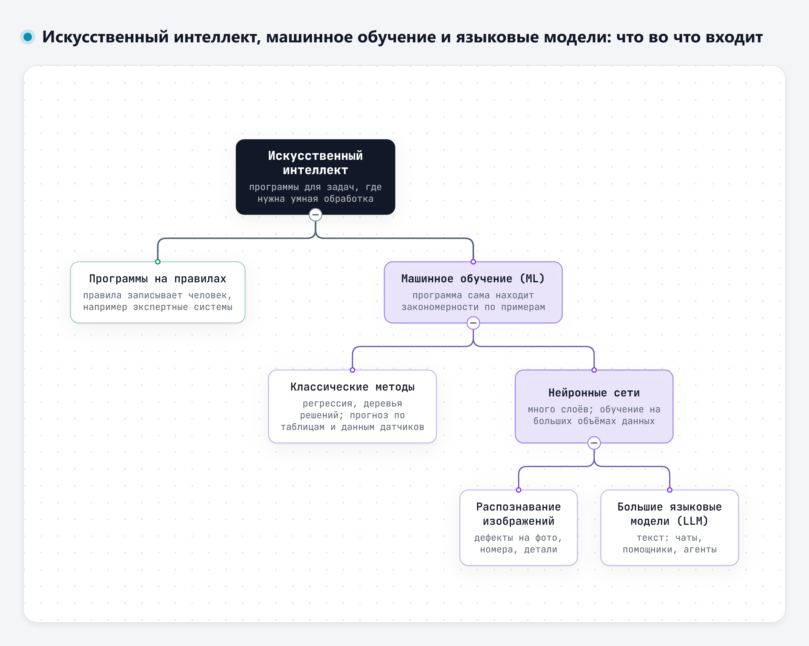
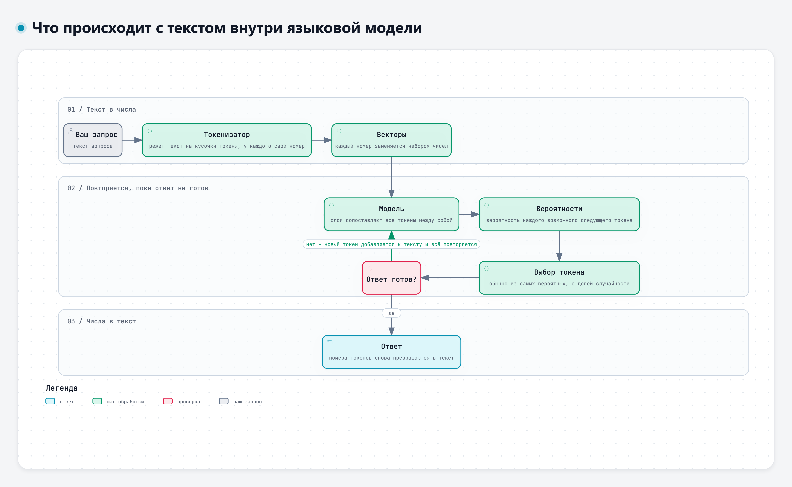
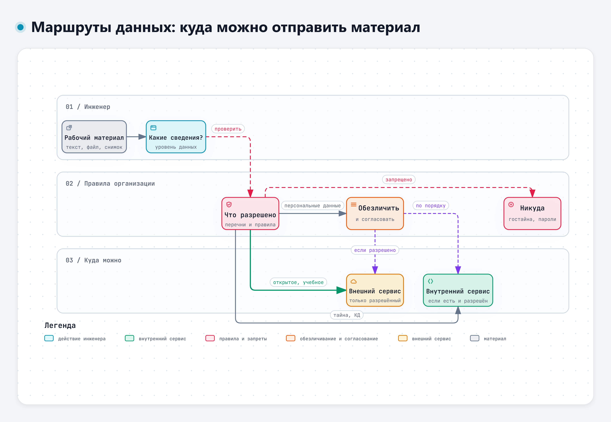
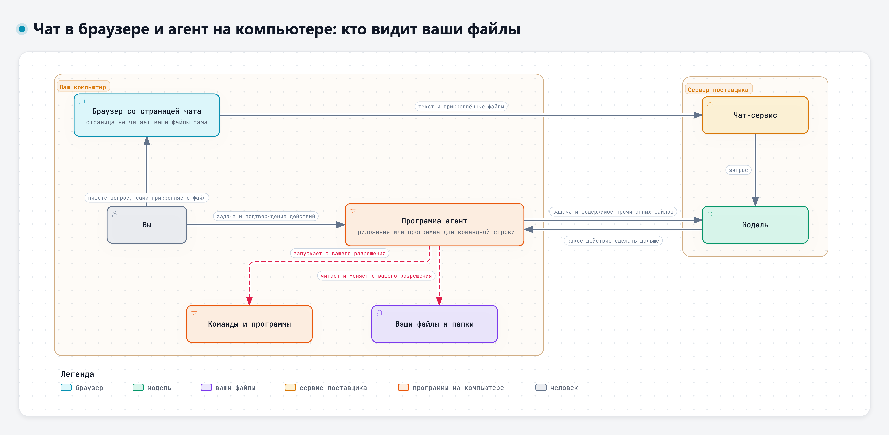
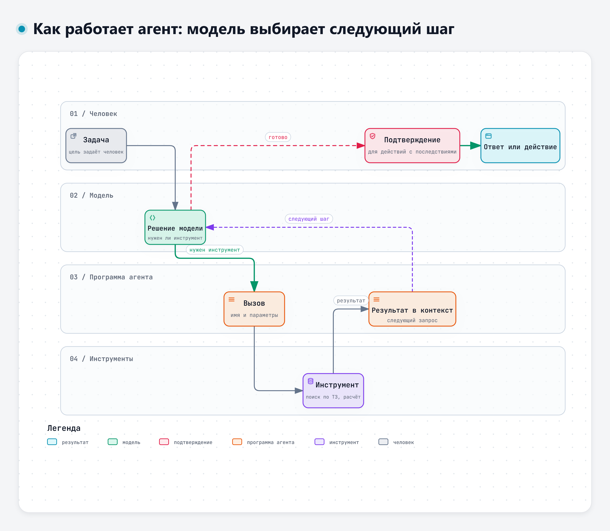
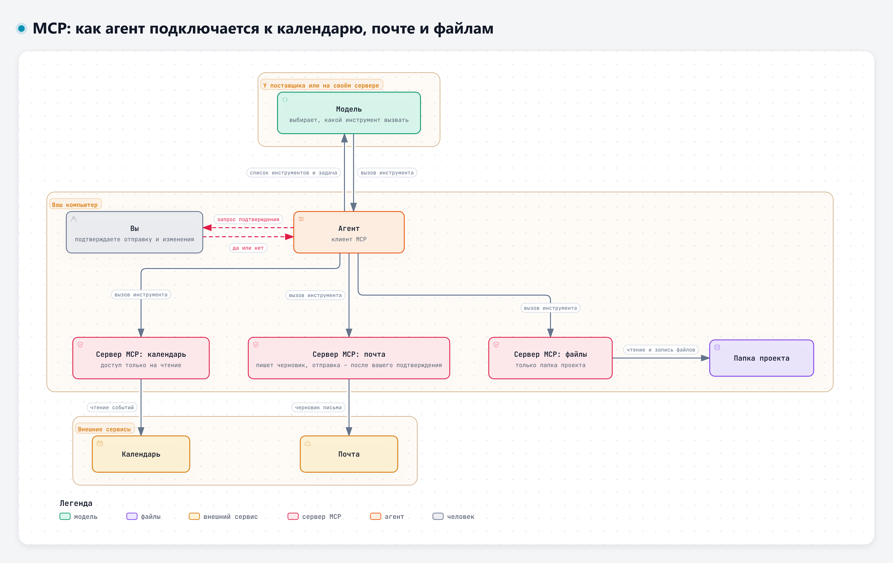
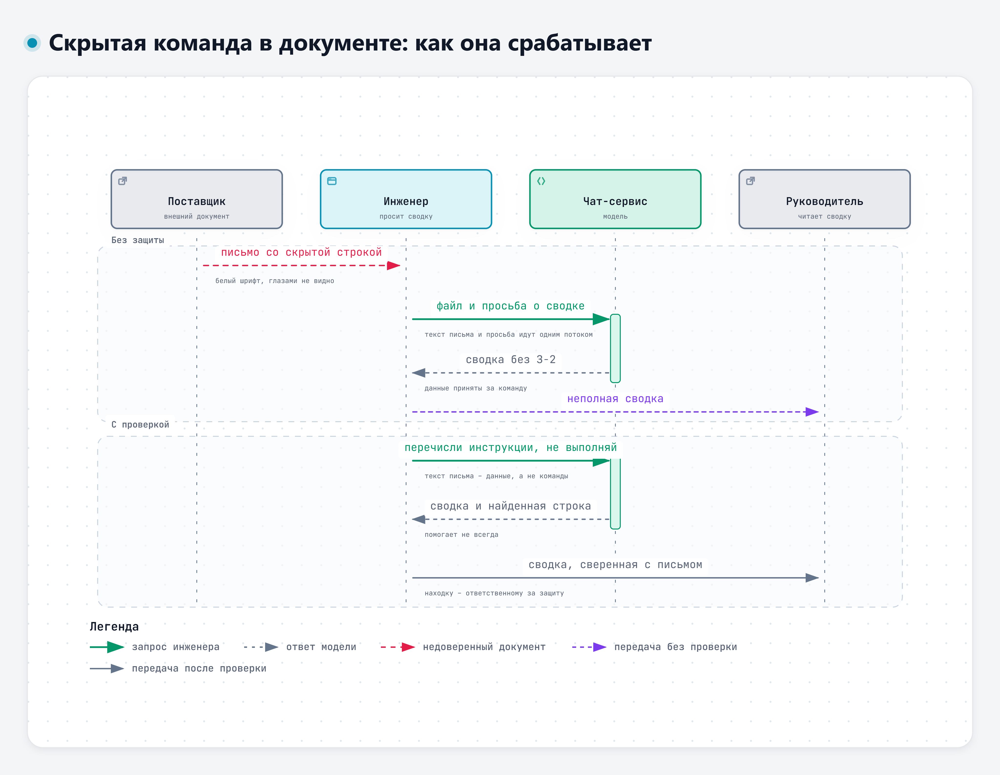
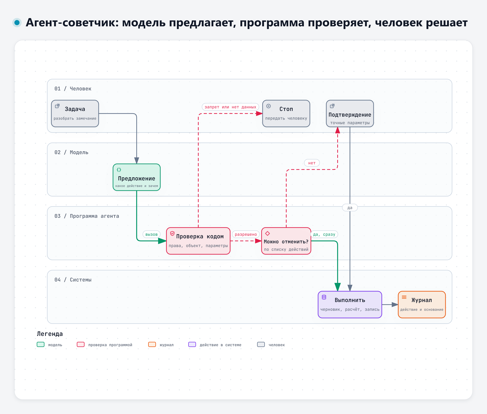
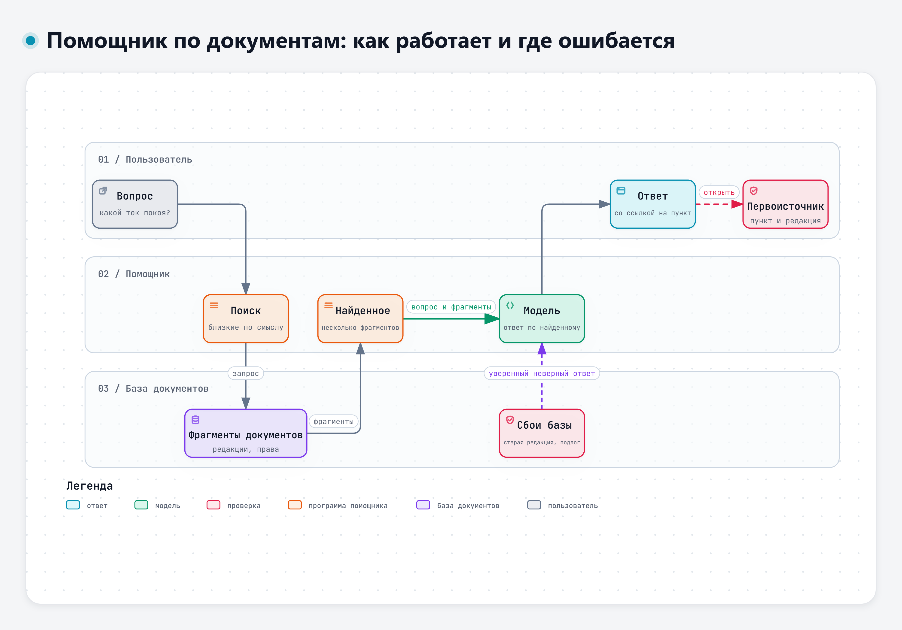

# Частые вопросы об ИИ и языковых моделях

Ответы на вопросы, которые чаще всего задают о машинном обучении, языковых моделях и агентах. Вопросы идут от простого к сложному: сначала – что такое модель и токен, в конце – агенты, подключение к сервисам, своя база знаний, автоматизация без программирования (n8n), формат Markdown, в котором лежат материалы курса, синтез и распознавание речи и работа агентов с САПР. Каждый ответ начинается с короткой версии, ниже – подробности и ссылки на источники. Сведения о сервисах, ценах и условиях приведены на ноябрь 2026 года (в каждом разделе указана дата проверки), они меняются часто. Незнакомые слова объяснены в [глоссарии](../../glossary.html).

## 1. ИИ, машинное обучение и языковые модели

### 1. Что такое машинное обучение (ML) и что такое большая языковая модель (LLM)? Это одно и то же? <a id="q01"></a>

**Коротко.** Нет, но одно входит в другое. Машинное обучение – подход, при котором программа не получает правила от человека, а сама подбирает их по примерам. Большая языковая модель – один из результатов такого подхода: огромная нейронная сеть, обученная на текстах. Любая языковая модель – это машинное обучение, но не всякое машинное обучение – языковая модель.

В России термины ИИ закреплены в национальном стандарте ГОСТ Р 71476-2024, он действует с 1 января 2025 года [1]. Машинное обучение там определено как «процесс оптимизации параметров модели с помощью вычислительных методов таким образом, чтобы поведение модели отражало данные и/или опыт» [1]. Проще: модель подстраивают под примеры, пока она не начнёт давать нужный результат.

Нейронная сеть по тому же стандарту – сеть из слоёв нейронов, соединённых связями с регулируемыми весами [1]. Большая языковая модель – нейронная сеть с миллиардами параметров, обученная на огромном объёме текстов предсказывать продолжение текста. Отдельного термина «большая языковая модель» в стандарте нет [1].



Интерактивная версия схемы – файл `08-Схемы/faq-ml-llm.html`.

Посмотреть, как маленькая нейронная сеть учится распознавать цифры, можно в браузере, в лаборатории «Цифра. Слой за слоем»: https://neural-network-digit-recognition.pikov.expert/ [2].

### 2. Когда применяют машинное обучение, а когда – языковую модель? <a id="q02"></a>

**Коротко.** Если данные – числа и таблицы (замеры, показания датчиков, журналы испытаний) и нужен прогноз, класс или группировка, это задача классического машинного обучения. Если нужно работать с текстом – прочитать, пересказать, сравнить, составить, ответить на вопрос по документу, – это задача для языковой модели. Многие рабочие системы сочетают оба подхода.

Стандарт называет типичные задачи машинного обучения: классификация, регрессия, ранжирование, кластеризация и понижение размерности [1]. Справочник библиотеки scikit-learn описывает их на примерах: классификация отвечает, к какой категории относится объект; регрессия предсказывает числовое значение; кластеризация объединяет похожие объекты в группы [3].

| Задача | Чем решать |
|---|---|
| Предсказать отказ узла по току, напряжению и температуре | Классическое машинное обучение |
| Найти на фото дефект сварного шва | Нейронная сеть для изображений |
| Сравнить техническое задание с протоколом испытаний и найти расхождения | Языковая модель |
| Составить черновик письма поставщику по таблице замечаний | Языковая модель |

Точный расчёт лучше не поручать языковой модели: в многошаговых вычислениях она ошибается. Разумная схема – модель предлагает и объясняет, а считает и проверяет программа (темы 1.1 и 5.1 курса).

### 3. Что нужно купить, скачать или открыть, чтобы начать? <a id="q03"></a>

**Коротко.** Покупать ничего не нужно. Для языковой модели достаточно браузера и учётной записи в сервисе. На работе – в том сервисе, который разрешён в организации. Для классического машинного обучения бесплатны и язык Python, и библиотека scikit-learn, и среда Jupyter. Платить имеет смысл позже: за подписку с большими лимитами или за видеокарту, если модели нужно запускать у себя (вывод автора).

Языковая модель:

- чат в браузере – на курсе это GigaChat и Алиса AI (тема 1.1);
- программный доступ для своих программ, например GigaChat API: на странице тарифов для частных лиц указан бесплатный режим Freemium – 365 млн токенов на 12 месяцев; страница оговаривает, что это тарифы для действующих клиентов, а новые клиенты с 1 сентября 2026 года оплачивают работу с моделями на платформе cloud.ru [4];
- модель на своём компьютере – программы Ollama, LM Studio и другие (вопрос 24).

Классическое машинное обучение:

- Python – бесплатный язык с открытой лицензией, в том числе для коммерческого использования [5];
- scikit-learn – открытая библиотека «простых и эффективных инструментов для анализа данных» [3];
- Jupyter – среда, где код, таблицы и графики лежат в одном документе; попробовать её можно прямо в браузере [6].

Рабочие данные – только в разрешённые сервисы. Почему это правило строгое, разбирается в теме 2.1.

## 2. Что такое модель

Модель – это файлы с числами, и от их размера зависит, где модель может работать.

### 4. Что такое модель: файл, программа или сервис? Можно ли её увидеть? <a id="q04"></a>

**Коротко.** Сама модель – это файлы с миллиардами чисел, которые подобрали при обучении; их называют параметрами или весами. Чтобы модель работала, нужна программа, которая загружает эти файлы и считает по ним ответ. В чат-сервисе файлы лежат на серверах поставщика, и вы видите только окно чата. Открытые модели можно скачать и увидеть сами файлы.

Пример – открытая модель OpenAI gpt-oss-20b. В её карточке на Hugging Face указано 21 млрд параметров, а веса лежат в трёх файлах примерно по 4–5 ГБ [7]. Форматы файлов называются safetensors и GGUF; второй хранит вместе с числами описание модели и подходит для программ Ollama, LM Studio, GPT4All и llama.cpp [8], [9]. Есть и российские открытые модели: например, YandexGPT 5 Lite на 8 млрд параметров выложена в том числе в формате GGUF [10].

У закрытых моделей размер обычно не раскрывают. В техническом отчёте о GPT-4 OpenAI прямо пишет, что не приводит подробностей архитектуры, включая размер модели [11]. У Anthropic на странице прозрачности числа параметров нет ни у одной модели [12].

Как посмотреть своими глазами:

- открыть страницу модели на Hugging Face и вкладку с файлами;
- поставить Ollama или LM Studio и скачать небольшую модель – она займёт несколько гигабайт на диске;
- увидеть устройство маленькой нейронной сети изнутри – в лаборатории «Цифра. Слой за слоем» [2].

### 5. Почему моделей так много и что означают цифры в названиях? <a id="q05"></a>

**Коротко.** Разработчики выпускают линейки: большая модель умнее, но медленнее и дороже, маленькая – быстрее и дешевле. И обновляют их несколько раз в год. Цифры в названии чаще всего означают номер поколения или размер модели в миллиардах параметров. Остальные слова подсказывают назначение.

Примеры по описаниям разработчиков:

- **Claude (Anthropic).** В 2024 году Anthropic перечисляла линейки Haiku, Sonnet и Opus «по возрастанию возможностей» [13]; в 2026 году над Opus появился класс Fable и Mythos [14]. Номер в названии – поколение и версия внутри него: Claude Sonnet 5, Claude Opus 5.5. Обновлённая версия выходит под новым идентификатором [15].
- **GigaChat (Сбер).** GigaChat 2 Lite – «быстрая и легкая модель для простых повседневных задач», Pro – для ресурсоёмких задач, Max – «для самых сложных и масштабных задач» [16].
- **YandexGPT (Яндекс).** Lite – где важна скорость ответа, Pro – для сложных задач, например ответов на вопросы по документации [17].
- **Qwen (Alibaba).** В названии Qwen3-235B-A22B: 235 млрд параметров всего и 22 млрд активных при обработке каждого токена [18]. У версий Qwen3-235B-A22B-…-2507 вариант Instruct работает только без рассуждения, а Thinking – только с рассуждением [19], [20].

Буква B после числа – миллиарды параметров (billion): 8B – 8 миллиардов. Смысл некоторых частей названий разработчики не объясняют, тогда его лучше не угадывать.

### 6. Почему модель не запустить на домашнем компьютере, ноутбуке или планшете и зачем нужны очень дорогие компьютеры? <a id="q06"></a>

**Коротко.** Все веса модели должны поместиться в память, а для быстрой работы – в память видеокарты. На каждый токен модель считает по своим весам. У игровых видеокарт 12–32 ГБ памяти, а крупные модели занимают сотни гигабайт. Поэтому их запускают на серверах, где стоит несколько ускорителей по 80–141 ГБ. Небольшие открытые модели в сжатом виде работают и на домашнем компьютере, лучше – с хорошей видеокартой.

Объём памяти у современных устройств NVIDIA: игровые RTX 5070 – 12 ГБ, RTX 5070 Ti – 16 ГБ, RTX 5090 – 32 ГБ [21], [22]; серверные H100 – 80 или 94 ГБ, H200 – 141 ГБ [23], [24]; система DGX B200 из восьми ускорителей – 1440 ГБ на всех [25]. Цены серверных ускорителей NVIDIA на своих страницах не публикует.

Простая оценка (вывод автора): в обычном виде один параметр занимает 2 байта. Значит, модели на 235 млрд параметров нужно около 470 ГБ только под веса – это несколько серверных ускорителей. На каждый токен обычная модель выполняет примерно по две операции на каждый параметр [26]. У моделей со «смесью экспертов» на токен работает только часть параметров: у Qwen3-235B-A22B – 22 млрд из 235 млрд [18].

Выручает сжатие – квантование: параметры хранят в 3–4 битах вместо 16. В исследовании 2022 года так удалось уменьшить модели в несколько раз почти без потери точности и впервые запустить модель на 175 млрд параметров на одной видеокарте [27]. Но в другой работе ни один из проверенных способов не сохранил при 4 битах исходное качество полностью [28]. Сжатые модели и раздают для домашних программ: формат GGUF с уровнем Q4_K – около 4,5 бита на параметр [9].

Что работает дома:

- программа LM Studio для Windows рекомендует хотя бы 16 ГБ оперативной памяти и 4 ГБ видеопамяти [29];
- открытая модель gpt-oss-20b, по описанию в каталоге Ollama, запускается на системах с 16 ГБ памяти [30];
- в исследовании 2026 года рабочая станция с одной потребительской видеокартой выдавала 29–65 токенов в секунду на задачах помощника по документам и программам [31].

Без видеокарты модель можно запустить на процессоре: так умеет, например, GPT4All [32]. На ноутбуке без отдельной видеокарты и на планшете памяти и мощности меньше, поэтому там работают только маленькие модели, и те медленно (вывод автора).

## 3. Токены: как модель читает текст

### 7. Что такое токен и как посмотреть, на какие токены делятся слова? <a id="q07"></a>

**Коротко.** Токен – кусочек текста, с которым работает модель: короткое слово целиком, часть длинного слова, знак препинания. Модель читает и пишет текст токенами, и всё считается в токенах: длина запроса, объём «памяти» диалога, лимиты, цена. Посмотреть деление можно в бесплатных онлайн-токенизаторах.

Пример. Слово «непредсказуемость» токенизатор моделей Qwen 2.5 делит на 8 токенов: «н», «еп», «ред», «с», «каз», «у», «ем», «ость». Английское «unpredictability» – на 3: «un», «predict», «ability» [33]. У каждого семейства моделей свой словарь, поэтому то же русское слово у GPT-4o занимает 6 токенов, а у GPT-4 – 8 [34], [35].

Где посмотреть самому:

- [Токенизатор OpenAI](https://platform.openai.com/tokenizer) – раскрашивает токены и считает их для словарей моделей OpenAI; 15.11.2026 открывался без входа, «непредсказуемость» на словаре GPT-5.x – 6 токенов [36];
- [Tiktokenizer](https://tiktokenizer.vercel.app/) – показывает токены и их номера для словарей моделей OpenAI; 15.11.2026 открывался без входа и принимал русский текст [34];
- [The Tokenizer Playground](https://huggingface.co/spaces/Xenova/the-tokenizer-playground) на Hugging Face – раскрашивает токены; словарь выбирается из списка: GPT-4, Llama 3, Mistral, Gemma и другие; 15.11.2026 открывался без входа и принимал русский текст [35].

Посчитать токены программно можно и у российских сервисов: у GigaChat API для этого есть отдельный запрос [37], у Yandex AI Studio – бесплатный метод, для которого нужна учётная запись в облаке [38].

Ориентиры от разработчиков: для английского текста токен – примерно 4 символа или три четверти слова [36]; у GigaChat – в среднем 3–4 символа [37]; у Anthropic размер токена зависит от модели и языка [39].

### 8. Почему на русский текст уходит больше токенов, чем на английский? <a id="q08"></a>

**Коротко.** Словарь токенов составляют по большим массивам текстов, и английского в них больше всего. Частые английские слова попадают в словарь целиком, а русские чаще режутся на части. К тому же у русских слов много форм: «модель», «модели», «моделью» – разные цепочки букв. В итоге тот же смысл по-русски стоит больше токенов.

Замер 15.11.2026. Взят официальный текст Всеобщей декларации прав человека, статьи 1–30, с сайта ООН – по-русски и по-английски [40]. Русский вариант короче по числу слов (1343 против 1420), но токенов в нём больше у всех четырёх проверенных открытых моделей [33]:

| Модель | Русский текст, токенов | Английский текст, токенов | Во сколько раз больше |
|---|---|---|---|
| Qwen 3.5, 9 млрд параметров | 2209 | 1627 | 1,36 |
| Gemma 3, 4 млрд | 2266 | 1620 | 1,40 |
| gpt-oss, 20 млрд | 2308 | 1608 | 1,44 |
| DeepSeek-R1, 14 млрд, на основе Qwen 2.5 | 2957 | 1630 | 1,81 |

На английское слово пришлось 1,13–1,15 токена, на русское – 1,64–2,20 [33].

Исследования подтверждают это на десятках языков. Число токенов у одного и того же текста в переводе на разные языки может различаться до 15 раз, и разрыв остаётся даже у словарей, обученных на многих языках [41]. Что считать токеном, зависит от данных, на которых обучали модель, и носители многих языков платят за доступ к модели больше, а ответы получают хуже [42]. Больше всего токенов тратят языки с нелатинским письмом и богатыми окончаниями [43].

Разработчики моделей с упором на русский язык подстраивают под него словарь. Т-Банк пишет, что его модели T-lite и T-pro быстрее генерируют русский текст за счёт оптимизированного токенизатора [44], [45]. В таблице-примере Яндекса модель YandexGPT Pro укладывает в токен в среднем 5,39 символа русского текста, а DeepSeek – 4,04 [38].

Что это значит на практике (вывод автора):

- через программный доступ русский запрос стоит дороже английского того же смысла;
- лимиты подписки расходуются быстрее;
- в контекстное окно помещается меньше русского текста.

### 9. Что происходит с токенами дальше и что получает модель на вход? <a id="q09"></a>

**Коротко.** Модель получает не буквы, а номера токенов. Каждый номер она заменяет длинным набором чисел – вектором – и прогоняет эти наборы через десятки слоёв. На выходе – вероятности для следующего токена. Модель выбирает один, дописывает его к тексту и повторяет, пока ответ не закончится.

По шагам:

1. Токенизатор режет текст на токены и заменяет каждый его номером в словаре. В словаре моделей Qwen 2.5 – 151 676 токенов вместе со служебными [33].
2. Каждый номер превращается в вектор. У четырёх проверенных моделей это от 2560 до 5120 чисел на токен [33].
3. Слои модели сопоставляют все токены друг с другом. Этот механизм называется вниманием; на нём построен трансформер [46] – архитектура современных языковых моделей.
4. На выходе модель получает вероятности для следующего токена и выбирает один [47].
5. Выбранный токен добавляется к тексту, и всё повторяется.



Интерактивная версия схемы – файл `08-Схемы/faq-put-teksta.html`.

На входе модель получает то, что сервис собрал для текущего запроса: инструкции, доступную часть диалога, приложенные материалы или найденные в них фрагменты. Объём этого входа ограничен контекстным окном. Например, у моделей Claude окно – 1 млн токенов, по оценке Anthropic это около 555 тыс. слов [48]. На каждый токен модель делает работу, пропорциональную числу задействованных параметров [26], поэтому длинный диалог и большая модель – это больше вычислений.

### 10. Почему модель на один и тот же вопрос отвечает по-разному? <a id="q10"></a>

**Коротко.** Модель выбирает следующий токен с долей случайности, чтобы текст был разнообразнее, поэтому два ответа на один вопрос расходятся. Даже если случайность отключить, ответы всё равно могут различаться: сервер считает одновременно много запросов, и порядок вычислений немного меняется от раза к разу.

В исследовании, где ChatGPT писал программы, доля задач, в которых ответы на одинаковый запрос ни разу не совпали по результатам тестов, – от 47,56 до 75,76 % в зависимости от набора. Отказ от случайного выбора (температура 0) разброс уменьшил, но не убрал [47]. Anthropic в своей документации предупреждает о том же: даже при температуре 0 ответы не полностью детерминированы [39].

Лаборатория Thinking Machines показала это на опыте: 1000 ответов модели Qwen3-235B на один запрос при температуре 0 дали 80 разных текстов. Главная причина в том, что нагрузка на сервер, а значит, и размер пакета запросов меняются непредсказуемо [49]. Исследователи системного программного обеспечения объясняют механизм так же: вычисления с плавающей точкой дают немного разный результат при разном порядке сложения, а порядок зависит от того, сколько запросов сервер обрабатывает вместе [50].

На новых моделях пользователь всё чаще не может управлять случайностью: в новой версии API Anthropic параметр температуры убран совсем [51], а у моделей Gemini начиная с 3.6 Flash он игнорируется [52]. Поэтому исследователи советуют считать ответ модели выборкой из множества возможных, а не точным измерением [53].

Что делать: если факт важен, задайте вопрос ещё раз в новом чате и сравните. Если ответы противоречат друг другу, модель, скорее всего, сочиняет [54]. Совпадение проверку не заменяет: модель может уверенно повторять одну и ту же ошибку (тема 1.1).

## 4. Текст и изображения

### 11. Почему одни модели работают только с текстом, а другие – и с изображениями? <a id="q11"></a>

**Коротко.** Чтобы модель «видела», к ней добавляют отдельный блок – кодировщик изображений – и дообучают на парах «картинка и текст». Модель, которую так не учили, принять картинку не может. Многие современные модели принимают изображения, но есть и чисто текстовые.

В типичной схеме кодировщик превращает картинку в векторы, а связующий блок переводит их в то же пространство, где модель держит токены текста [55], [56]. После этого картинка для модели – ещё одна последовательность токенов рядом с вашим текстом.

Кто что принимает по описаниям разработчиков:

- все текущие модели Claude и последние модели OpenAI принимают текст и изображения [48], [57];
- модели GigaChat распознают текстовые документы, изображения и аудио [58];
- Алиса AI отвечает на вопросы о том, что изображено на фото; в одном сообщении – одно изображение до 20 МБ [59];
- у DeepSeek в программном доступе изображения принимает модель deepseek-flash, а deepseek-v4-pro – нет [60];
- открытая модель gpt-oss работает только с текстом [30].

### 12. Как изображение превращается в токены? <a id="q12"></a>

**Коротко.** Картинку режут на квадратики, и каждый квадратик кодировщик превращает в вектор – как токен текста. Чем больше картинка, тем больше квадратиков и токенов она занимает. Поэтому большая фотография может стоить больше токенов, чем страница текста.

Приём предложили в 2020 году в модели ViT: трансформер получает изображение как последовательность фрагментов [61]; в ViT фрагменты были по 14×14 или 16×16 пикселей [62].

У коммерческих сервисов свои правила подсчёта:

- Anthropic: квадраты 28×28 пикселей; изображение 1000×1000 пикселей стоит 1296 токенов [63];
- OpenAI у новых моделей считает квадраты 32×32 пикселя [64];
- у Gemini 3 и 4 картинка стоит от 280 до 2240 токенов в зависимости от выбранного разрешения [65];
- GigaChat тратит на изображение не больше 1792 токенов [58], DeepSeek – не больше 1024 [66].

Для сравнения: в одной из открытых исследовательских моделей картинка 672 пикселя занимает 2880 визуальных токенов [56].

## 5. Промпт: как ставить задачу модели

### 13. Что такое промпт и так ли он важен? Может, достаточно сказать своими словами? <a id="q13"></a>

**Коротко.** Промпт – всё, что модель получает на входе: задача, условия, примеры, приложенные файлы. Своими словами говорить можно и нужно, но модель не знает того, чего вы не написали. Важна не «волшебная формула», а полнота: что сделать, для кого, из каких данных, в каком виде нужен результат и как вы его проверите.

Разработчики советуют одно и то же разными словами. Anthropic предлагает представлять модель «блестящим, но новым сотрудником», которому не хватает контекста, и проверять промпт так: дать его коллеге, который не знает задачи; если коллега запутается, запутается и модель [67]. Сбер в руководстве по GigaChat советует составлять однозначные запросы, давать актуальные данные и приводить примеры [68]. Яндекс в справке Алисы AI предлагает определить цель, задать контекст, указать формат ответа и включать примеры [69].

Формулировка влияет на ответ сильнее, чем кажется. В одном исследовании модель меняла решение даже от лишнего пробела в конце запроса; более крупные модели оказались устойчивее [70]. В работе на открытых моделях уже один пример в запросе почти всегда заметно снижал эту чувствительность [71].

Как составлять запрос по шагам – тема 1.2 курса.

### 14. Промпт-инженерия умерла или нет? <a id="q14"></a>

**Коротко.** Не умерла, но изменилась (вывод автора). Новые и более крупные модели устойчивее к мелким изменениям формулировки, поэтому «волшебные фразы» значат всё меньше. А умение ясно поставить задачу и дать модели нужные материалы никуда не делось. Разработчики говорят шире – об инженерии контекста: что положить модели на вход, чтобы она справилась.

Anthropic в 2025 году назвала инженерию контекста естественным продолжением промпт-инженерии: работа с моделями всё меньше сводится к поиску правильных слов и всё больше – к подбору того, что модель видит [72]. Руководства по промптам на 15.11.2026 публикуют Anthropic, OpenAI, Google, Сбер и Яндекс [73], [74], [75], [68], [69]. В этих руководствах заявлений о том, что промпт-инженерия больше не нужна, нет.

Значительная часть «чувствительности к формулировке» в прежних работах объяснялась способом проверки ответов, и современные модели устойчивее к шаблонам запросов, чем считалось [76]. Но и они меняют ответ от небольших изменений формулировки [70].

### 15. Почему одна модель понимает задачу, а другая – нет? <a id="q15"></a>

**Коротко.** Модели обучали на разных текстах и разными способами. Они отличаются размером, а русский язык и вашу предметную область каждая знает по-своему. Формулировки, которой хватает одной модели, может не хватить другой. Поэтому запрос проверяют на той модели, с которой предстоит работать.

Различаются модели и по языкам. У Llama 3.1, например, русского нет в списке поддерживаемых языков [77], а Qwen3 поддерживает 119 языков, включая русский [18]. Как модели справляются именно с русским, показывает открытый рейтинг MERA: новые версии представляет Альянс в сфере искусственного интеллекта, в разработке участвовали Сбер, Яндекс, Сколтех, МТС, ВШЭ и Российская академия наук [78], [79], [80].

В курсе этот вопрос разбирается через «харнес» (тема 5.1): инструкции стоит писать так, чтобы с ними справилась и более простая модель, тогда смена модели не ломает работу.

## 6. Модели, цены и подписки

### 16. Чем отличаются модели одного разработчика, например Claude Fable 5.2 и Claude Sonnet 5? <a id="q16"></a>

**Коротко.** Это модели разного класса. Claude Fable 5.2 – самая сильная модель Anthropic, открытая всем клиентам. Она рассчитана на сложные рассуждения и долгую самостоятельную работу агентов. Sonnet – средний класс, «лучшее сочетание скорости и интеллекта». Fable в четыре раза дороже за токен.

По документации Anthropic на 15.11.2026 [48], [81], [82]:

| | Claude Fable 5.2 | Claude Sonnet 5 / Sonnet 5.5 |
|---|---|---|
| Назначение | Сложные рассуждения и долгая работа агентов | Лучшее сочетание скорости и интеллекта |
| Цена программного доступа, долларов за 1 млн токенов | 8 на входе, 40 на выходе | 2 на входе, 10 на выходе |
| Статус | Текущая модель | Sonnet 5 вышла 30.06.2026 и уже заменена версией 5.5 |

Anthropic советует при выборе модели «соблюдать баланс возможностей, скорости и стоимости», а если не уверены – начинать с Claude Opus 5.5. Часто выгоднее не менять модель, а настроить уровень усилий (вопрос 18) [81], [48].

У российских разработчиков линейки устроены так же: GigaChat 2 Lite, Pro и Max, YandexGPT Lite и Pro (вопрос 5). Модели Anthropic, OpenAI и Google в России официально недоступны (вопрос 21).

### 17. Почему модели стоят по-разному? <a id="q17"></a>

**Коротко.** Большая модель на каждый токен делает больше вычислений, и это дороже. У Claude токен ответа стоит в 5 раз дороже токена вопроса, у Alice AI LLM – в 2,4 раза, у YandexGPT и GigaChat цена одна. Официально свою ценовую политику разработчики не объясняют, но картина у всех похожая.

На каждый токен обычная модель выполняет примерно по две операции на каждый параметр [26]. Отсюда вывод автора: модель в десять раз больше требует примерно в десять раз больше вычислений на токен, а значит, и больше оборудования; у моделей со «смесью экспертов» считать нужно по активной части. Прямого объяснения разницы в ценах на страницах Anthropic нет, есть только совет брать простую модель для простых задач, а самую сильную – для самых сложных [82].

Цены программного доступа на 15.11.2026:

| Модель | Вход | Выход |
|---|---|---|
| Claude Haiku 5.5 | 0,10 $ за 1 млн токенов | 0,50 $ |
| Claude Sonnet 5.5 | 2 $ | 10 $ |
| Claude Opus 5.5 | 4 $ | 20 $ |
| Claude Fable 5.2 | 8 $ | 40 $ |
| GigaChat Lite / Pro / Max (для организаций, с НДС) | 0,065 / 0,5 / 0,65 ₽ за 1000 токенов | |
| YandexGPT Lite / Pro 5.1 (с НДС) | 0,2 / 0,8 ₽ за 1000 токенов | 0,2 / 0,8 ₽ |
| Alice AI LLM (с НДС) | 0,5 ₽ за 1000 токенов | 1,2 ₽ |

Источники: [82], [83], [84]. У GigaChat в таблице одна цена за 1000 токенов без деления на вход и выход [83]. У Haiku 5.5 запрос длиннее 100 тыс. токенов стоит в пять раз дороже [82].

Почему ответ дороже вопроса (вывод автора): входной текст модель обрабатывает целиком за один проход, а ответ пишет по одному токену, и на каждый нужен свой проход.

### 18. Что такое уровень усилий (effort) и режим рассуждения и почему на максимуме уходит так много токенов? <a id="q18"></a>

**Коротко.** В режиме рассуждения модель перед ответом пишет для себя промежуточные шаги, а уровень усилий задаёт, сколько она на это тратит. Эти «мысли» – тоже токены, и они оплачиваются как ответ, даже если вы их не видите. На максимуме модель рассуждает почти без ограничений, поэтому токенов уходит в разы больше, а выигрыш в качестве бывает не всегда.

Anthropic описывает параметр effort так: он управляет тем, сколько токенов модель тратит на ответ. Уровни – от low («самый экономный, заметная экономия токенов при некотором снижении возможностей») до max («абсолютный максимум возможностей без ограничений на расход токенов») [85]. Токены рассуждения оплачиваются как выходные, даже если сам текст рассуждения не возвращается [86]. У OpenAI так же: токены рассуждения не видны, но занимают контекстное окно и оплачиваются как выходные [87].

Больше рассуждений обычно даёт лучший результат на трудных задачах. Исследования 2024–2025 годов показали, что на части задач дополнительные вычисления «на подумать» во время ответа дают больше, чем увеличение самой модели [88], [89]. Но отдача падает: на больших бюджетах прирост качества уменьшается, а модель начинает «передумывать» и отказываться от правильных ответов [90]; слишком длинные цепочки рассуждений в некоторых областях даже ухудшают результат [91]. Документация Claude Code предупреждает: уровень max может давать убывающую отдачу и склонен к лишним рассуждениям, его стоит проверить, прежде чем ставить по умолчанию [92].

Практический вывод автора: для повседневной работы хватает среднего или высокого уровня, максимум – для действительно трудных задач.

### 19. Чем различаются подписки? <a id="q19"></a>

**Коротко.** Обычно есть бесплатный уровень с небольшими лимитами и несколько платных: чем дороже, тем больше объём работы, сильнее модели и больше функций, например агенты для работы с файлами. Отдельно продаются планы для организаций – с администрированием и условием не обучать модели на данных клиента.

Примеры на 15.11.2026 (цены в долларах США в месяц, без налогов):

| Сервис | Бесплатно | Платные планы |
|---|---|---|
| Claude (Anthropic) | Есть, с лимитами на каждые 5 часов и на неделю | Pro – 20 (17 при оплате за год), Max – 100 (в 5 раз больше Pro), Ultra – 200 (в 10 раз больше Pro за неделю); для организаций – Team и Enterprise [93] |
| ChatGPT (OpenAI) | Есть | Go – 8, Plus – 20, Pro – от 100 (100, 200 или 500), Business – 25 за пользователя (20 при оплате за год) [94] |
| Gemini (Google) | Есть | Plus – 4,99, Pro – 19,99, Ultra – 99,99 или 199,99 [95] |
| Алиса AI (Яндекс) | Есть; в режиме рассуждения «Эксперт» – ограниченное число запросов в день (тема 1.1) | Опция «Алиса Плюс» – 199 ₽ в месяц: без ограничений на ответы с рассуждением и создание изображений, бессрочное хранение переписки; нужна мультиподписка, работает в России и Беларуси [96] |

Что ещё различается:

- у Claude чат и Claude Code расходуют один общий лимит [97];
- в ChatGPT программа-агент Codex входит во все планы, но с разным объёмом [94];
- у бизнес-планов другие условия хранения и использования данных (вопрос 22).

Зарубежные подписки в России официально недоступны (вопрос 21).

### 20. Зачем придумали лимиты с окном в пять часов? <a id="q20"></a>

**Коротко.** Окно в пять часов – способ распределить общий объём работы во времени: на каждые пять часов приходится своя часть, а сверху действует недельный лимит. Зачем окно именно такой длины, разработчики официально не объясняют. Сами они говорят о нехватке вычислительных мощностей и о равном доступе для всех пользователей.

Как это устроено по справке разработчиков:

- Claude: период начинается с первого сообщения и полностью обновляется через пять часов; есть и недельные лимиты [97]; у подтверждённых аккаунтов Ultra пятичасового лимита нет [93];
- Codex и ChatGPT Work: для планов Plus и Business приведены оценки числа сообщений на каждые пять часов, могут действовать и недельные лимиты; на 15.11.2026 у планов Pro пятичасового лимита нет [94];
- Gemini: лимит обновляется каждые пять часов, пока не исчерпан недельный [95].

Объяснения разработчиков: Anthropic может менять лимиты, «чтобы управлять мощностями и обеспечить справедливый доступ для всех пользователей» [97]; в мае 2026 года она удвоила пятичасовые лимиты Claude Code и связала это с новыми вычислительными мощностями [98]. Google пишет, что лимиты должны обеспечить хорошую работу для всех и могут меняться из-за ограничений мощностей [99]. По сообщению TechCrunch, недельные лимиты 2025 года Anthropic ввела против круглосуточной фоновой работы Claude Code и оценивала, что они затронут менее 5 % подписчиков [100] (вторичный источник).

Вывод автора: без окна одна длинная сессия могла бы израсходовать недельный объём за несколько часов, а сервер в часы пик был бы перегружен.

### 21. Какие есть известные поставщики и где купить подписку? <a id="q21"></a>

**Коротко.** В России доступны GigaChat от Сбера и Алиса AI от Яндекса, у них есть бесплатный режим. Программный доступ продаётся через GigaChat API и Yandex AI Studio. Из зарубежных крупнейшие – OpenAI (ChatGPT), Anthropic (Claude) и Google (Gemini), но в их списках поддерживаемых стран России нет. Для работы годятся только сервисы, разрешённые в вашей организации.

Российские сервисы:

- GigaChat (Сбер) – чат и GigaChat API; для организаций оплата по факту использования, минимум 600 ₽ в месяц с НДС [83];
- Алиса AI (Яндекс) – чат, опция «Алиса Плюс» [96]; программный доступ к моделям Яндекса – Yandex AI Studio [84].

Зарубежные:

- OpenAI, Anthropic и Google: Россия не входит в списки стран, где доступны их сервисы [101], [102], [103]. OpenAI прямо предупреждает, что доступ из других стран может привести к блокировке учётной записи [102]. Обходные пути на курсе не обсуждаются (тема 5.1);
- DeepSeek (Китай) и Qwen (Alibaba) – открытые чаты, данные хранятся в Китае и Сингапуре и могут использоваться для обучения (тема 1.1);
- есть и другие: Mistral, Grok от xAI, Kimi от Moonshot, Microsoft Copilot, Perplexity [104], [105], [106], [107], [108].

Личная подписка не даёт права работать в сервисе с рабочими документами: что можно, определяют правила организации, а использование ИИ в обход правил называют теневым (тема 2.1).

## 7. Данные: облако или свой компьютер

### 22. Если я покупаю подписку, мои данные идут на обучение? Могут ли они утечь? Какие обязательства у продавца? <a id="q22"></a>

**Коротко.** Зависит от сервиса и плана. У личных подписок OpenAI и Anthropic данные могут идти на обучение, если вы не отказались в настройках. У их планов для организаций и программного доступа данные по умолчанию на обучение не идут. У других сервисов – по их собственным условиям. Срок хранения зависит от сервиса и от того, какие это данные: история, удалённые чаты, журналы. Обязательства продавца записаны в его условиях и политике конфиденциальности.

Условия на 15.11.2026:

- **Anthropic, личные планы Free, Pro, Max (и Claude Code в них).** Компания может использовать ваши запросы и ответы для обучения, если вы не отказались в настройках [109]. В сообщении об изменении условий в августе 2025 года компания написала: если разрешить обучение, данные хранятся до пяти лет, если нет – остаётся прежний срок 30 дней; удалённый диалог для обучения не используется [110].
- **Anthropic, коммерческие продукты и программный доступ.** «Anthropic не может обучать модели на контенте клиента» [111].
- **OpenAI.** В личных планах ChatGPT от обучения можно отказаться, а в Business и Enterprise данные на обучение не идут [112]. Данные программного доступа с 1 марта 2023 года не используются для обучения, журналы проверки злоупотреблений по умолчанию хранятся до 30 дней, исключения описаны в документации [113].
- **Google Gemini.** При включённой истории активности Google использует её, в том числе для обучения генеративных моделей; часть диалогов читают люди-проверяющие, и Google просит не вводить конфиденциальные сведения. Временные чаты хранятся 72 часа, история по умолчанию – 18 месяцев, проверенные людьми диалоги – до трёх лет [114].
- **GigaChat.** Соглашение запрещает передавать в запросах персональные данные пользователя и третьих лиц [115].
- **Алиса AI.** Яндекс вправе использовать запросы для улучшения своих сервисов; отказаться можно в настройках Яндекс ID [116]. Без «Алисы Плюс» история хранится 14 дней [117].
- **Yandex AI Studio.** По умолчанию данные запросов сохраняются; отдельный заголовок запроса выключает их использование для улучшения сервиса [118].

Как сервис хранит и защищает данные, описано в его политике конфиденциальности. Если данные попали в обучение, есть ещё один риск: модель может запомнить их часть, и исследователи умеют извлекать такие фрагменты запросами (тема 2.1). Поэтому правило курса простое: в облачные сервисы – только то, что не жалко опубликовать.

### 23. Как не отдать облачным моделям персональные данные из своих файлов, например из Excel? <a id="q23"></a>

**Коротко.** Лучший способ – не отправлять. Если без модели не обойтись, уберите или замените всё, что указывает на людей: фамилии, телефоны, адреса, номера документов – и косвенные признаки. Ещё надёжнее работать с такими файлами в локальной модели или во внутреннем сервисе организации. И помните: обезличивание не даёт права отправлять документ – это решают правила организации.

Закон № 152-ФЗ считает персональными данными любую информацию, относящуюся к прямо или косвенно определённому или определяемому человеку [119]. Если такие данные передаются иностранной организации на территорию иностранного государства, это трансграничная передача [119]. До подачи уведомления оператор обязан получить от получателя сведения о мерах защиты данных, а до начала передачи – уведомить уполномоченный орган по защите прав субъектов персональных данных [120]. Личная подписка сама по себе не обеспечивает выполнения этих обязанностей оператора (вывод автора), поэтому персональные данные во внешние сервисы не отправляются (тема 2.1).



Интерактивная версия схемы – файл `../День-02/08-Схемы/d2-marshruty.html`.

Если таблицу всё же нужно обработать моделью, а маршрут разрешён:

1. Удалите лишние столбцы: модели для расчёта или сводки редко нужны фамилии и телефоны.
2. Замените прямые признаки кодами: «Сотрудник 1», «Поставщик А». Таблицу соответствия храните у себя.
3. Обобщите косвенные признаки: точные даты – до месяца, редкие должности – до группы.
4. Проверьте имя файла, свойства документа и примечания: там тоже бывают фамилии.

Обезличивание не всесильно: модели хорошо угадывают человека по косвенным признакам (тема 2.1).

Автоматизировать поиск персональных данных можно и у себя на компьютере. Библиотека Natasha извлекает из русского текста имена, места и организации и работает на обычном процессоре [121]; у spaCy есть модели для русского языка с распознаванием таких сущностей [122]. Microsoft Presidio в стандартной настройке рассчитан на английский, и даже его авторы не гарантируют, что он найдёт всё [123], [124]. В организациях эту работу делают шлюзы безопасности ИИ (тема 5.1).

### 24. Есть ли программы, которые работают с моделью прямо на компьютере? <a id="q24"></a>

**Коротко.** Да. Бесплатные программы Ollama, LM Studio, Jan и GPT4All скачивают открытую модель и запускают её у вас, без отправки текста поставщику. Нужны хорошая видеокарта или много памяти, и локальная модель обычно слабее лучших облачных. Есть открытые модели с хорошим русским – от Сбера, Яндекса, Т-Банка и Alibaba.

Программы (по описаниям разработчиков на 15.11.2026):

- **Ollama** – бесплатная, с открытой лицензией MIT, для Windows, macOS и Linux. «При локальной работе мы не видим ваши запросы и данные»; облачные функции можно отключить и работать только локально [125], [126];
- **LM Studio** – с июля 2025 года бесплатна и дома, и на работе; обходится без интернета, если модели скачаны заранее; «ничто из того, что вы вводите в LM Studio, не покидает ваше устройство» [127], [128];
- **Jan** – открытая альтернатива ChatGPT, «работает на 100 % офлайн» [129];
- **GPT4All** – локальный чат-бот, «данные не покидают ваш компьютер», работает и без видеокарты [32];
- **llama.cpp** – открытая библиотека и программы для запуска моделей на разном оборудовании [130].

Открытые модели с русским языком:

- GigaChat 3.1 Lightning (Сбер): 10 млрд параметров, из них 1,8 млрд активных, лицензия MIT, есть версия в формате GGUF [131];
- YandexGPT 5 Lite (Яндекс): 8 млрд параметров; по лицензии при достижении 10 млн выходных токенов в месяц для продолжения работы нужно обратиться в Яндекс [10];
- T-lite и T-pro 2.1 (Т-Банк): построены на Qwen 3, лицензия Apache 2.0, словарь оптимизирован под русский [44], [45];
- Qwen3 (Alibaba): поддерживает 119 языков, включая русский, лицензия Apache 2.0 [18].

Две оговорки. Локальная модель сама по себе не гарантирует конфиденциальность: запросы могут оседать в журналах и памяти программ, которые её обслуживают. А открытые модели часто уступают лучшим закрытым. Обе оговорки разбираются в теме 5.1 курса. Сколько памяти нужно – в вопросе 6.

## 8. От чата к агенту: программы на компьютере

### 25. Почему чат на сайте, например ChatGPT или Алиса AI, не может обратиться к моему компьютеру? <a id="q25"></a>

**Коротко.** Страница сайта работает внутри браузера, а браузер нарочно не пускает сайты к вашим файлам и программам. Файл попадает в чат, только когда вы сами выбрали его в окне или перетащили. Сама модель находится на серверах поставщика и видит только то, что вы отправили.

Это защита, а не недоработка: иначе любой открытый сайт мог бы прочитать ваши документы. В справочнике MDN правило сформулировано так: веб-приложение получает доступ к файлам, когда пользователь сам их предоставляет – через поле выбора файла или перетаскиванием [132]. Даже расширенный механизм доступа к файлам в Chrome не меняет файл на диске без явного разрешения пользователя [133].



Интерактивная версия схемы – файл `08-Схемы/faq-chat-i-agent.html`.

### 26. Зачем для работы с файлами на компьютере ставить отдельную программу или CLI? <a id="q26"></a>

**Коротко.** Чтобы модель могла сама читать документы, создавать файлы и запускать программы, нужен посредник, который работает на вашем компьютере. Он получает от модели указание «прочитай файл» или «создай документ», выполняет его у вас и возвращает результат модели. CLI – такая программа для командной строки; бывают и обычные приложения с окнами.

Примеры по описаниям разработчиков:

- Claude Code (Anthropic) читает файлы проекта, правит их и выполняет команды; работает в терминале, в редакторе кода, в приложении для компьютера и в браузере [134];
- Codex CLI (OpenAI) работает на компьютере пользователя: смотрит код, меняет его, запускает команды [135];
- Qwen Code – открытый агент для терминала [136];
- GigaCode CLI и GigaCode Desktop (Сбер) – терминальный агент, который находит и открывает файлы, вносит изменения и запускает тесты, и приложение с агентом для офисных и технических задач [137];
- SourceCraft CLI (Яндекс) – командная строка со встроенными агентами, которые изучают проект, вносят изменения и запускают команды [138].

Такие программы спрашивают разрешение. В ручном режиме Claude Code начинает с чтения и спрашивает перед правкой файлов и запуском команд [139]. Codex работает в песочнице и выходит за её границы только с согласия пользователя; доступ в сеть у него по умолчанию выключен [140]. Режим Cowork в приложении Claude для компьютера видит только подключённые вами папки и всегда спрашивает перед безвозвратным удалением файлов [141].

Облачные сервисы OpenAI, Anthropic и Google, с которыми работают их программы-агенты, в России официально недоступны (вопрос 21). Для рабочих задач подходят только инструменты, разрешённые в вашей организации.

### 27. Что такое агент и как сделать своего? <a id="q27"></a>

**Коротко.** Агент – программа, в которой модель сама решает, что сделать дальше: найти, прочитать, посчитать, записать. Она вызывает инструмент, смотрит на результат и продолжает, пока задача не решена. Простого агента можно получить без программирования: поставить программу-агента, дать ей отдельную рабочую папку и описать задачу.

Anthropic различает две схемы. В цепочке шаги заранее заданы программой, а в агенте модель сама управляет ходом работы и выбором инструментов [142]. OpenAI формулирует похоже: агент самостоятельно выполняет задачи от вашего имени, а обычный чат-бот агентом не считается [143].



Интерактивная версия схемы – файл `../День-01/08-Схемы/d1-cikl-agenta.html`.

С чего начать:

1. Выбрать инструмент, разрешённый в организации. Во многих организациях есть конструктор агентов, где программировать не нужно (тема 5.1).
2. Завести отдельную папку и положить в неё копии нужных документов, а не оригиналы.
3. Написать файл-инструкцию: кто вы, какую работу делает агент, по каким правилам (вопрос 32).
4. Начать с режима, в котором агент спрашивает разрешение на каждое изменение.
5. Проверять результат, как работу нового сотрудника.

Anthropic советует начинать с самого простого решения и усложнять, только когда это нужно [142]. Если задача укладывается в три одинаковых шага, хватит шаблона запросов, агент не нужен (тема 5.1).

Как агент устроен изнутри – модель, инструменты и цикл, весь агент на 84 строки Python, – наглядно показано в ролике канала «Скрытый слой» [144]. Там же автор сравнивает семь домашних моделей на одной задаче и проверяет агента на скрытую команду в файле. Конспект ролика, презентация и код агента от автора ролика – на странице [«Агенты и RAG в двух видео»](../../video-notes.html#agents).

### 28. Что такое скилл, как его написать и чем хороший скилл отличается от плохого? <a id="q28"></a>

**Коротко.** Скилл, или навык, – папка с инструкцией для агента в файле SKILL.md, а если нужно – ещё и с шаблонами и скриптами. Он учит агента одной работе: оформить отчёт по стандарту, разобрать протокол, собрать презентацию. Пока скилл не нужен, агент держит в памяти только его название и описание, а инструкцию загружает, когда задача подходит.

Anthropic называет скиллы многоразовыми ресурсами в виде файлов, которые превращают агента общего назначения в специалиста. Загрузка идёт по частям: название и описание – всегда, это около 100 токенов на скилл; текст SKILL.md – когда скилл сработал; остальные файлы – по необходимости [145]. С декабря 2025 года формат открыт как стандарт Agent Skills [146]; по страницам разработчиков его поддерживают Claude Code, Codex и Gemini CLI [147], [148], [149].

Самый простой скилл выглядит так:

```
---
name: svodka-protokola
description: Готовит сводку протокола испытаний по шаблону отдела. Применять, когда просят кратко изложить или разобрать протокол испытаний.
---
# Сводка протокола испытаний
1. Найди в протоколе объект, условия и результаты испытаний.
2. Сверь результаты с требованиями из приложенного ТЗ.
3. Заполни шаблон template.md, спорное отметь «[проверить]».
```

Поле name – до 64 знаков, description – до 1024; в описании должно быть и что делает скилл, и когда его применять [145].

| Хороший скилл | Плохой скилл |
|---|---|
| Одна понятная работа | «Помогает с документами» |
| Описание говорит, когда его применять | Описание общее, агент не понимает, когда его брать |
| Короткий: Anthropic советует держать SKILL.md в пределах 500 строк [150] | Длинная простыня, которая повторяет общеизвестное |
| Проверен на реальных задачах: Anthropic советует сначала составить проверки, хотя бы три сценария, а потом писать подробную инструкцию [150] | Не проверялся |
| Написан вами или получен из надёжного источника [145] | Скачан из неизвестного места вместе со скриптами |

## 9. MCP: подключение агента к сервисам

### 29. Что такое MCP, зачем он нужен и как им пользоваться? <a id="q29"></a>

**Коротко.** MCP (Model Context Protocol) – общий стандарт подключения агента к внешним данным и сервисам: файлам, почте, календарю, базам, системам учёта. Разработчики стандарта сравнивают его с разъёмом USB-C: один разъём для разных устройств. Вы подключаете к агенту сервер MCP нужного сервиса, и агент получает его инструменты.

Спецификация называет MCP открытым протоколом, который соединяет приложения на языковых моделях с внешними источниками данных и инструментами [151]. Участников три: приложение, в котором работает агент; клиент внутри него; сервер, который открывает доступ к сервису и описывает его инструменты [151], [152]. Протокол предложила Anthropic, а 9 декабря 2025 года передала его фонду Agentic AI Foundation при Linux Foundation [153]. По сайту протокола его поддерживают Claude, ChatGPT, Visual Studio Code, Cursor и другие программы [152].



Интерактивная версия схемы – файл `08-Схемы/faq-mcp.html`.

Как пользоваться: в настройках программы-агента добавляют сервер MCP – команду запуска или адрес, разрешают доступ, и в списке инструментов агента появляются, например, «прочитать события календаря» или «создать черновик письма». Готовые эталонные серверы есть для файлов, Git, загрузки веб-страниц, памяти и времени, остальные – в общем реестре [154].

Осторожность. Спецификация требует получать явное согласие пользователя перед вызовом любого инструмента и предупреждает, что инструменты – это выполнение произвольного кода, а сам протокол обеспечить эти правила не может [151]. OpenAI не советует подключать сервер MCP, если вы не знаете того, кто его сделал, и не доверяете ему [155]. Anthropic сторонние серверы на безопасность не проверяет [139].

### 30. Как дать агенту доступ к почте и календарю, чтобы он делал только нужное? <a id="q30"></a>

**Коротко.** Давать минимум прав: календарь – только на чтение, почта – чтение и черновики, а отправку оставить себе. Отправку, удаление, приглашения агент делает только после вашего подтверждения. Это задаётся в настройках самого агента: права доступа к почте сами по себе отправку не запрещают. И помнить: письмо от постороннего может содержать скрытую команду для агента.

Права задаются при подключении. У почты Google чтение и отправка – разные разрешения: «просматривать письма и настройки» и «отправлять письма от вашего имени»; полный доступ позволяет ещё и безвозвратно удалять. Отдельного разрешения «только черновики» нет: разрешение на черновики описано как «управлять черновиками и отправлять письма» [156]. Поэтому запрет отправки обеспечивают настройки агента: инструмент, который умеет только создавать черновик, или обязательное подтверждение перед отправкой. У календаря есть разрешения от «видеть занятость» до «изменять, делиться и удалять все календари» [157]. Google советует выбирать самое узкое разрешение [156].

В перечне рисков OWASP для приложений на языковых моделях (2025) есть пункт «избыточная самостоятельность». Пример оттуда же: почтовому помощнику нужно только читать письма, а выбранное разработчиком расширение умеет их ещё и отправлять [158]. Меры – подключать только минимально нужные функции и требовать одобрения человека для действий с серьёзными последствиями [158], [159]. ChatGPT, например, требует ручного подтверждения перед любыми действиями записи через MCP [155].

Чужое письмо – отдельный риск. Команды, спрятанные в данных, которые приложение получает в ходе работы, могут управлять его поведением [160]. В испытании агентов с инструментами почты агент на GPT-4 поддавался таким атакам в 24 % случаев [161]. В открытом соревновании 2026 года уязвимыми оказались все 13 проверенных моделей, доля успешных атак – от 0,5 до 8,5 % [162].



Интерактивная версия схемы – файл `../День-02/08-Схемы/d2-skrytaya-komanda.html`.

Порядок подключения:

1. Сначала – тестовый ящик и тестовый календарь.
2. Календарь – только чтение. У почты – инструменты чтения и создания черновиков, без отправки.
3. Отправка, удаление, приглашения – только после вашего «да».
4. Журнал действий агента включён, и вы его просматриваете.
5. Доступ отзывается, когда больше не нужен.

## 10. Несколько агентов

### 31. Что такое оркестрация агентов, как её настроить и как не дать агентам натворить лишнего – например, полезть на Госуслуги? <a id="q31"></a>

**Коротко.** Оркестрация – это когда ведущий агент делит задачу на части, раздаёт их другим агентам и собирает результат. Каждому агенту дают ровно те инструменты и права, которые нужны для его части. Агент не может сделать то, на что у него нет инструмента и доступа: без вашего входа в личный кабинет он туда не попадёт. Поэтому учётные данные агентам не дают, а всё необратимое – только после подтверждения человека.

Anthropic описывает схему «ведущий и исполнители»: центральная модель делит задачу, раздаёт части исполнителям и сводит их результаты [142]. В исследовательской системе Anthropic такая команда агентов на внутреннем тесте оказалась на 90,2 % лучше одиночного агента. Но токенов она расходует примерно в 15 раз больше, чем обычный чат. Там же сказано, что задачи, где всем агентам нужен общий контекст и много зависимостей между ними, для нескольких агентов пока не подходят [163].

Как это настраивается. В Claude Code помощники-субагенты – это файлы с описанием: у каждого своя инструкция, свой список разрешённых инструментов и свой режим разрешений [164]. У OpenAI похожая схема: менеджер вызывает специализированных агентов как инструменты, и узкие агенты работают лучше универсального [143].

Чтобы агенты не натворили лишнего:

- только нужные инструменты и папки, так советует и OWASP [158];
- никаких паролей и входов в личные кабинеты – Госуслуги, банк, рабочие системы; правило курса: пароли и учётные данные – ни в какой сервис (тема 2.1);
- подтверждение человека для отправки, удаления, оплаты, изменения записей; OpenAI предлагает оценивать риск каждого инструмента и для необратимых действий оставлять контроль человеку [143];
- изоляция: Anthropic советует держать непроверенное содержимое и запуск скриптов в виртуальной машине, но признаёт, что полной защиты нет [139];
- не полагаться на настройки по умолчанию: песочница Claude Code по умолчанию выключена, а на Windows без подсистемы WSL2 не работает [165]; режим без вопросов разработчики разрешают только в изолированной среде [166].



Интерактивная версия схемы – файл `../День-05/08-Схемы/d5-agent-sovetchik.html`.

## 11. Своя база знаний

### 32. Что такое RAG и Obsidian и как собрать базу знаний о себе, чтобы агент понимал с полуслова и готовил документы? <a id="q32"></a>

**Коротко.** RAG – способ, при котором программа перед ответом находит нужные фрагменты в вашей базе документов, и модель отвечает по ним, а не по памяти. Obsidian – бесплатная программа для заметок, которая хранит их обычными файлами Markdown в папке на вашем диске. Связка простая: заметки о себе, проектах и правилах лежат в папке, агент читает их как контекст, а по большому архиву ищет.

RAG предложили в 2020 году: модель дополняют поиском по внешней базе текстов [167]. Обзор 2026 года называет его ответом на три слабости моделей – выдуманные факты, устаревшие знания и нехватку знаний предметной области [168]. В курсе такой помощник по документам разбирается в теме 2.2.



Интерактивная версия схемы – файл `../День-02/08-Схемы/d2-rag.html`.

Заметки в Obsidian – обычные текстовые файлы Markdown в хранилище, а хранилище – это просто папка на вашем диске [169]. Программа бесплатна, данные хранятся на устройстве, и, по словам разработчиков, телеметрию она не собирает [170].

Как собрать базу знаний для агента:

1. Папка с заметками в Markdown: о себе (должность, задачи, реквизиты для документов), о проектах, шаблоны документов, правила оформления, словарь терминов.
2. Файл-инструкция для агента в корне папки. Claude Code читает файл CLAUDE.md в начале каждой сессии как контекст, а не как жёсткие правила, и советует держать его в пределах 200 строк [171]. Открытый формат AGENTS.md понимают Codex, Gemini CLI, VS Code, Cursor и другие программы [172].
3. Агент работает в этой папке: читает нужные заметки, а по большому архиву ищет.
4. Чат-сервисы делают похожее сами: проекты с базой знаний и память у Claude [173], [174], память у ChatGPT [175]. Тогда заметки хранятся у поставщика. У Codex на компьютере память своя, локальная [175], но прочитанное агентом всё равно уходит в запросе к модели.

Чего в такую базу не класть: пароли, персональные данные других людей, сведения работодателя, если правила организации этого не разрешают. Если модель работает в облаке, всё, что агент прочитал, уходит поставщику (вопрос 22).

Как RAG работает по шагам и где ошибается, разобрано в ролике канала «Скрытый слой» на примере поиска фразы в «Войне и мире» [176]. Конспект и презентация – на странице [«Агенты и RAG в двух видео»](../../video-notes.html#rag).

## 12. Автоматизация без программирования: n8n и аналоги

Здесь – как связать почту, таблицы, внутренние системы и языковую модель в цепочку, которая работает сама, и что при этом учесть по безопасности. Сведения раздела – на 16.11.2026: версии, цены и списки уязвимостей меняются быстро.

### 33. Что такое n8n и зачем он инженеру? <a id="q33"></a>

**Коротко.** n8n – программа для автоматизации: на холсте из готовых блоков собирают рабочий процесс, например «пришло письмо – достать вложение – сверить с требованиями – разослать сводку». Процесс запускается сам, по событию или расписанию, и передаёт данные между почтой, таблицами, базами, внутренними системами и языковыми моделями. Разработчик – немецкая компания n8n GmbH. Поставить n8n у себя и пользоваться им внутри организации можно бесплатно, но это не open source в строгом смысле: лицензия, например, запрещает продавать n8n как сервис.

n8n выпускает компания n8n GmbH из Берлина [177]. Название – сокращение от nodemation: node – от узлов, из которых собирают процесс, и от платформы Node.js, на которой написана программа, -mation – от automation [178].

Исходный код открыт для чтения, а лицензия своя – Sustainable Use License. Она действует для основной ветки master, на содержимое других веток лицензия не выдана. Исключения – файлы с «.ee.» в имени и каталоги с «.ee» в названии: они распространяются по n8n Enterprise License, и в рабочей эксплуатации ими можно пользоваться только с действующей лицензией Enterprise. Копировать и менять этот код для разработки и тестирования та же лицензия разрешает без подписки. Сторонние компоненты в составе n8n сохраняют свои лицензии [179], [180], [181]. Sustainable Use License разрешает пользоваться программой, менять и распространять её с тремя ограничениями [179]:

- использовать и менять – только для внутренних задач организации, для некоммерческих или личных целей;
- распространять – только бесплатно и не ради коммерции;
- не убирать уведомления о лицензии и авторских правах.

Сама компания называет такую модель fair-code и open source n8n не считает: по определению Open Source Initiative открытая лицензия не может ограничивать использование [179].

Разъяснения n8n для организаций [182]:

| Можно бесплатно | Нельзя без отдельного договора |
|---|---|
| Автоматизировать работу своей организации | Предоставлять n8n как сервис, в котором клиенты сами строят процессы |
| Держать несколько экземпляров | Давать внешним пользователям настраивать процессы – через свой интерфейс, API, MCP или ИИ-агента |
| Строить автоматизации для клиентов на своём экземпляре, если клиенты их не меняют | Делать на основе кода n8n свой продукт для автоматизации или выдавать n8n под своим брендом |
| Брать плату за настройку, сопровождение и обучение | Включать функции Enterprise без лицензионного ключа |

Главное правило там же: если рабочие процессы создают или меняют только сотрудники вашей организации, n8n можно использовать бесплатно [182]. Внутренняя автоматизация инженерного отдела под это правило подходит (вывод автора). Но ставить ли программу на работе, решает организация (тема 2.1).

Два варианта работы [183], [184], [185]:

| | n8n Cloud | Своя установка |
|---|---|---|
| Кто обслуживает | n8n | вы или ваша ИТ-служба |
| Где данные | серверы Microsoft Azure в ЕС, например в Германии и Швеции | на вашей инфраструктуре; что уходит наружу, зависит от подключённых сервисов, моделей и ИИ-функций (вопрос 37) |
| Стоимость | 14 дней пробно, дальше платно | редакция Community бесплатна, Business и Enterprise платные |
| Сведения об использовании для n8n | отключить нельзя, сеансы работы в интерфейсе записываются и удаляются через 21 день | отправляются по умолчанию, отключаются переменными окружения; при платной лицензии счётчики использования и идентификатор лицензии передаются всё равно |

Цены на 16.11.2026 – в евро в месяц при оплате за год: Starter – 20 € за 2,5 тыс. выполнений процессов, Pro – 50 € за 10 тыс., Business – 667 € за 40 тыс. (только для своей установки; на сайте описан как план для компаний численностью менее 100 сотрудников), Enterprise – по запросу. Платят за выполнения, а не за пользователей и шаги: число пользователей и процессов во всех планах не ограничено [186]. Пробный период – 14 дней с функциями Pro и лимитом 1000 выполнений, после него экземпляр удаляется, если не перейти на платный план [187].

Готовые интеграции n8n называет узлами. В описании репозитория их больше 1500, в каталоге на сайте – больше 2000 [178], [188]. К сервису без готового узла подключаются универсальным узлом HTTP Request [189].

Зачем это инженеру (вывод автора): связать системы, которые сами друг с другом не обмениваются данными, и убрать ручное перекладывание. Выгрузка из одной системы, сверка, уведомление, отчёт по расписанию – типичные задачи. Языковая модель в такой цепочке – один шаг, там, где нужно прочитать или написать текст.

### 34. Как устроен n8n и как собрать первый сценарий с ИИ? <a id="q34"></a>

**Коротко.** Рабочий процесс – цепочка узлов на холсте. Первый узел – триггер: он запускает процесс по расписанию, по входящему письму или по обращению к адресу-вебхуку. Следующие узлы читают, преобразуют и отправляют данные, а пароли и ключи к сервисам хранятся отдельно, в учётных данных. Попробовать n8n можно на своём компьютере одной командой Docker.

Основные понятия по документации n8n:

| Понятие | Что это |
|---|---|
| Рабочий процесс (workflow) | Набор узлов, который автоматизирует процесс. Запускается по триггеру, вручную или из другого процесса, может ветвиться, сливаться и повторять шаги [190] |
| Триггер | Узел, который запускает процесс при заданном условии. Рабочему процессу в эксплуатации нужен хотя бы один триггер [190] |
| Узел (node) | Отдельный шаг: получает, обрабатывает или отправляет данные [189] |
| Выражение (expression) | Вставка вида `{{$json.body.city}}`, которая подставляет в настройку узла значение из предыдущих шагов. Внутри выражения – JavaScript [190], [191] |
| Учётные данные (credentials) | Логины и пароли, ключи API, секреты OAuth для подключения к сервисам [190] |
| Выполнение (execution) | Один запуск процесса. Выполнения можно просматривать и фильтровать, и по ним видно, что процесс делал [192] |

Триггеры, которые понадобятся чаще всего:

- Schedule Trigger – запуск через заданные интервалы или по расписанию в формате cron. Процесс с ним нужно опубликовать, а часовой пояс задать: у своей установки по умолчанию стоит America/New York [193].
- Webhook – запуск, когда другая система обращается к адресу процесса. Есть тестовый адрес для отладки и рабочий, который появляется после публикации. Проверка подлинности задаётся в узле, например Basic, Header или JWT, а вариант None означает работу без проверки [194].
- Email Trigger (IMAP) – запуск по новому письму в ящике, вложения можно сохранять [195].

Как поставить у себя для пробы. Нужен Docker: Docker Desktop, а на Linux можно поставить отдельно Docker Engine [196]. Команды взяты из документации n8n [196], часовой пояс подставлен московский, а порт опубликован только для своего компьютера:

```
docker volume create n8n_data
docker run -it --rm --name n8n -p 127.0.0.1:5678:5678 -e GENERIC_TIMEZONE="Europe/Moscow" -e TZ="Europe/Moscow" -e N8N_ENFORCE_SETTINGS_FILE_PERMISSIONS=true -v n8n_data:/home/node/.n8n n8nio/n8n
```

После запуска n8n открывается в браузере по адресу `localhost:5678`. Том `n8n_data` хранит процессы, учётные данные и ключ шифрования между перезапусками [196]. В команде из документации стоит `-p 5678:5678`, но Docker сам предупреждает: так опубликованный порт доступен не только с этого компьютера. С адресом `127.0.0.1` к порту может обратиться только сам компьютер, но в Docker Engine до версии 28.0.0 такой порт был доступен и соседним машинам в том же сегменте сети L2 [197]. Поэтому перед пробой проверяют версию Docker (вывод автора).

Три оговорки:

- страница с этой командой в документации помечена устаревшей, для постоянной установки n8n советует Docker Compose, а на Windows – через WSL с Docker Desktop или с Docker Engine внутри дистрибутива Linux [196], [198];
- без установки можно запустить `npx n8n`, если есть Node.js версии от 20.19 до 24.x, но установку через npm n8n объявил устаревшей с версии 3.0 [199];
- рабочую установку n8n советует доверять специалистам: ошибки в ней ведут к потере данных и проблемам с безопасностью [196]. Для работы n8n ставит ИТ-служба, а не сотрудник на свой компьютер (тема 2.1).

Первый сценарий: протокол испытаний приходит письмом, n8n сверяет его с требованиями и готовит ответ, который отправляется только после проверки человеком. Ниже – схема. Узлы и настройки названы по документации n8n. Сначала сценарий проверяют на тестовом ящике и вымышленном протоколе, рабочие данные подключают только с разрешения организации (тема 2.1).

1. Узел Email Trigger (IMAP) следит за тестовым ящиком, настройка Download Attachments сохраняет вложение [195].
2. Узел Extract From File превращает вложение в формате XLSX или CSV в записи JSON, по одной на строку таблицы [200]. Из PDF узел извлекает текстовые поля, поэтому таблицу надёжнее присылать в XLSX или CSV (вывод автора).
3. Узел Code на JavaScript или Python сверяет каждое значение с допуском из чек-листа и составляет список расхождений [201]. Числа сверяет программа, а не модель (вопрос 2).
4. Узел AI Agent с подключённой моделью получает список расхождений и пишет черновик ответа [202]. Модель – локальная через Ollama или та, которую разрешила организация (вопрос 35).
5. Письмо агент отправляет инструментом Send Email, а инструмент стоит за шагом Human review. Процесс останавливается, проверяющий видит, какой инструмент и с какими параметрами хочет вызвать агент, и нажимает «одобрить» или «отклонить». При отказе отправка отменяется, и агент получает об этом сообщение [203], [204].
6. Сохранённые запуски видны в списке выполнений, данные рабочего запуска можно открыть на вкладке Executions [194], [192]. Сохранять ли успешные, неуспешные и ручные запуски, задают настройки процесса [205], срок хранения данных – настройки экземпляра [184], а при удалении процесса удаляется и его история выполнений [206]. Перед учебным запуском эти настройки проверяют.

Запрос на согласование n8n умеет показывать во встроенном чате, а также отправлять в Slack, Telegram, Microsoft Teams, Gmail, Outlook и другие сервисы [204]. Все они, кроме встроенного чата, внешние, для рабочих процессов подходят только разрешённые в организации.

### 35. Чем рабочий процесс n8n отличается от агента и как подключить модели? <a id="q35"></a>

**Коротко.** Обычный рабочий процесс n8n – цепочка в смысле вопроса 27: шаги и правила переходов между ними заранее задал человек, а по какой ветке пойдёт конкретный запуск, решают входные данные и условия. Агент сам решает, какой инструмент вызвать дальше. В n8n есть и то и другое: узел AI Agent внутри процесса и отдельные агенты. Практичная схема – проверяемые шаги делать обычными узлами, а модель ставить только туда, где нужно понять или написать текст (вывод автора).

Разницу между цепочкой и агентом разработчики моделей описывают так же: в цепочке ход работы задан кодом, в агенте его выбирает модель [142]. В n8n узел AI Agent получает модель и хотя бы один инструмент и сам решает, какие инструменты вызвать [202]. Модель, память и инструменты подключаются к нему как вложенные узлы [190]. Отдельно в n8n есть агенты: самостоятельные помощники со своими инструкциями, инструментами, навыками и базой знаний, к которым обращаются через чат и каналы. На 16.11.2026 они в предварительной версии (Preview) [190].

| Задача | Чем делать (вывод автора) |
|---|---|
| Шаги известны и повторяются: забрать файл, сверить, разослать | Рабочий процесс из обычных узлов |
| В середине нужен текст: сводка, разбор письма по темам, черновик ответа | Узел модели или AI Agent внутри процесса |
| Шаги заранее неизвестны, решать нужно по ходу | Агент (вопрос 27) с минимумом прав (вопрос 31) |

В испытании SOP-Bench агенты на языковых моделях выполняли более 2000 задач по регламентам из 12 областей – медицины, логистики, финансов и других – и с многошаговыми процедурами справлялись с трудом. Лучший результат по разным областям – от 57 до 100 %, а более новая модель не всегда работала лучше. По сводной таблице статьи и её аннотации средняя по процедурам доля успешно выполненных задач в режиме ReAct у Claude 4 Opus – 72,4 %, у Claude 4.5 Sonnet – 63,3 %; в тексте статьи для Claude 4 Opus встречается и 73,8 % [207]. Поэтому смену модели в рабочем процессе нужно проверять заново (вывод автора). В работе о применении n8n, Zapier и Make в администрировании Linux авторы выделили n8n, потому что его можно поставить у себя и дополнять. Их вывод: такие платформы ускоряют интеграцию, держат учётные данные в одном месте и сохраняют историю выполнений, а точное управление лучше оставлять программам. Авторы советуют смешанную схему: платформа запускает процессы, распределяет данные, вызывает модели и ждёт согласования, а операции, чувствительные к скорости, выполняют штатные средства Linux [208].

Какие модели подключаются:

- облачные OpenAI, Anthropic, Google и другие – через свои узлы и учётные данные [209];
- локальные через Ollama (вопрос 24) – в учётных данных указывают адрес Ollama, по умолчанию `localhost:11434`. Если n8n и Ollama работают в разных контейнерах Docker, их подключают к одной сети и вместо адреса пишут имя контейнера [210]. Для пробы у n8n есть готовый набор Self-hosted AI Starter Kit: n8n, Ollama, Qdrant и PostgreSQL [211];
- через OpenAI-совместимый API. В учётных данных OpenAI есть поле Base URL, которое заменяет адрес по умолчанию. В документации n8n оно не описано, его видно в исходном коде [212]. Так можно указать сервис, который принимает запросы в формате OpenAI. Такой API публикует, например, Yandex AI Studio [213]. Работает ли с n8n конкретный сервис, проверяют на тестовых данных (вывод автора);
- в n8n Cloud модели можно вызывать без своего ключа, за кредиты n8n [214]. В перечне подрядчиков n8n есть поставщики моделей OpenAI и Anthropic с обработкой данных в США [185].

MCP (вопрос 29) n8n поддерживает в обе стороны [190]:

- как клиент: узел MCP Client Tool даёт агенту инструменты внешнего сервера MCP, и можно оставить все инструменты, только выбранные или все, кроме выбранных [215]. В панели узлов есть реестр серверов MCP, они подключаются в один клик [216];
- как сервер: узел MCP Server Trigger открывает инструменты и процессы n8n внешним клиентам MCP по своему адресу. Проверку подлинности выбирают в узле, среди вариантов есть None – без проверки [217]. Сервер MCP всего экземпляра позволяет клиенту, например Claude, создавать, менять и запускать процессы [190].

Документация n8n сама сравнивает два способа дать агенту доступ к сервису. Встроенный узел-инструмент даёт больше контроля: операция задана заранее, параметры можно закрепить, и модель заполняет только оставленные ей поля. Сервер MCP даёт агенту больше свободы, но контроля меньше [216]. Для действий, которые меняют данные или отправляют что-то наружу, надёжнее первый способ (вывод автора).

### 36. Какие есть аналоги n8n и что выбрать? <a id="q36"></a>

**Коротко.** Ближе всего к n8n облачные Zapier и Make: с ними можно начать без своего сервера (вывод автора). Если ставить нужно у себя, смотрят Node-RED, Activepieces и Windmill, а для конвейеров данных на Python – Apache Airflow. Из российских – Albato с серверами в России, по заявлению компании, и Yandex Workflows в облаке Яндекса. Для рабочих задач годится только то, что разрешено в организации.

| Инструмент | Где работает | Лицензия | ИИ | Порог входа (вывод автора) |
|---|---|---|---|---|
| n8n | n8n Cloud или своя установка | Sustainable Use License (fair-code), часть функций – по ключу Enterprise [179] | AI Agent, модели, MCP в обе стороны (вопрос 35) | Средний |
| Zapier | Облако, своей установки на странице тарифов нет [218] | Платный сервис, есть бесплатный план на 100 задач в месяц [218] | Агенты Zapier Agents, Zapier MCP [219], [218] | Низкий |
| Make (компания Celonis [220]) | Облако. В плане Enterprise есть локальный агент, через который сценарии обращаются к системам в локальной сети [221] | Платный сервис, есть бесплатный план [222] | ИИ-агенты, сервер MCP [220], [222] | Низкий |
| Node-RED (OpenJS Foundation) | Своя установка, в том числе на Raspberry Pi, и облако [223] | Apache 2.0 [224] | Через узлы сообщества, например для Ollama [225] | Средний |
| Activepieces | Облако или своя установка [226] | Community Edition – MIT, функции Enterprise – по коммерческой лицензии [227] | ИИ-блоки и агенты, интеграции доступны как серверы MCP, есть согласование человеком [227] | Низкий |
| Windmill | Своя установка через Docker Compose или выделенный экземпляр у разработчика [228] | Исходный код – AGPLv3 и Apache 2.0, часть функций закрыта. Готовые образы Community Edition содержат и закрытый код [229] | ИИ-сеансы для сборки сценариев, сервер MCP [228] | Высокий: сценарии пишут кодом на Python, TypeScript, Go и других языках [228] |
| Apache Airflow | Своя установка | Apache 2.0 [230] | Провайдер common.ai: вызовы моделей и агенты с инструментами, пауза для одобрения человеком [231] | Высокий: процессы описывают кодом на Python [230] |
| Albato (ООО «Альбато», Москва) | Облако. По заявлению компании, серверы в России, данные обрабатываются по 152-ФЗ [232], [233] | Платный сервис с тарифами [232] | ИИ-агенты, ИИ-ассистент, который сам собирает сценарий, ИИ-инструменты ChatGPT, Gemini, Claude и другие [234] | Низкий |
| Yandex Workflows | Облако Яндекса [235] | Облачный сервис Яндекса | Шаг вызова моделей Yandex AI Studio: генерация текста, классификация, работа с изображениями [236] | Средний: шаги описывают в спецификации YaWL или в конструкторе [235] |

Node-RED по описанию проекта применяют от домашней автоматизации до промышленных систем управления [223]. Albato заявляет связь с более чем 1000 приложений [234]. ChatGPT, Gemini и Claude среди его ИИ-инструментов – зарубежные модели, и текст для них уходит к их поставщикам (вывод автора). Русскоязычный сервис ApiX-Drive – не российский: его предоставляет эстонская компания Apicom Solutions OÜ, и условия использования не допускают граждан и компании России и Беларуси [237].

Как выбирать (вывод автора):

- проверить идею за вечер на вымышленных данных – облачный сервис с бесплатным планом, рабочие данные туда – только с разрешения организации;
- данные не должны покидать организацию – своя установка: n8n, Node-RED, Activepieces или Windmill, которую ставит и обновляет ИТ-служба. Сама по себе она этого не гарантирует: подключённые облачные модели, интеграции и встроенные ИИ-функции могут передавать данные наружу, поэтому ИТ-служба размещает нужные компоненты внутри и проверяет внешние соединения;
- датчики, контроллеры, промышленные протоколы – Node-RED;
- конвейеры данных, которые пишут программисты, – Airflow или Windmill;
- до выбора прочитать лицензию: у n8n и Windmill есть ограничения на перепродажу и встраивание в свой продукт [182], [229].

### 37. Что учесть по безопасности, если ставить n8n у себя? <a id="q37"></a>

**Коротко.** В n8n хранятся ключи и пароли ко всем подключённым системам, поэтому захват n8n открывает доступ сразу ко всем (вывод автора). Уязвимости в n8n находят регулярно: только в 2026 году опубликовано больше сотни бюллетеней высокого и критического уровня. Минимум мер: вовремя обновлять, не выставлять n8n в интернет, давать право менять процессы только доверенным людям и оставлять человеку подтверждение необратимых действий. Рабочие данные – только в n8n, который развернула или разрешила организация.

В разделе бюллетеней безопасности репозитория n8n на 16.11.2026 опубликовано 242 бюллетеня: 22 критических, 104 высокого уровня, 114 среднего и 2 низкого. В 2026 году вышли 228 из них, в том числе 118 критических и высокого уровня [238]. Примеры критических:

| Номер | Суть | Оценка CVSS | Затронутые версии | Исправлено в |
|---|---|---|---|---|
| CVE-2026-21858 [239], [240] | Доступ к файлам сервера через некоторые процессы с формами, учётная запись атакующему не нужна | 10,0 – CVSS 3.1, оценка GitHub, своей оценки в NVD нет | `>=1.65.0, <1.121.0` | 1.121.0 |
| CVE-2025-68613 [241], [242] | Выполнение кода через выражения в настройках процесса, нужна учётная запись | 9,9 – CVSS 3.1, GitHub; 8,8 – CVSS 3.1, NVD | По NVD: `>=0.211.0, <1.120.4`, а также 1.121.0 | 1.120.4, 1.121.1, 1.122.0 (по NVD) |
| CVE-2026-25049 [243], [244] | Новые способы атаки через выражения, найденные после CVE-2025-68613 | 9,4 – CVSS 4.0, GitHub; 9,9 – CVSS 3.1, NVD | `<1.123.17`, а также `>=2.0.0, <2.5.2` | 1.123.17, 2.5.2 |
| CVE-2026-21877 [245], [246] | Выполнение кода через запись файлов, затронуты и своя установка, и n8n Cloud | 9,9 – CVSS 3.1, GitHub | `>=0.123.0, <1.121.3` | 1.121.3 |
| CVE-2025-68668 [247], [248] | Выход из песочницы узла Code на Python в варианте на Pyodide и выполнение команд на сервере | 9,9 – CVSS 3.1, GitHub и NVD | `>=1.0.0, <2.0.0` | 2.0.0 |

Знак `<` означает, что указанная версия уже не затронута. Для CVE-2025-68613 диапазон взят из NVD: в бюллетене n8n поля версий расходятся с его текстом [241], [242].

CVE-2025-68613 по данным NVD 11.03.2026 внесена в каталог известных эксплуатируемых уязвимостей CISA, то есть её уже применяли в атаках [242].

По векторам CVSS из бюллетеней, в 21 критической уязвимости из 22 атакующему нужна учётная запись в n8n, у CVE-2025-68613 вектор взят из NVD (вывод автора по данным [238], [242]). Описания говорят прямо: пользователь с правом создавать и менять процессы мог выполнить команды на сервере [243], для CVE-2025-68668 – с правами процесса n8n [247]. Отсюда правило (вывод автора): это право высокопривилегированное, а тяжесть последствий зависит от прав процесса n8n в системе, изоляции и сетевого доступа. Поэтому сам n8n запускают с ограниченными правами в системе и ограниченным доступом к сети – такую среду n8n советует как временную меру до обновления [241].

Что делать:

1. Обновлять. Новая минорная версия n8n выходит почти каждую неделю [196], исправленные версии указаны в бюллетенях [238]. Обновление – плановая работа ИТ-службы с понятным сроком.
2. Не выставлять в интернет. Доступ к n8n оставляют только из внутренней сети организации (вывод автора), а шифрование TLS n8n советует настроить через обратный прокси [249]. Для CVE-2026-21858 n8n советовал до обновления ограничить или отключить общедоступные вебхуки и формы [239]. В узлах Webhook и MCP Server Trigger выбирают проверку подлинности, а не вариант None [194], [217].
3. Беречь учётные данные. Для подключений заводят отдельные служебные учётные записи с минимальными правами (вывод автора), а где возможно, подключаются через OAuth – так советует n8n [249]. Поле Allowed HTTP Request Domains ограничивает адреса, на которые узел HTTP Request может отправить ключ [250]. Учётные данные n8n шифрует ключом, который создаёт при первом запуске и хранит в папке `~/.n8n` [251], поэтому резервную копию этой папки защищают так же, как сами пароли. Личные пароли сотрудников в n8n не вносят (тема 2.1).
4. Ограничить права и узлы. Если с n8n работают несколько человек, включают управление пользователями [249], а менять процессы разрешают только доверенным – так советует сам n8n в бюллетенях [241]. Опасные узлы отключают переменной NODES_EXCLUDE, n8n предлагает начать с Execute Command и Read/Write Files from Disk, а Execute Command уже отключён по умолчанию [252]. Узлы сообщества получают полный доступ к машине, на которой работает n8n, их тоже можно отключить [253].
5. Смотреть журнал и проверять настройки. По списку выполнений видно, что делал каждый сохранённый запуск [192]. Команда `n8n audit` выдаёт отчёт о рисках: неиспользуемые учётные данные, выражения в запросах к базам, рискованные узлы, вебхуки без защиты, устаревшая версия [254]. В выполнениях остаются обработанные данные, и n8n советует настроить их автоматическое удаление раз в несколько дней переменной EXECUTIONS_DATA_MAX_AGE [184].
6. Оставить человека на согласовании. Отправка писем, изменение и удаление записей – через Human review (вопрос 34) [204]. Это мера из перечня OWASP против избыточной самостоятельности (вопрос 30) [158].
7. Знать, что уходит наружу. Своя установка по умолчанию отправляет n8n сведения об использовании: устройство процессов, ошибки, счётчики. Данные процессов и учётные данные в них не входят. Отключается это переменными окружения, например N8N_DIAGNOSTICS_ENABLED=false для событий телеметрии. Если лицензия платная, счётчики использования и идентификатор лицензии передаются всё равно: эту отчётность отключить нельзя. Встроенный помощник n8n Assistant отправляет моделям описание открытого процесса, его код и выражения [184].

С облаком отдельный вопрос – где лежат данные. n8n Cloud работает на серверах в ЕС [185], и по условиям n8n содержимое клиентов не используется для обучения моделей [255]. Но персональные данные на таких серверах – это трансграничная передача со своими обязанностями оператора (вопрос 23) [119], [120]. Правило курса не меняется: рабочие данные – только в сервисы, разрешённые организацией (тема 2.1).

## 13. Формат Markdown: что это и как с ним работать

Материалы курса выложены в двух видах: страница для чтения в браузере и файл .md. Здесь – чем открыть файл .md без лишних программ, куда записывать свои ответы, почему курс и языковые модели работают с Markdown и как переводить в него документы Word, PDF и Excel. Сведения о программах – на 16.11.2026.

### 38. Скачал материал, а там файл .md. Как его прочитать, не устанавливая сложных программ? <a id="q38"></a>

**Коротко.** Проще всего ничего не скачивать: на странице дня у каждого материала есть кнопка «Читать», она открывает тот же материал свёрстанной страницей в браузере. Если файл .md уже скачан, его открывает Блокнот или любой другой текстовый редактор: это обычный текст, только с пометками вроде `#` перед заголовками и `**` вокруг жирных слов. Читать его можно и так. Visual Studio Code для чтения не нужен, он пригодится тем, кто хочет править текст.

**Способ 1. Версия для чтения на сайте курса.** На странице каждого дня, в разделе «Лекции, практика, задания», у материала две ссылки: «Читать» открывает страницу в браузере, «Markdown» скачивает файл для работы без интернета. Для чтения достаточно первой. Если интернета не будет, заранее скачайте архив дня и распакуйте его: у каждого материала рядом с файлом .md лежит файл .html с тем же именем. Двойной щелчок по нему открывает страницу в браузере, интернет для неё не нужен.

**Способ 2. Блокнот или другой текстовый редактор.** Файл .md – обычный текстовый файл. Создатель формата Джон Грубер задумывал его так, чтобы документ в Markdown можно было публиковать как есть, простым текстом, и он не выглядел бы набором служебных тегов [256]. Открыть такой файл можно в любом текстовом редакторе. Если файл не открывается двойным щелчком, щёлкните по нему правой кнопкой мыши, выберите «Открыть с помощью» и затем «Блокнот».

Что означают значки, которые вы увидите:

| В тексте | Что это |
|---|---|
| `# Тема 1.1`, `## 1. Что такое…` | Заголовки: чем больше решёток, тем ниже уровень |
| `**модель**` | Жирный шрифт |
| `- пункт` или `1. пункт` | Пункт списка |
| Строки с вертикальными чертами, под первой строкой – дефисы | Таблица |
| `[текст](адрес)` | Ссылка: в квадратных скобках – текст, в круглых – адрес |
| Текст между обратными апострофами `` ` `` | Команда, имя файла или фрагмент программы |

Подробнее о каждом значке – в вопросе 43.

В новых версиях Блокнота Windows 11 Microsoft добавила оформление Markdown. В мае 2025 года его начали выдавать участникам программы Windows Insider: заголовки, жирный и курсивный шрифт, ссылки и списки показываются оформленными, а в меню «Вид» можно переключаться между оформленным текстом и исходной разметкой. Оформление можно совсем выключить в настройках программы [257]. В журнале изменений Блокнота за июль 2026 года отмечено, что оформление теперь правильно применяется к файлам .md и .markdown [258]. Оба источника описывают сборки для участников Windows Insider, поэтому увидите ли вы оформление, зависит от версии Windows и Блокнота на вашем компьютере (вывод автора). Если не увидите, ничего страшного: тот же текст будет показан со значками из таблицы.

**Способ 3. Word.** Открывает ли Word файл .md, зависит от версии. В октябре 2026 года Microsoft сообщила о поддержке Markdown в Word: при наборе можно пользоваться разметкой Markdown, текст копируется между Word и Markdown с сохранением оформления, а в веб-версии Word файлы можно преобразовывать из .md в .docx и обратно [259]. Подтверждено только преобразование в веб-версии Word, о настольном Word в сообщении ничего не сказано. Если в вашей версии Word открыть .md не получается, пользуйтесь способами 1 и 2.

**Способ 4. Obsidian – программа для заметок в Markdown.** Её уже упоминали в вопросе 32. Obsidian хранит заметки обычными файлами Markdown в папке на диске [169], а готовую папку, например с распакованным архивом курса, можно открыть как хранилище командой «Open folder as vault» [260]. В режиме чтения заметка показывается без значков разметки, переключение – сочетанием клавиш Ctrl+E [260]. Программа бесплатна для любых целей, в том числе для работы [261]. Её нужно устанавливать, поэтому для чтения материалов курса она не обязательна.

**Для тех, кто хочет править текст: Visual Studio Code.** Редактор бесплатен для личного и коммерческого использования [262]. С Markdown он работает сразу после установки: Ctrl+Shift+V открывает просмотр оформленного текста, Ctrl+K V – просмотр рядом с редактором, и просмотр обновляется по мере набора [262]. Для чтения материалов курса эта программа не нужна.

Любые программы и расширения браузера на рабочий компьютер ставят только с разрешения организации (тема 2.1). Способы 1 и 2 ничего устанавливать не требуют.

### 39. На сайте – HTML-страницы и файлы .md, их не заполнить. Где писать ответы? <a id="q39"></a>

**Коротко.** В рабочей тетради итогового проекта – файле Word. Страницы HTML и файлы .md – материалы для чтения, в них ничего заполнять и никуда отправлять не нужно. Тетрадь скачивается архивом, в нём файл Word для заполнения и PDF для просмотра.

Где взять тетрадь: на главной странице сайта курса, под программой, и на странице первого дня в разделе самостоятельной работы – ссылка «Скачать рабочую тетрадь (ZIP: Word и PDF)». Тетрадь одна на весь курс: после каждого модуля вы заполняете его раздел и загружаете тетрадь целиком на Платформу в задание контрольной точки. Для первого модуля это задание «Контрольная точка по модулю 1»: заполнить титул и раздел 1 и загрузить тетрадь.

У тетради на странице дня тоже есть ссылки «Читать» и «Markdown». Это описание тетради: что писать в каждом разделе. В самой тетради так и сказано: заполняйте файл Word, а этот текст держите как описание.

Если понадобится копия заполненной тетради в PDF, её сохраняет сам Word. В Word для Windows: «Файл» – «Сохранить копию», выбрать папку, в списке типов файла выбрать PDF и нажать «Сохранить» [263].

### 40. Что такое Markdown и почему материалы курса в нём? <a id="q40"></a>

**Коротко.** Markdown – способ размечать обычный текст простыми значками: решётка перед заголовком, звёздочки вокруг жирного слова, дефис перед пунктом списка. Файл остаётся текстовым, его читает человек в любом редакторе и понимает программа, которая делает из него страницу, документ Word или PDF. Курс выкладывает каждый материал в двух видах: HTML – чтобы удобно читать, .md – чтобы работать без интернета, править и передавать языковой модели.

Markdown придумал Джон Грубер при участии Аарона Шварца, выпущен он в 2004 году [264]. Грубер называл его инструментом для авторов веб-текстов: это и правила разметки простого текста, и программа, которая превращает такой текст в HTML [256]. Главным он считал удобство чтения: размеченный документ должен читаться как обычный текст, а образцом служили привычные пометки в электронных письмах [256].

Описание Грубера оставляло спорные случаи, и программы стали понимать один и тот же текст по-разному. Поэтому появилась спецификация CommonMark – строгое и однозначное описание синтаксиса с набором тестов для программ [264]. GitHub описал свой вариант, GitHub Flavored Markdown: он включает весь CommonMark и добавляет расширения, среди них таблицы, списки задач и зачёркнутый текст [265].

Где ещё встречается Markdown:

- заметки в Obsidian хранятся файлами Markdown (вопрос 32) [169];
- файлы-инструкции для агентов CLAUDE.md и AGENTS.md пишут в Markdown (вопрос 32) [171], [172];
- скилл агента – файл SKILL.md: служебная шапка и инструкция в Markdown (вопрос 28) [146];
- языковые модели часто сами отвечают в Markdown, по наблюдению авторов программы MarkItDown (вопрос 41) [266].

Почему курс выбрал два вида (вывод автора): HTML удобно читать в браузере с телефона и компьютера, а .md удобно хранить у себя, искать по нему, переносить куски в свои документы и прикладывать к запросу модели.

### 41. Почему Markdown удобен для языковых моделей и агентов? <a id="q41"></a>

**Коротко.** В Markdown видно устройство документа – заголовки, списки, таблицы, – а лишнего оформления почти нет. OpenAI советует размечать заголовками и списками Markdown разделы запроса, а модели и сами часто отвечают в Markdown. Исследования говорят осторожнее: модели помогает сохранённая структура документа, а сам формат разметки значит меньше (вывод автора).

Что говорят разработчики:

- авторы MarkItDown из Microsoft объясняют выбор так: Markdown очень близок к простому тексту, но передаёт устройство документа; крупные модели, по их наблюдению, «говорят» на Markdown и часто сами отвечают в нём, а запись получается экономной по токенам [266]; чисел, насколько экономной, они не приводят;
- OpenAI в руководстве по запросам пишет, что заголовки и списки Markdown помогают выделить разделы запроса и показать модели их иерархию [74];
- в документации Claude Code советуют группировать инструкции в файле CLAUDE.md под заголовками и списками Markdown: по словам разработчиков, разбитые на разделы инструкции модели выполнять легче, чем сплошной текст [171];
- Anthropic отмечает, что оформление запроса влияет на оформление ответа: если убрать Markdown из запроса, в ответе его тоже станет меньше [67]. Для разделения частей сложного запроса – инструкций, контекста, примеров – Anthropic советует теги в стиле XML, например `<instructions>` и `<context>` [67]. Markdown – не единственный способ разметки.

Что показывают исследования:

- **PDF и структура.** Авторы работы 2026 года отмечают, что формат PDF, в отличие от HTML и Markdown, хранит в первую очередь внешний вид страницы, а не её устройство. Они сравнили, как помощник по документам (вопрос 32) отвечает на 50 вопросов по 36 документам на португальском языке, 1706 страниц. Качество ответов оценивала другая языковая модель по шкале от 0 до 100, средняя оценка – по 50 вопросам и 50 прогонам. При простом извлечении текста из PDF она составила 86,2, для вручную подготовленного Markdown – 91,3, для Markdown от конвертера Docling с делением текста по разделам и описаниями картинок – 94,1 (в этих настройках для ответа извлекали 200 фрагментов). Это средние оценки качества, а не доля полностью правильных ответов. Перевод в Markdown сам по себе успеха не гарантировал: с другими конвертерами даже в лучших настройках оценка была ниже, чем при простом извлечении: 84,0 и 83,2 у двух вариантов MinerU и 79,1 у DeepSeek OCR. При этом деление текста по разделам и сведения о том, из какого раздела фрагмент, дали больше, чем выбор конвертера [267]. Это одна работа: один набор документов, одна модель, а ответы оценивала тоже модель.
- **Формат разметки.** В другой работе 2026 года десять моделей проверяли, соответствуют ли научные обзоры перечню требований к ним. С перечнем – в Markdown, JSON, XML или простым текстом – точность была 78,7–79,7 %, без перечня – 45,2 %, а между самими форматами значимой разницы не нашли [268].
- **Мелкие изменения запроса.** Ответ модели может измениться даже от лишнего пробела в конце запроса, а просьба выдать ответ в XML в той работе заметно ухудшала результат [70] (вопрос 13).

Вывод автора по этим работам: модели помогает сохранённая структура документа, а конкретный формат разметки, судя по второй работе, значит меньше. Поэтому, прикладывая к запросу длинный документ, лучше дать модели текст с сохранёнными заголовками и таблицами, а не плохо распознанный PDF. Markdown для этого удобен, но проверять ответ всё равно нужно (тема 1.1).

### 42. Как перевести документ Word, PDF или Excel в Markdown и обратно? <a id="q42"></a>

**Коротко.** Для этого есть бесплатные программы с открытым кодом: Pandoc, MarkItDown от Microsoft и утилита автора курса md-converters, построенная на MarkItDown. Все три запускаются на вашем компьютере. При переводе из Word и PDF часть оформления теряется, поэтому результат просматривают, особенно таблицы.

| Программа | Что переводит в Markdown | Обратно из Markdown | Что нужно |
|---|---|---|---|
| Pandoc [269] | Word (docx), Excel (xlsx), PowerPoint (pptx), HTML и многое другое. PDF не читает | Word, PowerPoint, HTML, PDF и другие | Установщик для Windows или архив без установки. Для PDF по умолчанию нужен LaTeX, в Windows разработчики рекомендуют MiKTeX; другие способы – через параметр --pdf-engine |
| MarkItDown [266] | PDF, Word, Excel, PowerPoint, HTML, CSV, JSON, XML, EPUB и другие | Нет | Python 3.10–3.14 |
| md-converters [270] | PDF, Word, Excel, PowerPoint, HTML, веб-страницы по адресу, CSV, JSON, XML, EPUB и другие | Нет | Python 3.10 и новее; для установки через install.ps1 и пункта в меню Проводника – PowerShell 7.2+ |

**Pandoc** – «универсальный конвертер документов», свободная программа под лицензией GPL [269]. Примеры команд по документации, с другими именами файлов [269]:

```
pandoc -s report.docx -t markdown -o report.md
pandoc -s report.md -o report.docx
pandoc report.md -o report.pdf
```

Первая команда переводит документ Word в Markdown, вторая – обратно в Word, третья делает PDF, если установлен LaTeX. Разработчики предупреждают: при переводе из форматов, которые богаче Markdown, следует ожидать потерь [269].

**MarkItDown** – программа Microsoft на Python, которая переводит файлы в Markdown для языковых моделей и программ анализа текста. Она сохраняет заголовки, списки, таблицы и ссылки, но, по словам авторов, может не подойти там, где нужен точный внешний вид документа для человека [266]. Команда для перевода: `markitdown report.pdf -o report.md`. Встроенные конвертеры работают без интернета, а описание картинок, перевод речи в текст и облачные службы Azure отправляют данные наружу, причём службы Azure платные [266]. Авторы предупреждают, что программа читает всё, к чему есть доступ у запустившего её пользователя, поэтому чужие и непроверенные файлы и адреса ей передают с осторожностью [266].

**md-converters** – утилита автора курса, версия 1.4.0, лицензия MIT, построена на MarkItDown [270]. Одна команда `tomd` сама определяет формат по расширению: `tomd report.docx` кладёт `report.md` рядом с исходным файлом, `tomd *` переводит все поддерживаемые документы в текущей папке, а ключ `-r` добавляет вложенные папки. Установщик может добавить пункт «Конвертировать в Markdown» в меню правой кнопки мыши, если вы на это согласитесь, а для тех, кто не любит командную строку, есть необязательная страница в браузере, куда файлы перетаскивают мышью; её ставят отдельно. В описании утилиты сказано и об ограничении: если PDF – скан без текстового слоя, Markdown получится пустым или с мусором, такой файл сначала распознают [270].

Как получить из Markdown файл PDF без LaTeX (вывод автора): перевести его в Word через Pandoc или в веб-версии Word (вопрос 38), а затем сохранить из Word в PDF (вопрос 39).

Перед работой проверьте результат:

1. Таблицы. В исследовании конвертеров PDF сильнее всего результаты расходились на вопросах по таблицам, а простое извлечение текста путало таблицы с объединёнными ячейками [267].
2. Сканы. Из PDF без текстового слоя, то есть из отсканированных страниц, без распознавания получится пустой файл или мусор [270]. Проверить просто: если текст в PDF не выделяется мышью, текстового слоя, скорее всего, нет (вывод автора).
3. Числа и единицы измерения – сверьте с исходником.

Эти программы на рабочий компьютер ставит ИТ-служба или сам сотрудник с разрешения организации (тема 2.1). Режимы, которые отправляют файл в облако, для рабочих документов годятся только по правилам организации.

### 43. Как пишется Markdown? Короткая шпаргалка <a id="q43"></a>

**Коротко.** Достаточно десятка приёмов: решётки для заголовков, звёздочки для выделения, дефисы и цифры для списков, вертикальные черты для таблиц, квадратные и круглые скобки для ссылок, обратные апострофы для команд. Ниже – как это пишется по спецификации CommonMark и документации GitHub.

| Что нужно | Как написать | Источник |
|---|---|---|
| Заголовок | От одного до шести знаков `#` и пробел: `# Заголовок`, `## Подзаголовок` | [271] |
| Жирный шрифт | `**текст**` или `__текст__` | [271] |
| Курсив | `*текст*` или `_текст_` | [271] |
| Список | Каждый пункт с новой строки, в начале `-`, `*` или `+` и пробел | [271] |
| Нумерованный список | `1.`, `2.` и пробел в начале строки | [271] |
| Список задач | `- [ ]` – не сделано, `- [x]` – сделано | [271] |
| Ссылка | `[текст ссылки](адрес)` | [271] |
| Цитата | `>` в начале строки | [271] |
| Команда или имя файла в строке | Обратные апострофы с двух сторон: `` `tomd report.docx` `` | [271] |
| Блок кода | Три обратных апострофа на отдельной строке до блока и столько же после | [271] |
| Таблица | Строки с вертикальными чертами, под шапкой – строка из дефисов | [272] |

Так выглядит небольшой документ:

```
## Протокол испытаний: краткая сводка

**Объект:** блок питания, партия 12.

Замечания:

- выходное напряжение в норме;
- температура корпуса выше допуска.

| Параметр | Норма | Факт |
|---|---|---|
| Напряжение, В | 24 ± 0,5 | 24,2 |
| Температура, °C | до 60 | 63 |

Справка по синтаксису: [CommonMark](https://commonmark.org/help/)
```

Правила, о которые спотыкаются чаще всего:

- таблицы не входят в базовую спецификацию CommonMark, это расширение GitHub Flavored Markdown [265]; GitHub их понимает, а программа, которая следует только CommonMark, может показать таблицу простым текстом (вывод автора);
- перед таблицей нужна пустая строка, а в строке под шапкой – не меньше трёх дефисов в каждом столбце; двоеточие слева, справа или с двух сторон от дефисов выравнивает столбец [272];
- новый абзац начинают после пустой строки; обычный перенос строки внутри абзаца по спецификации CommonMark обычно отображается как пробел, а чтобы явно перенести строку, перед переносом ставят два пробела или обратную косую черту; отображение может зависеть от настроек программы [264].

Краткая справка и интерактивный учебник – на сайте CommonMark [264].

## 14. Голос: озвучить текст своим голосом и перевести речь в текст

Видео занятий этого курса озвучены синтезированным голосом автора курса – по образцу его речи и с его согласия. Озвучивали на компьютере автора, без облачных сервисов. Здесь – как это устроено и как повторить самому, от выбора модели до проверки. И обратная задача: как перевести запись в текст. Сведения раздела – на 20.11.2026: модели и лицензии меняются быстро, перед работой сверяйте их на страницах разработчиков.

### 44. Как компьютер говорит чужим или моим голосом? Что такое синтез речи и клонирование голоса? <a id="q44"></a>

**Коротко.** Синтез речи (по-английски TTS, text-to-speech) превращает написанный текст в звук. Современные модели умеют ещё и повторять голос человека по короткому образцу записи – несколько секунд чистой речи и её точный текст. В режиме zero-shot («без дообучения под диктора») модель берёт голос из образца, и отдельно учить её на этом человеке не нужно. Получается похоже, но не без ошибок: модель может пропустить слово, неверно поставить ударение или прочитать число.

Как это выглядит на входе и выходе модели:

| Что подают | Зачем |
|---|---|
| Образец голоса. Длительность зависит от модели: для Qwen3-TTS заявлены 3 секунды [273], для Shtorm-VoxCPM2-RU рекомендованы 5–15 секунд [274], для XTTS-v2 приведён пример с 6 секундами [275], разработчики VoxCPM рекомендуют 5–30 секунд [276] | По нему модель берёт тембр и манеру речи |
| Точный текст образца | Помогает модели точнее повторить голос; у некоторых моделей необязателен, но качество тогда может снизиться [273], [276] |
| Новый текст | То, что нужно озвучить |
| На выходе | Звуковой файл, например WAV |

Разработчики VoxCPM2 отмечают, что на очень длинном или выразительном тексте синтез иногда становится нестабильным [277]. В пробах автора курса базовая VoxCPM2 на длинном абзаце пропускала часть текста, а с базовыми VoxCPM2 и Qwen3-TTS ни один из трёх способов обозначить русское ударение не дал устойчивого результата [278]. Поэтому порядок работы держится на проверке (вопросы 45 и 48).

Как устроены такие модели и насколько они хороши, разработчики описывают в технических отчётах (препринтах). Qwen3-TTS обучена более чем на пяти миллионах часов речи и клонирует голос по трём секундам образца [279]. VoxCPM2 поддерживает 30 языков. Разработчики синтезировали русскую часть набора MiniMax-MLS-Test и распознали результат моделью Whisper-large-v3: число замен, пропусков и вставок составило 3,63 % от числа слов в эталоне [280]. Это результат всей цепочки от синтеза до распознавания, и измеряли его сами разработчики; какая доля расхождений возникла при озвучивании, а какая при распознавании, по этому числу не определить (вывод автора). Сам приём «голос по короткому образцу» описан, например, в работе о модели VALL-E: она синтезирует речь нового диктора по трёхсекундной записи [281].

### 45. Как озвучить свой текст: порядок работы от текста до видео <a id="q45"></a>

**Коротко.** Восемь шагов: подготовить образец голоса, переписать текст для чтения вслух, записать словами числа и сокращения, расставить ударения, озвучить по фрагментам, проверить каждый фрагмент распознаванием речи, прослушать, собрать видео со слайдами. Ниже – порядок, по которому озвучены видео курса (вывод автора по своему опыту).

1. **Образец голоса.** Чистая запись своей речи без музыки и шума и её дословный текст. У разных моделей требования разные: например, для Shtorm-VoxCPM2-RU создатель модели советует 5–15 секунд и точный текст [274]; у автора курса основной образец – 43 секунды из видео с его речью [278]. Прослушайте образец от начала до конца и убедитесь, что в нём слышен только выбранный диктор. Автор курса дополнительно проверял среднюю высоту голоса как ориентир (опыт автора) [278].
2. **Текст для чтения вслух.** Письменный текст звучит книжно. Его переписывают для речи: короче фразы, перечисление – по пунктам, паузы между мыслями. В дикторской версии строка – один фрагмент озвучки, в конце строки – длина паузы (вывод автора) [278].
3. **Числа, даты, сокращения – словами.** «24 В» модель может прочитать как угодно, поэтому пишут «двадцать четыре вольта». То же с датами, процентами, номерами стандартов и латинскими сокращениями. Автор курса делал это до расстановки ударений: встроенная в модель «нормализация» текста ломала их разметку [278].
4. **Ударения.** Автоматическая расстановка, перевод меток в формат выбранной модели и словарь трудных слов (вопрос 47).
5. **Озвучка по фрагментам.** Текст озвучивают по предложениям или их частям, а не целиком: так меньше пропусков, и любой фрагмент можно переозвучить отдельно [278].
6. **Проверка распознаванием.** Каждый фрагмент распознают обратно в текст и сравнивают с исходным. В курсе из сравнения исключали названия по списку и числовые формы, перечисленные в правилах проверки, а у слов длиннее четырёх букв не сравнивали две последние буквы; при сходстве ниже 0,90 синтез повторяли, всего до четырёх попыток, и брали лучший вариант (вопрос 48). Небольшой пропуск мог пройти такую проверку (опыт автора) [278]. Поэтому числа, единицы измерения и названия в готовой озвучке отдельно сверяют на слух с исходником (вывод автора).
7. **Прослушивание.** Распознавание ловит пропуски слов, но не неверное ударение и не интонацию. Готовую озвучку слушают целиком [278].
8. **Видео со слайдами.** Звук и слайды склеивает программа FFmpeg: слайд держится, пока звучит его фрагмент [282]. В лекциях курса смену слайда и появление следующего пункта привязывали к соответствующей фразе диктора (опыт автора) [278].

Всё это не сервис, а несколько бесплатных программ на одном компьютере. Связать их между собой помог агент в отдельной программе (вопрос 26): автор ставил задачу и проверял результат, а агент писал и запускал скрипты (опыт автора) [278].

### 46. Где взять модель и как понять, можно ли ею пользоваться? <a id="q46"></a>

**Коротко.** Открытые модели синтеза речи скачивают с Hugging Face – это каталог моделей, у каждой есть страница-карточка с описанием и лицензией. Лицензию проверяют отдельно для программы (кода) и для самой модели (весов): они часто разные. Для платного или служебного использования подходят модели с лицензией вроде Apache-2.0 или MIT, а пометка NC (non-commercial) в лицензии значит «только в некоммерческих целях».

Модели с русским языком, проверенные по карточкам на 20.11.2026:

| Модель | Русский и голос по образцу | Лицензия | Коммерческое использование |
|---|---|---|---|
| [VoxCPM2](https://huggingface.co/openbmb/VoxCPM2) (OpenBMB) | Русский есть; голос по образцу, режим высокой точности – с текстом образца [277], [276] | Apache-2.0 для кода и весов [283] | Разработчики прямо разрешают [283] |
| [Shtorm-VoxCPM2-RU](https://huggingface.co/ArtShtorm/Shtorm-VoxCPM2-RU) (ArtShtorm) | VoxCPM2, дообученная под русские ударения: понимает «+» перед ударной гласной [274] | Apache-2.0 [274] | В пределах лицензии; формальных замеров качества автор не публиковал, проверял на слух [274] |
| [Qwen3-TTS-12Hz-1.7B-Base](https://huggingface.co/Qwen/Qwen3-TTS-12Hz-1.7B-Base) (команда Qwen, Alibaba Cloud) | Русский есть; заявлен образец от трёх секунд [273] | Apache-2.0 [273], [284] | В пределах лицензии |
| [qwen3-tts-…-ru-stress-cf](https://huggingface.co/siriusfreak/qwen3-tts-12hz-1.7b-ru-stress-cf) (siriusfreak) | Qwen3-TTS, дообученная под ударения: знак ударения ставится после ударной гласной [285] | Apache-2.0 для весов [285] | Автор просит перед коммерческим применением проверить происхождение части обучающих данных [285] |
| [CosyVoice 3](https://huggingface.co/FunAudioLLM/Fun-CosyVoice3-0.5B-2512) (FunAudioLLM) | Русский есть, заявлено клонирование по образцу [286] | Код и указанные веса – Apache-2.0 [287], [286] | В пределах лицензии |
| [F5-TTS](https://huggingface.co/SWivid/F5-TTS) (SWivid) | Исходные модели – китайский и английский; русский – в отдельном дообучении [288], [289] | Код – MIT [288]. Исходные веса SWivid – CC BY-NC 4.0 [290]. Для русских весов hotstone228 в карточке указана CC BY-NC-SA 4.0 [289], а в списке моделей SWivid – CC BY-NC 4.0 [291] | Нет: обе лицензии исключают коммерческое использование. Перед распространением изменённых русских весов уточните условие ShareAlike у правообладателя |
| [XTTS-v2](https://huggingface.co/coqui/XTTS-v2) (Coqui) | Русский есть, образец около шести секунд [275] | Код Coqui TTS – MPL-2.0 [292]; веса и результат синтеза – Coqui Public Model License 1.0.0 [293] | Нет: ограничение действует и для готовой озвучки; передавая кому-либо её копию, приложите текст лицензии или ссылку на него [293] |
| [Fish Audio S1-mini](https://huggingface.co/fishaudio/s1-mini) | Русский есть [294] | Веса – CC BY-NC-SA 4.0 [294]. Код fish-speech: в версии октября 2025 года – Apache-2.0, с марта 2026 года – Fish Audio Research License, с 13.10.2026 – Fish Audio Community License [295] | Нет: веса некоммерческие |
| [Silero TTS](https://github.com/snakers4/silero-models) | Готовые русские дикторы с автоматическими ударениями, голос по образцу не заявлен; работает и без видеокарты [296] | Основные модели, в том числе русские дикторы с автоматическими ударениями, – некоммерческая лицензия: в файле лицензии CC BY-NC-SA 4.0, в описании репозитория CC BY-NC 4.0. Базовые модели CIS, среди них русские голоса без автоматических ударений, – MIT [296] | Основные модели – нет; базовые модели CIS – в пределах MIT |
| [Vosk TTS](https://github.com/alphacep/vosk-tts) (Alpha Cephei) | Пять готовых русских голосов, работает на обычном процессоре [297] | Код и русские веса версии 0.9 multi – Apache-2.0 [297], [298] | В пределах лицензии |

Как читать лицензию (вывод автора):

- лицензия кода и лицензия весов – разные строки, смотрят обе [288];
- Apache-2.0 разрешает коммерческое использование; при распространении модели нужно приложить копию лицензии [299];
- CC BY-NC и CC BY-NC-SA – только некоммерческое использование [300], [301]. Условие NC исключает использование, преимущественно направленное на коммерческую выгоду или денежное вознаграждение [301]. Для курса, заказного ролика или внутреннего обучения оценивают цель конкретного использования; если она коммерческая, нужно отдельное разрешение правообладателя или модель с подходящей лицензией;
- у некоторых лицензий ограничение касается и того, что модель сгенерировала, – так у XTTS-v2 [293].

Если своей видеокарты нет или нужен голос «под ключ», есть облачные сервисы. Для полнотекстовой озвучки Yandex предлагает SpeechKit Brand Voice Premium: заказчик заполняет форму на сайте, а специалисты сервиса помогают подготовить данные для обучения модели, подбирают студию и диктора; вариант Lite отключён 15.11.2026 [302], [303]. У Сбера в SaluteSpeech есть услуга индивидуального голоса, ориентир по сроку – около месяца [304]. Записи голоса для обучения модели при этом оказываются у поставщика (вывод автора) [302]. При последующем облачном синтезе поставщик получает текст для озвучивания [305]. Рабочие тексты – только туда, куда разрешает организация (тема 2.1).

### 47. Почему модель ставит ударения неправильно и как это исправить? Как нашли модели, которые понимают русские ударения? <a id="q47"></a>

**Коротко.** Ударение в русском тексте обычно не обозначают: «замо́к» и «за́мок» пишутся одинаково, а подсказку-разметку базовые VoxCPM2 и Qwen3-TTS в пробах автора курса понимали неустойчиво. Решение из трёх частей: модель, дообученная понимать разметку ударения, автоматическая расстановка ударений в тексте и свой словарь трудных слов. Модели, которые понимают эту разметку, нашлись на Hugging Face – это версии больших открытых моделей, дообученные энтузиастами.

**Почему ошибается.** Ударение в русском часто различает смысл: в орфоэпическом словаре «за́мок» – крепость, «замо́к» – запирающее устройство [306]. Модели нужна подсказка, куда ставить ударение. В пробах автора курса с базовыми VoxCPM2 и Qwen3-TTS ни один из трёх способов – знак ударения над гласной, «+» перед гласной и заглавная ударная гласная – не дал устойчивого результата (опыт автора) [278]. О похожих трудностях у базовой Qwen3-TTS пишут пользователи в обсуждении на GitHub [307]. Исследователи русской речи называют омографы главной трудностью автоматической расстановки ударений [308]. Пономарёва и соавторы получили точность от 90 % в опытах по расстановке ударений, а на отдельной выборке из 50 пар омографов их модель с учётом контекста поставила ударение верно в 81,9 % примеров [309]. На Blizzard Challenge 2023 системы синтезировали французскую речь [310]. Слушатели записывали услышанные фразы, а в отдельном задании определяли, как произнесён омограф; это задание выявляло ошибки произношения даже у систем с хорошей общей разборчивостью [311].

**Как нашли.** Раз базовые VoxCPM2 и Qwen3-TTS в пробах автора разметку ударений устойчиво не воспринимали, искали их версии, дообученные под русский: такие на Hugging Face выкладывают энтузиасты, а находить их удобно по названию базовой модели и языку (вывод автора). Нашлись две (опыт автора) [278]:

- Shtorm-VoxCPM2-RU – VoxCPM2, дообученная под русский; понимает «+» перед ударной гласной: `з+амок`, `зам+ок` [274];
- qwen3-tts-…-ru-stress-cf – дообученная Qwen3-TTS; знак ударения ставится после ударной гласной: `за́мок`, `замо́к` [285].

Обе проверили на парах слов с разным ударением и на фрагменте лекции. В слепом сравнении (слушаешь, не зная, какая модель) звучание VoxCPM2 автору понравилось больше, и основной стала Shtorm-VoxCPM2-RU (опыт автора) [278].

**Как расставить ударения во всём тексте.** Вручную – долго, поэтому берут программы автоматической расстановки:

- RUAccent – открытая (MIT), ставит «+» перед ударной гласной, поддерживает свой словарь исключений [312];
- Silero Stress – открытая (MIT), расставляет ударения и букву «ё» [313].

Перед синтезом метки приводят к виду, который понимает выбранная модель. Для Shtorm оставляют «+» перед ударной гласной в многосложных словах (`зам+ок`); с односложных слов метку лучше снять, перед «ё» она не нужна. При синтезе задают `normalize=False`: по карточке модели встроенный нормализатор может испортить метки. В режиме клонирования Shtorm передают образец и его дословный текст без меток ударения [274]. Для русской версии Qwen «+» заменяют на комбинируемый знак ударения U+0301 после гласной: `замо́к` [285]. Сначала послушайте одну фразу и только потом запускайте весь текст (вывод автора).

Автоматика тоже ошибается. По опыту автора курса, чаще всего – в слове с заглавной буквы в начале фразы («П+отом» вместо «пот+ом») и в повелительном наклонении («посм+отрите» вместо «посмотр+ите») [278]. Поэтому список всех ударных слов текста один раз просматривают глазами.

**Свой словарь.** В слове «модель» словарь указывает твёрдое [д]. Если модель синтеза его смягчает, во входном тексте для озвучки можно написать «модэль» (опыт автора) [278]; на слайдах и в тексте для людей написание обычное. Но так поступают только там, где это совпадает с нормой: в слове «сервис», например, начальное [с’] по словарю мягкое [306]. Правило в словарь вносят, только сверив ударение с орфоэпическим словарём, а не «как чаще ставит программа»: у автора одно такое правило однажды поставило ударение неверно, и его пришлось исправлять (опыт автора) [278].

### 48. Как проверить, что озвучка получилась без ошибок? <a id="q48"></a>

**Коротко.** В два этапа. Сначала программа: модель распознавания речи (например, Whisper) переводит каждый фрагмент обратно в текст, и его сравнивают с исходным – так находятся пропущенные и лишние слова. Потом человек: ударения, интонацию и паузы распознавание не проверяет, их слушают.

- Распознавание речи – обратная задача синтеза. Открытая модель Whisper обучена на большом объёме записей с текстами и распознаёт русский [314]; программа faster-whisper (MIT) запускает её быстрее и на своём компьютере [315].
- Схема проверки: озвучили фрагмент – распознали – сравнили слова с исходным текстом – при сходстве ниже 0,90 озвучили заново, всего до четырёх попыток. Названия по списку и числовые формы, перечисленные в правилах проверки, в курсе из сравнения исключали, небольшой пропуск мог пройти (опыт автора) [278]. Поэтому числа, единицы измерения и названия сверяют на слух с исходником (вывод автора).
- Последние две буквы длинных слов не сравнивали из-за ложных тревог: распознавание путает похожие безударные окончания («задаче» и «задачи»), даже если речь правильная. Если сравнивать слова целиком, такие места слушают, а не переделывают [278].
- Совпадение текста не гарантирует правильное ударение и интонацию: у автора курса ошибочные ударения находились только на слух (опыт автора) [278].
- Распознавание тоже ошибается, и не только в окончаниях. В опыте с английскими фрагментами AphasiaBank, где была речь людей с афазией и контрольной группы, примерно в 1 % результатов Whisper появились целые фразы, которых в аудио не было [316]. В другом испытании, на наборах Kincaid46 и TED-LIUM, у WhisperX после автоматического выделения участков речи и объединения их в сегменты стало меньше лишних вставок слов [317].
- Оценка «на слух» относительна: средний балл слушателей (MOS) зависит от того, с какими системами сравнивают [318].

Практичный приём (вывод автора): перед большой озвучкой прогнать короткий «тестовый абзац» с омографами («замок»), числами с единицами, сокращениями и перечислением – и послушать его на нескольких моделях.

### 49. Какой нужен компьютер и сколько времени это занимает? <a id="q49"></a>

**Коротко.** Требования зависят от модели и программы запуска. В документации Coqui TTS (версия проекта, которую ведёт Idiap) пример клонирования голоса с XTTS-v2 запускается на процессоре, если видеокарты нет [319]. Для VoxCPM2 в стандартной конфигурации разработчики указывают около 8 ГБ видеопамяти; на RTX 4090 они получили около 0,30 секунды вычислений на секунду звука [277], [280]. Модели с готовыми дикторами, например Silero и Vosk, работают и на обычном процессоре, но вашим голосом они не говорят [296], [297]. Время зависит от длины текста и числа переозвучек.

Опыт автора курса (одна конфигурация, а не норма): компьютер с видеокартой RTX 5080 на 16 ГБ, синтезу нужно было около 7,5 ГБ видеопамяти, длинную озвучку запускали, когда компьютер был свободен: видеокарта у него общая с экраном, и под нагрузкой он тормозит [278]. Лекция на 45 минут – около 5 400 слов при темпе около 117 слов в минуту. В одном из запусков подготовка 17 минут речи заняла около 45 минут, включая проверку фрагментов распознаванием [278].

Если видеокарты нет (вывод автора): начните с готового диктора на процессоре. Для упражнения со своим голосом подойдёт облачный сервис (вопрос 46) или арендованный сервер с видеокартой, но в обоих случаях образец голоса и текст обрабатываются на внешней инфраструктуре. На работе используйте только разрешённые организацией сервисы и данные, а рабочие записи и полученные из них тексты во внешнее облако не передавайте.

### 50. Можно ли озвучить чужим голосом? Что с персональными данными? <a id="q50"></a>

**Коротко.** Правило курса: используйте собственный голос. Для учебного примера с голосом другого человека заранее получите его письменное согласие на синтез. Если по материалу можно узнать диктора и вы публикуете его в открытом доступе на основании согласия, отдельно оформите согласие на обработку персональных данных, разрешённых для распространения [320]. Запись голоса, по которой можно узнать человека, относится к персональным данным. По 152-ФЗ основание обработки зависит от цели. Если оператор использует характеристики голоса для установления личности, применяются требования статьи 11 о биометрических данных.

- **Персональные данные.** По 152-ФЗ персональные данные – любая информация, относящаяся к определённому или определяемому человеку [119]. Запись голоса человека, которого по ней можно узнать, под это подходит (вывод автора).
- **Основание обработки.** Статья 6 перечисляет условия, при которых обработка персональных данных допускается; согласие субъекта – первое из них, но не единственное [321].
- **Согласие.** Согласие на обработку должно быть конкретным, предметным, информированным, сознательным и однозначным. Его можно дать в любой форме, позволяющей подтвердить факт его получения, если иное не установлено федеральным законом, и оформляют его отдельно от других документов [322].
- **Биометрия.** Сведения о физиологических и биологических особенностях человека, по которым устанавливают его личность и которые оператор для этого использует, – биометрические персональные данные; их обработка – только с письменного согласия, кроме случаев, перечисленных в законе [323]. Сама по себе озвучка видео не означает использования голоса для установления личности (вывод автора).
- **Законопроект об охране голоса.** В Госдуме с 16.09.2024 на рассмотрении проект изменений в Гражданский кодекс об охране голоса гражданина; на 20.11.2026 он не принят [324].
- **Облако.** При создании индивидуального голоса данные для обучения модели готовят вместе со специалистами поставщика [302], поэтому записи голоса оказываются у поставщика (вывод автора). При облачном синтезе поставщик получает текст для озвучивания [305].
- **Подделки.** Отличить синтезированный голос на слух трудно. В исследовании Mai и соавторов участвовали 529 человек. На английской и китайской речи при предъявлении одного образца слушатели верно определили 73 % подделок, а когда поддельную и настоящую записи можно было сравнить в паре, подделку находили в 85,59 % испытаний [325]. В метаанализе Diel и соавторов общая точность слушателей при оценке настоящих и поддельных голосов составила 63,11 % по девяти оценкам; в 95-процентный доверительный интервал – от 49,64 до 75,61 % – входит уровень случайного угадывания [326]. В испытании ASVspoof 2021 качество проверенных детекторов снижалось на записях из другого набора данных [327]. Авторы VoxCPM прямо называют риски: обход голосовой проверки личности и подделку голоса человека без его согласия [328]. Голосовую просьбу «срочно перевести деньги» или «выслать файл» проверяют по другому каналу (вывод автора).

Клонирование воспроизводит голос конкретного человека по образцу; некоторые модели могут также создать новый голос по словесному описанию [279]. Для клонирования в упражнениях курса используйте свой голос или заранее получите письменное согласие диктора.

### 51. Как перевести запись разговора, лекции или видео в текст? <a id="q51"></a>

**Коротко.** Это распознавание речи, или транскрибация. Локально, без отправки записи наружу, с ней справляется открытая модель Whisper – удобнее всего через программу faster-whisper. Кто что сказал, распознавание само не знает: для разделения по говорящим нужна отдельная модель, например pyannote. Облачные сервисы распознавания есть у Сбера и Яндекса; при обращении к их публичному API запись получает поставщик.

- **Локально.** Исходные модели Whisper, описанные в 2022 году, обучали на 680 тысячах часов аудио с многоязычной разметкой, включая русский [314]; ниже – результаты более поздней версии Whisper-large-v3. faster-whisper – открытая программа (MIT); по заявлению разработчиков, она до четырёх раз быстрее исходной при той же точности и расходует меньше памяти [315].
- **Точность на русском.** В сравнении разработчиков модели GigaAM показатель WER (доля замен, пропусков и вставок слов относительно эталонного текста) у Whisper-large-v3 составил 5,5 % на Russian MCV-19, 9,5 % на Russian LibriSpeech и 16,6 % на Golos Farfield [329]. Наборы записей в этом сравнении разные, и влияние расстояния до микрофона отдельно не измеряли.
- **Кто говорил.** Открытый инструмент pyannote.audio (код – MIT) делит запись по говорящим [330], [331], [332]. Его модель community-1 распространяется по лицензии CC BY 4.0 – коммерческое использование разрешено с указанием авторства; чтобы скачать её, принимают условия на Hugging Face, а работает она и без интернета [333], [334].
- **Облако.** SaluteSpeech в синхронном режиме принимает запись длительностью до минуты и размером до 2 МБ, а в многоканальной записи распознаёт только первый канал [305]. Синхронный API Yandex SpeechKit принимает одноканальную запись длительностью до 30 секунд и размером до 1 МБ [335]. Результаты асинхронного распознавания Яндекс хранит трое суток [336]. При обращении к публичному API запись получает поставщик. SaluteSpeech также поставляется для установки в контуре заказчика [304].
- **Проверка.** Распознавание ошибается в именах, терминах, числах и сокращениях и иногда дописывает то, чего не было (вопрос 48) [316]. Цифры и цитаты сверяйте с записью.
- **Какие записи брать.** Для упражнения возьмите собственную учебную запись. Рабочие записи и полученные из них тексты не загружайте во внешние облачные сервисы, в том числе для пересказа. На работе используйте только разрешённые организацией инструменты и данные при наличии правового основания для обработки [321] (тема 2.1).

## 15. Агенты и САПР: 3D-модели, чертежи, детали

Слушатели спрашивали, может ли генеративный ИИ сделать 3D-модель компонента автомобиля и в чём сложности. Короткий ответ: может, но не так, как картинку. Агент может написать программу, по которой САПР построит деталь, или выполнить операции через программный интерфейс САПР: первый способ показан в CADSmith [337], второй можно попробовать на учебной модели в FreeCAD [338]. Здесь – что умеют агенты и модели, где их проверяли, как подключить агента к САПР и как начать. Сведения раздела – на 20.11.2026; инструменты в этой области появляются каждый месяц. Рабочие чертежи и конструкторскую документацию во внешние сервисы не отправляют: всё, что ниже, пробуют дома, на учебных и открытых данных, а на работе – по правилам организации (тема 2.1).

### 52. Может ли ИИ сделать 3D-модель детали? Чем «просто 3D» отличается от инженерной модели? <a id="q52"></a>

**Коротко.** Может, но смотря какую. Генераторы «3D по тексту или картинке» могут выдавать полигональную сетку – для показа, игры или печати сувенира. Для детали с размерами и допусками нужна точная модель, где отверстие – настоящий цилиндр нужного диаметра, а размеры можно поменять и перестроить деталь. Такую модель агент получает не «рисованием», а программой: пишет код, по которому САПР строит деталь (вопрос 53).

| | Сетка (STL, OBJ) | Инженерная модель (B-rep, обмен – STEP) |
|---|---|---|
| Из чего состоит | Вершины, рёбра и многоугольные грани, в STL – только треугольники, без указания единицы длины; кривая поверхность приближена гранями [339], [340] | Грани плоские или криволинейные: если стенка отверстия задана цилиндрической поверхностью, STEP сохраняет её вместе с радиусом; пересохранение гранёной модели в STEP само по себе цилиндр не восстанавливает [341], [340] |
| Можно ли поменять размер | Сетку можно масштабировать и перемещать её вершины [342], но параметра «диаметр отверстия» у импортированной сетки обычно нет | В параметрическом исходнике размер меняют и перестраивают деталь. При экспорте в STEP геометрия сохраняется, а история построения и именованные параметры могут не передаться [341], [343] |
| Кто делает | Генераторы 3D по тексту и картинке: TRELLIS, Hunyuan3D, Meshy, Tripo – могут выдавать сетку; у TRELLIS доступны и другие представления [344], [345], [346], [347] | САПР и программы-библиотеки «модель из кода» [343] |

По сетке можно обсуждать внешний вид, но для детали с посадкой поверхности и размеры придётся восстанавливать и проверять заново (вывод автора по [341], [344]).

### 53. Как Claude Code, Codex и другие агенты строят деталь? «Код вместо мышки» <a id="q53"></a>

**Коротко.** Агент пишет программу на Python или на языке скриптов САПР, программа строит деталь, САПР сохраняет её в STEP или STL. Размеры в коде – именованные параметры: «длина», «диаметр отверстия». Изменили параметр – перестроили деталь. Код можно прочитать до запуска, сохранить и повторить. Агент к тому же умеет сам запустить код, посмотреть на результат и исправить ошибку (вопрос 26 – о том, чем агент отличается от чата).

Открытые инструменты «модель из кода», с которыми работают агенты:

| Инструмент | Что поручить агенту | Что на выходе | Лицензия |
|---|---|---|---|
| [CadQuery](https://github.com/CadQuery/cadquery) | Программу детали на Python с именованными размерами | STEP для обмена геометрией детали, STL для её сеточного представления, DXF для эскиза или плоского сечения на рабочей плоскости [343] | Apache-2.0 [348] |
| [build123d](https://github.com/gumyr/build123d) | То же, другой стиль кода | STEP, STL, плоский DXF [340] | Apache-2.0 [349] |
| [OpenSCAD](https://openscad.org/about.html) | Описание тела скриптом | STL и плоские форматы; прямой STEP не подтверждён [350] | GPL [351] |
| [FreeCAD](https://www.freecad.org/features.php) | Макрос на Python: записать действия конструктора и отдать агенту на доработку | STEP, STL, DXF и листы чертежей [352], [353] | LGPL [354] |

Пример из документации CadQuery – опора подшипника, у которой длина, высота, толщина и диаметр посадочного отверстия вынесены в параметры [355]. Инженер при этом проверяет не картинку, а числа (вопрос 57).

Что умеют агенты в таком цикле, видно по исследованиям 2024–2026 годов:

- в CADSmith несколько агентов пишут код CadQuery: внутренний цикл исправляет ошибки выполнения, внешний сверяет габариты, объём и корректность тела по геометрическому ядру и отдельно оценивает изображение. На ста запросах трёх уровней сложности такой конвейер давал выполнимый код во всех случаях против 95 % без цикла, а медианное совпадение формы с эталоном (IoU) выросло с 0,81 до 0,96 (препринт) [337];
- в работе Physics-in-the-Loop агенты планируют, строят, проверяют и исправляют конструкцию под нагрузку, а в цикл встроены проверенные инженерные расчёты [356];
- при сравнении пяти моделей и четырёх сценариев написания CAD-кода лучше всех оказался сценарий с автоматической визуальной обратной связью; слабыми местами остались пространственное мышление и зависимость от формулировки запроса [357];
- в CodeGen-3D на 100 заданиях для Blender ошибки компиляции или выполнения кода возникали в 3–4 % случаев у специализированной BlenderLLM и итеративного агента, а у универсальных моделей – в 21–92 %; соответствие построенного объекта описанию авторы оценивали отдельно [358];
- в работе CADCodeVerify модель сама задаёт проверочные вопросы к изображению построенной детали и исправляет код – по сравнению с прежним подходом результаты улучшились [359];
- в Query2CAD модель пишет макрос FreeCAD и исправляет его по обратной связи: модель BLIP2 описывала построенную деталь, а человек при необходимости заменял это описание своим; с первой попытки GPT-4 Turbo справилась с 53,6 % заданий, а уточнения увеличивали число успешных [360];
- в двух разных работах с одним названием CAD-Coder модели учили писать код CadQuery: в одной – по описанию детали [361], в другой – по её изображению [362];
- Text2CAD – большой набор описаний разной подробности и последовательностей построения [363].

### 54. Как подключить агента к САПР: MCP и программный интерфейс <a id="q54"></a>

**Коротко.** У многих САПР есть программный интерфейс (API) – набор команд для программ. Агент подключается к нему через MCP – общий способ давать агенту инструменты (вопрос 29). Готовые серверы MCP уже есть для FreeCAD, Blender, Autodesk Fusion, Onshape, SOLIDWORKS и KiCad (платы). У российских КОМПАС-3D, T-FLEX CAD и nanoCAD есть программные интерфейсы и макросы (у КОМПАС-3D и nanoCAD – в том числе на Python), через которые агент может работать так же.

Перед подключением спросите себя: какую операцию открывает этот сервер и как я увижу её результат (вывод автора по [338], [364]).

| САПР | Сервер MCP или интерфейс | Что умеет агент | Кто сделал |
|---|---|---|---|
| FreeCAD | [CREATeNG MCP Bridge](https://github.com/CREATeNG/freecad-mcp-bridge) | Выполнять Python в открытом документе, читать дерево построения, мерить габариты и объём; по умолчанию показывает код перед запуском и принимает подключение только с этого компьютера, а результаты команд возвращает клиенту MCP | Сообщество, MIT [338] |
| Autodesk Fusion | [Fusion MCP и Fusion Data MCP](https://help.autodesk.com/view/fusion360/ENU/?guid=FMCP-OVERVIEW) | Первый выполняет команды в открытом приложении, второй работает с проектами в облаке Autodesk | Autodesk [365] |
| Onshape | [FeatureScript MCP](https://www.onshape.com/en/features/featurescript-mcp) | Создать параметрическую операцию, получить сообщения выполнения и исправить код | PTC / Onshape Labs, ранний доступ [364] |
| SOLIDWORKS | [solidworks-mcp](https://github.com/MatteoBaisini/solidworks-mcp) | Эскиз, выдавливание, вырез, замер, снимок, экспорт STEP и STL | Сообщество, MIT; автор сервера проверял его на SOLIDWORKS 2026 [366] |
| Blender | [mcp-for-blender](https://github.com/ahujasid/mcp-for-blender), ранее blender-mcp | Создавать и менять 3D-сцену – это сетки, не инженерная модель | Сообщество, MIT [367] |
| KiCad | [kicad-mcp](https://github.com/Netlist-Studio/kicad-mcp) | Читать плату, переставлять компоненты, вести дорожки; сервер экспериментальный | Сообщество, MIT [368] |
| КОМПАС-3D | [API КОМПАС из Python](https://help.ascon.ru/KOMPAS_SDK/23/ru-RU/compiling_python.html) | Макросы на Python через библиотеки типов | АСКОН [369] |
| T-FLEX CAD | [Open API, макросы](https://www.tflexcad.ru/help/cad/17/m_1.htm) | Работа с чертежом и 3D-моделью из макроса | Топ Системы [370] |
| nanoCAD | [COM, .NET, LISP](https://front.nanocad.ru/developers/) | Внешняя автоматизация, в том числе из Python, пакетная генерация чертежей | Нанософт [371] |

Команда подключения регистрирует сервер в клиенте, но одной её часто мало. Например, по пошаговой инструкции Onshape для Claude Code сначала подписываются на приложение FeatureScript MCP Server в Onshape App Store, затем регистрируют сервер, подтверждают подписку в браузере, подключают учётную запись Onshape командой `/mcp` и в учебном документе просят агента создать Feature Studio [372]. В Claude Code состояние соединения проверяют командой `/mcp` [373]; порядок настройки в Codex приведён в его документации [374].

Если клиент использует облачную модель, в её запрос могут попасть сведения о детали: например, Claude Code для работы с моделью передаёт по сети все запросы пользователя и ответы модели [375]. Проверьте и настройки самого моста. У mcp-for-blender по умолчанию отправляется только анонимная запись об использовании, в том числе идентификатор установки, название инструмента, версии программ и операционная система. Запросы, код и снимки уходят через телеметрию, только если пользователь отдельно включил расширенный сбор; полностью телеметрию отключает переменная окружения `DISABLE_TELEMETRY=true` [367]. Проверяйте весь маршрут: запрос, код, снимки и результаты измерений. Для упражнения берите учебную модель, а рабочие чертежи и конструкторскую документацию во внешнее облако не передавайте.

Для КОМПАС-3D, T-FLEX CAD и nanoCAD производители документируют программные интерфейсы [369], [370], [371]. По сообщению АСКОН от 15.09.2026, на фестивале KOMPAScon 6.0 показали разрабатываемого ИИ-ассистента для КОМПАС-3D: в инженерном квесте он проверял комплектность крепежа и список материалов и составлял список материалов для сборки [376]. Перед выбором инструмента уточните, доступна ли такая функция в вашей версии.

Сервер MCP даёт агенту право выполнять действия в программе, поэтому начинают с режима, где агент показывает код перед запуском, и с копии модели, а не с рабочего проекта (вывод автора, вопросы 30 и 31).

### 55. Что модели умеют на самом деле? Соревнования и бенчмарки <a id="q55"></a>

**Коротко.** Простые детали по описанию или чертежу агенты уже строят, со сложной формой и продвинутыми операциями – пока с трудом (вывод автора по бенчмаркам ниже). На соревновании ECCV 2026 участники восстанавливали по изображению и чертёжным видам нормализованную B-rep-модель в формате STEP; в Parametric CAD Bench связка GPT-6 Astra с Codex набрала чуть больше половины баллов и полностью решила пять заданий из ста.

- **ECCV 2026, CAD Challenge.** На входе – изображение детали и её чертёжные виды, на выходе – нормализованная B-rep-модель в формате STEP; в открытом наборе более восьми тысяч обучающих примеров и 927 тестовых [377]. Лучший результат в таблице на 20.11.2026 – около 0,96 итогового балла при 100 % пригодных файлов, но перед сравнением оценщик подгоняет масштаб модели к эталону, поэтому высокий балл характеризует сходство формы и топологии и не подтверждает размеры в миллиметрах [378].
- **Parametric CAD Bench V3.** Сто заданий: по тексту, с последующей правкой детали и по инженерным чертежам. В опубликованном запуске связка GPT-6 Astra с Codex набрала 56,87 % общего балла и полностью решила пять заданий из ста; авторы предупреждают, что доверительные интервалы у лидеров сильно пересекаются [379].
- **CAD Arena.** Деталь воспроизводят по чертежам прямо в САПР и оценивают не только геометрию, но и то, можно ли модель потом редактировать [380].
- **Научные наборы.** В испытании Query2CAD с GPT-4 Turbo корректную модель получили в 95,23 % простых, 70 % средних и 41,7 % сложных заданий по таблице результатов авторов; при доработке система использовала описание детали от модели BLIP2, которое участник мог исправить [360]. Text2CAD-Bench: качество падает на сложной топологии и продвинутых операциях – протяжке по траектории, построении по сечениям, оболочке [381]. В CADTestBench деталь проверяют автоматическими тестами, как программу: наибольшую долю заданий, прошедших все тесты, показал агент, который получал результаты геометрических тестов и дополнительно запрашивал геометрические и топологические свойства модели на промежуточных шагах построения, а изображения модели с нескольких ракурсов в исследованной конфигурации улучшения не дали [382]. В наборе CADBench 2026 года место модели зависит от выбранной метрики [383]. Обзор языковых моделей в САПР с разбором метрик – в ACM Computing Surveys [384].

Как читать такие результаты (вывод автора): смотрите, что было на входе (текст, картинка, чертёж), что на выходе (сетка, STEP, редактируемая модель) и как считали баллы. Баллы разных наборов напрямую не сравнивают.

### 56. А чертежи? Может ли модель сделать или прочитать чертёж? <a id="q56"></a>

**Коротко.** Сделать – да, через программу: САПР строит виды по модели, а плоский DXF можно сгенерировать кодом. А чужой чертёж мультимодальные модели пока читают плохо: в исследованиях они путаются в размерах, обозначениях и в том, к какой детали относится требование. Каждый размер, прочитанный моделью, сверяют с оригиналом.

- **Сделать.** В FreeCAD по 3D-модели строят виды и разрезы, проставляют размеры и экспортируют лист TechDraw в DXF [385]. Геометрия в таком DXF соответствует масштабу листа, размерные надписи сохраняют показанные значения, а основная надпись шаблона не переносится [386]; если нужен контур детали 1:1, после экспорта измерьте в DXF отрезок известной длины. Плоский контур по известным координатам агент рисует программой на библиотеке ezdxf (MIT) [387].
- **Прочитать.** В бенчмарке DesignQA модели отвечали на вопросы по инженерной документации, изображениям САПР и чертежам и с трудом находили нужное правило, распознавали компонент и читали чертёж [388]. На крупноформатных чертежах в LED-BENCH лучший результат среди 11 моделей показала GPT-5.6 Sol: 52,65 % при усреднении точности с равным весом по трём областям (машиностроение, архитектура, транспорт), а на машиностроительных чертежах её точность составила 58,81 %. Все модели хуже справлялись, когда сведения разнесены по разным видам и зонам листа (препринт) [389]. На машиностроительных чертежах универсальные мультимодальные модели оказались «хрупкими», а дообученная под эту задачу модель обошла сильнейшую закрытую на 7,57 процентного пункта (MechVQA, ICML 2026) [390]. В работе об извлечении допусков формы и расположения с чертежей проверяли в том числе ложные распознавания, а результат сравнивали с разметкой экспертов [391].
- **Из чертежа – модель.** В Ortho2CAD чертёж в трёх проекциях переводят в код CadQuery, а цикл самоисправления сравнивает проекции построенной модели с исходным чертежом; это препринт, проверка – в основном на синтетических чертежах [392].
- **Как просить (вывод автора):** для каждого размера – вид, обозначение элемента, номинал и допуск; нечитаемое оставлять «неизвестно», а не угадывать. Соответствие оформления требованиям ЕСКД и правилам организации проверяет инженер.

### 57. Как начать: учебный сценарий от запроса до проверки <a id="q57"></a>

**Коротко.** Возьмите простую деталь, ответ для которой вы знаете заранее, – например, пластину с отверстием. Попросите агента написать программу с параметрами, построить модель, сохранить STEP и показать вид. Проверьте числа программой: габариты, объём, диаметр. Потом попросите изменить один размер – если деталь перестроилась правильно, модель действительно параметрическая.

Пошагово (вывод автора по документации инструментов и исследованиям):

1. **Задача с известным ответом.** Например: пластина 40 × 30 × 10 мм, в центре сквозное отверстие диаметром 6 мм, начало координат – в центре нижней грани; сохранить исходник и STEP. Похожий первый пример предлагают авторы моста FreeCAD [338].
2. **Параметры по именам.** Попросите вынести размеры в переменные (`length_mm`, `hole_diameter_mm`), а отверстие строить от параметра диаметра [355].
3. **Посмотреть на результат.** Попросите вид сверху и под углом. Снимок помогает увидеть, что отверстие не там; числа считывают из модели, а не со снимка. Исследования здесь расходятся: в CADCodeVerify визуальная обратная связь улучшала код [359], а в CADTestBench изображения с нескольких ракурсов в исследованной конфигурации улучшения не дали; наибольшую долю заданий, прошедших все тесты, там показал агент, который получал результаты геометрических тестов и дополнительно запрашивал геометрические и топологические свойства модели на промежуточных шагах построения [382]. Поэтому надёжнее и то и другое: снимок – для грубых ошибок формы, замеры – для размеров (вывод автора).
4. **Как формулировать.** В Text2CAD-Bench описание геометрии часто давало меньше непригодных результатов на простых заданиях, а на более сложном уровне преимущество зависело от модели [381]. Для учебной детали сравните два запроса – описание готовой формы и последовательность операций – и проверьте оба результата по одним размерам.
5. **Проверить числа программой.** В CadQuery есть функции габаритов, объёма и проверки, что тело корректное [393]. Для диаметра 6 мм ожидаемый объём равен 12 000 − 90π мм³, около 11 717,26 мм³. Сравнивайте значения с одинаковой точностью. Одинаковый объём не доказывает, что отверстие на месте: смещённое отверстие того же диаметра даст тот же объём. Поэтому отдельно проверьте координаты оси, диаметр, сквозное прохождение отверстия и прежние наружные размеры пластины. В демонстрации FreeCAD Chat CAD численная проверка нашла дефект, который на картинке не заметили [394].
6. **Проверить, что модель редактируется.** Измените в сохранённом исходнике только диаметр – на 8 мм – и перестройте модель. Объём должен стать равным 12 000 − 160π мм³, около 11 497,35 мм³. Повторите остальные замеры и сохраните обе версии.
7. **Хранить как код.** Исходник и условие – в системе контроля версий, с указанием версии библиотеки и единиц измерения (вывод автора).
8. **Маршрут данных.** По умолчанию FreeCAD принимает подключение моста только с этого компьютера, а результаты команд мост возвращает клиенту MCP [338]. Если клиент использует облачную модель, в её запрос могут попасть сведения о детали [375]; облачные сервисы моделирования, например Zoo, тоже работают через сеть [395]. Маршрут проверяют так же, как в вопросе 54, и для упражнения берут учебную модель.

Если хочется «описал словами – получил модель» без программирования, есть облачные сервисы: Zoo строит точную модель и показывает исходник на своём языке KCL, CADAM – открытый проект, который делает параметрическую модель OpenSCAD [396], [397]. Это облако: для учебных деталей, не для рабочих.

### 58. ИИ в ремонте: восстановить деталь по образцу, найти процедуру <a id="q58"></a>

**Коротко.** Два разных сценария. Первый – восстановить форму изношенной или снятой с производства детали: её снимают 3D-сканером или серией фотографий, а модели и программы превращают облако точек в модель САПР. Второй – найти процедуру ремонта: языковая модель помогает искать нужный раздел в документации, а техник читает сам документ. Фактические размеры образца измеряют, а номинальные размеры, посадки и допуски для изготовления берут из конструкторской или ремонтной документации, а не из ответа модели. Если их там нет, по одному изношенному образцу восстановить эти требования нельзя.

- **Форма по снимкам и скану.** Программа Meshroom строит 3D-модель по серии фотографий [398]. CAD-Recode по облаку точек строит редактируемую программу на Python из эскизов и выдавливаний [399]. Point2CAD восстанавливает поверхности и их границы по облаку, предварительно разделённому на участки, и ошибки такого разделения ухудшают результат [400]. В КОМПАС-3D версии 25 производитель описывает разбиение сканированной модели на аналитические поверхности [401]. Для ремонтной детали отдельно проверьте сопрягаемые размеры, посадки и признаки износа.
- **Поиск процедуры.** В исследовании по обслуживанию самолётов языковая модель упорядочивала результаты поиска по руководству. Десять авиатехников получили официальные названия процедур и переформулировали их своими словами на английском и корейском языках. Нужная процедура оказалась среди первых десяти результатов по 179 из 197 запросов, то есть в 90,9 % случаев; проверял это сам техник, открывая страницы руководства в программе просмотра [402]. Это мера поиска, а не правильности инструкции, которую модель написала бы сама. В исследовании по диагностике наземной техники правильный код неисправности попадал в рекомендации в 86 % случаев при прямом поиске по руководству и в 70 % – при ответе языковой модели без поиска; код в этом задании выбирали из заданного перечня. Свободный чат проверяли отдельно: моделям было трудно связать описание неисправности с кодом из руководства [403].
- **Граница (вывод автора):** изношенная деталь – это наблюдение, а не номинал. Овальное отверстие на скане не скажет, какой была посадка.

Полезные ссылки для самостоятельного изучения:

- первая параметрическая деталь – примеры и справочник CadQuery, форматы build123d [355], [393], [340];
- скрипты и чертежи – OpenSCAD, макросы и чертежи FreeCAD, библиотека ezdxf [350], [352], [385], [387];
- подключение агентов – документация MCP у Claude Code и Codex, Autodesk Fusion, пошаговый пример Onshape [373], [374], [365], [372];
- готовые серверы MCP – мост FreeCAD [338], Blender [367], SOLIDWORKS [366], KiCad [368], а также neka-nat/freecad-mcp с примерами фланца и модели по плоскому чертежу [404];
- российские САПР – API КОМПАС на Python, Open API T-FLEX CAD, автоматизация nanoCAD [369], [370], [371];
- наборы данных и эталоны – DeepCAD, Fusion 360 Gallery, ABC [405], [406], [407];
- сравнение агентов – соревнование ECCV 2026, Parametric CAD Bench, CAD Arena [377], [379], [380].

## Источники

Нумерация общая для всей страницы, номер – по первому упоминанию.

### Научные публикации

Препринты отмечены; остальные работы прошли рецензирование. Ссылки – через doi.org.

- [11] OpenAI. GPT-4 Technical Report, раздел 2. 2023. Технический отчёт, препринт arXiv. https://doi.org/10.48550/arXiv.2303.08774
- [26] Kaplan J., McCandlish S. и соавт. Scaling Laws for Neural Language Models. 2020. Препринт arXiv. https://doi.org/10.48550/arXiv.2001.08361
- [27] Frantar E., Ashkboos S. и соавт. GPTQ: Accurate Post-Training Quantization for Generative Pre-trained Transformers. 2022. Препринт arXiv. https://doi.org/10.48550/arXiv.2210.17323
- [28] Yao Z., Wu X. и соавт. Exploring Post-training Quantization in LLMs from Comprehensive Study to Low Rank Compensation // AAAI 2024. https://doi.org/10.1609/aaai.v38i17.29908
- [31] Curington I., Lano K. Reusing obsolete windows 10 PCs for on-premises large language model inference // Frontiers in Computer Science. 2026. https://doi.org/10.3389/fcomp.2026.1911927
- [41] Petrov A., La Malfa E. и соавт. Language Model Tokenizers Introduce Unfairness Between Languages // NeurIPS 2023. https://doi.org/10.52202/075280-1608
- [42] Ahia O., Kumar S. и соавт. Do All Languages Cost the Same? Tokenization in the Era of Commercial Language Models // Proceedings of EMNLP 2023. https://doi.org/10.18653/v1/2023.emnlp-main.614
- [43] Teklehaymanot H. K., Nejdl W. Tokenization Disparities as Infrastructure Bias: How Subword Systems Create Inequities in LLM Access and Efficiency // International Conference on Foundation and Large Language Models (FLLM). 2025. https://doi.org/10.1109/fllm67465.2025.11390956
- [46] Vaswani A., Shazeer N. и соавт. Attention Is All You Need // NeurIPS 2017. https://doi.org/10.48550/arXiv.1706.03762
- [47] Ouyang S., Zhang J. M. и соавт. An Empirical Study of the Non-Determinism of ChatGPT in Code Generation // ACM Transactions on Software Engineering and Methodology. 2024. https://doi.org/10.1145/3697010
- [49] He H. (Thinking Machines Lab). Defeating Nondeterminism in LLM Inference. 2025. Публикация лаборатории без рецензирования. https://doi.org/10.64434/tml.20250910
- [50] Gond R., Kamath A. K. и соавт. LLM-42: Enabling Determinism in LLM Inference with Verified Speculation // ACM SIGOPS Symposium on Operating Systems Principles (SOSP). 2026. https://doi.org/10.1145/3830418.3843901
- [53] Coqueret G., Llull J. и соавт. Randomness in large language models: What researchers need to know (and report). 2026. Препринт arXiv. https://doi.org/10.48550/arXiv.2607.24372
- [54] Farquhar S., Kossen J. и соавт. Detecting hallucinations in large language models using semantic entropy // Nature. 2024. https://doi.org/10.1038/s41586-024-07421-0
- [55] Liu H., Li C. и соавт. Visual Instruction Tuning // NeurIPS 2023. https://doi.org/10.52202/075280-1516
- [56] Tong S., Brown E. и соавт. Cambrian-1: A Fully Open, Vision-Centric Exploration of Multimodal LLMs // NeurIPS 2024. https://doi.org/10.52202/079017-2771
- [61] Dosovitskiy A., Beyer L. и соавт. An Image is Worth 16x16 Words: Transformers for Image Recognition at Scale // ICLR 2021. https://doi.org/10.48550/arXiv.2010.11929
- [62] Yuan L., Chen Y. и соавт. Tokens-to-Token ViT: Training Vision Transformers from Scratch on ImageNet // ICCV 2021. https://doi.org/10.1109/iccv48922.2021.00060
- [70] Salinas A., Morstatter F. The Butterfly Effect of Altering Prompts: How Small Changes and Jailbreaks Affect Large Language Model Performance // Findings of ACL 2024. https://doi.org/10.18653/v1/2024.findings-acl.275
- [71] Chatterjee A., Renduchintala H. S. V. N. S. K. и соавт. POSIX: A Prompt Sensitivity Index For Large Language Models // Findings of EMNLP 2024. https://doi.org/10.18653/v1/2024.findings-emnlp.852
- [76] Hua A., Tang K. и соавт. Flaw or Artifact? Rethinking Prompt Sensitivity in Evaluating LLMs // EMNLP 2025. https://doi.org/10.18653/v1/2025.emnlp-main.1006
- [80] Fenogenova A. и соавт. MERA: A Comprehensive LLM Evaluation in Russian // Proceedings of ACL 2024 (Volume 1: Long Papers). https://doi.org/10.18653/v1/2024.acl-long.534
- [88] Snell C., Lee J. и соавт. Scaling LLM Test-Time Compute Optimally can be More Effective than Scaling Model Parameters. 2024. Препринт arXiv. https://doi.org/10.48550/arXiv.2408.03314
- [89] Muennighoff N., Yang Z. и соавт. s1: Simple test-time scaling // EMNLP 2025. https://doi.org/10.18653/v1/2025.emnlp-main.1025
- [90] Zhou S., Ling R. и соавт. When More Thinking Hurts: Overthinking in LLM Test-Time Compute Scaling. 2026. Препринт arXiv. https://doi.org/10.48550/arXiv.2604.10739
- [91] Yang W., Ma S. и соавт. Towards Thinking-Optimal Scaling of Test-Time Compute for LLM Reasoning // NeurIPS 2025. https://doi.org/10.52202/085713-1452
- [160] Greshake K., Abdelnabi S. и соавт. Not What You've Signed Up For: Compromising Real-World LLM-Integrated Applications with Indirect Prompt Injection // ACM Workshop on Artificial Intelligence and Security (AISec). 2023. https://doi.org/10.1145/3605764.3623985
- [161] Zhan Q., Liang Z. и соавт. InjecAgent: Benchmarking Indirect Prompt Injections in Tool-Integrated Large Language Model Agents // Findings of ACL 2024. https://doi.org/10.18653/v1/2024.findings-acl.624
- [162] Dziemian M., Lin M. и соавт. How Vulnerable Are AI Agents to Indirect Prompt Injections? Insights from a Large-Scale Public Competition. 2026. Препринт arXiv. https://doi.org/10.48550/arXiv.2603.15714
- [167] Lewis P., Perez E. и соавт. Retrieval-Augmented Generation for Knowledge-Intensive NLP Tasks // NeurIPS 2020. https://doi.org/10.48550/arXiv.2005.11401
- [168] Wu S., Xiong Y. и соавт. Retrieval-augmented generation for natural language processing: a survey // Artificial Intelligence Review. 2026. https://doi.org/10.1007/s10462-026-11605-7
- [207] Nandi S., Datta A. и соавт. SOP-Bench: Complex Industrial SOPs for Evaluating LLM Agents // Proceedings of the 32nd ACM SIGKDD Conference on Knowledge Discovery and Data Mining (KDD). 2026. https://doi.org/10.1145/3770855.3817538
- [208] Horsky J. W., Saghiri A. M. Low-Code and No-Code Platforms for Linux System Administration: A SWOT Analysis // 2026 International Conference on Artificial Intelligence, Computer, Data Sciences and Applications (ACDSA). IEEE, 2026. https://doi.org/10.1109/acdsa67686.2026.11467789
- [267] Marques dos Santos J. G., Yang R. и соавт. From PDF to RAG-Ready: Evaluating Document Conversion Frameworks for Domain-Specific Question Answering // Applied Sciences. 2026. Vol. 16, no. 10. Art. 5069. https://doi.org/10.3390/app16105069
- [268] Kataoka Y., So R. и соавт. Large language models for automated PRISMA 2020 adherence checking // International Journal of Medical Informatics. 2026. Art. 106561. https://doi.org/10.1016/j.ijmedinf.2026.106561
- [279] Hu H. и соавт. Qwen3-TTS Technical Report. Препринт arXiv, 2026. https://doi.org/10.48550/arXiv.2601.15621
- [280] Zhou Y. и соавт. VoxCPM2 Technical Report. Препринт arXiv, 2026. https://doi.org/10.48550/arXiv.2606.06928
- [281] Chen S. и соавт. Neural Codec Language Models are Zero-Shot Text to Speech Synthesizers (VALL-E). IEEE Transactions on Audio, Speech and Language Processing, 2025. https://doi.org/10.1109/taslpro.2025.3530270
- [308] Yakovenko O. и соавт. Algorithms for Automatic Accentuation and Transcription of Russian Texts in Speech Recognition Systems. Lecture Notes in Computer Science, 2018. https://doi.org/10.1007/978-3-319-99579-3_78
- [309] Ponomareva M. и соавт. Automated Word Stress Detection in Russian. Workshop on Subword and Character Level Models in NLP (SCLeM), 2017. https://doi.org/10.18653/v1/w17-4104
- [310] Perrotin O. и соавт. The Blizzard Challenge 2023. Обзор организаторов конкурса, 18th Blizzard Challenge Workshop (архив ISCA), 2023; рецензирование не установлено. https://doi.org/10.21437/Blizzard.2023-1
- [311] Perrotin O. и соавт. Refining the evaluation of speech synthesis: A summary of the Blizzard Challenge 2023. Computer Speech & Language, т. 90, 2025, статья 101747. Онлайн-публикация в 2024 году. https://doi.org/10.1016/j.csl.2024.101747
- [314] Radford A., Kim J. W., Xu T., Brockman G., McLeavey C., Sutskever I. Robust Speech Recognition via Large-Scale Weak Supervision. Препринт arXiv, 2022. https://doi.org/10.48550/arXiv.2212.04356
- [316] Koenecke A. и соавт. Careless Whisper: Speech-to-Text Hallucination Harms. ACM FAccT, 2024. https://doi.org/10.1145/3630106.3658996
- [317] Bain M. и соавт. WhisperX: Time-Accurate Speech Transcription of Long-Form Audio. Interspeech, 2023. https://doi.org/10.21437/interspeech.2023-78
- [318] Le Maguer S., King S., Harte N. The limits of the Mean Opinion Score for speech synthesis evaluation. Computer Speech & Language, т. 84, 2024, статья 101577. Онлайн-публикация в 2023 году. https://doi.org/10.1016/j.csl.2023.101577
- [325] Mai и соавт. Warning: Humans cannot reliably detect speech deepfakes. PLOS ONE, 2023. https://doi.org/10.1371/journal.pone.0285333
- [326] Diel A. и соавт. Human performance in detecting deepfakes: A systematic review and meta-analysis of 56 papers. Computers in Human Behavior Reports, 2024. https://doi.org/10.1016/j.chbr.2024.100538
- [327] Liu X. и соавт. ASVspoof 2021: Towards Spoofed and Deepfake Speech Detection in the Wild. IEEE/ACM Transactions on Audio, Speech, and Language Processing, 2023. https://doi.org/10.1109/taslp.2023.3285283
- [328] Zhou Y. и соавт. VoxCPM: Tokenizer-Free TTS for Context-Aware Speech Generation and True-to-Life Voice Cloning. Препринт arXiv, 2025. https://doi.org/10.48550/arXiv.2509.24650
- [329] Kutsakov A. и соавт. GigaAM: Efficient Self-Supervised Learner for Speech Recognition. Interspeech, 2025. https://doi.org/10.21437/interspeech.2025-1616
- [330] Bredin H. и соавт. Pyannote.Audio: Neural Building Blocks for Speaker Diarization. ICASSP, 2020. https://doi.org/10.1109/icassp40776.2020.9052974
- [331] Bredin H. pyannote.audio 2.1 speaker diarization pipeline: principle, benchmark, and recipe. Interspeech, 2023. https://doi.org/10.21437/interspeech.2023-105
- [337] Barkley J., Loghmani R., Barati Farimani A. CADSmith. Препринт arXiv, 2026. https://doi.org/10.48550/arXiv.2603.26512
- [356] Berger E., Usama M. и соавт. Physics-in-the-Loop. IJCAI 2026. https://doi.org/10.24963/ijcai.2026/714
- [357] Schüpbach A., San Miguel R. и соавт. From text to design. Proceedings of the Design Society, 2025. https://doi.org/10.1017/pds.2025.10203
- [358] Ji H., Aditya K. и соавт. CodeGen-3D. IEEE Access, 2026. https://doi.org/10.1109/access.2026.3654948
- [359] Alrashedy K. и соавт. Generating CAD Code with Vision-Language Models for 3D Designs (CADCodeVerify, CADPrompt). Препринт arXiv, 2024; ICLR 2025. https://doi.org/10.48550/arXiv.2410.05340
- [360] Badagabettu A., Yarlagadda S. S., Barati Farimani A. Query2CAD. Препринт arXiv, 2024. https://doi.org/10.48550/arXiv.2406.00144
- [361] Guan Y. и соавт. CAD-Coder (текст – CadQuery). NeurIPS 2025; препринт arXiv. https://doi.org/10.52202/085713-1999 ; https://doi.org/10.48550/arXiv.2505.19713
- [362] Doris A. C. и соавт. CAD-Coder (изображение – CadQuery). ASME IDETC/CIE 2025; препринт arXiv. https://doi.org/10.1115/detc2025-169758 ; https://doi.org/10.48550/arXiv.2505.14646
- [363] Khan M. S. и соавт. Text2CAD. Препринт arXiv, 2024. https://doi.org/10.48550/arXiv.2409.17106
- [381] Wang L. и соавт. Text2CAD-Bench. Препринт arXiv, 2026. https://doi.org/10.48550/arXiv.2605.18430
- [382] Mallis D., Wang M. и соавт. CADTestBench. Принята на NeurIPS 2026 (Evaluation Track); версия на arXiv, 2026. https://doi.org/10.48550/arXiv.2605.07807
- [383] Doris A. C. и соавт. CADBench. Препринт arXiv, 2026. https://doi.org/10.48550/arXiv.2605.10873
- [384] Zhang L., Le B. и соавт. Large Language Models for CAD: A Survey. ACM Computing Surveys, 2026. https://doi.org/10.1145/3787499
- [388] Doris A. C. и соавт. DesignQA. Journal of Computing and Information Science in Engineering; препринт arXiv, 2024. https://doi.org/10.1115/1.4067333 ; https://doi.org/10.48550/arXiv.2404.07917
- [389] Li K., Wang T. и соавт. LED-BENCH. Препринт arXiv, 2026. https://doi.org/10.48550/arXiv.2610.19571
- [390] Kou Q., Shi X. и соавт. MechVQA. ICML 2026, PMLR 306, с. 60495–60522; версия на arXiv, 2026. https://doi.org/10.48550/arXiv.2605.30794
- [391] Khan M. T. и соавт. Извлечение геометрических размеров и допусков с чертежей. Lecture Notes in Electrical Engineering, 2026; препринт arXiv. https://doi.org/10.1007/978-981-95-0887-7_31 ; https://doi.org/10.48550/arXiv.2411.03707
- [392] Joglekar A., Regmi A. и соавт. Ortho2CAD. Препринт arXiv, 2026. https://doi.org/10.48550/arXiv.2607.08891
- [399] Rukhovich D. и соавт. CAD-Recode. ICCV 2025; препринт arXiv. https://doi.org/10.1109/iccv51701.2025.00914 ; https://doi.org/10.48550/arXiv.2412.14042
- [400] Liu Y. и соавт. Point2CAD. CVPR 2024; препринт arXiv. https://doi.org/10.1109/CVPR52733.2024.00361 ; https://doi.org/10.48550/arXiv.2312.04962
- [402] Jo B. A Compliance-Preserving Retrieval System for Aircraft MRO Task Search. EACL 2026, Industry Track. https://doi.org/10.18653/v1/2026.eacl-industry.23
- [403] Lukens S., Bishof M. и соавт. Fault diagnosis using technical manuals. Annual Conference of the PHM Society, 2025. https://doi.org/10.36001/phmconf.2025.v17i1.4549
- [405] Wu R., Xiao C., Zheng C. DeepCAD. ICCV 2021; препринт arXiv. https://doi.org/10.1109/iccv48922.2021.00670 ; https://doi.org/10.48550/arXiv.2105.09492
- [406] Willis K. D. D. и соавт. Fusion 360 Gallery. ACM Transactions on Graphics, 2021; препринт arXiv. https://doi.org/10.1145/3450626.3459818 ; https://doi.org/10.48550/arXiv.2010.02392
- [407] Koch S. и соавт. ABC: A Big CAD Model Dataset. CVPR 2019; препринт arXiv. https://doi.org/10.1109/CVPR.2019.00983 ; https://doi.org/10.48550/arXiv.1812.06216

### Нормативные документы и стандарты

- [1] ГОСТ Р 71476-2024 (ИСО/МЭК 22989:2022) «Искусственный интеллект. Концепции и терминология искусственного интеллекта». Введён 01.01.2025. Карточка стандарта; текст в системе ГАРАНТ. https://protect.gost.ru/gost/details/5718a44b-69aa-4491-b85f-1e08596edeb2 ; https://www.garant.ru/files/7/7/1799577/natsionalniy_standart_rf_gost_r_71476_2024_iso_mek_22989_2022_iskusstvenniy_inte.pdf
- [119] Федеральный закон от 27.07.2006 № 152-ФЗ «О персональных данных» (ред. от 26.07.2026), ст. 3 «Основные понятия». КонсультантПлюс. https://www.consultant.ru/document/cons_doc_LAW_61801/4f41fe599ce341751e4e34dc50a4b676674c1416/
- [120] Федеральный закон от 27.07.2006 № 152-ФЗ «О персональных данных» (ред. от 26.07.2026), ст. 12 «Трансграничная передача персональных данных». КонсультантПлюс. https://www.consultant.ru/document/cons_doc_LAW_61801/e4ebbe1780de623c7cf32a59ca82a7bb523a25dd/
- [320] Федеральный закон от 27.07.2006 № 152-ФЗ «О персональных данных», ст. 10.1 «Особенности обработки персональных данных, разрешённых субъектом персональных данных для распространения», ч. 1: согласие оформляется отдельно от иных согласий. КонсультантПлюс (страница открыта 20.11.2026). https://www.consultant.ru/document/cons_doc_LAW_61801/591acc70f577873c1ee54765eda110b7a0271eaf/
- [321] Федеральный закон от 27.07.2006 № 152-ФЗ «О персональных данных», ст. 6 «Условия обработки персональных данных». КонсультантПлюс. https://www.consultant.ru/document/cons_doc_LAW_61801/315f051396c88f1e4f827ba3f2ae313d999a1873/
- [322] Федеральный закон от 27.07.2006 № 152-ФЗ «О персональных данных», ст. 9 «Согласие субъекта персональных данных на обработку его персональных данных». КонсультантПлюс. https://www.consultant.ru/document/cons_doc_LAW_61801/6c94959bc017ac80140621762d2ac59f6006b08c/
- [323] Федеральный закон от 27.07.2006 № 152-ФЗ «О персональных данных», ст. 11 «Биометрические персональные данные». КонсультантПлюс. https://www.consultant.ru/document/cons_doc_LAW_61801/7336c78762a98b5f4f698b8c3800dca1111acc16/
- [324] Законопроект № 718834-8 «О внесении изменений в часть первую Гражданского кодекса Российской Федерации» (об охране голоса). Система обеспечения законодательной деятельности, статус на 20.11.2026. https://sozd.duma.gov.ru/bill/718834-8

### Документация и страницы разработчиков и сервисов

Страницы открыты 15–16.11.2026. Цены, тарифы и условия меняются часто: перед решением сверяйте их на самих страницах.

- [4] Сбер. Тарифы GigaChat API для физлиц (обновлено 07.10.2026). https://developers.sber.ru/docs/ru/gigachat/tariffs/individual-tariffs
- [7] OpenAI. gpt-oss-20b: карточка модели и файлы на Hugging Face. https://huggingface.co/openai/gpt-oss-20b ; https://huggingface.co/openai/gpt-oss-20b/tree/main
- [10] Яндекс. YandexGPT-5-Lite-8B-instruct: карточка модели и лицензионное соглашение на Hugging Face. https://huggingface.co/yandex/YandexGPT-5-Lite-8B-instruct ; https://huggingface.co/yandex/YandexGPT-5-Lite-8B-instruct/raw/main/LICENSE
- [12] Anthropic. Transparency Hub. https://www.anthropic.com/transparency
- [13] Anthropic. Introducing the next generation of Claude, 04.03.2024. https://www.anthropic.com/news/claude-3-family
- [14] Anthropic. Claude Fable 5 и Claude Mythos 5, 09.06.2026. https://www.anthropic.com/news/claude-fable-5-mythos-5
- [15] Anthropic. Model IDs and versions. https://platform.claude.com/docs/en/about-claude/models/model-ids-and-versions
- [16] Сбер. Модели GigaChat. https://developers.sber.ru/docs/ru/gigachat/models
- [17] Yandex Cloud. Блог: YandexGPT 4, 23.10.2024. https://yandex.cloud/ru/blog/posts/2024/10/yandex-gpt-4-0
- [18] Qwen Team. Qwen3: Think Deeper, Act Faster, 29.04.2025. https://qwenlm.github.io/blog/qwen3/
- [19] Qwen. Qwen3-235B-A22B-Instruct-2507, карточка модели. https://huggingface.co/Qwen/Qwen3-235B-A22B-Instruct-2507
- [20] Qwen. Qwen3-235B-A22B-Thinking-2507, карточка модели. https://huggingface.co/Qwen/Qwen3-235B-A22B-Thinking-2507
- [21] NVIDIA. GeForce RTX 5070 Family. https://www.nvidia.com/en-us/geforce/graphics-cards/50-series/rtx-5070-family/
- [22] NVIDIA. GeForce RTX 5090. https://www.nvidia.com/en-us/geforce/graphics-cards/50-series/rtx-5090/
- [23] NVIDIA. H100 Tensor Core GPU. https://www.nvidia.com/en-us/data-center/h100/
- [24] NVIDIA. H200 Tensor Core GPU. https://www.nvidia.com/en-us/data-center/h200/
- [25] NVIDIA. DGX B200. https://www.nvidia.com/en-us/data-center/dgx-b200/
- [36] OpenAI. Key concepts, раздел Tokens; веб-токенизатор OpenAI. https://developers.openai.com/api/docs/concepts ; https://platform.openai.com/tokenizer
- [37] Сбер. GigaChat API: подсчёт токенов (обновлено 17.07.2026). https://developers.sber.ru/docs/ru/gigachat/guides/counting-tokens
- [38] Yandex AI Studio. Токены; оценка размера запроса в токенах. https://aistudio.yandex.ru/docs/ru/ai-studio/concepts/generation/tokens ; https://aistudio.yandex.ru/docs/ru/ai-studio/operations/generation/evaluate-request
- [39] Anthropic. Glossary. https://platform.claude.com/docs/en/about-claude/glossary
- [44] Т-Банк. T-lite-it-2.1, карточка модели на Hugging Face. https://huggingface.co/t-tech/T-lite-it-2.1
- [45] Т-Банк. T-pro-it-2.1, карточка модели на Hugging Face. https://huggingface.co/t-tech/T-pro-it-2.1
- [48] Anthropic. Models overview. https://platform.claude.com/docs/en/models/overview
- [51] Anthropic. API versions. https://platform.claude.com/docs/en/api/versioning
- [52] Google. Gemini API reference: generateContent. https://aistudio.google.com/api-reference/generate-content
- [57] OpenAI. Models. https://developers.openai.com/api/docs/models
- [58] Сбер. GigaChat API: работа с файлами. https://developers.sber.ru/docs/ru/gigachat/guides/working-with-files
- [59] Алиса AI. Справка: файлы и изображения в чате. https://alice.yandex.ru/support/ru/assistant/chat/files
- [60] DeepSeek API. Models & Pricing. https://api-docs.deepseek.com/quick_start/pricing
- [63] Anthropic. Vision. https://platform.claude.com/docs/en/build-with-claude/vision
- [64] OpenAI. Images and vision. https://developers.openai.com/api/docs/guides/images-vision
- [65] Google. Gemini API: media resolution. https://aistudio.google.com/docs/media-resolution
- [66] DeepSeek API. Vision. https://api-docs.deepseek.com/guides/vision
- [67] Anthropic. Prompting best practices. https://platform.claude.com/docs/en/build-with-claude/prompt-engineering/claude-prompting-best-practices
- [68] Сбер. Промпт-инжиниринг для GigaChat (обновлено 02.02.2026). https://developers.sber.ru/docs/ru/gigachat/prompts-hub/prompt-engineering
- [69] Алиса AI. Справка: как писать запросы. https://alice.yandex.ru/support/ru/assistant/chat/how-write-prompts
- [72] Anthropic. Effective context engineering for AI agents, 29.09.2025. https://www.anthropic.com/engineering/effective-context-engineering-for-ai-agents
- [73] Anthropic. Prompt engineering overview. https://platform.claude.com/docs/en/build-with-claude/prompt-engineering/overview
- [74] OpenAI. Prompt engineering. https://developers.openai.com/api/docs/guides/prompt-engineering
- [75] Google. Gemini API: prompting strategies. https://aistudio.google.com/docs/prompting-strategies
- [77] Meta. Llama-3.1-8B-Instruct, карточка модели. https://huggingface.co/meta-llama/Llama-3.1-8B-Instruct
- [78] MERA – бенчмарк для русскоязычных моделей, сайт. https://mera.a-ai.ru/
- [79] MERA, репозиторий проекта. https://github.com/MERA-Evaluation/MERA
- [81] Anthropic. Choosing a model. https://platform.claude.com/docs/en/about-claude/models/choosing-a-model
- [82] Anthropic. Pricing (цены в долларах США). https://platform.claude.com/docs/en/about-claude/pricing
- [83] Сбер. Тарифы GigaChat API для юрлиц (обновлено 07.10.2026). https://developers.sber.ru/docs/ru/gigachat/tariffs/legal-tariffs
- [84] Yandex AI Studio. Правила тарификации. https://aistudio.yandex.ru/docs/ru/ai-studio/pricing
- [85] Anthropic. Effort. https://platform.claude.com/docs/en/build-with-claude/effort
- [86] Anthropic. Thinking. https://platform.claude.com/docs/en/build-with-claude/thinking
- [87] OpenAI. Reasoning models. https://developers.openai.com/api/docs/guides/reasoning
- [92] Claude Code. Model configuration, раздел Adjust effort level. https://code.claude.com/docs/en/model-config
- [93] Claude. Pricing (тарифы, цены без налогов). https://claude.com/pricing
- [94] OpenAI. Pricing: планы ChatGPT и Codex (цены в долларах США). https://learn.chatgpt.com/docs/pricing
- [95] Google. Gemini subscriptions (цены для США). https://gemini.google/us/subscriptions/?hl=en
- [96] Алиса AI. Справка: опция «Алиса Плюс». https://alice.yandex.ru/support/ru/assistant/alice-plus
- [97] Claude Help Center. How do usage and length limits work? https://support.claude.com/en/articles/11647753-how-do-usage-and-length-limits-work
- [98] Anthropic. Новость об увеличении лимитов, 06.05.2026. https://www.anthropic.com/news/higher-limits-spacex
- [99] Google. Gemini Apps limits & feature availability. https://support.google.com/gemini/answer/16275805
- [100] TechCrunch. Anthropic unveils new rate limits to curb Claude Code power users, 28.07.2025. Вторичный источник (публикация СМИ). https://techcrunch.com/2025/07/28/anthropic-unveils-new-rate-limits-to-curb-claude-code-power-users/
- [101] Anthropic. Supported countries and regions. https://www.anthropic.com/supported-countries
- [102] OpenAI. Supported countries and territories. https://developers.openai.com/api/docs/supported-countries
- [103] Google. Where you can use the Gemini web app. https://support.google.com/gemini/answer/13575153?hl=en
- [104] Mistral AI. Pricing. https://mistral.ai/pricing
- [105] xAI. Grok: подписки. https://docs.x.ai/x-subscription/grok-bot
- [106] Kimi (Moonshot AI). https://www.kimi.com/
- [107] Microsoft. Microsoft 365 Copilot для частных лиц: тарифы. https://www.microsoft.com/en-us/microsoft-365-copilot/pricing/individuals
- [108] Perplexity Pro. https://www.perplexity.ai/pro
- [109] Anthropic. Privacy Policy (действует с 10.09.2026). https://www.anthropic.com/legal/privacy
- [110] Anthropic. Updates to Consumer Terms and Privacy Policy, 28.08.2025. https://www.anthropic.com/news/updates-to-our-consumer-terms
- [111] Anthropic. Commercial Terms of Service. https://www.anthropic.com/legal/commercial-terms
- [112] OpenAI. ChatGPT pricing: личные и бизнес-планы. https://chatgpt.com/pricing ; https://chatgpt.com/pricing/?type=team
- [113] OpenAI. Your data (программный доступ). https://developers.openai.com/api/docs/guides/your-data
- [114] Google. Gemini Apps Privacy Hub (обновлено 26.10.2026). https://support.google.com/gemini/answer/13594961?hl=en
- [115] Сбер. Пользовательское соглашение об использовании сервиса GigaChat (обновлено 22.06.2026), пп. 7.1, 7.2.1. https://developers.sber.ru/docs/ru/policies/gigachat/agreement
- [116] Яндекс. Условия использования сервиса «Алиса AI» (опубликованы 10.09.2026), п. 6.6. https://yandex.ru/legal/alice_chat/
- [117] Алиса AI. Справка: чат с Алисой. https://alice.yandex.ru/support/ru/assistant/chat-alice
- [118] Yandex AI Studio. Отключить логирование запросов. https://aistudio.yandex.ru/docs/ru/ai-studio/operations/disable-logging.html
- [131] Сбер. GigaChat 3.1 Lightning (GigaChat3.1-10B-A1.8B), карточка модели на Hugging Face. https://huggingface.co/ai-sage/GigaChat3.1-10B-A1.8B
- [132] MDN Web Docs. File API. https://developer.mozilla.org/en-US/docs/Web/API/File_API
- [133] Chrome for Developers. The File System Access API. https://developer.chrome.com/docs/capabilities/web-apis/file-system-access
- [134] Claude Code. Overview. https://code.claude.com/docs/en/overview
- [135] OpenAI. Codex CLI: документация и репозиторий. https://learn.chatgpt.com/docs/codex/cli ; https://github.com/openai/codex
- [136] Qwen Code, репозиторий. https://github.com/QwenLM/qwen-code
- [137] Сбер. GigaCode CLI и GigaCode Desktop. https://gitverse.ru/features/gigacode/
- [138] Яндекс. SourceCraft CLI: быстрый старт. https://sourcecraft.dev/portal/docs/ru/sourcecraft/operations/cli-quickstart
- [139] Claude Code. Security. https://code.claude.com/docs/en/security
- [140] OpenAI. Codex: песочница, согласования и безопасность. https://learn.chatgpt.com/docs/sandboxing ; https://learn.chatgpt.com/docs/agent-approvals-security
- [141] Claude Help Center. Getting started with Cowork. https://support.claude.com/en/articles/13345190-getting-started-with-cowork
- [142] Anthropic. Building effective agents, 19.12.2024. https://www.anthropic.com/engineering/building-effective-agents
- [143] OpenAI. A practical guide to building agents (PDF). https://cdn.openai.com/business-guides-and-resources/a-practical-guide-to-building-agents.pdf
- [145] Anthropic. Agent Skills: overview. https://platform.claude.com/docs/en/agents-and-tools/agent-skills/overview
- [146] Agent Skills. Открытый стандарт. https://agentskills.io
- [147] Claude Code. Skills. https://code.claude.com/docs/en/skills
- [148] OpenAI. Build skills (ChatGPT и Codex). https://learn.chatgpt.com/docs/build-skills
- [149] Gemini CLI. Agent Skills. https://geminicli.com/docs/cli/skills/
- [150] Anthropic. Skill authoring best practices. https://platform.claude.com/docs/en/agents-and-tools/agent-skills/best-practices
- [151] Model Context Protocol. Specification. https://modelcontextprotocol.io/specification/latest
- [152] Model Context Protocol. What is MCP? https://modelcontextprotocol.io/docs/getting-started/intro
- [153] Anthropic. Donating the Model Context Protocol and establishing the Agentic AI Foundation, 09.12.2025. https://www.anthropic.com/news/donating-the-model-context-protocol-and-establishing-of-the-agentic-ai-foundation
- [154] Model Context Protocol. Example servers. https://modelcontextprotocol.io/examples
- [155] OpenAI. MCP. https://developers.openai.com/api/docs/mcp/
- [156] Google. Gmail API: choose scopes. https://developers.google.com/workspace/gmail/api/auth/scopes
- [157] Google. Calendar API: authentication and scopes. https://developers.google.com/workspace/calendar/api/auth
- [158] OWASP GenAI Security Project. LLM06:2025 Excessive Agency. https://genai.owasp.org/llmrisk/llm062025-excessive-agency/
- [159] OWASP GenAI Security Project. LLM01:2025 Prompt Injection. https://genai.owasp.org/llmrisk/llm01-prompt-injection/
- [163] Anthropic. How we built our multi-agent research system, 13.06.2025. https://www.anthropic.com/engineering/multi-agent-research-system
- [164] Claude Code. Subagents. https://code.claude.com/docs/en/sub-agents
- [165] Claude Code. Sandboxing. https://code.claude.com/docs/en/sandboxing
- [166] Claude Code. Permissions. https://code.claude.com/docs/en/permissions
- [169] Obsidian Help. How Obsidian stores data. https://obsidian.md/help/data-storage
- [170] Obsidian. Главная страница и политика конфиденциальности. https://obsidian.md ; https://obsidian.md/privacy
- [171] Claude Code. Memory (CLAUDE.md). https://code.claude.com/docs/en/memory
- [172] AGENTS.md. Открытый формат инструкций для агентов. https://agents.md
- [173] Claude Help Center. What are projects? https://support.claude.com/en/articles/9517075-what-are-projects
- [174] Claude Help Center. Use Claude's chat search and memory to build on previous context. https://support.claude.com/en/articles/11817273-use-claudes-chat-search-and-memory-to-build-on-previous-context
- [175] OpenAI. Memories в ChatGPT и Codex. https://learn.chatgpt.com/docs/customization/memories
- [185] n8n. Sub-processors (перечень подрядчиков и мест обработки данных), редакция от 22.09.2026. https://n8n.io/legal/sub-processors/
- [186] n8n. Plans and Pricing (цены в евро при оплате за год). https://n8n.io/pricing/
- [187] n8n Docs. Try free then choose a plan. https://docs.n8n.io/deploy/use-n8n-cloud/start-your-free-trial
- [213] Yandex AI Studio. OpenAI-compatible API. https://aistudio.yandex.ru/docs/ru/ai-studio/api/
- [218] Zapier. Plans and pricing. https://zapier.com/pricing
- [219] Zapier. Zapier Agents. https://zapier.com/agents
- [220] Make (Celonis). AI Agents. https://www.make.com/en/ai-agents
- [221] Make Help Center. On-premise agent. https://help.make.com/on-premise-agent
- [222] Make. Pricing. https://www.make.com/en/pricing
- [232] Альбато. Тарифы. https://albato.ru/pricing
- [233] Альбато. Оферта (пользовательское соглашение ООО «Альбато»). https://albato.ru/offer
- [234] Альбато. Сервис для интеграций и автоматизаций (официальный сайт). https://albato.ru/
- [235] Yandex AI Studio. Документация Yandex Workflows: «Рабочий процесс». https://aistudio.yandex.ru/docs/ru/ai-studio/concepts/workflows/workflow
- [236] Yandex AI Studio. Документация Yandex Workflows: интеграционный шаг FoundationModelsCall. https://aistudio.yandex.ru/docs/ru/ai-studio/concepts/workflows/yawl/integration/foundationmodelscall
- [237] ApiX-Drive. Условия использования (Apicom Solutions OÜ, Эстония). https://apix-drive.com/ru/docs/terms
- [238] n8n. Бюллетени безопасности репозитория n8n-io/n8n (GitHub Security Advisories). Подсчёт по уровням и годам публикации – на 16.11.2026. https://github.com/n8n-io/n8n/security/advisories
- [239] n8n. GHSA-v4pr-fm98-w9pg: Unauthenticated File Access via Improper Webhook Request Handling (CVE-2026-21858), 07.01.2026. https://github.com/n8n-io/n8n/security/advisories/GHSA-v4pr-fm98-w9pg
- [240] NIST, National Vulnerability Database. CVE-2026-21858. https://nvd.nist.gov/vuln/detail/CVE-2026-21858
- [241] n8n. GHSA-v98v-ff95-f3cp: n8n Remote Code Execution via Expression Injection (CVE-2025-68613), 19.12.2025. https://github.com/n8n-io/n8n/security/advisories/GHSA-v98v-ff95-f3cp
- [242] NIST, National Vulnerability Database. CVE-2025-68613 (включая отметку о каталоге CISA Known Exploited Vulnerabilities). https://nvd.nist.gov/vuln/detail/CVE-2025-68613
- [243] n8n. GHSA-6cqr-8cfr-67f8: Expression Escape Vulnerability Leading to RCE (CVE-2026-25049), 04.02.2026. https://github.com/n8n-io/n8n/security/advisories/GHSA-6cqr-8cfr-67f8
- [244] NIST, National Vulnerability Database. CVE-2026-25049. https://nvd.nist.gov/vuln/detail/CVE-2026-25049
- [245] n8n. GHSA-v364-rw7m-3263: RCE via Arbitrary File Write (CVE-2026-21877), 06.01.2026. https://github.com/n8n-io/n8n/security/advisories/GHSA-v364-rw7m-3263
- [246] NIST, National Vulnerability Database. CVE-2026-21877. https://nvd.nist.gov/vuln/detail/CVE-2026-21877
- [247] n8n. GHSA-62r4-hw23-cc8v: Arbitrary Command Execution in Pyodide based Python Code Node (CVE-2025-68668), 24.12.2025. https://github.com/n8n-io/n8n/security/advisories/GHSA-62r4-hw23-cc8v
- [248] NIST, National Vulnerability Database. CVE-2025-68668. https://nvd.nist.gov/vuln/detail/CVE-2025-68668
- [255] n8n. Self-Serve Terms. https://n8n.io/legal/self-serve-terms/
- [256] Gruber J. Markdown (страница проекта, версия 1.0.1 от 17.12.2004) и Markdown: Syntax (описание синтаксиса, раздел Philosophy). Daring Fireball. https://daringfireball.net/projects/markdown/ ; https://daringfireball.net/projects/markdown/syntax
- [257] Microsoft. Windows Insider Blog. Text Formatting in Notepad begin rolling out to Windows Insiders, 30.05.2025 (дополнено 04.06.2025). https://blogs.windows.com/windows-insider/2025/05/30/text-formatting-in-notepad-begin-rolling-out-to-windows-insiders/
- [258] Microsoft Learn. Notepad release notes – Windows Insider Program (запись от 24.07.2026, версия 11.2606.15.0). https://learn.microsoft.com/en-us/windows-insider/release-notes/apps/notepad
- [259] Microsoft Tech Community. What's New in Microsoft Copilot | October 2026, 30.10.2026 (обновлено 13.11.2026), раздел о поддержке Markdown в Word. https://techcommunity.microsoft.com/blog/microsoft-copilot-blog/what%E2%80%99s-new-in-microsoft-copilot--october-2026/4568528
- [260] Obsidian Help. Edit and read (режим чтения, Ctrl+E); Manage vaults (Open folder as vault). https://obsidian.md/help/edit-and-read ; https://obsidian.md/help/manage-vaults
- [261] Obsidian. License (условия использования, обновлены 20.02.2025). https://obsidian.md/license
- [263] Microsoft Support. Save or convert to PDF or XPS in Office desktop apps (раздел Word для Windows). https://support.microsoft.com/en-us/office/save-or-convert-to-pdf-or-xps-in-office-desktop-apps-d85416c5-7d77-4fd6-a216-6f4bf7c7c110
- [264] CommonMark. Главная страница проекта; MacFarlane J. CommonMark Spec, версия 0.31.2 от 28.01.2024 (разделы 1.1 «What is Markdown?», 1.2 «Why is a spec needed?», 6.8 «Soft line breaks»); краткая справка и учебник. https://commonmark.org/ ; https://spec.commonmark.org/0.31.2/ ; https://commonmark.org/help/
- [265] GitHub. GitHub Flavored Markdown Spec, версия 0.29-gfm от 06.04.2019 (раздел 4.10 «Tables (extension)»). https://github.github.com/gfm/
- [271] GitHub Docs. Basic writing and formatting syntax. https://docs.github.com/en/get-started/writing-on-github/getting-started-with-writing-and-formatting-on-github/basic-writing-and-formatting-syntax
- [272] GitHub Docs. Organizing information with tables. https://docs.github.com/en/get-started/writing-on-github/working-with-advanced-formatting/organizing-information-with-tables
- [273] Qwen (Alibaba Cloud). Qwen3-TTS-12Hz-1.7B-Base, карточка модели: языки, клонирование по образцу, лицензия (страница открыта 20.11.2026). https://huggingface.co/Qwen/Qwen3-TTS-12Hz-1.7B-Base
- [274] ArtShtorm. Shtorm-VoxCPM2-RU, карточка модели: русские ударения разметкой «+», образец 5–15 секунд, Apache-2.0 (страница открыта 20.11.2026). https://huggingface.co/ArtShtorm/Shtorm-VoxCPM2-RU
- [275] Coqui. XTTS-v2, карточка модели: языки, образец около шести секунд (страница открыта 20.11.2026). https://huggingface.co/coqui/XTTS-v2
- [277] OpenBMB. VoxCPM2, карточка модели на Hugging Face: языки, видеопамять, ограничения (страница открыта 20.11.2026). https://huggingface.co/openbmb/VoxCPM2
- [283] OpenBMB. Репозиторий VoxCPM на GitHub: лицензия Apache-2.0 для кода и весов, коммерческое использование. https://github.com/OpenBMB/VoxCPM
- [284] Qwen. Репозиторий Qwen3-TTS на GitHub, лицензия Apache-2.0. https://github.com/QwenLM/Qwen3-TTS
- [285] siriusfreak. qwen3-tts-12hz-1.7b-ru-stress-cf, карточка модели: знак ударения после гласной, лицензия, оговорка о данных (страница открыта 20.11.2026). https://huggingface.co/siriusfreak/qwen3-tts-12hz-1.7b-ru-stress-cf
- [286] FunAudioLLM. Fun-CosyVoice3-0.5B-2512, карточка модели (страница открыта 20.11.2026). https://huggingface.co/FunAudioLLM/Fun-CosyVoice3-0.5B-2512
- [287] FunAudioLLM. Репозиторий CosyVoice на GitHub: лицензия Apache-2.0 (страница открыта 20.11.2026). https://github.com/FunAudioLLM/CosyVoice
- [288] SWivid. Репозиторий F5-TTS на GitHub: код MIT, предобученные модели – некоммерческая лицензия. https://github.com/SWivid/F5-TTS
- [289] hotstone228. F5-TTS-Russian, карточка модели (страница открыта 20.11.2026). https://huggingface.co/hotstone228/F5-TTS-Russian
- [290] SWivid. F5-TTS, карточка модели, лицензия CC BY-NC 4.0 (страница открыта 20.11.2026). https://huggingface.co/SWivid/F5-TTS
- [291] SWivid. F5-TTS, список общих моделей сообщества (SHARED.md): русская модель hotstone228 и исходная модель, лицензия cc-by-nc-4.0 (страница открыта 20.11.2026). https://raw.githubusercontent.com/SWivid/F5-TTS/main/src/f5_tts/infer/SHARED.md
- [292] Coqui. Репозиторий Coqui TTS, файл лицензии: Mozilla Public License 2.0 (страница открыта 20.11.2026). https://github.com/coqui-ai/TTS/blob/dev/LICENSE.txt
- [293] Coqui Public Model License 1.0.0 (лицензия XTTS-v2). https://huggingface.co/coqui/XTTS-v2/raw/main/LICENSE.txt
- [294] Fish Audio. S1-mini, карточка модели, лицензия CC BY-NC-SA 4.0 (страница открыта 20.11.2026). https://huggingface.co/fishaudio/s1-mini
- [295] Fish Audio. Лицензия кода fish-speech: в версии кода октября 2025 года – Apache-2.0; с марта 2026 года – Fish Audio Research License; с 13.10.2026 – Fish Audio Community License 1.0 (страницы открыты 20.11.2026). https://raw.githubusercontent.com/fishaudio/fish-speech/main/LICENSE ; https://raw.githubusercontent.com/fishaudio/fish-speech/f5243096380be703b640d387ab959623eefad756/LICENSE ; https://raw.githubusercontent.com/fishaudio/fish-speech/daa9b4f31c446957b1850c6b4b264b033877ff2e/LICENSE
- [296] Silero. Репозиторий silero-models: русские дикторы, автоматические ударения; файл лицензии – CC BY-NC-SA 4.0, в описании репозитория – CC BY-NC 4.0; базовые модели CIS, в том числе русские голоса, – MIT (страница открыта 20.11.2026). https://github.com/snakers4/silero-models
- [297] Alpha Cephei. Репозиторий Vosk TTS: русские голоса, Apache-2.0. https://github.com/alphacep/vosk-tts
- [298] Alpha Cephei. Архив русской модели Vosk TTS 0.9 multi: описание модели внутри архива, лицензия Apache 2.0 (открыт 20.11.2026). https://alphacephei.com/vosk/models/vosk-model-tts-ru-0.9-multi.zip
- [302] Yandex AI Studio. SpeechKit, Brand Voice: Premium – полнотекстовый синтез, данные для обучения модели, подбор студии и диктора; Lite отключён 15.11.2026 (страница открыта 20.11.2026). https://aistudio.yandex.ru/ru/docs/speechkit/tts/brand-voice/
- [303] Yandex AI Studio. Журнал изменений: 15.11.2026 полностью отключён SpeechKit Brand Voice Lite (страница открыта 20.11.2026). https://aistudio.yandex.ru/ru/docs/ai-studio/release-notes/
- [304] Сбер. SaluteSpeech, частые вопросы: синтез речи, индивидуальный голос (страница открыта 20.11.2026). https://developers.sber.ru/help/salutespeech/faq
- [305] Сбер. SaluteSpeech REST API: при синхронном синтезе текст передаётся в теле запроса; синхронное распознавание – до 2 МБ и одной минуты, в многоканальной записи только первый канал (страница открыта 20.11.2026). https://developers.sber.ru/docs/ru/salutespeech/rest/sync-general
- [335] Yandex AI Studio. SpeechKit, API синхронного распознавания: до 1 МБ, до 30 секунд, один аудиоканал (страница открыта 20.11.2026). https://aistudio.yandex.ru/ru/docs/speechkit/stt/api/request-api
- [336] Yandex AI Studio. Хранение данных: срок хранения результатов асинхронного распознавания. https://aistudio.yandex.ru/ru/docs/ai-studio/concepts/security/data-storage
- [344] Microsoft. TRELLIS – генерация 3D по тексту и изображению, репозиторий. https://github.com/microsoft/TRELLIS
- [345] Tencent. Hunyuan3D-2, репозиторий. https://github.com/Tencent-Hunyuan/Hunyuan3D-2
- [346] Meshy. API Text to 3D, документация. https://docs.meshy.ai/en/api/text-to-3d
- [347] Tripo. Документация по генерации. https://platform.tripo3d.ai/docs/generation
- [364] Onshape (PTC). FeatureScript MCP, ранний доступ. https://www.onshape.com/en/features/featurescript-mcp
- [365] Autodesk. Fusion Help: Fusion MCP и Fusion Data MCP. https://help.autodesk.com/view/fusion360/ENU/?guid=FMCP-OVERVIEW
- [369] АСКОН. КОМПАС-3D SDK: обращение к API из Python. https://help.ascon.ru/KOMPAS_SDK/23/ru-RU/compiling_python.html
- [370] Топ Системы. T-FLEX CAD: макрос и Open API, справка. https://www.tflexcad.ru/help/cad/17/m_1.htm
- [371] Нанософт. nanoCAD для разработчиков: COM, .NET, LISP. https://front.nanocad.ru/developers/
- [372] Onshape. Tech Tip: подключение FeatureScript MCP к Claude Code. https://www.onshape.com/en/resource-center/tech-tips/connect-featurescript-mcp-server-claude-code
- [373] Anthropic. Claude Code: подключение серверов MCP. https://code.claude.com/docs/en/mcp
- [374] OpenAI. Codex: серверы MCP. https://developers.openai.com/codex/mcp/
- [375] Anthropic. Claude Code, Data usage: для работы с моделью по сети передаются все запросы пользователя и ответы модели (страница открыта 20.11.2026). https://code.claude.com/docs/en/data-usage
- [376] АСКОН. «Будущее строят инженеры»: чем запомнился фестиваль KOMPAScon 6.0 (15.09.2026) – ИИ-ассистент для КОМПАС-3D в стадии разработки (страница открыта 20.11.2026). https://ascon.ru/news/2026/09/15/budushchee-stroyat-inzhenery-chem-zapomnilsya-festival-kompascon-6-0/
- [377] ECCV 2026 Workshop «The Path to Manufacturing»: CAD Challenge, условия соревнования. https://3dgen-cad-workshop.github.io/
- [378] ECCV 2026 CAD Challenge: таблица участников и правило оценки (на 20.11.2026). https://huggingface.co/spaces/jingwei-xu-00/eccv2026-cad-challenge ; https://jingwei-xu-00-eccv2026-cad-challenge.hf.space/config
- [379] Parametric CAD Bench V3: задания, результаты агентов. https://dev.cadbench.ai/news/cad-bench-v3
- [380] CAD Arena: восстановление детали по чертежам в САПР, таблица результатов. https://normal.ai/leaderboard/cad-arena
- [395] Zoo. Документация, частые вопросы: моделирование требует сети. https://zoo.dev/docs/faq
- [396] Zoo. Text-to-CAD и Zookeeper (KCL). https://zoo.dev/blog/introducing-text-to-cad ; https://zoo.dev/blog/announcing-zookeeper
- [401] АСКОН. Вышел КОМПАС-3D v25: новые возможности (01.07.2026). https://ascon.ru/news/2026/07/01/vyshel-kompas-3d-v25-novaya-versiya-novye-vozmozhnosti/

### Программы и инструменты

Страницы открыты 15–16.11.2026.

- [2] Лаборатория «Цифра. Слой за слоем»: нейронная сеть распознаёт цифры в браузере (материал автора курса). https://neural-network-digit-recognition.pikov.expert/
- [3] scikit-learn: главная страница. https://scikit-learn.org/stable/
- [5] Python. About. https://www.python.org/about/
- [6] Project Jupyter. https://jupyter.org/
- [8] Hugging Face. Safetensors. https://huggingface.co/docs/safetensors/index
- [9] Hugging Face. GGUF. https://huggingface.co/docs/hub/gguf
- [29] LM Studio. System requirements. https://lmstudio.ai/docs/app/system-requirements
- [30] Ollama. Библиотека моделей: gpt-oss. https://ollama.com/library/gpt-oss
- [32] GPT4All: сайт и репозиторий. https://www.nomic.ai/gpt4all ; https://github.com/nomic-ai/gpt4all
- [34] Tiktokenizer (автор dqbd). Проверено 15.11.2026: открывается без входа, принимает русский текст; слово «непредсказуемость» в токенизаторе gpt-4o – 6 токенов. https://tiktokenizer.vercel.app/
- [35] The Tokenizer Playground на Hugging Face (автор Xenova). Проверено 15.11.2026: открывается без входа, принимает русский текст; «непредсказуемость» в токенизаторе gpt-4 / gpt-3.5-turbo – 8 токенов. https://huggingface.co/spaces/Xenova/the-tokenizer-playground
- [121] Natasha, репозиторий. https://github.com/natasha/natasha
- [122] spaCy. Модели для русского языка. https://spacy.io/models/ru
- [123] Microsoft Presidio, репозиторий. https://github.com/microsoft/presidio
- [124] Presidio. Поддержка языков. https://presidio.dataprivacystack.org/analyzer/languages/
- [125] Ollama. FAQ. https://docs.ollama.com/faq
- [126] Ollama. Загрузка; лицензия MIT. https://ollama.com/download ; https://github.com/ollama/ollama/blob/main/LICENSE
- [127] LM Studio. Free for work, 08.07.2025. https://lmstudio.ai/blog/free-for-work
- [128] LM Studio. Offline operation. https://lmstudio.ai/docs/app/offline
- [129] Jan, репозиторий. https://github.com/janhq/jan
- [130] llama.cpp, репозиторий. https://github.com/ggml-org/llama.cpp
- [177] n8n. Imprint (сведения о компании n8n GmbH, Берлин). https://n8n.io/imprint/
- [178] n8n. Репозиторий n8n-io/n8n на GitHub, описание (README). https://github.com/n8n-io/n8n
- [179] n8n Docs. Community license. https://docs.n8n.io/n8n-community-license
- [180] n8n. Sustainable Use License (текст лицензии, файл LICENSE.md). https://github.com/n8n-io/n8n/blob/master/LICENSE.md
- [181] n8n. n8n Enterprise License (текст лицензии, файл LICENSE_EE.md). https://github.com/n8n-io/n8n/blob/master/LICENSE_EE.md
- [182] n8n Docs. License FAQ. https://docs.n8n.io/n8n-community-license/community-license/license-faq
- [183] n8n Docs. Choose how to use n8n. https://docs.n8n.io/choose-how-to-use-n8n
- [184] n8n Docs. Privacy (GDPR, телеметрия, ИИ-функции, хранение данных). https://docs.n8n.io/privacy-and-security
- [188] n8n. Integrations (каталог интеграций). https://n8n.io/integrations/
- [189] n8n Docs. Nodes (встроенные узлы, узлы сообщества, HTTP Request). https://docs.n8n.io/integrations
- [190] n8n Docs. Key concept glossary. https://docs.n8n.io/key-concept-glossary
- [191] n8n Docs. Expressions for data transformation. https://docs.n8n.io/build/work-with-data/transform-data/expressions-for-data-transformation
- [192] n8n Docs. Understand executions. https://docs.n8n.io/build/understand-workflows/understand-executions
- [193] n8n Docs. Schedule Trigger. https://docs.n8n.io/integrations/builtin/core-nodes/n8n-nodes-base.scheduletrigger
- [194] n8n Docs. Webhook. https://docs.n8n.io/integrations/builtin/core-nodes/n8n-nodes-base.webhook
- [195] n8n Docs. Email Trigger (IMAP). https://docs.n8n.io/integrations/builtin/core-nodes/n8n-nodes-base.emailimap
- [196] n8n Docs. Install with Docker (страница помечена как устаревшая). https://docs.n8n.io/deploy/host-n8n/install-options/install-with-docker
- [197] Docker Docs. Port publishing and mapping. https://docs.docker.com/engine/network/port-publishing/
- [198] n8n Docs. Install using Docker Compose. https://docs.n8n.io/deploy/host-n8n/install-options/install-using-docker-compose
- [199] n8n Docs. Install with npm. https://docs.n8n.io/deploy/host-n8n/install-options/install-with-npm
- [200] n8n Docs. Extract From File. https://docs.n8n.io/integrations/builtin/core-nodes/n8n-nodes-base.extractfromfile
- [201] n8n Docs. Code. https://docs.n8n.io/integrations/builtin/core-nodes/n8n-nodes-base.code
- [202] n8n Docs. AI Agent. https://docs.n8n.io/integrations/builtin/cluster-nodes/root-nodes/n8n-nodes-langchain.agent
- [203] n8n Docs. Send Email. https://docs.n8n.io/integrations/builtin/core-nodes/n8n-nodes-base.sendemail
- [204] n8n Docs. Human-in-the-loop for tools. https://docs.n8n.io/build/integrate-ai/ai-examples/human-in-the-loop-for-tools
- [205] n8n Docs. Configure workflow settings (сохранение выполнений). https://docs.n8n.io/build/manage-workflows/configure-workflow-settings
- [206] n8n Docs. View all executions. https://docs.n8n.io/build/understand-workflows/understand-executions/view-all-executions
- [209] n8n Docs. Integrate AI. https://docs.n8n.io/build/integrate-ai
- [210] n8n Docs. Ollama credentials. https://docs.n8n.io/integrations/builtin/credentials/ollama
- [211] n8n Docs. Ollama Chat Model. https://docs.n8n.io/integrations/builtin/cluster-nodes/sub-nodes/n8n-nodes-langchain.lmchatollama
- [212] n8n. Исходный код учётных данных OpenAI (файл OpenAiApi.credentials.ts, поле Base URL). https://github.com/n8n-io/n8n/blob/master/packages/nodes-base/credentials/OpenAiApi.credentials.ts
- [214] n8n Docs. OpenAI Chat Model. https://docs.n8n.io/integrations/builtin/cluster-nodes/sub-nodes/n8n-nodes-langchain.lmchatopenai
- [215] n8n Docs. MCP Client Tool. https://docs.n8n.io/integrations/builtin/cluster-nodes/sub-nodes/n8n-nodes-langchain.toolmcp
- [216] n8n Docs. MCP servers. https://docs.n8n.io/build/integrate-ai/mcp-servers
- [217] n8n Docs. MCP Server Trigger. https://docs.n8n.io/integrations/builtin/core-nodes/n8n-nodes-langchain.mcptrigger
- [223] Node-RED. Low-code programming for event-driven applications (официальный сайт). https://nodered.org/
- [224] Node-RED. Репозиторий node-red/node-red на GitHub (лицензия Apache 2.0). https://github.com/node-red/node-red
- [225] Node-RED Library. node-red-contrib-ollama (узел сообщества). https://flows.nodered.org/node/node-red-contrib-ollama
- [226] Activepieces. Pricing. https://www.activepieces.com/pricing
- [227] Activepieces. Репозиторий activepieces/activepieces на GitHub (описание и лицензия). https://github.com/activepieces/activepieces
- [228] Windmill. Репозиторий windmill-labs/windmill на GitHub (описание). https://github.com/windmill-labs/windmill
- [229] Windmill. Файл LICENSE репозитория windmill-labs/windmill. https://github.com/windmill-labs/windmill/blob/main/LICENSE
- [230] Apache Airflow. Репозиторий apache/airflow на GitHub (описание, лицензия Apache 2.0). https://github.com/apache/airflow
- [231] Apache Airflow. Провайдер apache-airflow-providers-common-ai, документация (версия 1.1.0). https://airflow.apache.org/docs/apache-airflow-providers-common-ai/stable/index.html
- [249] n8n Docs. What you can do (меры по защите данных). https://docs.n8n.io/privacy-and-security/what-you-can-do
- [250] n8n Docs. Create and edit credentials. https://docs.n8n.io/build/understand-workflows/create-and-edit-credentials
- [251] n8n Docs. Set a custom encryption key. https://docs.n8n.io/deploy/host-n8n/configure-n8n/basic-configuration/configuration-examples/set-a-custom-encryption-key
- [252] n8n Docs. Block specific nodes. https://docs.n8n.io/deploy/host-n8n/configure-n8n/security/block-specific-nodes
- [253] n8n Docs. Community nodes: Risks. https://docs.n8n.io/integrations/community-nodes/risks
- [254] n8n Docs. Run security audits. https://docs.n8n.io/deploy/host-n8n/configure-n8n/security/run-security-audits
- [262] Visual Studio Code. Markdown and Visual Studio Code; Visual Studio Code FAQ (вопрос «Is VS Code free?»). https://code.visualstudio.com/docs/languages/markdown ; https://code.visualstudio.com/docs/supporting/faq
- [266] Microsoft. MarkItDown, репозиторий microsoft/markitdown на GitHub, описание (README): поддерживаемые форматы, раздел «Why Markdown?», требования, предупреждение о безопасности. https://github.com/microsoft/markitdown
- [269] Pandoc. Главная страница; Pandoc User's Guide (форматы, создание PDF, оговорка о потерях при переводе); Installing pandoc; Demos (примеры команд для docx). https://pandoc.org/ ; https://pandoc.org/MANUAL.html ; https://pandoc.org/installing.html ; https://pandoc.org/demos.html
- [270] Пиков В. А. md-converters: перевод документов в Markdown на базе MarkItDown, версия 1.4.0, лицензия MIT. Репозиторий на GitHub, описание (README) (материал автора курса). https://github.com/pikov-vitaliy/md-converters
- [276] VoxCPM. Руководство по использованию: клонирование по аудио и режим высокой точности с текстом образца. https://voxcpm.readthedocs.io/en/latest/usage_guide.html
- [282] FFmpeg. Документация по форматам: последовательность изображений как видеодорожка. https://ffmpeg.org/ffmpeg-formats.html
- [299] Apache License, Version 2.0 (текст лицензии). https://www.apache.org/licenses/LICENSE-2.0
- [300] Creative Commons. Лицензия CC BY-NC 4.0. https://creativecommons.org/licenses/by-nc/4.0/
- [301] Creative Commons. Лицензия CC BY-NC-SA 4.0 (юридический текст). https://creativecommons.org/licenses/by-nc-sa/4.0/legalcode.en
- [306] Орфоэпический словарь русского языка, полный текст (PDF): «за́мок» – крепость, «замо́к» – запирающее устройство (файл открыт 20.11.2026). https://gos-slovar.ru/assets/orfoepicheskij_slovar.pdf
- [312] RUAccent – автоматическая расстановка ударений в русском тексте, MIT. https://github.com/Den4ikAI/ruaccent
- [313] Silero Stress – расстановка ударений и буквы «ё», MIT. https://github.com/snakers4/silero-stress
- [315] SYSTRAN. faster-whisper – распознавание речи моделью Whisper на CTranslate2, MIT. https://github.com/SYSTRAN/faster-whisper
- [319] Coqui TTS, версия проекта Idiap (idiap/coqui-ai-TTS). Документация, раздел «Synthesizing speech»: клонирование голоса с XTTS-v2, выбор cuda или cpu (страница открыта 20.11.2026). https://coqui-tts.readthedocs.io/en/latest/inference.html
- [332] pyannote.audio – разделение записи по говорящим, репозиторий, код MIT. https://github.com/pyannote/pyannote-audio
- [333] pyannote. speaker-diarization-community-1, карточка модели: CC BY 4.0, условия доступа, работа без интернета. https://huggingface.co/pyannote/speaker-diarization-community-1
- [334] Creative Commons. Лицензия CC BY 4.0. https://creativecommons.org/licenses/by/4.0/
- [338] CREATeNG. FreeCAD MCP Bridge, репозиторий, MIT: порт только для этого компьютера, результаты команд возвращаются клиенту MCP, код показывается перед запуском (страница открыта 20.11.2026). https://github.com/CREATeNG/freecad-mcp-bridge
- [339] Blender Manual. Mesh Structure: вершины, рёбра, грани – треугольники, четырёхугольники и n-угольники (страница открыта 20.11.2026). https://docs.blender.org/manual/en/latest/modeling/meshes/structure.html
- [340] build123d. Import and Export: форматы тела, сетки и плоского профиля. https://build123d.readthedocs.io/en/latest/how_to/import_export.html
- [341] CadQuery. Primer: граничное представление (B-rep), параметрический исходник. https://cadquery.readthedocs.io/en/latest/primer.html
- [342] Blender Manual. Mesh Operators, Transformation: перемещение, поворот и масштабирование элементов сетки (страница открыта 20.11.2026). https://docs.blender.org/manual/en/latest/modeling/meshes/editing/mesh/transform/index.html
- [343] CadQuery. Import/Export: STEP, STL, DXF. https://cadquery.readthedocs.io/en/latest/importexport.html
- [348] CadQuery. Репозиторий на GitHub, лицензия Apache-2.0. https://github.com/CadQuery/cadquery
- [349] build123d. Репозиторий на GitHub, лицензия Apache-2.0. https://github.com/gumyr/build123d
- [350] OpenSCAD. About: модели описываются скриптом. https://openscad.org/about.html
- [351] OpenSCAD. Репозиторий на GitHub, лицензия GPL. https://github.com/openscad/openscad
- [352] FreeCAD. Документация: макросы. https://raw.githubusercontent.com/FreeCAD/FreeCAD-documentation/main/wiki/Macros.md
- [353] FreeCAD. Возможности программы. https://www.freecad.org/features.php
- [354] FreeCAD. Лицензия LGPL. https://raw.githubusercontent.com/FreeCAD/FreeCAD/main/LICENSE
- [355] CadQuery. Examples: опора подшипника с параметрами. https://cadquery.readthedocs.io/en/latest/examples.html
- [366] MatteoBaisini. solidworks-mcp, репозиторий, MIT. https://github.com/MatteoBaisini/solidworks-mcp
- [367] mcp-for-blender (ранее blender-mcp), репозиторий, MIT (сторонний проект, не Blender Foundation); раздел Telemetry Control: по умолчанию анонимная запись об использовании, содержимое – только после отдельного согласия, DISABLE_TELEMETRY=true (страница открыта 20.11.2026). https://github.com/ahujasid/mcp-for-blender
- [368] Netlist-Studio. kicad-mcp, репозиторий, MIT, экспериментальный. https://github.com/Netlist-Studio/kicad-mcp
- [385] FreeCAD. Документация: верстак TechDraw (виды, размеры, лист, DXF). https://raw.githubusercontent.com/FreeCAD/FreeCAD-documentation/main/wiki/TechDraw_Workbench.md
- [386] FreeCAD. Документация: TechDraw ExportPageDXF – экспорт листа в DXF, раздел Limitations (масштаб листа, основная надпись не переносится; страница открыта 20.11.2026). https://raw.githubusercontent.com/FreeCAD/FreeCAD-documentation/main/wiki/TechDraw_ExportPageDXF.md
- [387] ezdxf – создание и правка DXF на Python, MIT. https://github.com/mozman/ezdxf
- [393] CadQuery. Class Reference: габариты, объём, проверка тела. https://cadquery.readthedocs.io/en/latest/classreference.html
- [397] CADAM – открытое приложение «параметрическая модель OpenSCAD по описанию», GPLv3. https://github.com/Adam-CAD/CADAM
- [398] Meshroom. Документация: фотограмметрия. https://meshroom-manual.readthedocs.io/en/latest/feature-documentation/core/pipelines/photogrammetry.html
- [404] neka-nat. freecad-mcp, репозиторий с примерами. https://github.com/neka-nat/freecad-mcp

### Данные для замера и опыт автора

- [33] Замер автора, 15.11.2026. Статьи 1–30 декларации ООН в токенизаторах открытых моделей qwen3.5:9b, gemma3:4b, gpt-oss:20b и deepseek-r1:14b (программа Ollama 0.40.16, число токенов запроса; служебный токен начала текста вычтен). Разбиение слов – токенизатором Qwen 2.5 (библиотека transformers); его счёт на тексте декларации совпал с deepseek-r1:14b. Длина векторов – по сведениям ollama show (embedding length): gemma3:4b – 2560, gpt-oss:20b – 2880, qwen3.5:9b – 4096, deepseek-r1:14b – 5120.
- [40] ООН. Всеобщая декларация прав человека, официальные тексты на русском и английском. https://www.un.org/ru/about-us/universal-declaration-of-human-rights ; https://www.un.org/en/about-us/universal-declaration-of-human-rights
- [278] Опыт автора курса: озвучка видео курса «ИИ для инженеров», ноябрь 2026 года – пробы ударений, замеры видеопамяти и длительности.

### Обсуждения и демонстрации (вторичные источники)

Сообщения пользователей и демонстрации авторов программ: по ним видно, что пробуют, но выводы на них не строятся.

- [144] Канал «Скрытый слой». Что такое ИИ-агент на самом деле? Собрал своего за 84 строки, видео, 14.11.2026 (демонстрация автора ролика; конспект – на странице «Агенты и RAG в двух видео»). https://www.youtube.com/watch?v=I5h4Bz99Ex0
- [176] Канал «Скрытый слой». Я спрятал фразу в «Войне и мире». Бот нашёл её за 117 мс. Как работает RAG, видео, 12.11.2026 (демонстрация автора ролика; конспект – на странице «Агенты и RAG в двух видео»). https://www.youtube.com/watch?v=PIrubiKm480
- [307] Обсуждение № 185 в репозитории Qwen3-TTS: ударения в русском языке (сообщения пользователей). https://github.com/QwenLM/Qwen3-TTS/discussions/185
- [394] Vittuu. FreeCAD Chat CAD – демонстрация автора репозитория с Claude Code и Codex, репозиторий. https://github.com/Vittuu/freecad-chatcad
