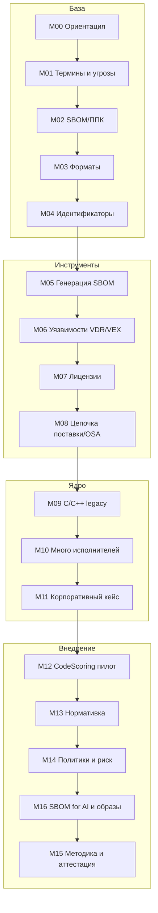

# 🎓 Карта курса

> [!info] Живая карта
> Таблица модулей строится `dataview` из конспектов. Колонка «Статус» показывает готовность (`stub`/`draft`/`ready`).

## Модули

```dataview
TABLE WITHOUT ID
  link(file.folder, module) as "Модуль",
  module_title as "Тема",
  difficulty as "Сложность",
  status as "Статус"
FROM "01 Курс"
WHERE type = "lecture"
SORT module ASC
```

## Учебная траектория



## Результат обучения

> [!success] Что умеет выпускник
> Построить SCA/OSA процесс для продукта с C/C++ legacy и несколькими исполнителями: получить SBOM/ППК, оценить качество координат, провести vulnerability/license triage, оформить VEX как решение производителя продукта, оформить исключения и внедрить CI/CD gate.

## Ключевые справки

- [[02 Справочник/VEX в процессе РБПО - откуда берется и как выпускать|VEX в процессе РБПО: откуда берется и как выпускать]] — обязательная опора для М06, П09 и П35.
- [[02 Справочник/Оглавление справочника|Оглавление справочника]]

---

> [!tip] Дальше
> [[00 Карты/Навигатор курса SCA OSA|🧭 Навигатор курса]] · [[Карта практик|🧪 Практики]] · [[Канбан внедрения OSA-SCA процесса|🗂 Канбан]] · [[00 Карты/Архитектура пайплайна.canvas|🖼 Канвас]] · [[02 Справочник/VEX в процессе РБПО - откуда берется и как выпускать|VEX в РБПО]]
