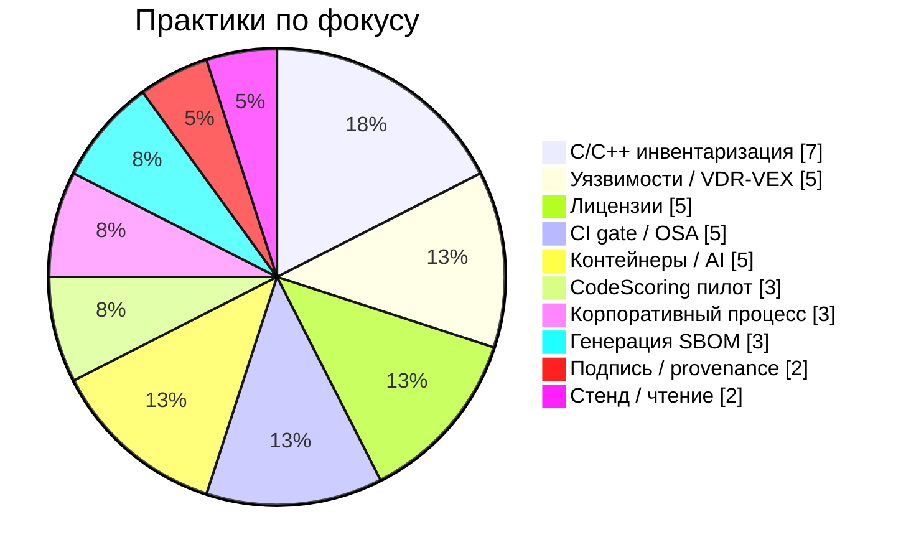

# 🧭 Навигатор курса SCA/OSA

> [!info] Что это
Стартовая панель курса: быстрый вход в модули, практикум, инструменты, нормативку, шаблоны и справочник. Часть таблиц строится через `dataview` по полям frontmatter, поэтому обновляется сама. Если вместо таблиц виден код — включите плагин **Dataview** и режим чтения.

## Состав материалов по статусам

```dataview
TABLE WITHOUT ID
  status as "Статус",
  length(rows) as "Заметок"
FROM "01 Курс" OR "03 Практикум" OR "04 Инструменты" OR "05 Нормативка" OR "07 CodeScoring" OR "08 Шаблоны"
WHERE status
GROUP BY status
SORT status ASC
```

> [!tip] Прогресс одной строкой
Статус нужен для внутреннего сопровождения курса: `ready` означает, что материал можно использовать на занятии или в рабочей практике; `draft` и `stub` помогают быстро найти, что ещё требует редакторского внимания.

## ⏳ Материалы в работе

```dataview
LIST "(" + type + ")"
FROM "01 Курс" OR "03 Практикум" OR "04 Инструменты" OR "05 Нормативка" OR "07 CodeScoring" OR "08 Шаблоны"
WHERE status AND status != "ready"
SORT file.folder ASC
```

## 🎓 Модули курса

```dataview
TABLE WITHOUT ID
  link(file.folder, module) as "Модуль",
  difficulty as "Сложность",
  status as "Статус"
FROM "01 Курс"
WHERE type = "lecture"
SORT module ASC
```

## 🧪 Практикум

```dataview
TABLE WITHOUT ID
  link(file.link, practice) as "№",
  module as "Модуль",
  join(tools, ", ") as "Инструменты",
  join(ecosystem, ", ") as "Экосистема",
  gate as "Gate",
  difficulty as "Сложность"
FROM "03 Практикум"
WHERE type = "practice"
SORT practice ASC
```

## 🛠 Инструменты по категориям

```dataview
TABLE WITHOUT ID
  category as "Категория",
  length(rows) as "Карточек",
  filter(rows.offline, (o) => o = "yes").length as "Offline-готовы"
FROM "04 Инструменты"
WHERE type = "tool"
GROUP BY category
SORT length(rows) DESC
```

> [!tip] Полный список инструментов — в [[Карта специальных тем]] и в папке `04 Инструменты`. Каждая карточка содержит «Для чего / Как применяют / Сильные стороны / Ограничения / Offline».

## 📜 Нормативная база по юрисдикциям

```dataview
TABLE WITHOUT ID
  jurisdiction as "Юрисдикция",
  length(rows) as "Документов"
FROM "05 Нормативка"
WHERE type = "normative"
GROUP BY jurisdiction
SORT length(rows) DESC
```

## 📋 Шаблоны и регламенты по областям

```dataview
TABLE WITHOUT ID
  process_area as "Область",
  length(rows) as "Шаблонов"
FROM "08 Шаблоны"
WHERE type = "template"
GROUP BY process_area
SORT length(rows) DESC
```

## 🧭 Распределение практик по экосистемам (схема)

> [!note] Про графики
> Таблицы выше строятся через `dataview`, а диаграмма ниже — статичная `mermaid`. Для учебной выдачи контента достаточно стандартного Markdown/Mermaid и Dataview; расширенные графики можно подключать в вашей рабочей среде отдельно.



## 🔗 Навигация

> [!abstract] Карты и доски
> - ⭐ [[02 Справочник/Почему генерация SBOM — это искусство|Почему генерация SBOM — это искусство]] (плохой vs хороший SBOM, в т.ч. C/C++)
> - ⭐ [[02 Справочник/VEX в процессе РБПО - откуда берется и как выпускать|VEX в процессе РБПО]] (кто выпускает VEX, как доказать `not_affected`, где хранить evidence)
> - [[Главная карта]] · [[Карта курса]] · [[Карта практик]]
> - [[Канбан внедрения OSA-SCA процесса|🗂 Канбан внедрения]] · [[00 Карты/Архитектура пайплайна.canvas|🖼 Канвас архитектуры]]
> - [[Карта C C++ legacy]] · [[Карта CodeScoring]] · [[Карта специальных тем]] · [[Карта источников]] · [[02 Справочник/Оглавление справочника|Справочник]]
> - [[99 Служебное/Схема метаданных и стиль курса|⚙ Схема метаданных и стиль]]
