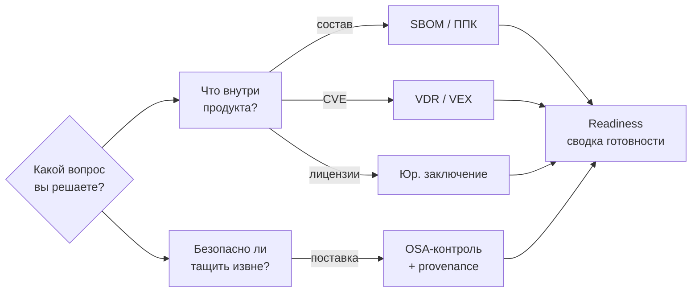

# М00. Ориентация в курсе и карта решений

Это вводный, навигационный модуль. Он не учит инструментам — он учит **выбирать**: с каким вопросом вы пришли, нужен ли тут SCA или OSA, какой артефакт должен лежать на выходе и кто за него отвечает. После М00 любой следующий модуль читается не «по порядку», а под конкретную задачу.

## Зачем этот модуль

- Снять путаницу «SCA = OSA = сканер»: показать, что это разные вопросы с разными выходными артефактами.
- Дать **карту решений** — дерево «вопрос → дисциплина → артефакт → роль».
- Объяснить устройство vault: где конспект, где практика, где нормативка, где шаблон, как связаны `[[...]]`.
- Помочь спланировать персональный маршрут (быстрый старт vs полный трек).

## Карта решений в одну картинку

## Материалы модуля

- [[01 Курс/М00 Ориентация в курсе и карта решений/01 Конспект|01 Конспект]] — устройство курса, полное дерево решений, роли, маршрут.
- [[01 Курс/М00 Ориентация в курсе и карта решений/02 План занятия|02 План занятия]] — 90 минут вводного занятия.
- [[01 Курс/М00 Ориентация в курсе и карта решений/03 Практическая работа|03 Практическая работа]] — построить карту решений для своего продукта.
- [[01 Курс/М00 Ориентация в курсе и карта решений/04 Контрольные вопросы|04 Контрольные вопросы]] — самопроверка навигации.
- [[01 Курс/М00 Ориентация в курсе и карта решений/05 Что проверять на проекте|05 Что проверять на проекте]] — чек-лист «знает ли команда свою карту».

## Куда вести дальше (входы в трек)

| Ваш вопрос | Следующий модуль |
|------------|------------------|
| Что вообще такое SCA/OSA, где границы | [[01 Курс/М01 Термины, угрозы и границы SCA OSA/00 Карта модуля\|М01. Термины и границы]] |
| Нужен машинный состав продукта | [[01 Курс/М02 SBOM и ППК как машинный источник фактов/00 Карта модуля\|М02. SBOM и ППК]] |
| Ищем уязвимости, ведём VDR/VEX | [[01 Курс/М06 Поиск уязвимостей и управление VDR VEX/00 Карта модуля\|М06. VDR/VEX]] |
| Лицензионная чистота, юр. заключение | [[01 Курс/М07 Лицензионная чистота и юридический workflow/00 Карта модуля\|М07. Лицензии]] |
| Контроль внешних поступлений | [[01 Курс/М08 Защита цепочки поставки и OSA/00 Карта модуля\|М08. OSA и цепочка поставки]] |

## Связи

- Навигация по курсу: [[00 Карты/Главная карта|Главная карта]] · [[00 Карты/Карта курса|Карта курса]] · [[00 Карты/Карта практик|Карта практик]]
- Практики на выходе: [[03 Практикум/П29. Readiness dashboard|П29. Readiness dashboard]] · [[03 Практикум/П36. Итоговый мини-проект|П36. Итоговый мини-проект]]
- Регламент-зонтик: [[08 Шаблоны/Регламент композиционного анализа ПО|Регламент композиционного анализа ПО]] · [[08 Шаблоны/RACI для SCA OSA процесса|RACI для SCA/OSA процесса]]
