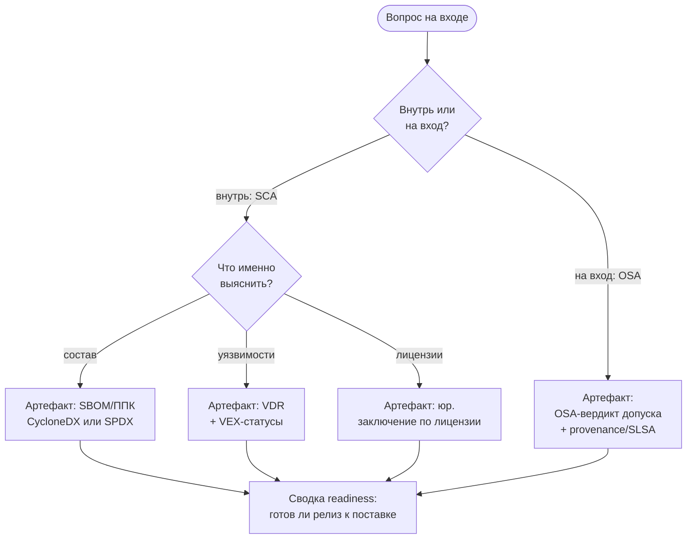

# Конспект: ориентация в курсе и карта решений

## Зачем модуль

Самая частая ошибка новичка — спутать инструмент, дисциплину и результат. Человек запускает «сканер», получает список из 800 строк и не понимает, что с ним делать, потому что не задал себе исходный вопрос. А вопросов на самом деле четыре, и они разные: *что у меня внутри?*, *есть ли в этом известные уязвимости?*, *можно ли это легально поставлять?* и *безопасно ли вообще тащить эту зависимость извне?* Этот модуль даёт навигацию: связать каждый вопрос с дисциплиной (SCA или OSA), с конкретным выходным артефактом и с ролью, которая за артефакт отвечает. Без такой карты курс распадается на 17 несвязанных тем, а проект — на хаотичные прогоны утилит.

Модуль решает и вторую задачу — научить пользоваться материалом. Курс построен слоями: на каждый модуль есть конспект (теория с примерами), план занятия (как провести), практическая работа (что сделать руками), контрольные вопросы (самопроверка) и чек-лист «что проверять на проекте» (взгляд аудитора). Отдельно лежат практики `Пxx` (пошаговые упражнения с инструментами), нормативка (раздел 05) и шаблоны/регламенты (раздел 08). Связи `[[...]]` сшивают всё это: из конспекта вы попадаете в нужную практику, из практики — в шаблон отчёта, из шаблона — в требование стандарта. М00 показывает, как читать эту сеть и где начинать под свою задачу.

## Ключевые идеи

**SCA и OSA — это не синонимы.** SCA (Software Composition Analysis) смотрит *внутрь* уже имеющегося артефакта: разбирает состав, сопоставляет компоненты с базами уязвимостей и лицензий. OSA (Open Source Analysis, в нашей трактовке — контроль поступления и происхождения) смотрит *на входе*: можно ли вообще пускать этот пакет в контур, откуда он, кто его собрал, нет ли protestware/typosquatting. SCA отвечает «что уже есть», OSA — «что мы впускаем». Один и тот же пакет проходит через обе дисциплины в разные моменты: OSA решает, впустить ли его в контролируемый репозиторий, а SCA позже учитывает его в составе релиза и проверяет на уязвимости и лицензии.

**Маршрут обучения зависит от задачи.** Полный трек идёт по [[00 Карты/Главная карта|Главной карте]] от М01 (термины и границы) до М16 (SBOM для AI и контейнеры). Но если задача узкая, удобнее «быстрый старт»: команде, которой срочно нужен только состав релиза и затрагивающие его CVE, достаточно цепочки М01 → М02 → М06 с практиками [[03 Практикум/П03. Генерация SBOM через Syft|П03]] и [[03 Практикум/П35. VEX triage|П35]]. Лицензии (М07), C/C++ legacy (М09), поставку от нескольких исполнителей (М10) и OSA (М08) подключают тогда, когда они реально присутствуют в продукте.

**Каждый вопрос имеет канонический артефакт на выходе.** Это и есть карта решений:

**Артефакт ≠ файл сканера.** SBOM/ППК — это факт о составе. VDR — реестр уязвимостей по релизу, а VEX — отдельное *решение* по каждой («не затронуты», «исправлено», «под расследованием»). Юридическое заключение — не строка лицензии, а вывод юриста с обоснованием. Readiness — управленческая сводка, собирающая всё это в «да/нет к поставке».

**Роли разведены по решениям.** Разработчик/соисполнитель порождает состав; инженер SCA отвечает за качество координат и triage; юрист закрывает лицензии; владелец продукта/риск-офицер принимает риск и подписывает readiness. Кто принимает решение — фиксируется заранее (см. RACI), иначе VDR превращается в свалку без владельца.

## Как выглядит на практике

Маршрутная таблица, с которой стоит начинать любой запрос на проекте:

| Вопрос | Дисциплина | Артефакт | Кто решает | Модуль / практика |
|--------|-----------|----------|-----------|-------------------|
| Что внутри релиза? | SCA | SBOM / ППК | инженер SCA | [[01 Курс/М02 SBOM и ППК как машинный источник фактов/00 Карта модуля\|М02]], [[03 Практикум/П03. Генерация SBOM через Syft\|П03]] |
| Есть ли CVE? | SCA | VDR + VEX | инженер SCA | [[01 Курс/М06 Поиск уязвимостей и управление VDR VEX/00 Карта модуля\|М06]], [[03 Практикум/П09. VDR и VEX различие факта и решения\|П09]] |
| Лицензионная чистота? | SCA | юр. заключение | юрист | [[01 Курс/М07 Лицензионная чистота и юридический workflow/00 Карта модуля\|М07]], [[03 Практикум/П27. Юридическое заключение и реестр лицензий\|П27]] |
| Можно ли впускать пакет? | OSA | вердикт допуска + provenance | OSA/безопасность | [[01 Курс/М08 Защита цепочки поставки и OSA/00 Карта модуля\|М08]], [[03 Практикум/П17. OSA controlled repository policy\|П17]] |
| Готов ли релиз к поставке? | оба | readiness-сводка | владелец продукта | [[03 Практикум/П29. Readiness dashboard\|П29]] |

## Слепые зоны именно этой темы

> [!warning] Где спотыкаются на старте
> - **«Сделаем SBOM и закроем тему».** SBOM — это вход для уязвимостей, лицензий и readiness, а не финальный артефакт сам по себе.
> - **Путают VDR и VEX.** VDR фиксирует факт (нашли CVE-XXXX), VEX фиксирует решение (этот CVE нас не затрагивает). Без VEX VDR не уменьшается и теряет смысл.
> - **OSA сводят к «ещё одному сканеру».** OSA — это политика допуска на входе, а не повторный поиск CVE внутри.
> - **Нет роли-решателя.** Артефакт есть, а кто по нему принимает решение — не назначено; readiness подписать некому.

## Связь с нормативкой

Базовый словарь и требования к выходным артефактам заданы в [[05 Нормативка/ГОСТ Р 56939-2024|ГОСТ Р 56939-2024]] и [[05 Нормативка/NIST SP 800-218 SSDF|NIST SP 800-218 (SSDF)]]; минимальный состав SBOM — [[05 Нормативка/NTIA Minimum Elements for SBOM|NTIA Minimum Elements]] и [[05 Нормативка/CISA Minimum Elements for SBOM|CISA]]. Зонтичный процесс описан в [[08 Шаблоны/Регламент композиционного анализа ПО|Регламенте композиционного анализа ПО]], распределение решений — в [[08 Шаблоны/RACI для SCA OSA процесса|RACI для SCA/OSA процесса]].

## Что уносим в работу

1. Перед любым прогоном утилиты сформулировать **вопрос** и по карте назвать целевой **артефакт**.
2. Закрепить за каждым артефактом **роль-решателя** (RACI), а не только исполнителя.
3. Не считать SBOM финалом — он вход для VDR/VEX, лицензий и readiness.
4. Спланировать маршрут: быстрый старт (М01→М02→М06) или полный трек по [[00 Карты/Главная карта|Главной карте]].
5. Свести всё в одну точку: [[03 Практикум/П29. Readiness dashboard|П29. Readiness dashboard]] и [[03 Практикум/П36. Итоговый мини-проект|П36. Итоговый мини-проект]].
