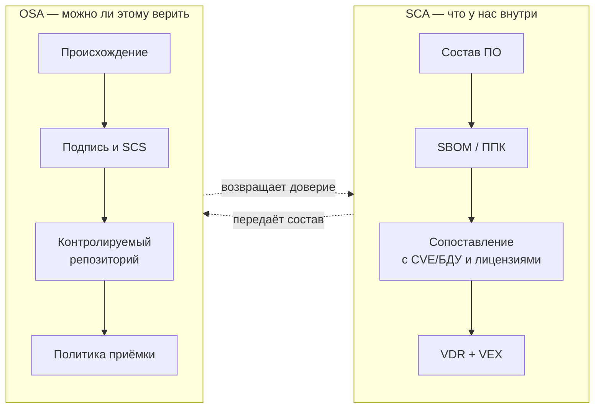

# М01. Термины, угрозы и границы SCA OSA

> [!info] Зачем этот модуль
> Дальше весь курс будет оперировать словами SCA, OSA, SBOM, ППК, SCS, VEX, VDR так, будто разница между ними очевидна. Она не очевидна. Этот модуль ставит точные определения, чертит границу «где заканчивается SCA и начинается OSA» и показывает, против какой именно модели угроз цепочки поставки всё это работает. Без общей терминологии аудит превращается в спор о словах.

## Что внутри
Модуль отвечает на четыре вопроса и закрывает каждый отдельным файлом.

| Вопрос | Где ответ |
|--------|-----------|
| Что значит каждый термин и чем они различаются | [[01 Курс/М01 Термины, угрозы и границы SCA OSA/01 Конспект\|01 Конспект]] |
| Как провести занятие по таймингу | [[01 Курс/М01 Термины, угрозы и границы SCA OSA/02 План занятия\|02 План занятия]] |
| Как развести термины руками на своём продукте | [[01 Курс/М01 Термины, угрозы и границы SCA OSA/03 Практическая работа\|03 Практическая работа]] |
| Как проверить понимание | [[01 Курс/М01 Термины, угрозы и границы SCA OSA/04 Контрольные вопросы\|04 Контрольные вопросы]] |
| Что искать в проекте как аудитор | [[01 Курс/М01 Термины, угрозы и границы SCA OSA/05 Что проверять на проекте\|05 Что проверять на проекте]] |

## Граница SCA / OSA в одном взгляде

## Ключевые понятия
[[SCA]] · [[OSA]] · [[SBOM]] · [[ППК]] · [[02 Справочник/Глоссарий/SCS|SCS]] · [[VEX]] · [[VDR]] · [[компонент]] · [[заимствование]]

## Нормативная опора
[[05 Нормативка/ГОСТ Р 58412-2019]] (модель угроз при разработке ПО, п. 5.3.2 и 5.5.1) · [[05 Нормативка/ГОСТ Р 56939-2024]] · [[05 Нормативка/OWASP Top 10 A06]] · [[05 Нормативка/CWE Top 25]] · [[05 Нормативка/NTIA Minimum Elements for SBOM]]

## Связь с соседними модулями
- Дальше по составу фактов: [[01 Курс/М02 SBOM и ППК как машинный источник фактов/00 Карта модуля\|М02. SBOM и ППК]]
- Дальше по идентификаторам: [[01 Курс/М04 Идентификаторы компонентов и уязвимостей/00 Карта модуля\|М04. Идентификаторы]]
- Дальше по решениям об уязвимостях: [[01 Курс/М06 Поиск уязвимостей и управление VDR VEX/00 Карта модуля\|М06. VDR/VEX]]
- Дальше по доверию к источнику: [[01 Курс/М08 Защита цепочки поставки и OSA/00 Карта модуля\|М08. Защита цепочки поставки и OSA]]
- Вверх к карте курса: [[01 Курс/М00 Ориентация в курсе и карта решений/00 Карта модуля\|М00. Ориентация]]

## Практики, которые опираются на этот модуль
[[03 Практикум/П02. Чтение CycloneDX JSON руками\|П02]] · [[03 Практикум/П09. VDR и VEX различие факта и решения\|П09]] · [[03 Практикум/П17. OSA controlled repository policy\|П17]]

## Практический результат
Слушатель умеет на любом фрагменте отчёта или SBOM сказать: это факт о составе (SCA) или утверждение о доверии к источнику (OSA), это машинный факт или человеческое решение, и какому термину из таблицы он соответствует.
