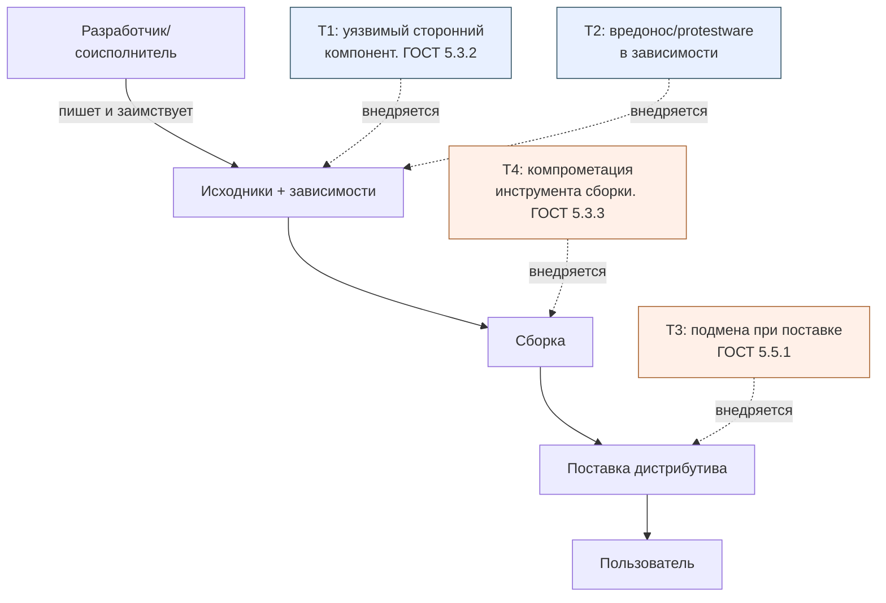

# Конспект: термины, угрозы и границы SCA OSA

## Зачем модуль

В переписке и в отчётах слова SCA, OSA, SBOM, ППК, VEX, VDR используют как синонимы, и из-за этого ломается коммуникация. Кто-то пишет «у нас есть SBOM, значит SCA закрыт» — а SBOM это только перечень, без сопоставления с уязвимостями он ничего не закрывает. Кто-то называет «VEX-ом» список найденных CVE — а VEX это, наоборот, утверждение о применимости, чаще со словом «не затрагивает». Модуль фиксирует точные определения и одну ключевую границу: SCA отвечает на вопрос «что у нас внутри и чем это опасно», OSA — на вопрос «можно ли вообще доверять источнику этого кода». Перепутать их означает закрыть не ту угрозу.

## Ключевые идеи

**Семь терминов, которые путают.** Различия проще держать через ось «факт → решение» и ось «состав → доверие».

| Термин | Расшифровка | Что это по сути | Пример из жизни |
|--------|-------------|-----------------|-----------------|
| SCA | Software Composition Analysis | Процесс: выявить состав ПО и сопоставить его с уязвимостями и лицензиями | «У `log4j-core` версия 2.14.1 — это CVE-2021-44228» |
| OSA | Open Source Analysis / Application Security для OSS | Шире SCA: ещё и происхождение, доверие к источнику, политика приёмки, контролируемый репозиторий | «Пакет скачан с зеркала, подпись не сверена — не принимать» |
| SBOM | Software Bill of Materials | Машинный артефакт-перечень компонентов (CycloneDX, SPDX, SWID) | JSON со списком `purl` и версий |
| ППК | Перечень покупных (заимствованных) компонентов | Российский аналог понятия BOM в терминах ГОСТ; состав заимствованного ПО | Таблица сторонних библиотек в составе изделия |
| SCS | Supply Chain Security / Software Composition Security | Зонт над безопасностью самой цепочки: подпись, provenance, целостность | SLSA-уровень сборки, in-toto attestation |
| VEX | Vulnerability Exploitability eXchange | Утверждение **применимости** уязвимости: затрагивает / не затрагивает / уже исправлено | «CVE-2021-44228 — `not_affected`, JNDI-путь не вызывается» |
| VDR | Vulnerability Disclosure Report | Отчёт о найденных уязвимостях компонентов — список фактов до решения | Выгрузка findings из портфеля SBOM |

> [!warning] Самая частая ошибка
> VDR и VEX — не одно и то же и даже не уровни одного. VDR это «что нашли» (факт, машинный список). VEX это «что это для нас значит» (решение человека о применимости). VDR без VEX заваливает команду ложными срабатываниями; VEX без зафиксированного VDR — решение без доказательной базы.

**Где заканчивается SCA и начинается OSA.** SCA берёт артефакт сборки и говорит про его *внутренности*: компоненты, версии, лицензии, CVE. OSA добавляет вопрос про *входную дверь*: откуда этот компонент попал в сборку, не подменён ли он, подписан ли, разрешён ли политикой. В ГОСТ Р 58412-2019 это ровно две разные угрозы: внедрение уязвимости через заимствованный сторонний компонент (п. 5.3.2 — зона SCA) и внедрение уязвимости в программу в процессе её поставки (п. 5.5.1 — зона OSA/SCS). Один сканер версий не закроет вторую.

## Как выглядит на практике

SCA-факт живёт во фрагменте SBOM (CycloneDX), а VEX-решение — рядом, но в отдельном поле:

```json
{
  "components": [
    { "type": "library", "name": "log4j-core", "version": "2.14.1",
      "purl": "pkg:maven/org.apache.logging.log4j/log4j-core@2.14.1" }
  ],
  "vulnerabilities": [
    { "id": "CVE-2021-44228",
      "affects": [ { "ref": "pkg:maven/.../log4j-core@2.14.1" } ],
      "analysis": { "state": "not_affected",
                    "justification": "code_not_reachable" } }
  ]
}
```

Здесь `components` — это SBOM (факт SCA), запись в `vulnerabilities` без `analysis` была бы VDR, а блок `analysis.state` — это VEX (решение). OSA в этом JSON не виден: доверие к `purl` (что библиотека пришла из контролируемого репозитория, а не с подменённого зеркала) проверяется отдельно — подписью и provenance.

## Модель угроз цепочки поставки



Голубые угрозы (T1, T2) ловит SCA — анализом состава. Оранжевые (T3, T4) — зона OSA/SCS: целостность поставки и доверие к среде сборки.

## Слепые зоны именно этой темы

- **«SBOM = безопасность».** SBOM это инвентарь, не вердикт. Без сопоставления с CVE/БДУ и без VEX он не уменьшает риск.
- **Protestware ≠ CVE.** Самоповреждающий пакет (логические бомбы по гео-признаку) не имеет CVE и не ловится списком версий — это аргумент в пользу OSA и контроля источника, а не очередного SCA-скана.
- **Транзитивные зависимости.** Угроза 5.3.2 чаще приходит не через прямую зависимость, а через зависимость зависимости, которую человек глазами не выбирал.
- **VEX-инфляция.** Массовый `not_affected` без обоснования (`justification`) — это не управление риском, а его маскировка.

## Связь с нормативкой

- [[05 Нормативка/ГОСТ Р 58412-2019]] — модель антропогенных угроз при разработке: внешние и внутренние нарушители, угрозы 5.3.2 (заимствованные компоненты) и 5.5.1 (поставка).
- [[05 Нормативка/ГОСТ Р 56939-2024]] — меры РБПО, которые эти угрозы нейтрализуют.
- [[05 Нормативка/OWASP Top 10 A06]] — Vulnerable and Outdated Components как прикладная формулировка.
- Шаблоны: [[08 Шаблоны/Минимальный набор полей ППК\|Минимальный набор полей ППК]], [[08 Шаблоны/Паспорт open source библиотеки\|Паспорт open source библиотеки]].

## Что уносим в работу

1. На каждом findings-артефакте уметь различить четыре сущности: состав (SBOM/ППК), факт уязвимости (VDR), решение о применимости (VEX), доверие к источнику (OSA/SCS).
2. Не называть SBOM «результатом SCA» — это его вход, а не вывод.
3. Любой `not_affected` сопровождать `justification`, иначе это не VEX, а отписка → [[03 Практикум/П09. VDR и VEX различие факта и решения\|П09]].
4. Проверять не только версии, но и происхождение пакета → [[03 Практикум/П17. OSA controlled repository policy\|П17]].
5. Тренировать чтение CycloneDX руками, чтобы видеть границу полей `components` / `vulnerabilities` / `analysis` → [[03 Практикум/П02. Чтение CycloneDX JSON руками\|П02]].
