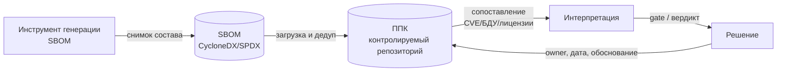

# М02. SBOM и ППК как машинный источник фактов

## Зачем этот модуль
Модуль учит относиться к SBOM и ППК не как к отчёту для галочки, а как к **машиночитаемому реестру фактов** о составе ПО. Один и тот же файл `bom.json` может быть либо доказательной базой для решения «выпускать / не выпускать релиз», либо красивой пустышкой без `purl`, без хэшей и без указания, кто и когда его сгенерировал. Разница — в наличии минимальных элементов (NTIA/CISA) и в дисциплине заполнения.

Сквозная идея модуля — жёсткое разделение трёх слоёв: **факт** (что зафиксировано в SBOM/ППК) → **интерпретация** (что это значит после сопоставления с CVE/БДУ, лицензиями, политиками) → **решение** (вердикт человека или gate). SBOM хранит первый слой и не должен содержать двух других.

> [!info] SBOM и ППК в этом курсе
> **SBOM** — машинная сериализация состава (CycloneDX/SPDX), снимок, который генерирует инструмент на конкретном коммите. **ППК** — перечень программных компонентов Организации: управляемый, дедуплицированный и обогащённый реестр в контролируемом репозитории, к которому привязаны владельцы, решения и evidence. SBOM — топливо, ППК — учётная система. Они дополняют друг друга, а не заменяют.

## Что внутри модуля
- [[01 Курс/М02 SBOM и ППК как машинный источник фактов/01 Конспект|01 Конспект]] — минимальные элементы SBOM, слои факт→интерпретация→решение, почему ППК и SBOM дополняют друг друга.
- [[01 Курс/М02 SBOM и ППК как машинный источник фактов/02 План занятия|02 План занятия]] — тайминг на 90 минут: теория, демо `jq`, разбор «битого» SBOM.
- [[01 Курс/М02 SBOM и ППК как машинный источник фактов/03 Практическая работа|03 Практическая работа]] — оценить полноту минимальных элементов в реальном CycloneDX и развести дефекты данных по слоям.
- [[01 Курс/М02 SBOM и ППК как машинный источник фактов/04 Контрольные вопросы|04 Контрольные вопросы]] — вопросы и кейсы на различение факта, интерпретации и решения.
- [[01 Курс/М02 SBOM и ППК как машинный источник фактов/05 Что проверять на проекте|05 Что проверять на проекте]] — чек-лист аудитора по качеству SBOM/ППК.

## Карта связей

## Куда ведёт дальше
- Форматы: [[01 Курс/М03 Форматы SBOM CycloneDX, SPDX, SWID/00 Карта модуля|М03. Форматы SBOM]] — где именно лежат минимальные элементы в CycloneDX и SPDX.
- Идентичность: [[01 Курс/М04 Идентификаторы компонентов и уязвимостей/00 Карта модуля|М04. Идентификаторы]] — почему без `purl`/CPE факт не сопоставляется с уязвимостью.
- Генерация: [[01 Курс/М05 Инструменты генерации SBOM/00 Карта модуля|М05. Инструменты генерации SBOM]].
- AI-расширение: [[01 Курс/М16 SBOM for AI и честный SBOM контейнерных образов/00 Карта модуля|М16. SBOM for AI и честный SBOM образов]].

## Практики и нормативка
- Практика: [[П02. Чтение CycloneDX JSON руками]].
- Нормативка: [[05 Нормативка/NTIA Minimum Elements for SBOM]] · [[05 Нормативка/CISA Minimum Elements for SBOM]] · [[05 Нормативка/BSI TR-03183-2 v2.1.0]] · [[05 Нормативка/NIST SP 800-218 SSDF]] · [[05 Нормативка/ГОСТ Р 56939-2024]] · [[05 Нормативка/Проект ГОСТ Р КАПО]].
- Шаблоны: [[Минимальный набор полей ППК]] · [[Чек-лист качества CycloneDX]] · [[Соглашение о качестве данных SBOM]].

## Практический результат
Слушатель умеет открыть произвольный CycloneDX JSON, за несколько команд `jq` оценить, какие минимальные элементы присутствуют, и сформулировать, какие из найденных проблем — дефект инструмента, какие — дефект процесса поставки, а какие вообще не относятся к слою факта.
