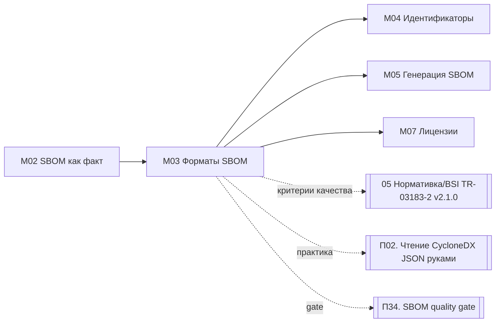

# М03. Форматы SBOM: CycloneDX, SPDX, SWID

## Зачем этот модуль
Три названия в заголовке — это не три равноправных формата SBOM. CycloneDX и SPDX — полноценные форматы спецификации состава ПО; SWID (ISO/IEC 19770-2) — формат тегов идентификации установленного ПО, который в современных SBOM используется лишь как **один из идентификаторов компонента**, а не как контейнер всего SBOM. Модуль учит видеть это различие, выбирать формат под задачу (безопасность / лицензии / обмен / регуляторика) и оценивать качество SBOM по измеримым критериям BSI TR-03183-2.

> [!info] Ключевой тезис модуля
> BSI TR-03183-2 v2.1.0 принимает SBOM только в **CycloneDX ≥ 1.6** или **SPDX ≥ 3.0.1** (JSON или XML). SWID в этом стандарте — это значение поля «Other unique identifiers» (`swid.tagId` в CycloneDX, `externalIdentifierType: swid` в SPDX), а не формат самого SBOM.

## Ключевые понятия
[[04 Инструменты/CycloneDX|CycloneDX]] · [[04 Инструменты/SPDX|SPDX]] · [[04 Инструменты/SWID|SWID]] · [[02 Справочник/Глоссарий/PURL|purl]] · [[04 Инструменты/CPE|CPE]] · [[02 Справочник/Глоссарий/Эффективная лицензия|Эффективная лицензия]] · [[02 Справочник/Глоссарий/Distribution licence|Distribution licence]] · [[02 Справочник/Глоссарий/BSI property taxonomy|BSI property taxonomy]]

## Что внутри модуля
- [[01 Курс/М03 Форматы SBOM CycloneDX, SPDX, SWID/01 Конспект|01 Конспект]] — назначение и модель данных трёх форматов, сравнительная таблица, фрагменты JSON, критерии качества BSI.
- [[01 Курс/М03 Форматы SBOM CycloneDX, SPDX, SWID/02 План занятия|02 План занятия]] — тайминг занятия на 90 минут.
- [[01 Курс/М03 Форматы SBOM CycloneDX, SPDX, SWID/03 Практическая работа|03 Практическая работа]] — проверка одного компонента на обязательные поля BSI (раздел 5.2.2) в CycloneDX и SPDX.
- [[01 Курс/М03 Форматы SBOM CycloneDX, SPDX, SWID/04 Контрольные вопросы|04 Контрольные вопросы]] — вопросы и кейс-задачи.
- [[01 Курс/М03 Форматы SBOM CycloneDX, SPDX, SWID/05 Что проверять на проекте|05 Что проверять на проекте]] — чек-лист аудитора по форматам и качеству SBOM.

## Карта связей

## Смежные модули
- [[01 Курс/М02 SBOM и ППК как машинный источник фактов/00 Карта модуля|М02. SBOM и ППК как машинный источник фактов]] — что вообще такое SBOM как доказательство.
- [[01 Курс/М04 Идентификаторы компонентов и уязвимостей/00 Карта модуля|М04. Идентификаторы компонентов и уязвимостей]] — purl / CPE / SWID как ключи.
- [[01 Курс/М05 Инструменты генерации SBOM/00 Карта модуля|М05. Инструменты генерации SBOM]] — кто и в каком формате генерирует.
- [[01 Курс/М07 Лицензионная чистота и юридический workflow/00 Карта модуля|М07. Лицензионная чистота и юридический workflow]] — три категории лицензий из BSI.

## Нормативная и шаблонная опора
[[05 Нормативка/BSI TR-03183-2 v2.1.0]] · [[05 Нормативка/CycloneDX ECMA-424]] · [[05 Нормативка/SPDX ISO IEC 5962]] · [[05 Нормативка/CISA Minimum Elements for SBOM]] · [[Чек-лист качества CycloneDX]] · [[Чек-лист качества SPDX]] · [[Соглашение о качестве данных SBOM]]

## Практический результат
Слушатель умеет отличить CycloneDX от SPDX от SWID по структуре файла, найти в обоих форматах обязательные по BSI (раздел 5.2.2) поля компонента и обосновать выбор формата под конкретную задачу Организации.
