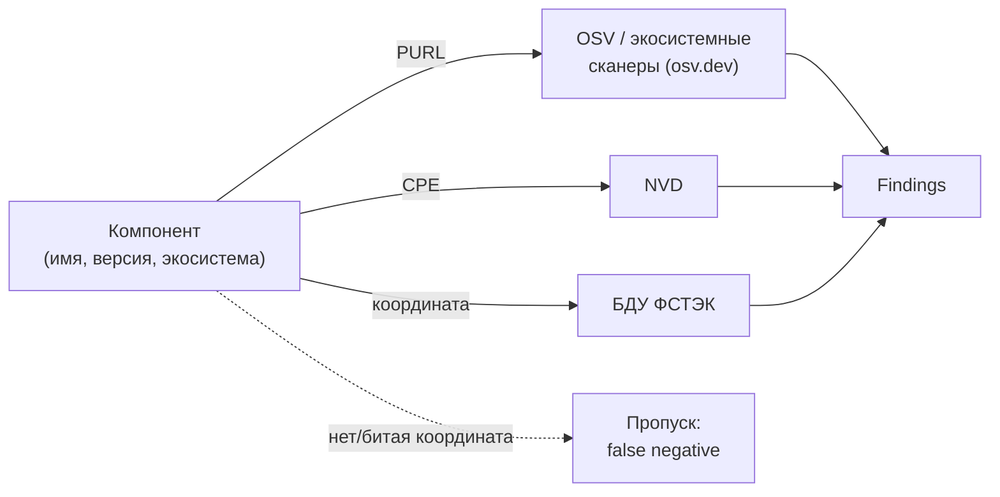

# М04. Идентификаторы компонентов и уязвимостей

## Зачем этот модуль
Анализатор не «понимает» компонент — он сопоставляет строки-координаты. У компонента это **PURL** (для экосистемных сканеров) и **CPE** (для NVD); у уязвимости — **CVE**, **GHSA**, идентификаторы **OSV** и **BDU** ФСТЭК. Если координата отсутствует или записана неточно, сопоставление просто не происходит — и не как ошибка, а как тишина: findings приходит подозрительно мало. Модуль учит читать, нормализовать и сверять координаты так, чтобы «ноль уязвимостей» означал «их нет», а не «мы не туда смотрели».

> [!info] Центральный механизм модуля
> Нет координаты → нет соединения → нет находки. Это не сбой инструмента, а штатное поведение матчинга. Самый опасный результат в SCA — не false positive (его видно), а false negative из-за битого PURL/CPE (его не видно).

## Что внутри
- [[01 Курс/М04 Идентификаторы компонентов и уязвимостей/01 Конспект|01 Конспект]] — два мира матчинга (PURL→OSV, CPE→NVD), разбор log4j, alias-проблема CPE.
- [[01 Курс/М04 Идентификаторы компонентов и уязвимостей/02 План занятия|02 План занятия]] — тайминг 90 минут: теория, демо матчинга, ПЗ.
- [[01 Курс/М04 Идентификаторы компонентов и уязвимостей/03 Практическая работа|03 Практическая работа]] — таблица координат и эксперимент «битый PURL → потеря находок».
- [[01 Курс/М04 Идентификаторы компонентов и уязвимостей/04 Контрольные вопросы|04 Контрольные вопросы]] — вопросы и кейсы на чтение и сверку координат.
- [[01 Курс/М04 Идентификаторы компонентов и уязвимостей/05 Что проверять на проекте|05 Что проверять на проекте]] — чек-лист аудитора по качеству координат.

## Ключевые понятия
[[PURL]] · [[04 Инструменты/CPE|CPE]] · [[04 Инструменты/CVE|CVE]] · [[02 Справочник/Глоссарий/GHSA|GHSA]] · [[02 Справочник/Глоссарий/OSV|OSV]] · [[BDU]] · [[04 Инструменты/CWE|CWE]]

## Карта связей

## Соседние модули
- [[01 Курс/М03 Форматы SBOM CycloneDX, SPDX, SWID/00 Карта модуля|М03. Форматы SBOM]] — где в SBOM физически лежат `purl` и `cpe`.
- [[01 Курс/М05 Инструменты генерации SBOM/00 Карта модуля|М05. Генерация SBOM]] — кто и насколько точно проставляет координаты.
- [[01 Курс/М06 Поиск уязвимостей и управление VDR VEX/00 Карта модуля|М06. Поиск уязвимостей и VDR/VEX]] — что делать с находками после матчинга (severity, EPSS, KEV — там).
- [[01 Курс/М09 C и C++ legacy без дисциплины пакетного менеджера/00 Карта модуля|М09. C/C++ legacy]] — где координат нет в принципе и alias-проблема бьёт сильнее всего.

## Практики
- [[П24. PURL нормализация и private qualifiers]] — чистка PURL от приватных qualifiers перед публичным матчингом.
- [[П25. CPE alias worklist]] — список C/C++ зависимостей без CPE и их ручная разметка.

## Нормативная опора
[[04 Инструменты/БДУ ФСТЭК|БДУ ФСТЭК]] · [[05 Нормативка/NIST SP 800-218 SSDF]] (RV.1 — поиск уязвимостей в компонентах) · [[05 Нормативка/CISA Minimum Elements for SBOM]] · [[05 Нормативка/BSI TR-03183-2 v2.1.0]] (качество SBOM, в т.ч. полнота идентификаторов)

## Практический результат
Таблица PURL/CPE/CVE/GHSA/BDU для OpenSSL, zlib, libcurl и внутренней библиотеки + воспроизведённый эффект «битый PURL → пропавшие находки».
