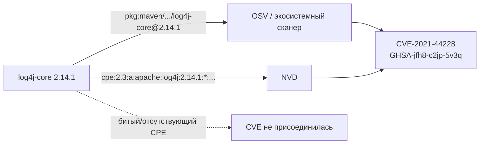

# Конспект: идентификаторы компонентов и уязвимостей

## Зачем модуль
Сканер уязвимостей не анализирует код компонента — он соединяет две таблицы по ключу. С одной стороны лежит ваш компонент с координатой (PURL или CPE), с другой — записи об уязвимостях, привязанные к таким же координатам. Совпали ключи — появилась находка; не совпали — её нет. Поэтому качество SCA определяется не «мощностью» движка, а точностью координат на входе. Самый коварный результат — не ложная тревога (её видно и можно снять), а **молчаливый пропуск**: компонент уязвим, но без корректного PURL/CPE он просто не попал в join и в отчёте отсутствует. Отчёт «0 уязвимостей» при этом выглядит как хорошая новость.

## Ключевые идеи

**Два мира матчинга.** Экосистемные сканеры (OSV-Scanner, Grype, Trivy в режиме осведомлённости об экосистеме) матчат по **PURL** — пакет в пределах своей экосистемы и диапазон затронутых версий. NVD матчит по **CPE** — `vendor:product:version`. Это разные системы координат, и компонент должен иметь правильную координату для каждого мира, иначе соответствующий источник его «не увидит».

**PURL — координата экосистемы.** Грамматика: `pkg:type/namespace/name@version?qualifiers#subpath`. Примеры:
- `pkg:npm/lodash@4.17.21`
- `pkg:pypi/django@4.2.1`
- `pkg:maven/org.apache.logging.log4j/log4j-core@2.14.1`
- `pkg:golang/github.com/gorilla/mux@v1.8.0`
- `pkg:deb/debian/curl@7.74.0-1.3?arch=amd64`

PURL хорош тем, что у пакетных экосистем уже есть канонические имена — для npm/PyPI/Maven координата вычисляется почти однозначно.

**CPE — координата словаря NVD.** Формата 2.3 это строка ровно из 13 полей: `cpe:2.3:part:vendor:product:version:update:edition:language:sw_edition:target_sw:target_hw:other`, где `part` ∈ {a, o, h}, пустое поле = `*`. Пример: `cpe:2.3:a:openssl:openssl:3.0.7:*:*:*:*:*:*:*`. CPE назначается централизованно, словарём NVD, и здесь начинаются расхождения имён.

**Идентификаторы уязвимостей — тоже координаты, и их несколько.** `CVE-2021-44228` (MITRE/NVD), `GHSA-jfh8-c2jp-5v3q` (GitHub Advisory). OSV (osv.dev) — это и схема, и агрегатор: его записи имеют экосистемные префиксы (`PYSEC-…`, `RUSTSEC-…`, `GO-…`) либо переиспользуют `GHSA-…`, а поле `aliases` связывает эквивалентные записи между собой. **БДУ ФСТЭК** — национальный источник с идентификаторами вида `BDU:2021-05541`; часть записей БДУ вообще не имеет CVE (специфика РФ), а сроки публикации могут опережать или отставать от NVD. Поэтому БДУ — отдельная координатная система, а не перевод NVD.

> [!warning] Alias-проблема CPE
> Один и тот же продукт в словаре NVD может жить под разными vendor. Для curl исторически существуют записи и под `cpe:2.3:a:haxx:curl:...`, и под `cpe:2.3:a:curl:curl:...`. Если ваш SBOM использует один vendor, а часть CVE привязана к другому, эти CVE в join не попадут. Сверять CPE по словарю NVD — отдельная ручная работа ([[П25. CPE alias worklist]]).

## Как выглядит на практике

Возьмём log4j — все координаты публичны и проверяемы:

| Координата | Значение |
|---|---|
| PURL | `pkg:maven/org.apache.logging.log4j/log4j-core@2.14.1` |
| CPE 2.3 | `cpe:2.3:a:apache:log4j:2.14.1:*:*:*:*:*:*:*` |
| CVE | `CVE-2021-44228` |
| GHSA | `GHSA-jfh8-c2jp-5v3q` |

Обратите внимание на расхождение: в Maven компонент — `org.apache.logging.log4j` / `log4j-core`, в CPE — vendor `apache`, product `log4j`. Это не опечатка, это два независимых именования одного артефакта. Именно поэтому связку PURL↔CPE нельзя выводить простым склеиванием строк — она требует нормализации и проверки по словарю.

## Слепые зоны именно этой темы
- **Битый PURL = тихий ноль.** Лишний приватный qualifier (`?repository_url=...`, `?user=...`) или экзотический `type` уводит компонент мимо публичной базы — находок ноль, ошибки нет. Чистить приватные qualifiers перед матчингом — задача [[П24. PURL нормализация и private qualifiers]].
- **C/C++ без CPE.** У C/C++ часто нет нативного пакетного менеджера, значит нет естественного PURL. Компонент опирается на CPE, а CPE надо проставить вручную — и тут максимально бьёт alias-проблема. См. [[01 Курс/М09 C и C++ legacy без дисциплины пакетного менеджера/00 Карта модуля|М09]].
- **Диапазоны версий, а не точные.** Уязвимость почти всегда описана диапазоном версий. Если у компонента версия не нормализована (`v1.2.0` против `1.2.0`, эпохи в deb), попадание в диапазон ломается.
- **Не путать identity и severity.** Этот модуль — про то, нашли ли мы уязвимость вообще. Приоритизация (EPSS, KEV, CVSS) — это уже [[01 Курс/М06 Поиск уязвимостей и управление VDR VEX/00 Карта модуля|М06]].

## Связь с нормативкой
- [[05 Нормативка/NIST SP 800-218 SSDF]] RV.1 — непрерывный поиск уязвимостей в компонентах опирается на корректную идентификацию компонента.
- [[05 Нормативка/CISA Minimum Elements for SBOM]] — уникальные идентификаторы как обязательный элемент SBOM.
- [[05 Нормативка/BSI TR-03183-2 v2.1.0]] — критерии качества SBOM, включая полноту и корректность идентификаторов.
- [[04 Инструменты/БДУ ФСТЭК|БДУ ФСТЭК]] — национальный источник уязвимостей и требования к его учёту.

## Что уносим в работу
1. На каждый значимый компонент должны быть **обе** координаты — PURL и CPE; для C/C++ CPE проставляется и сверяется вручную ([[П25. CPE alias worklist]]).
2. Перед матчингом PURL нормализуем и снимаем приватные qualifiers ([[П24. PURL нормализация и private qualifiers]]).
3. «0 уязвимостей» трактуем как гипотезу, а не вывод: проверяем, что компоненты вообще попали в join (есть ли у них координаты).
4. CPE сверяем по словарю NVD на alias (vendor может быть не один).
5. БДУ ФСТЭК подключаем как самостоятельный источник, не ожидая полного совпадения с NVD по идентификаторам.
