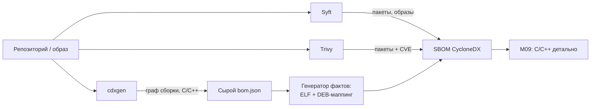

# М05. Инструменты генерации SBOM

## Зачем этот модуль
SBOM не «получается» нажатием одной кнопки — то, что попадёт в `bom.json`, целиком определяется тем, какой инструмент запустили, на каком входе и в каком режиме. Syft, Trivy и cdxgen смотрят на проект под разными углами: один читает манифесты и lock-файлы, другой умеет залезть в собранный образ и бинарь, третий вытягивает граф из системы сборки. Запусти три инструмента на одном репозитории — получишь три разных SBOM с разным числом компонентов, разной полнотой PURL и разным набором лицензий. Этот модуль учит понимать, **что именно видит и чего не видит каждый генератор**, осознанно выбирать инструмент под экосистему и фиксировать вход так, чтобы результат был воспроизводим.

Отдельный фокус модуля — C/C++, где ни один генератор не отдаёт полный состав сам: cdxgen восстанавливает часть графа из системы сборки, а недостающие факты (динамические библиотеки, маппинг на DEB) дотягивает обогащение «генератором фактов». Глубокий разбор C/C++ — в [[01 Курс/М09 C и C++ legacy без дисциплины пакетного менеджера/00 Карта модуля|М09]]; здесь мы разбираем инструменты как таковые.

## Ключевые понятия
- **Манифест-скан vs бинарь-скан**: чтение `package-lock.json`/`requirements.txt`/`go.sum` против анализа собранного образа, слоёв и ELF-файлов. Разный охват, разные слепые зоны.
- **Что видит инструмент**: Syft — пакеты в файловой системе и образах; Trivy — то же плюс встроенный сканер уязвимостей; cdxgen — граф из системы сборки для множества экосистем, включая C/C++.
- **Фиксация версии инструмента и входа**: SBOM без зафиксированных tool version, commit/tag и параметров запуска нельзя воспроизвести и нельзя сравнивать во времени.
- **Обогащение результата**: сырой cdxgen-SBOM для C/C++ дополняется бинарным анализом ELF и маппингом библиотек на пакеты — этим занимается отдельная enrichment-утилита («генератор фактов»).

## Миникарта модуля

## Нормативная опора
[[05 Нормативка/NIST SP 800-218 SSDF]] (PS.3.2 — формировать и сохранять SBOM) · [[05 Нормативка/BSI TR-03183-2 v2.1.0]] (требования к качеству SBOM) · [[05 Нормативка/CycloneDX ECMA-424]] (формат) · [[05 Нормативка/NTIA Minimum Elements for SBOM]] · [[05 Нормативка/CISA Minimum Elements for SBOM]] · [[05 Нормативка/ГОСТ Р 56939-2024]]

## Материалы модуля
- [[01 Курс/М05 Инструменты генерации SBOM/01 Конспект|01 Конспект]] — что видит каждый генератор, манифест vs бинарь, роль обогащения для C/C++.
- [[01 Курс/М05 Инструменты генерации SBOM/02 План занятия|02 План занятия]] — 90 минут: теория, демо трёх инструментов, практика-сравнение.
- [[01 Курс/М05 Инструменты генерации SBOM/03 Практическая работа|03 Практическая работа]] — сгенерировать SBOM тремя инструментами и сравнить охват.
- [[01 Курс/М05 Инструменты генерации SBOM/04 Контрольные вопросы|04 Контрольные вопросы]] — вопросы и кейс-задачи.
- [[01 Курс/М05 Инструменты генерации SBOM/05 Что проверять на проекте|05 Что проверять на проекте]] — чек-лист аудитора по генерации SBOM.

## Связанные практики
[[П03. Генерация SBOM через Syft]] · [[П04. Генерация SBOM через cdxgen для C C++]] · [[П05. Trivy как генератор и сканер]]

## Связь с другими модулями
- Вперёд: [[01 Курс/М09 C и C++ legacy без дисциплины пакетного менеджера/00 Карта модуля|М09]] — детальный разбор C/C++, ELF, DEB-маппинга и обогащения, на которые здесь только указано.

## Практический результат
Слушатель умеет: выбрать генератор под экосистему; запустить Syft, Trivy и cdxgen с зафиксированными версией и входом; прочитать `bom.json` и оценить, что вошло в SBOM, а что осталось слепой зоной; объяснить, зачем сырой C/C++ SBOM отдают на обогащение «генератору фактов».
