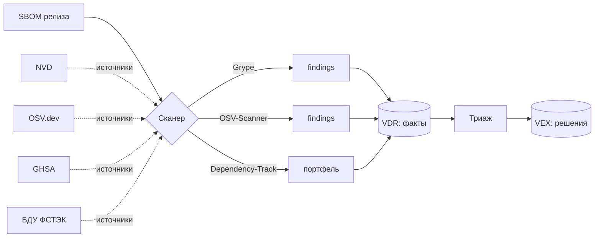

# М06. Поиск уязвимостей и управление VDR/VEX

> [!info] О чём модуль
> Готовый SBOM сам по себе не содержит ни одной уязвимости — он описывает только состав. Уязвимости появляются в момент сопоставления координат компонента (PURL/CPE/версия) с базами CVE. Этот модуль учит превращать SBOM в управляемый поток находок: получить **VDR** (список фактов «такая-то CVE затрагивает такой-то компонент»), а затем для каждой находки принять **VEX**-решение (затронут продукт реально или нет, кто как производитель это утверждает и чем подтверждает).

## Зачем этот модуль

Между «сканер нашёл 142 CVE» и «нам нужно срочно патчить» лежит триаж. Без него команда либо тонет в шуме (большинство находок не эксплуатируемы в данном контексте), либо пропускает реальный риск. Модуль разделяет два артефакта, которые на проектах часто путают:

- **VDR (Vulnerability Disclosure Report)** — машинный *факт*: компонент X версии Y связан с CVE-Z. Источник — сканер.
- **VEX (Vulnerability Exploitability eXchange)** — человеческое *решение* о применимости: `not_affected` / `affected` / `fixed` / `under_investigation`, с обоснованием, владельцем и сроком.

## Карта связей

## Материалы модуля

- [[01 Курс/М06 Поиск уязвимостей и управление VDR VEX/01 Конспект|01 Конспект]] — теория: сканеры, VDR vs VEX, состояния, источники, SLA.
- [[01 Курс/М06 Поиск уязвимостей и управление VDR VEX/02 План занятия|02 План занятия]] — тайминг занятия на 90 минут.
- [[01 Курс/М06 Поиск уязвимостей и управление VDR VEX/03 Практическая работа|03 Практическая работа]] — Grype + OSV-Scanner + Dependency-Track, оформление VEX.
- [[01 Курс/М06 Поиск уязвимостей и управление VDR VEX/04 Контрольные вопросы|04 Контрольные вопросы]] — проверка понимания + кейсы.
- [[01 Курс/М06 Поиск уязвимостей и управление VDR VEX/05 Что проверять на проекте|05 Что проверять на проекте]] — чек-лист аудитора.
- [[02 Справочник/VEX в процессе РБПО - откуда берется и как выпускать|VEX в процессе РБПО: откуда берется и как выпускать]] — обязательная справка: кто выдает VEX, как проходит triage, какие evidence нужны и где хранить VEX.

## Связь с другими модулями

- [[01 Курс/М04 Идентификаторы компонентов и уязвимостей/00 Карта модуля|М04. Идентификаторы]] — без качественных PURL/CPE сопоставление с CVE не работает (это вход для М06).
- [[01 Курс/М05 Инструменты генерации SBOM/00 Карта модуля|М05. Генерация SBOM]] — SBOM, который мы здесь сканируем, приходит из М05.
- [[01 Курс/М08 Защита цепочки поставки и OSA/00 Карта модуля|М08. Цепочка поставки и OSA]] — VEX-обмен с соисполнителями.

## Практики модуля

[[П06. Grype поверх готового SBOM]] · [[П07. OSV-Scanner и lockfiles]] · [[П08. Dependency-Track как портфель SBOM]] · [[П09. VDR и VEX различие факта и решения]] · [[П10. БДУ ФСТЭК как национальный источник]] · [[П35. VEX triage]]

Перед [[П09. VDR и VEX различие факта и решения|П09]] слушатель читает [[02 Справочник/VEX в процессе РБПО - откуда берется и как выпускать|VEX в процессе РБПО]], чтобы отличать VEX как утверждение производителя от внешнего vulnerability feed. Перед [[П35. VEX triage|П35]] та же справка используется как критерий качества evidence.

## Нормативная опора

[[05 Нормативка/NIST SP 800-218 SSDF]] (RV.1/RV.2) · [[04 Инструменты/БДУ ФСТЭК|БДУ ФСТЭК]] · [[05 Нормативка/CycloneDX ECMA-424]] (VEX-расширение) · [[05 Нормативка/OWASP SCVS]]

## Шаблоны

[[Политика управления уязвимостями компонентов]] · [[Порядок загрузки VDR из Dependency-Track]] · [[Регламент ретеста после исправления]] · [[Порядок обновления БДУ]]
