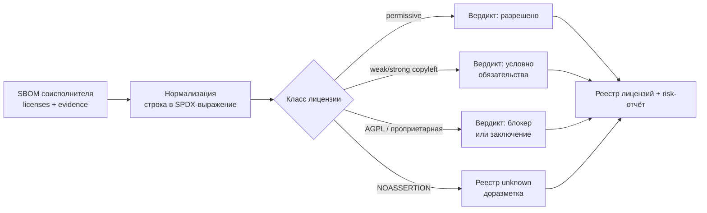

# М07. Лицензионная чистота и юридический workflow

## Зачем модуль
Уязвимость можно закрыть патчем, а нарушение лицензии — нет: оно остаётся в выпущенной поставке навсегда. Этот модуль учит превращать строку лицензии из SBOM в управляемое юридическое решение. Граница тут не «безопасно/небезопасно», а «можно распространять на наших условиях / нельзя / нужно отдельное заключение». Сильнейший риск — `NOASSERTION` и проприетарная лицензия в составе продукта, который Организация считает open-source-чистым.

В отличие от модулей про уязвимости (тут нет CVE и severity), фокус — на тексте лицензии, его нормализации в SPDX-выражение и на цепочке обязательств: что лицензия требует при распространении бинарника, при динамической линковке, при работе по сети.

## Ключевые понятия
SPDX License Expression · permissive · weak copyleft · strong copyleft · network copyleft · совместимость лицензий · `NOASSERTION` · юридический вердикт · evidence

## Карта workflow

## Материалы модуля
- [[01 Курс/М07 Лицензионная чистота и юридический workflow/01 Конспект|01 Конспект]] — SPDX-выражения, классы лицензий, совместимость, цепочка evidence → вердикт.
- [[01 Курс/М07 Лицензионная чистота и юридический workflow/02 План занятия|02 План занятия]] — тайминг занятия на 90 минут.
- [[01 Курс/М07 Лицензионная чистота и юридический workflow/03 Практическая работа|03 Практическая работа]] — нормализация лицензий и сборка реестра с вердиктами.
- [[01 Курс/М07 Лицензионная чистота и юридический workflow/04 Контрольные вопросы|04 Контрольные вопросы]] — проверка понимания + кейсы.
- [[01 Курс/М07 Лицензионная чистота и юридический workflow/05 Что проверять на проекте|05 Что проверять на проекте]] — чек-лист аудитора.

## Связи с курсом
- Практики: [[П11. ScanCode для лицензий]] · [[П12. ORT и license policy]] · [[П13. FOSSology как юридический workflow]] · [[П26. Лицензионная классификация]] · [[П27. Юридическое заключение и реестр лицензий]] · [[П30. Исключения и принятие риска]]
- Смежные модули: лицензия привязана к компоненту, опознанному в [[01 Курс/М04 Идентификаторы компонентов и уязвимостей/00 Карта модуля|М04]] (без устойчивого PURL нет к чему привязать вердикт); полнота полей `licenses` напрямую зависит от выбора генератора SBOM из [[01 Курс/М05 Инструменты генерации SBOM/00 Карта модуля|М05]] — разные инструменты дают разный набор распознанных лицензий и разное число `NOASSERTION`.
- Нормативка: [[05 Нормативка/SPDX ISO IEC 5962|SPDX ISO/IEC 5962]] · [[05 Нормативка/OpenChain ISO IEC 5230|OpenChain ISO/IEC 5230]] · [[05 Нормативка/ISO IEC 27001|ISO/IEC 27001 A.5/A.8]]
- Шаблоны: [[08 Шаблоны/Политика лицензионной чистоты]] · [[08 Шаблоны/Порядок работы с неизвестной лицензией]] · [[08 Шаблоны/Шаблон юридического заключения по лицензии]] · [[08 Шаблоны/Реестр исключений]]

## Практический результат
Слушатель строит классификатор лицензий (permissive / weak copyleft / strong copyleft / network copyleft / проприетарная / unknown) с таблицей обязательств и проводит набор SPDX-выражений из реального SBOM через цепочку «evidence → нормализация → вердикт → запись в реестр».
