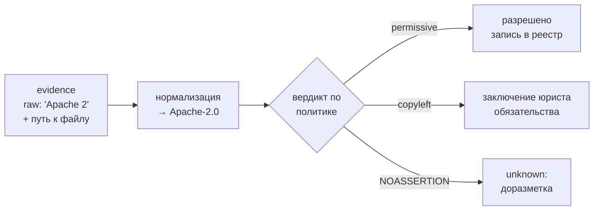

# Конспект: Лицензионная чистота и юридический workflow

## Зачем модуль
Лицензионный дефект устроен иначе, чем уязвимость. Уязвимость закрывается обновлением версии — лицензия же определяет условия, на которых компонент вообще разрешено включать в продукт и распространять. Если в проприетарную поставку Организации попала зависимость под GPL-3.0-only или AGPL-3.0, это не «обновим и забудем»: при определённых сценариях распространения это требование раскрыть исходный код всего производного произведения. Такой дефект не виден сканеру уязвимостей и не имеет CVSS — его ловит только разбор лицензий.

Второй драйвер — поставки от соисполнителей. Организация принимает SBOM, собранные чужими руками и инструментами, и в полях `licenses` приходит зоопарк: аккуратный SPDX-идентификатор, свободный текст `BSD-like`, либо пусто или `NOASSERTION`. Этот модуль превращает такой ввод в управляемые решения.

## Ключевые идеи

**SPDX-выражение — это не строка, а грамматика.** SPDX License List даёт каноничные идентификаторы (`MIT`, `Apache-2.0`, `GPL-2.0-or-later`), а SPDX License Expression позволяет их комбинировать операторами: `(MIT OR Apache-2.0)` — выбор, `Apache-2.0 AND MIT` — оба обязательства одновременно, `GPL-2.0-only WITH Classpath-exception-2.0` — лицензия с исключением. Дисциплина: `GPL-2.0` устарел, корректно `GPL-2.0-only` либо `GPL-2.0-or-later` — разница в том, можно ли перейти на GPL-3.0, и это меняет вердикт.

**Классы важнее конкретных имён.** Лицензий сотни, но обязательства сводятся к четырём поведенческим классам:

| Класс | Примеры | Главное обязательство при распространении | Триггер copyleft |
|-------|---------|-------------------------------------------|------------------|
| Permissive | MIT, BSD-3-Clause, Apache-2.0 | сохранить текст лицензии и атрибуцию; Apache-2.0 даёт патентный грант | нет |
| Weak copyleft | LGPL-3.0, MPL-2.0 | открыть изменения самого компонента | пофайлово (MPL) / при статической линковке (LGPL) |
| Strong copyleft | GPL-2.0-only, GPL-3.0-only | открыть весь производный продукт | линковка в одно произведение |
| Network copyleft | AGPL-3.0 | открыть исходники даже при использовании по сети (SaaS) | сетевое взаимодействие |

**Совместимость — это направленный граф, а не симметрия.** Код под Apache-2.0 можно включить в GPL-3.0-проект, но не наоборот; Apache-2.0 несовместим с GPL-2.0-only из-за патентных оговорок. Поэтому «в продукте есть и MIT, и GPL» само по себе не нарушение — нарушением становится конкретный способ объединения.

**Самый дорогой риск — `NOASSERTION` и проприетарщина.** Пустая или нераспознанная лицензия опаснее «плохой, но понятной»: пока класс неизвестен, вердикт дать нельзя, а значит компонент юридически не готов к выпуску. Отраслевые обзоры широкоиспользуемого FOSS показывают, что лицензионные и идентификационные данные у части популярных пакетов неполны — то есть `NOASSERTION` это не редкость, а массовое явление, требующее процедуры доразметки.

> [!warning] Слепая зона: линковка и способ распространения
> Класс copyleft срабатывает не от факта наличия библиотеки, а от способа её использования. LGPL при динамической линковке ведёт себя мягко, при статической — жёстче. AGPL не трогает того, кто гоняет софт у себя в закрытом контуре, но «выстреливает», как только продукт становится сетевым сервисом для внешних пользователей. Один и тот же `purl` даёт разный вердикт в зависимости от архитектуры продукта — поэтому вердикт нельзя вынести по одной строке лицензии без контекста поставки.

## Как выглядит на практике

Цепочка обработки в сервисе аудита/вердиктов: **evidence → нормализация → вердикт → заключение/риск**.



Фрагмент CycloneDX, где видны обе стороны — исходная строка как evidence и нормализованное выражение:

```json
{
  "name": "somelib", "version": "2.4.1",
  "purl": "pkg:npm/somelib@2.4.1",
  "licenses": [
    { "expression": "MIT OR Apache-2.0" }
  ],
  "evidence": {
    "licenses": [
      { "license": { "name": "BSD-like (raw from header)" } }
    ]
  }
}
```

Здесь `expression` — нормализованный факт для политики, а `evidence.licenses` хранит сырьё, на котором этот факт основан: при споре аудитор видит, откуда взялось решение.

## Слепые зоны именно этой темы
- **Лицензия проекта ≠ лицензия файла.** Репозиторий заявляет MIT, а внутри лежит файл под GPL — посборочный детектор (ScanCode) это поймает, метаданные пакета — нет.
- **Dual licensing читают неверно.** `MIT OR GPL-2.0` означает «выбери одну», а не «обе действуют» — при ошибке выбора Организация добровольно берёт на себя лишние copyleft-обязательства.
- **`LicenseRef-*` и кастомные тексты** не входят в SPDX List и требуют ручного заключения — автоматика их пропускает.
- **Транзитивные зависимости** под copyleft опаснее прямых: их редко смотрят глазами, а вердикт нужен и им.

## Связь с нормативкой
- [[05 Нормативка/SPDX ISO IEC 5962|SPDX ISO/IEC 5962]] — формат выражений и License List как машинный словарь.
- [[05 Нормативка/OpenChain ISO IEC 5230|OpenChain ISO/IEC 5230]] — требует задокументированного процесса license compliance, а не разовой проверки.
- [[05 Нормативка/ISO IEC 27001|ISO/IEC 27001 A.5/A.8]] — управление активами и compliance как часть СУИБ.
- Шаблоны: [[08 Шаблоны/Политика лицензионной чистоты]] · [[08 Шаблоны/Порядок работы с неизвестной лицензией]].

## Что уносим в работу
1. Храните по каждой лицензии две сущности: исходную строку (evidence) и нормализованное SPDX-выражение — см. [[П26. Лицензионная классификация]].
2. Классифицируйте не имена, а поведение: permissive / weak / strong / network copyleft + проприетарная + unknown.
3. Вердикт выносите с учётом способа распространения и линковки, а не по одной строке.
4. `NOASSERTION` — это не «зелёный», а отдельная очередь на доразметку с ответственным.
5. Каждый copyleft- и unknown-кейс доводите до записи в реестре с автором, датой и сроком пересмотра — [[П27. Юридическое заключение и реестр лицензий]], [[П30. Исключения и принятие риска]]; для глубокого детекта — [[П11. ScanCode для лицензий]] и [[П12. ORT и license policy]].
