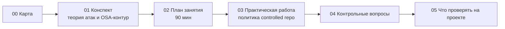

# М08. Защита цепочки поставки и OSA

## Зачем этот модуль

SCA отвечает на вопрос «что у нас уже стоит и чем это опасно». Но к моменту, когда компонент попал в `node_modules` или в локальный кэш сборки, вредоносный `postinstall`-скрипт уже мог выполниться. Этот модуль про **превентивный контур**: как не пустить опасный пакет в периметр разработки до того, как SCA его найдёт.

Тема узкая и практичная: атаки на цепочку поставки (typosquatting, dependency confusion, protestware, компрометация апстрима), и архитектура защиты — **OSA** (Open Source Analysis на входе): firewall/proxy пакетных менеджеров, controlled repository, политики блокировки и карантина.

> [!info] Ключевой водораздел модуля
> **OSA** работает «на входе» — проверяет каждый запрашиваемый пакет до его попадания в контур и может отказать в скачивании. **SCA** работает «по составу» — анализирует то, что уже собрано (SBOM, lockfile, артефакт). Это разные контуры с разными точками контроля, а не синонимы.

## Ключевые понятия

[[controlled repository]] · [[OSA Proxy]] · карантин (quarantine) · политика блокировки · typosquatting · dependency confusion · protestware · slopsquatting · provenance апстрима

## Что внутри модуля

- [[01 Курс/М08 Защита цепочки поставки и OSA/01 Конспект|01 Конспект]] — таксономия атак, OSA как firewall, режимы proxy, отличие OSA от SCA.
- [[01 Курс/М08 Защита цепочки поставки и OSA/02 План занятия|02 План занятия]] — тайминг занятия на 90 минут.
- [[01 Курс/М08 Защита цепочки поставки и OSA/03 Практическая работа|03 Практическая работа]] — проектирование политики controlled repository.
- [[01 Курс/М08 Защита цепочки поставки и OSA/04 Контрольные вопросы|04 Контрольные вопросы]] — вопросы и кейс-задачи.
- [[01 Курс/М08 Защита цепочки поставки и OSA/05 Что проверять на проекте|05 Что проверять на проекте]] — чек-лист аудитора OSA-контура.

## Связи с другими модулями

- [[01 Курс/М01 Термины, угрозы и границы SCA OSA/00 Карта модуля|М01. Термины, угрозы и границы]] — базовое разграничение SCA/OSA задаётся там, здесь раскрывается на атаках.
- [[01 Курс/М05 Инструменты генерации SBOM/00 Карта модуля|М05. Инструменты генерации SBOM]] — OSA умеет строить SBOM на проверяемые пакеты и образы.
- [[01 Курс/М06 Поиск уязвимостей и управление VDR VEX/00 Карта модуля|М06. Поиск уязвимостей и VDR/VEX]] — вердикт OSA опирается на те же фиды угроз.
- [[01 Курс/М12 CodeScoring и подготовка пилота/00 Карта модуля|М12. CodeScoring и подготовка пилота]] — где OSA-контур разворачивается в Организации.
- [[01 Курс/М14 Политики, исключения и принятие риска/00 Карта модуля|М14. Политики и исключения]] — игноры и принятие риска для заблокированных пакетов.

## Практики и нормативка

- [[П17. OSA controlled repository policy]] — политика controlled repo: warmup, monitoring, blocking, exception, audit trail.
- [[П18. OSA Proxy режимы и ограничения]] — режимы proxy и их пределы применимости.
- [[05 Нормативка/ГОСТ Р 56939-2024]] — требования к контролю элементов, полученных от сторонних поставщиков, и анализу кода из цепочек поставок на ВПО.

## Практический результат

Слушатель проектирует политику controlled repository для одной экосистемы (npm или PyPI): этапы warmup → monitoring → blocking, правила карантина, процедуру исключений и audit trail — и умеет объяснить, почему OSA-контур ловит то, что SCA пропускает.
