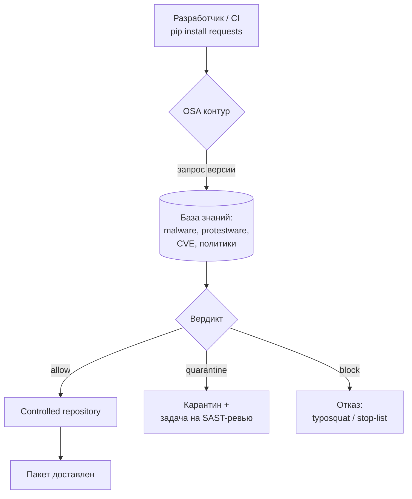

# Конспект: Защита цепочки поставки и OSA

## Зачем модуль

Когда разработчик выполняет `npm install` или `pip install`, пакет скачивается, и его установочные скрипты (`postinstall`, `setup.py`) выполняются на машине разработчика или на раннере CI **до** того, как кто-либо посмотрит на состав сборки. SCA в этот момент уже опоздал: он анализирует то, что собрано. Модуль закрывает разрыв между «пакет запросили» и «пакет проанализировали» — то есть отвечает на вопрос, как **не пустить** опасный компонент в периметр, а не как найти его постфактум.

Масштаб проблемы конкретен: в открытых экосистемах обнаруживается более 1000 новых вредоносных пакетов в месяц, а число атак на цепочки поставки за год выросло кратно. Это не абстрактная угроза — это поток, который надо фильтровать на входе.

## Ключевые идеи

**Таксономия атак** (по систематизации supply-chain атак, arxiv 2204.04008) делится на три класса, и под каждый нужен свой контроль:

- **Вредоносный пакет как нормальный** — пакет создаётся сразу с нагрузкой и раскручивается в сообществе. Пример нагрузки: кража переменных окружения, бэкдор, шифровальщик.
- **Путаница в названиях** — typosquatting (`djngo`, `djanga` вместо `django`), combosquatting (`requests-dev`), brandjacking (`aws-…`, `google-…`), built-in confusion (имя как у стандартного модуля), и slopsquatting — пакеты-галлюцинации, которые LLM «рекомендует» в коде (в исследовании arxiv 2406.10279 до 20% рекомендаций — несуществующие пакеты, 58% галлюцинаций повторяются). Сюда же **dependency confusion**: пакетный менеджер тянет публичную версию вместо внутренней, если публичный индекс отдаёт более высокий номер.
- **Подрыв легитимного пакета** — компрометация апстрима: вредоносный MR, захват майнтейнерства, взлом системы сборки. Каноничные примеры — бэкдор в **XZ Utils** (нацелен на `sshd`) и червь **Shai-Hulud** в npm (искал секреты через TruffleHog, публиковал их и дописывал себя в пакеты жертвы, затронуто >500 проектов). Отдельный класс — **protestware**: майнтейнер сам встраивает деструктив (`node-ipc`, `colors`, `faker`, `es5-ext`).

**OSA как превентивный контур.** Open Source Analysis ставится между разработчиком/CI и публичным реестром. Каждый запрашиваемый компонент сканируется, сверяется с фидами malware/protestware и политиками безопасности, и либо проходит, либо помещается в карантин, либо блокируется. Архитектурно это реализуется двумя способами:

- **Плагин к менеджеру артефактов** (Nexus, JFrog Artifactory) — работает в **блокирующем** режиме: репозиторий физически не отдаёт запрещённый пакет.
- **OSA Proxy** — подключается без привязки к хранилищу, проксирует трафик пакетного менеджера и на лету исключает уязвимые/вредоносные версии из выдачи индекса. Регистри вроде Harbor, GitLab Container Registry поддерживаются в **сканирующем** (наблюдающем) режиме.

> [!warning] OSA — это не «SCA, но раньше»
> Частая ошибка: думать, что OSA и SCA — одно и то же на разных этапах. У них разная точка контроля и разный отказ. OSA отвечает на запрос «дай мне пакет X@1.2.3» вердиктом *да/карантин/нет* — это контроль **доступа**. SCA отвечает на вопрос «из чего собран релиз и где в нём CVE» — это контроль **состава**. OSA может блокировать то, чего ещё нет в вашем SBOM; SCA видит только то, что уже вошло в сборку.

## Как выглядит на практике

Поток пакета через OSA-контур:

Пример правила политики (логика реальных OSA-движков с объединением условий):

| Условие срабатывания | Действие |
|---|---|
| Пакет из stop-list или определён как malware | Заблокировать, задача на 3-ю линию |
| Версия выпущена позже даты X / «слишком молодая» | Карантин + задача на SAST-ревью |
| `critical in direct deps + has_exploit + has_fixed_version` | Задача напрямую разработчику |
| Нарушена лицензионная чистота | Задача на замену + уведомить юристов |

«Слишком молодая версия» — рабочий приём против компрометации апстрима: пакет, выпущенный 2 часа назад, держат в карантине N дней, пока сообщество не успеет отреагировать.

## Слепые зоны именно этой темы

- **Скрипты установки.** Даже корректный по составу пакет может нести вредоносный `postinstall`. Запрет исполнения install-скриптов (`npm install --ignore-scripts`) — отдельный контроль, не заменяемый сканом.
- **Dependency confusion на приватных именах.** Если внутренние пакеты не зарезервированы в публичном индексе и не приоритизированы в конфиге менеджера, OSA-proxy не спасёт от подмены — нужна ещё и правильная настройка scope/index-url.
- **Сканирующий режим ≠ блокировка.** Harbor/GitLab в наблюдающем режиме покажут проблему, но пакет уже доставлен. Не путать «увидели» с «не пустили».
- **Карантин без SLA.** Если на «молодые» версии нет процедуры разбора, карантин превращается в стоп-кран для разработки, и его отключают.

## Связь с нормативкой

[[05 Нормативка/ГОСТ Р 56939-2024]] прямо требует контролировать зависящие от сторонних поставщиков элементы разработки и **анализировать код, полученный через цепочки поставок, на предмет внедрения ВПО**. OSA-контур — это инженерная реализация именно этого требования: точка, где код из апстрима проверяется до включения в разработку. Также: контроль использования предсобранного поставщиком ПО (Docker-образы проходят через OSA так же, как пакеты).

## Что уносим в работу

1. OSA и SCA — два контура, а не два названия одного: OSA на входе (доступ), SCA по составу. Развёрнуты должны быть оба.
2. Под три класса атак — три контроля: фиксация версий и `--ignore-scripts` (вредоносный пакет), запрет неизвестного через OSA (путаница в именах), аудит + карантин «молодых» версий (подрыв апстрима).
3. Блокирующий режим (плагин к Nexus/JFrog) даёт реальный отказ; сканирующий — только видимость. Для критичных потоков нужен блокирующий.
4. Политика обязана включать карантин с SLA и процедуру исключений — иначе её отключат как мешающую.

Практики: [[П17. OSA controlled repository policy]] (warmup → monitoring → blocking, audit trail), [[П18. OSA Proxy режимы и ограничения]] (где proxy работает, а где нет).
