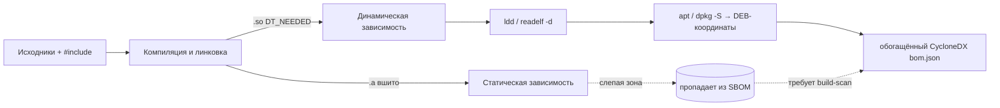

# М09. C и C++ legacy без дисциплины пакетного менеджера

## Зачем этот модуль
В экосистемах npm, PyPI, Go, Cargo состав ПО декларирован: есть lock-файл, есть устойчивый ключ компонента (PURL), и SBOM почти полностью восстанавливается из манифеста. В C/C++ без Conan или vcpkg ничего этого нет. `#include <openssl/ssl.h>` не говорит, какая версия OpenSSL слинкована и слинкована ли вообще; зависимость может прийти из системного `apt`-пакета, из ручного каталога `third_party/`, из внутреннего форка с собственными патчами или быть «вшита» статически в бинарь. Этот модуль учит восстанавливать состав там, где сборочный процесс не отдаёт метаданных, и честно отмечать слепые зоны вместо того, чтобы выдавать неполный SBOM за полный.

Это самый сложный модуль курса: здесь сходятся бинарный анализ ELF, маппинг на DEB-пакеты, граф линковки и роль build-scan. Модуль опирается на инструменты из [[01 Курс/М05 Инструменты генерации SBOM/00 Карта модуля|М05]] и готовит к корпоративному кейсу обогащения фактов в [[01 Курс/М11 Корпоративный кейс генератор фактов и сервис вердиктов/00 Карта модуля|М11]].

## Ключевые понятия
- `#include` ≠ зависимость: заголовок виден компилятору, но не задаёт версию и факт линковки.
- Три разных слоя: исходная зависимость → **динамическая** линковка (`.so`, видна через `ldd`/`readelf -d`/`DT_NEEDED`) → **статическая** линковка (`.a`, слепая зона: компонент исчезает из SBOM).
- Маппинг ELF → DEB через `apt`/`dpkg -S`: системная библиотека получает координаты (имя пакета, версия, дистрибутив).
- Полнота достигается на этапе **сборки** (build scan, перехват вызовов компилятора), а не поздним сканом готового бинаря.
- Роль Conan/vcpkg, когда они есть: `conan graph info` даёт идентичность пакета и устойчивый PURL.

Опорные заметки справочника: [[06 C C++ legacy/include не равен зависимости|include ≠ зависимость]] · [[06 C C++ legacy/динамическая линковка|динамическая линковка]] · [[06 C C++ legacy/статическая линковка|статическая линковка]] · [[06 C C++ legacy/ELF и разделы dynamic|ELF и DT_NEEDED]] · [[06 C C++ legacy/dpkg apt metadata|dpkg/apt metadata]] · [[06 C C++ legacy/stripped binaries|stripped binaries]] · [[06 C C++ legacy/vendored source|vendored source]] · [[06 C C++ legacy/unresolved libraries|unresolved libraries]] · [[06 C C++ legacy/Архитектурный кейс - генератор фактов и сервис вердиктов|кейс генератора фактов]]

## Миникарта модуля

## Нормативная опора
[[05 Нормативка/ГОСТ Р 56939-2024]] · [[05 Нормативка/NIST SP 800-218 SSDF]] (PS.3.2, PW.4, RV.1) · [[05 Нормативка/BSI TR-03183-2 v2.1.0]] · [[05 Нормативка/CERT C C++]] · [[05 Нормативка/MISRA C C++]]

## Материалы модуля
- [[01 Курс/М09 C и C++ legacy без дисциплины пакетного менеджера/01 Конспект|01 Конспект]] — почему SCA ломается в C/C++ и как обогащать SBOM бинарным анализом.
- [[01 Курс/М09 C и C++ legacy без дисциплины пакетного менеджера/02 План занятия|02 План занятия]] — 90 минут: теория, демо, практика.
- [[01 Курс/М09 C и C++ legacy без дисциплины пакетного менеджера/03 Практическая работа|03 Практическая работа]] — собрать проект, снять `ldd`/`readelf`, сравнить динамику и статику.
- [[01 Курс/М09 C и C++ legacy без дисциплины пакетного менеджера/04 Контрольные вопросы|04 Контрольные вопросы]] — вопросы и кейс-задачи.
- [[01 Курс/М09 C и C++ legacy без дисциплины пакетного менеджера/05 Что проверять на проекте|05 Что проверять на проекте]] — чек-лист аудитора по C/C++.

## Связанные практики
[[П19. C C++ make build inventory]] · [[П20. CMake dependency graph]] · [[П21. Conan graph и package identity]] · [[П22. ELF dynamic dependencies]] · [[П23. Статическая линковка как слепая зона]] · [[П24. PURL нормализация и private qualifiers]] · [[П25. CPE alias worklist]]

## Связь с другими модулями
- Назад: [[01 Курс/М05 Инструменты генерации SBOM/00 Карта модуля|М05]] — генераторы SBOM (cdxgen, syft), которые здесь упираются в C/C++.
- Вперёд: [[01 Курс/М10 Много исполнителей и корпоративная модель продукта/00 Карта модуля|М10]] — приёмка C/C++ компонентов от соисполнителей; [[01 Курс/М11 Корпоративный кейс генератор фактов и сервис вердиктов/00 Карта модуля|М11]] — обогащение фактов и сервис вердиктов как сквозной кейс.

## Практический результат
Слушатель умеет: собрать тестовый C/C++ проект; снять `ldd`/`readelf -d` и отличить динамическую зависимость от статической; сгенерировать `cdxgen` SBOM и увидеть, чего в нём не хватает; смаппить `.so` на DEB-пакеты через `apt`; оформить список unresolved libraries для ручной доразметки.
