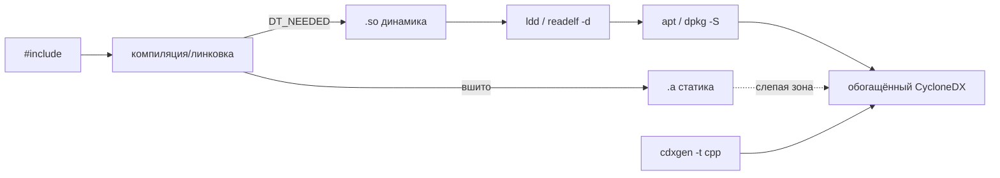

# Конспект: C и C++ legacy без дисциплины пакетного менеджера

## Зачем модуль
В управляемых экосистемах состав ПО декларирован lock-файлом, и SBOM почти полностью восстанавливается из манифеста. В C/C++ без Conan или vcpkg такого манифеста нет. Зависимость может прийти из системного `apt`-пакета, из ручного каталога `third_party/`, из внутреннего форка с патчами или быть статически вшита в бинарь. Поэтому генератор SBOM, запущенный по исходникам, видит подозрительно мало компонентов — и тишина в отчёте читается как «зависимостей нет», хотя на деле они есть, просто не задекларированы. Модуль учит восстанавливать состав там, где сборка не отдаёт метаданных, и честно фиксировать слепые зоны.

> [!info] Census III о C/C++
> Census III (Linux Foundation) отмечает, что C и C++, в отличие почти от всех других языков, не предотвращают нарушения memory safety — корневую причину самого распространённого класса уязвимостей. И отдельно: отсутствие единой схемы именования компонентов (CPE/PURL) заметно тормозит анализ. Для C/C++ это бьёт дважды: высокий риск компонента и слабая идентичность.

## Ключевые идеи
- **`#include` ≠ зависимость.** Заголовок `<openssl/ssl.h>` виден компилятору, но не задаёт ни версию, ни факт линковки. Версию даёт только сборка и бинарь.
- **Три слоя состава.** Исходная зависимость → динамическая линковка (`.so`) → статическая линковка (`.a`). Динамику видно: запись `DT_NEEDED` в ELF-секции `.dynamic`. Статику не видно: код `libfoo.a` копируется в исполняемый файл и теряет границу — компонент исчезает из SBOM.
- **Маппинг ELF → DEB даёт координаты.** `ldd`/`readelf -d` дают имя `.so`; `dpkg -S` / `apt` превращают путь в пакет с версией и дистрибутивом — а значит, в PURL вида `pkg:deb/debian/libssl3@3.0.11`.
- **Полнота — на этапе сборки.** Поздний скан готового (особенно stripped) бинаря теряет статически слинкованное и vendored. Надёжнее build-scan: перехват вызовов компилятора и линкера во время `make`/`cmake`.
- **Conan/vcpkg, когда есть.** `conan graph info` отдаёт граф и идентичность пакета — устойчивый PURL вместо `pkg:generic/...`.

## Как выглядит на практике
Динамическую библиотеку видно в ELF и можно смаппить на пакет:
```text
$ readelf -d ./app | grep NEEDED
 0x0001 (NEEDED)  Shared library: [libssl.so.3]
 0x0001 (NEEDED)  Shared library: [libcrypto.so.3]
$ dpkg -S $(ldconfig -p | awk '/libssl.so.3/{print $NF; exit}')
 libssl3:amd64: /usr/lib/x86_64-linux-gnu/libssl.so.3
```
Так `libssl.so.3` получает координату `pkg:deb/debian/libssl3@<версия>`. А если тот же OpenSSL слинкован статически (`-l:libssl.a`), в `readelf -d` его нет вовсе — остаётся искать символы (`readelf -s`, `strings`) и поднимать build-log.


Здесь работает «генератор фактов» (enrichment-утилита): на вход — сырой CycloneDX от `cdxgen` плюс ELF-бинарники; он добавляет результат бинарного анализа ELF и маппинг динамических библиотек на DEB через `apt`, дополняет метаданные из PyPI/npm/Conan/apt и отдаёт обогащённый `bom.json`. См. [[06 C C++ legacy/Архитектурный кейс - генератор фактов и сервис вердиктов|архитектурный кейс]].

## Слепые зоны именно C/C++
> [!warning] Что теряется
> - **Статическая линковка (`.a`)** — компонент вшит, в `DT_NEEDED` его нет.
> - **Stripped binaries** — вырезаны символы и debug-info, бинарный анализ слепнет.
> - **Vendored / `third_party/`** — копия исходников OSS без версии и истории.
> - **Внутренний форк** — выглядит как апстрим, но имеет свои патчи и другой профиль риска.
> - **`unresolved` библиотеки** — `.so` не маппится ни на один установленный DEB-пакет.

## Связь с нормативкой
[[05 Нормативка/ГОСТ Р 56939-2024]] требует управляемости работ; [[05 Нормативка/NIST SP 800-218 SSDF]] (PS.3.2, PW.4, RV.1) задаёт связку «SBOM — сторонние компоненты — реакция на уязвимости»; [[05 Нормативка/BSI TR-03183-2 v2.1.0]] — критерии качества SBOM; [[05 Нормативка/CERT C C++]] и [[05 Нормативка/MISRA C C++]] объясняют, почему риск C/C++ компонента высок. Шаблоны: [[08 Шаблоны/Реестр unresolved libraries|Реестр unresolved libraries]], [[08 Шаблоны/Порядок работы с неопознанной библиотекой|Порядок работы с неопознанной библиотекой]].

## Что уносим в работу
- Почему «хороший» SBOM по C/C++ — это **честный** SBOM, и чем он отличается от плохого: [[02 Справочник/Почему генерация SBOM — это искусство|Почему генерация SBOM — это искусство]].
- Тишина в C/C++ SBOM — это не «зависимостей нет», а сигнал к проверке статики и vendored.
- Сначала `readelf -d` + `dpkg -S` для динамики, потом отдельно ищем статически вшитое.
- Полноту даёт build-scan, не поздний скан бинаря.
- Любую `.so` без DEB-координаты заносим в реестр unresolved libraries с ответственным.
- Практики: [[П19. C C++ make build inventory]], [[П20. CMake dependency graph]], [[П21. Conan graph и package identity]], [[П22. ELF dynamic dependencies]], [[П23. Статическая линковка как слепая зона]].
