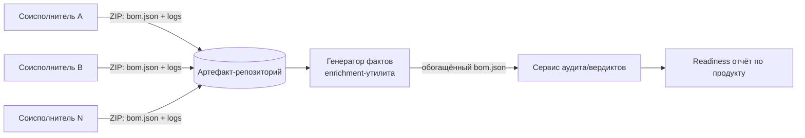

# М10. Много исполнителей и корпоративная модель продукта

## Зачем этот модуль
Корпоративный продукт Организации редко собирается одной командой. Это «изделие», в которое 5–10 соисполнителей вкладывают свои подсистемы поверх огромного legacy. SCA/OSA при этом превращается из «прогнать сканер по своему репозиторию» в задачу **управления составом продукта, который ты сам не собираешь**: SBOM приходит готовым, в ZIP-поставке, через артефакт-репозиторий, и качество этих данных контролирует не разработчик, а внешняя команда. Модуль учит организовать приём, оценить пригодность поставленного SBOM и однозначно ответить на вопрос «кто отвечает за состав».

## Что внутри модуля
- [[01 Курс/М10 Много исполнителей и корпоративная модель продукта/01 Конспект|01 Конспект]] — контракт поставки, потоки артефактов, качество данных от внешних команд, распределение ответственности.
- [[01 Курс/М10 Много исполнителей и корпоративная модель продукта/02 План занятия|02 План занятия]] — тайминг занятия на 90 минут: лекция, демо приёмки, ПЗ.
- [[01 Курс/М10 Много исполнителей и корпоративная модель продукта/03 Практическая работа|03 Практическая работа]] — приёмочный контроль ZIP-поставки одного соисполнителя.
- [[01 Курс/М10 Много исполнителей и корпоративная модель продукта/04 Контрольные вопросы|04 Контрольные вопросы]] — вопросы и кейсы по приёмке и ответственности.
- [[01 Курс/М10 Много исполнителей и корпоративная модель продукта/05 Что проверять на проекте|05 Что проверять на проекте]] — чек-лист аудитора процесса много-исполнительской поставки.

## Поток поставки (укрупнённо)

## Ключевые понятия
Контракт поставки · ZIP-поставка · артефакт-репозиторий · приёмочный контроль SBOM · соглашение о качестве данных · владелец состава · provenance соисполнителя · merge SBOM в единый состав изделия.

## Связи модуля
- Практики: [[03 Практикум/П28. Поставка от нескольких исполнителей|П28. Поставка от нескольких исполнителей]], [[03 Практикум/П29. Readiness dashboard|П29. Readiness dashboard]].
- Шаблоны: [[08 Шаблоны/Контракт поставки SBOM от соисполнителя|Контракт поставки SBOM от соисполнителя]], [[08 Шаблоны/Соглашение о качестве данных SBOM|Соглашение о качестве данных SBOM]], [[08 Шаблоны/Чек-лист ZIP поставки|Чек-лист ZIP поставки]], [[08 Шаблоны/Шаблон отчета по соисполнителю|Шаблон отчёта по соисполнителю]].
- Смежные модули: [[01 Курс/М09 C и C++ legacy без дисциплины пакетного менеджера/00 Карта модуля|М09. C/C++ legacy]] (откуда берётся «грязный» SBOM соисполнителя), [[01 Курс/М11 Корпоративный кейс генератор фактов и сервис вердиктов/00 Карта модуля|М11. Корпоративный кейс: генератор фактов и сервис вердиктов]] (как принятые SBOM обрабатываются дальше).
- Нормативка: [[05 Нормативка/ГОСТ Р 56939-2024|ГОСТ Р 56939-2024]], [[05 Нормативка/Проект ГОСТ Р КАПО|Проект ГОСТ Р КАПО]], [[05 Нормативка/ISO IEC 27001|ISO/IEC 27001 (supplier relationships)]], [[05 Нормативка/NIST SP 800-161 Rev.1|NIST SP 800-161]].

## Практический результат
Слушатель умеет: принять ZIP-поставку соисполнителя через артефакт-репозиторий, прогнать её через приёмочный контроль качества SBOM, зафиксировать дефекты данных как worklist (а не как «отказ»), и указать в RACI, кто отвечает за состав каждого фрагмента изделия.
