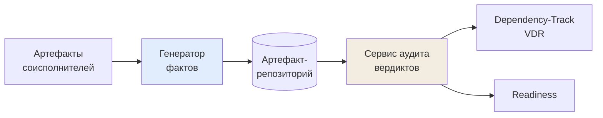

# М11. Корпоративный кейс: генератор фактов и сервис вердиктов

## Назначение
Это центральный кейс курса. Все приёмы предыдущих модулей (C/C++ legacy, ELF, маппинг библиотек, поставка от соисполнителей) собираются здесь в один работающий конвейер из двух обезличенных сервисов Организации:

1. **Генератор фактов** (enrichment-утилита) — превращает сырой артефакт соисполнителя (cdxgen-SBOM + ELF-бинарники) в обогащённый, валидный CycloneDX. Только факты, никаких суждений.
2. **Сервис аудита/вердиктов** — принимает обогащённый SBOM, прогоняет его через юридический и уязвимостный workflow, выпускает вердикты и собирает **readiness** релиза.

Главная мысль модуля — **граница между ФАКТАМИ и РЕШЕНИЯМИ**. Один сервис не имеет права выносить вердикт; другой не имеет права дописывать состав. Это разделение и делает аудит воспроизводимым.

## Карта потока (mini)

## Ключевые понятия
[[sbom enrichment]] · [[CycloneDX-first]] · [[02 Справочник/Глоссарий/факты vs решения|факты vs решения]] · [[legal verdict]] · [[VDR]] · [[readiness]]

## Нормативная опора
[[05 Нормативка/NIST SP 800-218 SSDF]] (PS.3.2, RV.1) · [[05 Нормативка/ГОСТ Р 56939-2024]] · [[04 Инструменты/БДУ ФСТЭК|БДУ ФСТЭК]] · [[05 Нормативка/CycloneDX ECMA-424]] · [[05 Нормативка/OWASP SCVS]]

## Материалы модуля
- [[01 Курс/М11 Корпоративный кейс генератор фактов и сервис вердиктов/01 Конспект|01 Конспект]] — архитектура двух сервисов, граница «факты/решения», полный пайплайн.
- [[01 Курс/М11 Корпоративный кейс генератор фактов и сервис вердиктов/02 План занятия|02 План занятия]] — тайминг лекции, демо и ПЗ.
- [[01 Курс/М11 Корпоративный кейс генератор фактов и сервис вердиктов/03 Практическая работа|03 Практическая работа]] — прогнать артефакт через обе стадии и собрать readiness.
- [[01 Курс/М11 Корпоративный кейс генератор фактов и сервис вердиктов/04 Контрольные вопросы|04 Контрольные вопросы]] — контроль + кейс-задачи на границу ответственности.
- [[01 Курс/М11 Корпоративный кейс генератор фактов и сервис вердиктов/05 Что проверять на проекте|05 Что проверять на проекте]] — чек-лист аудитора по разделению контуров.

## Смежные модули и практики
- [[01 Курс/М09 C и C++ legacy без дисциплины пакетного менеджера/00 Карта модуля|М09. C/C++ legacy]] — откуда берётся ELF-анализ внутри генератора фактов.
- [[01 Курс/М10 Много исполнителей и корпоративная модель продукта/00 Карта модуля|М10. Много исполнителей]] — как устроен вход конвейера (поставка артефактов).
- [[03 Практикум/П28. Поставка от нескольких исполнителей|П28. Поставка от нескольких исполнителей]]
- [[03 Практикум/П29. Readiness dashboard|П29. Readiness dashboard]]

## Практический результат
Уметь нарисовать и защитить полный конвейер Организации: артефакт соисполнителя → обогащение (факты) → артефакт-репозиторий → аудит/вердикты → Dependency-Track (VDR) → readiness; и для каждой стрелки назвать, кто отвечает и чем это подтверждается на аудите.
