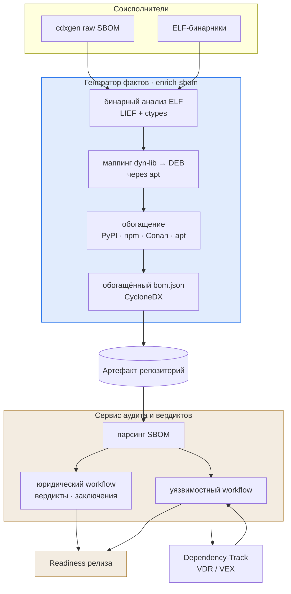

# Конспект: корпоративный кейс — генератор фактов и сервис вердиктов

## Зачем модуль
В Организации сложилась двухсервисная связка, потому что наивная схема «один сканер на всё» в реальной поставке от соисполнителей разваливается. Сырой SBOM от cdxgen приходит с дырами: для C/C++-компонентов в нём видны компоненты, но не видны фактически слинкованные системные библиотеки и их версии; PURL частично отсутствуют; лицензии — текстовые строки без нормализации. Если в таком виде сразу прогонять анализатор, получаем мало findings и ложную картину «всё чисто». Модуль показывает, как Организация разнесла обработку на два контура: один **доводит факты до качества** (обогащение), второй **выносит решения** (вердикты и готовность) — и почему нельзя путать эти ответственности.

Разделение нужно не из любви к архитектуре, а потому что у фактов и решений разные жизненные циклы и разные владельцы. Факты пересобираются автоматически при каждой новой поставке артефакта; решения принимаются людьми, живут дольше одного релиза и подлежат периодическому пересмотру. Если смешать их в одном сервисе, то любое переобогащение состава начнёт стирать ранее принятые вердикты, а любое юридическое решение — «протекать» в данные о составе и делать их невоспроизводимыми. Кейс этого модуля — рабочая граница, которая удерживает оба свойства одновременно: состав всегда можно пересчитать, а решения по нему — предъявить с историей.

## Ключевые идеи
**Генератор фактов (enrichment-утилита)** — CLI с единственной командой `enrich-sbom`. На вход — сырой CycloneDX от cdxgen плюс каталог ELF-бинарников соисполнителя. Внутри происходит то, чего cdxgen не делает: бинарный анализ ELF (через LIEF + ctypes) находит динамически слинкованные библиотеки, маппит их на системные DEB-пакеты через `apt`, добивает метаданные компонентов из PyPI, npm, Conan и apt. На выходе — обогащённый валидный `bom.json`. Жёсткая граница: утилита **не** ищет уязвимости, **не** проверяет лицензии на допустимость, **не** строит graph рисков. Она только фиксирует «что есть».

**Сервис аудита/вердиктов** — full-stack веб-приложение (загрузка SBOM соисполнителей → парсинг → юридический workflow). Здесь появляются вердикты по лицензиям, заключения, паспорта рисков и **readiness-отчёт** по релизу. Этот сервис **ничего не дописывает в состав** — он интерпретирует факты и хранит решения с автором, датой и обоснованием. Уязвимостный workflow выносится в Dependency-Track: туда импортируется обогащённый состав, оттуда забирается VDR/VEX, и сервис увязывает каждую запись о уязвимости с конкретной версией компонента и состоянием обработки.

**Передаточное звено — артефакт-репозиторий.** Между двумя контурами лежит хранилище, куда генератор фактов кладёт `bom.json`, а сервис вердиктов его оттуда читает. Это не просто папка: именно здесь фиксируется иммутабельность и provenance — версия артефакта, дата, соисполнитель, commit/tag сборки. Если этот узел пропустить и подавать SBOM «из рук в руки», теряется ровно та трассируемость, ради которой и строились оба сервиса: на аудите нельзя будет доказать, какой именно состав породил данный вердикт. Поэтому передача артефакта между контурами — отдельная контрольная точка, а не техническая деталь.

> [!info] Факты vs Решения
> Факт обратим и воспроизводим: повтори `enrich-sbom` на том же входе — получишь тот же `bom.json`. Решение субъективно и подписано: вердикт «copyleft несовместим с поставкой» имеет автора и срок пересмотра. Аудитор должен мгновенно отвечать, по какую сторону границы находится любая строка отчёта.

## Как выглядит на практике
Команда первой стадии (генератор фактов):
```bash
# CLI генератора фактов (enrichment-утилита), единственная команда:
enrich-sbom raw-bom.json enriched-bom.json --component-path ./build/bin
```
Эффект обогащения на одном компоненте — появляется `purl`, нормализованная лицензия и evidence-привязка к DEB:
```json
{
  "type": "library", "name": "libssl3", "version": "3.0.13-0ubuntu3",
  "purl": "pkg:deb/debian/libssl3@3.0.13-0ubuntu3?arch=amd64",
  "licenses": [{ "license": { "id": "Apache-2.0" } }],
  "evidence": { "identity": { "field": "purl", "methods": [
    { "technique": "binary-analysis", "confidence": 0.8 }] } }
}
```

Дальше — водораздел двух контуров и весь конвейер целиком:


## Слепые зоны именно этой темы
- **Утечка интерпретации в генератор фактов.** Соблазн «заодно отфильтровать GPL» на стадии обогащения ломает воспроизводимость: факт перестаёт быть фактом.
- **Версионный разрыв форматов.** Удаление Excel-отчёта в версии 2.0.0 генератора означает, что потребитель обязан читать `bom.json`; забытый скрипт на старую команду молча перестаёт получать данные.
- **DEB-маппинг привязан к окружению.** Бинарный анализ требует Astra/Debian-окружения (`python3-apt`, `liblief`); запуск на другой ОС даст неполный маппинг и тихо занизит состав.
- **«Зелёный» readiness при пустом VDR.** Если Dependency-Track ещё не подтянул фид БДУ/OSV, отсутствие findings выглядит как готовность, хотя это лишь отсутствие данных.

## Связь с нормативкой
- [[05 Нормативка/NIST SP 800-218 SSDF|SSDF]] — PS.3.2 (хранить provenance компонентов) и RV.1 (реагировать на уязвимости) ровно описывают два контура кейса.
- [[05 Нормативка/ГОСТ Р 56939-2024|ГОСТ Р 56939-2024]] — требование управляемости работ; здесь это разделение ответственности фактов и решений.
- [[05 Нормативка/CycloneDX ECMA-424|CycloneDX ECMA-424]] и [[05 Нормативка/OWASP SCVS|OWASP SCVS]] — качество обогащённого SBOM (purl, evidence, лицензии).
- [[08 Шаблоны/Шаблон управленческой сводки готовности|Шаблон управленческой сводки готовности]] и [[08 Шаблоны/Порядок загрузки VDR из Dependency-Track|Порядок загрузки VDR]] — выходные артефакты второго контура.

## Что уносим в работу
1. Прежде чем доверять findings — проверь, что SBOM **обогащён** (есть purl/evidence), а не сырой.
2. Никогда не выноси вердикт внутри генератора фактов и не дописывай состав внутри сервиса вердиктов.
3. Readiness считай валидным только при «живом» VDR (фид подтянут, дата свежая).
4. Фиксируй версию генератора фактов — смена формата выхода ломает потребителей молча.
5. Отрабатывай это на [[03 Практикум/П28. Поставка от нескольких исполнителей|П28]] (вход) и [[03 Практикум/П29. Readiness dashboard|П29]] (выход).
