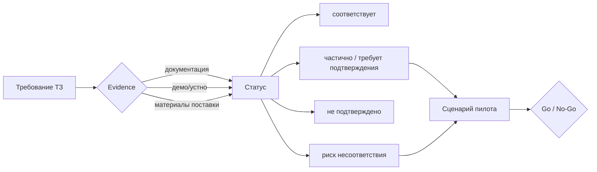

# М12. CodeScoring и подготовка пилота

## Зачем этот модуль
Организация выбирает SCA/OSA-инструмент под собственное ТЗ, где преобладают C/C++ legacy-сборки без дисциплины пакетного менеджера. Маркетинговое «соответствует всем требованиям» здесь не работает: половина требований ТЗ либо смешивает разные режимы продукта (Proxy, plugin репозитория, CLI/агент), либо шире того, что инструмент реально подтверждает. Модуль учит **превращать ТЗ в проверяемую матрицу** и **строить пилот так, чтобы спорные требования закрывались демонстрацией, а не обещанием**.

Сквозной навык модуля — методика **требование → evidence → статус**:

## Спорные зоны, ради которых нужен пилот
- **OSA Proxy ≠ все пакетные менеджеры.** Proxy-firewall подтверждён для Maven, NPM, PyPI, NuGet V3, Go, Debian, Alpine/APK, RPM, Docker Registry. Conan, Conda, RubyGems в режиме Proxy не подтверждены — это «риск несоответствия».
- **C/C++ build scan: make/CMake — да, qmake — под вопрос.** Сборочный анализ через агент/eBPF на GCC/Clang заявлен; qmake прямо не подтверждён и требует демо на реальном проекте.
- **Готовые бинарники и статическая линковка.** Архивы и контейнеры распознаются; native stripped, `.a`/`.so` без сборочного контекста — ненадёжно (заявлено поставщиком прямо).
- **Reachability** (анализ вызовов) только для Java/Python/Go; IDE-плагины — VS Code и IntelliJ-based, Qt Creator не покрыт.

## Материалы модуля
- [[01 Курс/М12 CodeScoring и подготовка пилота/01 Конспект|01 Конспект]] — методика оценки и спорные зоны.
- [[01 Курс/М12 CodeScoring и подготовка пилота/02 План занятия|02 План занятия]] — тайминг занятия на 90 минут.
- [[01 Курс/М12 CodeScoring и подготовка пилота/03 Практическая работа|03 Практическая работа]] — собрать матрицу и сценарии пилота.
- [[01 Курс/М12 CodeScoring и подготовка пилота/04 Контрольные вопросы|04 Контрольные вопросы]] — проверка понимания + кейсы.
- [[01 Курс/М12 CodeScoring и подготовка пилота/05 Что проверять на проекте|05 Что проверять на проекте]] — чек-лист аудитора пилота.

## Опорные материалы раздела 07
- [[07 CodeScoring/Матрица соответствия требованиям OSA SCA]]
- [[07 CodeScoring/Критерии Go No-Go после пилота]]
- [[07 CodeScoring/OSA Proxy и поддержанные экосистемы]]
- [[07 CodeScoring/C C++ build scan make cmake qmake]]
- [[07 CodeScoring/Статическая линковка и форки]]
- [[07 CodeScoring/Ограничения готовых бинарников]]
- [[07 CodeScoring/Приемочные сценарии пилота]]
- [[07 CodeScoring/Документы поставщика для закупки]]

## Связи
- Смежные модули: [[01 Курс/М08 Защита цепочки поставки и OSA/00 Карта модуля|М08 Защита цепочки поставки и OSA]] · [[01 Курс/М09 C и C++ legacy без дисциплины пакетного менеджера/00 Карта модуля|М09 C/C++ legacy]] · [[01 Курс/М14 Политики, исключения и принятие риска/00 Карта модуля|М14 Политики и риск]]
- Практики: [[П31. Пилот CodeScoring make CMake qmake]] · [[П33. AppSec и CodeScoring сравнение по задаче]]
- Нормативка: [[05 Нормативка/ГОСТ Р 56939-2024]] · [[05 Нормативка/NIST SP 800-218 SSDF]] · [[05 Нормативка/Проект ГОСТ Р КАПО]]
- Шаблоны: [[Шаблон протокола пилота SCA инструмента]] · [[Матрица соответствия требованиям]]

## Результат модуля
Готовая матрица соответствия с расставленными статусами, перечень сценариев пилота под спорные зоны и сформулированные критерии Go/No-Go, по которым принимается решение о закупке.
