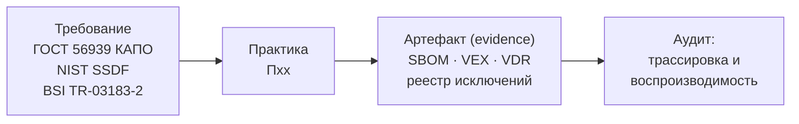

# М13. Нормативная трассировка и доказательная база

## Зачем этот модуль
Предыдущие модули учили *получать* артефакты: SBOM, VDR, license scan, build inventory. М13 отвечает на другой вопрос — **чем доказать аудитору, что процесс композиционного анализа действительно выполняется**. Здесь мы строим мост от формулировки требования (ГОСТ Р 56939-2024, NIST SSDF, BSI TR-03183-2) к конкретной практике и к машинному артефакту, который этот контроль подтверждает. Результат — матрица `требование → практика → артефакт (evidence)`, по которой можно пройти аудит, а не пересказывать намерения.

## Главная идея модуля
Доказательная база держится на разделении **статики и динамики**: SBOM по BSI TR-03183-2 статичен и НЕ содержит сведений об уязвимостях (§3, §8.1.14), а сведения об уязвимостях динамичны и живут в отдельном артефакте (VEX/CSAF/VDR). Поэтому одной строки «у нас есть SBOM» для аудита недостаточно: каждый контроль требует *своего* типа evidence с фиксированными атрибутами (дата, версия продукта, инструмент, владелец).

## Материалы модуля
- [[01 Курс/М13 Нормативная трассировка и доказательная база/01 Конспект|01 Конспект]] — связь требование→практика→артефакт, полная матрица маппинга трёх стандартов.
- [[01 Курс/М13 Нормативная трассировка и доказательная база/02 План занятия|02 План занятия]] — тайминг занятия 90 минут.
- [[01 Курс/М13 Нормативная трассировка и доказательная база/03 Практическая работа|03 Практическая работа]] — собрать одну строку матрицы end-to-end и проверить её на воспроизводимость.
- [[01 Курс/М13 Нормативная трассировка и доказательная база/04 Контрольные вопросы|04 Контрольные вопросы]] — вопросы и кейсы по трассировке.
- [[01 Курс/М13 Нормативная трассировка и доказательная база/05 Что проверять на проекте|05 Что проверять на проекте]] — чек-лист аудитора.

## Сжатая матрица (полная — в конспекте)

| Требование КАПО (ГОСТ Р 56939-2024) | NIST SSDF | BSI TR-03183-2 | Артефакт |
|---|---|---|---|
| Регламент КА | PW.4 | — | Регламент КАПО (роли, периодичность) |
| Формирование ППК/SBOM | PS.3.2 | §4, §5.2.1–5.2.2 | CycloneDX 1.6 JSON |
| Контроль и актуализация ППК | RV.1 | §8.1.14 | VDR + журнал анализа |
| Анализ на поверхности атаки | RV.2 | §8.1.14 | VEX/CSAF |
| Корректирующие воздействия | RV.2 | — | Реестр исключений, протокол ретеста |

## Связи
- Нормативка: [[05 Нормативка/ГОСТ Р 56939-2024]] · [[05 Нормативка/Проект ГОСТ Р КАПО]] · [[05 Нормативка/NIST SP 800-218 SSDF]] · [[05 Нормативка/BSI TR-03183-2 v2.1.0]] · [[05 Нормативка/CISA Minimum Elements for SBOM]] · [[05 Нормативка/ISO IEC 27001]]
- Шаблоны: [[08 Шаблоны/Матрица evidence для аудита|Матрица evidence для аудита]] · [[08 Шаблоны/Журналирование и audit trail|Журналирование и audit trail]] · [[08 Шаблоны/Матрица соответствия требованиям|Матрица соответствия требованиям]]
- Смежные модули: [[01 Курс/М02 SBOM и ППК как машинный источник фактов/00 Карта модуля|М02 SBOM как источник фактов]] · [[01 Курс/М06 Поиск уязвимостей и управление VDR VEX/00 Карта модуля|М06 VDR/VEX]] · [[01 Курс/М09 C и C++ legacy без дисциплины пакетного менеджера/00 Карта модуля|М09 C/C++ legacy]] · [[01 Курс/М14 Политики, исключения и принятие риска/00 Карта модуля|М14 Политики и исключения]]
- Практики: [[03 Практикум/П03. Генерация SBOM через Syft|П03]] · [[03 Практикум/П08. Dependency-Track как портфель SBOM|П08]] · [[03 Практикум/П09. VDR и VEX различие факта и решения|П09]] · [[03 Практикум/П35. VEX triage|П35]] · [[03 Практикум/П30. Исключения и принятие риска|П30]]
