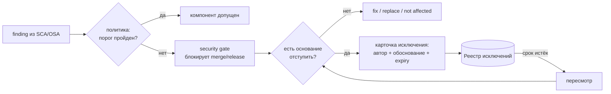

# М14. Политики, исключения и принятие риска

## Зачем этот модуль
Сканер находит сотни findings, но сам по себе не имеет права ничего блокировать или пропускать. Решение «впускаем компонент / правим / временно живём с риском» принимает не инструмент, а правило (политика) и человек (владелец риска). Модуль учит превращать политику приёмки сторонних компонентов в исполняемые пороги (CVSS, лицензии, malware), а каждое отклонение от порога — в карточку исключения со сроком пересмотра, а не в молчаливое «замьютили в сканере».

> [!info] Граница модуля
> М14 — не про то, *как* найти уязвимость или лицензию (это М06 и М07), а про то, *по какому правилу* мы принимаем или отклоняем компонент и *кто и на какой срок* берёт на себя остаточный риск. Ключевое различие модуля: **security gate** (автоматическое правило в CI) против **управленческого решения** (исключение, подписанное владельцем риска).

## Что внутри
- [[01 Курс/М14 Политики, исключения и принятие риска/01 Конспект|01 Конспект]] — пороги политики, анатомия карточки исключения, gate vs решение.
- [[01 Курс/М14 Политики, исключения и принятие риска/02 План занятия|02 План занятия]] — 90 минут: лекция, демо реестра, ПЗ.
- [[01 Курс/М14 Политики, исключения и принятие риска/03 Практическая работа|03 Практическая работа]] — оформить исключение с expiry и завести запись в реестре.
- [[01 Курс/М14 Политики, исключения и принятие риска/04 Контрольные вопросы|04 Контрольные вопросы]] — пороги, процедура, кейсы.
- [[01 Курс/М14 Политики, исключения и принятие риска/05 Что проверять на проекте|05 Что проверять на проекте]] — чек-лист аудитора по политикам и реестру.

## Карта решения

## Связи модуля
- Пороги и анализ findings: [[01 Курс/М06 Поиск уязвимостей и управление VDR VEX/00 Карта модуля|М06 Уязвимости и VDR/VEX]], [[01 Курс/М07 Лицензионная чистота и юридический workflow/00 Карта модуля|М07 Лицензионная чистота]].
- Граница VEX и принятия риска: [[02 Справочник/VEX в процессе РБПО - откуда берется и как выпускать|VEX в процессе РБПО]].
- Где живёт gate в конвейере: [[01 Курс/М08 Защита цепочки поставки и OSA/00 Карта модуля|М08 Защита цепочки поставки]].
- Доказательная связка с нормативкой: [[01 Курс/М13 Нормативная трассировка и доказательная база/00 Карта модуля|М13 Нормативная трассировка]].
- Шаблоны: [[08 Шаблоны/Политика приемки сторонних компонентов]] · [[08 Шаблоны/Реестр исключений]] · [[08 Шаблоны/Порядок принятия риска]] · [[08 Шаблоны/Требования к CI security gate]].
- Практика: [[03 Практикум/П30. Исключения и принятие риска|П30. Исключения и принятие риска]].

## Результат на выходе
Слушатель умеет: записать политику приёмки как набор измеримых порогов; отличить случай, который должен ловить gate, от случая, требующего управленческого решения; оформить карточку исключения (автор, обоснование, компенсирующие меры, срок пересмотра) и завести её в реестр с трассируемостью до версии компонента.
