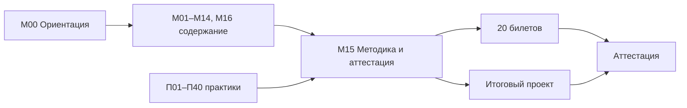

# М15. Методика преподавания и итоговая аттестация

## Зачем модуль
Это единственный модуль курса, адресованный преподавателю, а не слушателю. Он отвечает на вопрос «как вести этот курс из 16 содержательных модулей (М00–М14, М16) и 40 практик (П01–П40), чтобы на выходе человек умел не запускать инструмент, а защитить решение по составу ПО перед ИБ, DevOps, юристом и руководителем». Здесь собраны форматы занятий, регламент работы со стендом, разбор типовых затруднений слушателей и устройство итоговой аттестации (20 билетов плюс итоговый проект) с разбираемыми критериями оценивания.

## Что внутри модуля
- [[01 Курс/М15 Методика преподавания и итоговая аттестация/01 Конспект|01 Конспект]] — форматы лекция/демо/ПЗ, дидактика стенда, карта затруднений, как читать рубрику аттестации.
- [[01 Курс/М15 Методика преподавания и итоговая аттестация/02 План занятия|02 План занятия]] — сценарий дня итоговой аттестации (180 минут): инструктаж по критериям, калибровка оценки, защита проектов.
- [[01 Курс/М15 Методика преподавания и итоговая аттестация/03 Практическая работа|03 Практическая работа]] — преподаватель оценивает один готовый билет и фрагмент проекта по общей рубрике (калибровочный прогон).
- [[01 Курс/М15 Методика преподавания и итоговая аттестация/04 Контрольные вопросы|04 Контрольные вопросы]] — методические вопросы и кейс-задачи о ведении курса и снятии затруднений.
- [[01 Курс/М15 Методика преподавания и итоговая аттестация/05 Что проверять на проекте|05 Что проверять на проекте]] — чек-лист эксперта для приемки итогового проекта.

## Куда ведут связи
Модуль завязан на раздел оценивания и сквозные практики:
- аттестация: [[10 Оценивание/Итоговый проект|Итоговый проект]] · [[10 Оценивание/Билет 01|Билет 01]];
- стенд и старт: [[01 Курс/М00 Ориентация в курсе и карта решений/00 Карта модуля|М00 Ориентация в курсе]] · [[03 Практикум/П01. Стенд WSL2 Docker и базовая гигиена|П01. Стенд WSL2 Docker]];
- финальная отработка навыка: [[03 Практикум/П36. Итоговый мини-проект|П36. Итоговый мини-проект]] · [[03 Практикум/П29. Readiness dashboard|П29. Readiness dashboard]];
- частые точки затруднений: [[03 Практикум/П23. Статическая линковка как слепая зона|П23. Статическая линковка]] · [[03 Практикум/П09. VDR и VEX различие факта и решения|П09. VDR и VEX]] · [[03 Практикум/П24. PURL нормализация и private qualifiers|П24. PURL нормализация]];
- нормативная опора компетенций: [[05 Нормативка/ГОСТ Р 56939-2024|ГОСТ Р 56939-2024]].

## Практический результат для преподавателя
Провести занятие любого из 16 модулей в формате лекция → демо → ПЗ на стенде, распознать и снять 5–7 типовых затруднений слушателей, и оценить итоговую работу по единой рубрике 100 баллов так, чтобы две оценки от разных экспертов расходились не более чем на один блок.
