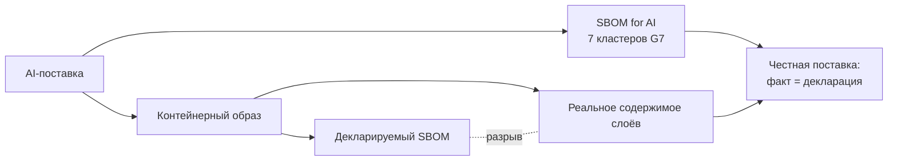

# М16. SBOM for AI и честный SBOM контейнерных образов

## Зачем этот модуль

Классический SBOM описывает дерево пакетов приложения. Но в 2026 году две вещи ломают это допущение:

1. **AI-системы** — это не только код. Модель, её веса, обучающие датасеты и инфраструктура исполнения несут собственные риски (provenance датасета, лицензия весов, lineage дистилляции), которых нет в обычном `package-lock.json`. G7 в документе «SBOM for AI: Minimum Elements» (Avian, France, 2026) формализовал это как **семь кластеров**, дополняющих обычный SBOM, а не заменяющих его.

2. **Контейнерный образ** — это слоистый артефакт, и SBOM, сгенерированный по нему, может **лгать**. Удалённый секрет остаётся в нижнем слое; обфускация метаданных превращает 97 уязвимостей в 0; UPX-упаковка и стрип build-info прячут зависимости от сканера. «Честный SBOM» — это про разрыв между тем, что **декларируется**, и тем, что **реально лежит** в образе.

Модуль учит видеть оба разрыва и закрывать их процессом.

## Что внутри модуля

- [[01 Курс/М16 SBOM for AI и честный SBOM контейнерных образов/01 Конспект|01 Конспект]] — две темы с конкретными примерами (Models/Datasets кластеры; `docker save` + извлечение секрета из слоя).
- [[01 Курс/М16 SBOM for AI и честный SBOM контейнерных образов/02 План занятия|02 План занятия]] — тайминг 90 минут, демо обфускации и разбора слоёв.
- [[01 Курс/М16 SBOM for AI и честный SBOM контейнерных образов/03 Практическая работа|03 Практическая работа]] — собрать честный SBOM образа и AI-карточку модели.
- [[01 Курс/М16 SBOM for AI и честный SBOM контейнерных образов/04 Контрольные вопросы|04 Контрольные вопросы]] — вопросы и кейсы.
- [[01 Курс/М16 SBOM for AI и честный SBOM контейнерных образов/05 Что проверять на проекте|05 Что проверять на проекте]] — чек-лист аудитора.

## Связанные практики

- [[П37. Контейнерный образ слои секреты и удаленные файлы]] — разбор слоёв, поиск секретов в нижних слоях.
- [[П38. Честный SBOM контейнерного образа]] — реальное содержимое vs декларация, проверка обфускации.
- [[П39. SBOM for AI minimum elements]] — заполнение семи кластеров G7.

## Справочник и нормативка

- [[02 Справочник/SBOM for AI - минимальные элементы]] — расшифровка кластеров и элементов.
- Нормативная опора: ГОСТ Р 56939-2024 (РБПО, общие требования), проект ГОСТ Р по композиционному анализу ПО, G7 «SBOM for AI: Minimum Elements» (2026). См. раздел [[05 Нормативка|05 Нормативка]].

## Смежные модули

Идентичность компонента и PURL — базовый модуль по SBOM; провенанс и attestations (in-toto, SLSA) — модуль по целостности цепочки поставки; сканирование уязвимостей образов — модуль по контейнерной безопасности.

## Практический результат

Слушатель умеет: (1) заполнить минимальные элементы SBOM for AI для модели и датасета и отличить их от обычного SBOM; (2) доказать, что декларируемый SBOM образа расходится с реальным содержимым слоёв, и сформулировать критерий «честности» поставки.
