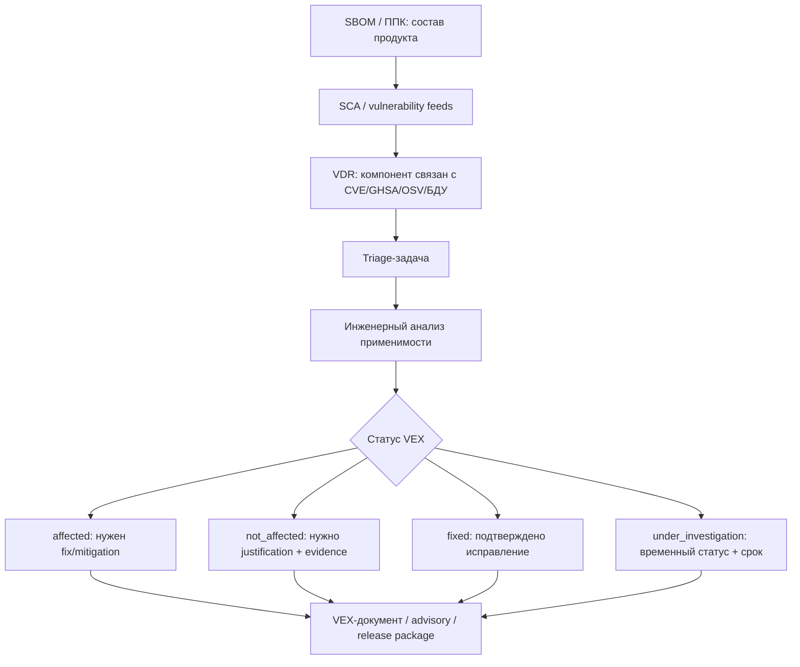

# VEX в процессе РБПО: откуда берется и как выпускать

## Короткий вывод

VEX не является еще одной базой уязвимостей и не "скачивается" из NVD, БДУ ФСТЭК, OSV или GitHub Advisory Database. Эти источники дают факт: у компонента, версии или продукта есть известная уязвимость. VEX появляется позже: когда ответственный за конкретный продукт производитель или поставщик устанавливает, влияет ли эта уязвимость на конкретную версию продукта в конкретном контексте использования.

Если организация сама разрабатывает программное обеспечение, то для своего продукта VEX в общем случае выпускает сама организация. Практически это делает не один сканер, а связка ролей: РБПО / Product Security / PSIRT / AppSec, владелец продукта, владелец компонента и разработчики, которые могут доказать, как компонент реально встроен, собран, вызывается и поставляется.

SCA-инструмент может подготовить входные данные или черновик, но VEX-утверждение является инженерно-управленческим решением производителя продукта.

## Что такое VEX в рабочем процессе

VEX, Vulnerability Exploitability eXchange, отвечает на вопрос:

> Влияет ли конкретная уязвимость на конкретный продукт или компонент в заданной версии, сборке и эксплуатационном контексте?

Это отличается от трех близких, но других артефактов.

| Артефакт | Что фиксирует | Тип данных | Кто обычно формирует |
|---|---|---|---|
| SBOM / ППК | Состав продукта: компоненты, версии, связи, идентификаторы | Факт состава | сборка, SCA, владелец релиза |
| VDR / vulnerability report | Связь "компонент - уязвимость": CVE, GHSA, OSV, БДУ, severity, affected range | Факт обнаружения | SCA-инструмент, vulnerability feed, analyst |
| VEX | Решение о применимости уязвимости к конкретному продукту | Инженерное утверждение с обоснованием | производитель продукта, PSIRT/AppSec/РБПО |
| Risk acceptance / exception | Разрешение временно принять остаточный риск или отступить от политики | Управленческое решение | владелец риска, security governance |

Главная ошибка: называть таблицу CVE "VEX-ом". Список найденных CVE является VDR или vulnerability report. VEX начинается только там, где есть статус применимости, обоснование и связь с конкретной версией продукта.

## Кто выдает VEX

### Если вы потребитель чужого продукта

Если организация покупает или использует чужой продукт, VEX нужно запрашивать у поставщика этого продукта. Типичные места, где он может появиться:

- security advisory поставщика;
- CSAF/VEX feed;
- customer portal;
- release security package;
- SBOM-портал поставщика;
- пакет поставки для закрытого контура;
- ответ поставщика по контрактному запросу на уязвимость.

Такой VEX имеет смысл только в отношении продукта поставщика и конкретных версий, которые он указал. Его нельзя автоматически переносить на ваш продукт, если вы встроили библиотеку иначе, пересобрали ее, изменили конфигурацию или поставляете другой состав.

### Если вы производитель ПО

Если организация сама выпускает продукт, VEX для этого продукта выдает сама организация. Внутри процесса это должно выглядеть так:

| Роль | Ответственность в VEX |
|---|---|
| РБПО / AppSec / Product Security | организует triage, проверяет полноту evidence, ведет политику статусов, контролирует качество VEX |
| PSIRT | выпускает внешние advisories и VEX для клиентов, если продукт поставляется наружу |
| Владелец продукта | подтверждает scope продукта, версию, релиз, SLA и допустимость поставки |
| Владелец компонента | отвечает за техническое решение по конкретному компоненту |
| Разработчик / архитектор | доказывает, как компонент собран, вызывается, конфигурируется и доступен атакующему |
| DevOps / release engineer | подтверждает build evidence: артефакты, SBOM, контейнеры, хэши, pipeline |
| Compliance / юрист | подключается, если VEX связан с контрактными обязательствами, внешней поставкой или регуляторной отчетностью |

В зрелом процессе VEX подписывает или утверждает не "любой инженер", а назначенная роль. Для внутреннего VEX это может быть владелец компонента плюс AppSec reviewer. Для внешнего VEX это обычно PSIRT или Product Security от имени производителя.

### Если речь о сторонней библиотеке внутри вашего продукта

Upstream-проект может выпустить свой advisory или VEX. Это полезный источник evidence, но не финальный ответ для вашего продукта.

Причина простая: только ваша организация знает, как библиотека использована именно у вас.

Например:

- библиотека есть в SBOM, но уязвимый модуль не собран;
- уязвимый код собран, но не вызывается;
- код вызывается только на доверенном локальном вводе;
- компонент входит только в build-time tooling и не поставляется клиенту;
- библиотека статически слинкована и уже не видна как отдельный файл;
- используется внутренний fork с backport-патчем;
- уязвимость проявляется только при опции, которая в продукте отключена;
- продукт поставляется в нескольких вариантах, и один вариант затронут, а другой нет.

Поэтому upstream VEX можно приложить к triage-задаче, но финальный статус "наш продукт affected / not affected / fixed / under investigation" должен быть вашим.

## Откуда фактически берется VEX

VEX берется из процесса анализа применимости уязвимости. Входом являются технические факты, а выходом является машиночитаемое утверждение.



Упрощенно:

1. SBOM/ППК говорит: компонент есть в продукте.
2. SCA/VDR говорит: у компонента есть потенциальная уязвимость.
3. Triage выясняет: относится ли эта уязвимость к продукту в реальной поставке.
4. VEX фиксирует решение так, чтобы его могли прочитать люди и инструменты.

## Базовый порядок работы

### Шаг 1. Зафиксировать finding как факт

Исходная запись должна быть максимально конкретной:

| Поле | Что фиксировать |
|---|---|
| Продукт | имя продукта, редакция, версия, build, platform |
| Артефакт | installer, container image digest, package, firmware, archive |
| Компонент | имя, версия, supplier, PURL/CPE/SWID, hash, путь в SBOM |
| Уязвимость | CVE/GHSA/OSV/БДУ, источник, severity, CVSS, EPSS, KEV при наличии |
| Источник факта | сканер, база, дата базы, команда запуска, ссылка на отчет |

На этом этапе еще нет VEX. Есть только факт, что потенциально затронутый компонент найден.

### Шаг 2. Завести triage-задачу

Triage-задача должна иметь владельца и срок. Минимальные поля:

- идентификатор finding;
- продукт и версия;
- компонент и версия;
- уязвимость;
- владелец компонента;
- ответственный от РБПО/AppSec;
- deadline по SLA;
- текущий статус расследования;
- ссылки на SBOM, VDR, build logs, advisory, issue.

Для критичных CVE, KEV, remote code execution, internet-facing компонентов и криптографических библиотек срок triage должен быть коротким. `under_investigation` не должен жить неделями без владельца и временных мер.

### Шаг 3. Проверить применимость к продукту

Ключевые вопросы для разработчика и security reviewer:

1. Компонент действительно входит в поставку или только присутствует в репозитории?
2. Версия компонента действительно попадает в affected range?
3. Идентификаторы сопоставлены корректно: PURL/CPE/name/version не дали ложного совпадения?
4. Уязвимый файл, функция, класс или модуль реально присутствует в сборке?
5. Уязвимый код достижим из runtime-пути продукта?
6. Может ли атакующий контролировать данные, которые попадают в уязвимый код?
7. Нужна ли специфическая конфигурация, окружение, feature flag, plugin, protocol или build option?
8. Есть ли runtime, perimeter, compiler или configuration mitigation?
9. Уязвимость уже исправлена patch/backport/fork-изменением?
10. Все ли варианты поставки проверены: Windows/Linux, debug/release, plugin edition, container, offline installer?

Для C/C++ этот шаг особенно важен: наличие библиотеки в исходном дереве не означает наличие уязвимого кода в поставочном бинарнике, а отсутствие видимого package manifest не означает отсутствие компонента.

### Шаг 4. Выбрать статус

На уровне общей VEX-модели обычно используют четыре статуса.

| Статус | Смысл | Что должно быть в evidence |
|---|---|---|
| `affected` | продукт затронут, нужны действия | affected component, exploitability context, план исправления или mitigation, SLA |
| `not_affected` | компонент или CVE есть в данных, но продукт не затронут | обязательное justification, техническое доказательство, reviewer, срок пересмотра |
| `fixed` | продуктовая версия содержит исправление | commit/patch, новая версия, новый SBOM, retest, скан после исправления |
| `under_investigation` | применимость еще неизвестна | владелец, deadline, временные меры, дата следующего обновления |

Важно: разные форматы называют эти статусы немного по-разному. OpenVEX использует `affected`, `not_affected`, `fixed`, `under_investigation`. CSAF VEX использует поля product status вроде `known_affected`, `known_not_affected`, `fixed`, `under_investigation`. CycloneDX хранит анализ в блоке `vulnerabilities[].analysis`, где используются свои значения `state`, `justification`, `response`, `detail`. Методически это одна задача: выразить применимость уязвимости к продукту.

### Шаг 5. Обосновать `not_affected`

`not_affected` является самым полезным и самым опасным статусом. Он снижает шум, но при ошибке маскирует реальную уязвимость.

Типовые обоснования:

| Обоснование | Когда допустимо | Что приложить |
|---|---|---|
| компонент не присутствует | сканер ошибочно сопоставил пакет или компонент есть в исходниках, но не в поставке | SBOM поставки, build manifest, artifact inventory |
| уязвимый код отсутствует | компонент есть, но уязвимый файл/функция удалены, отключены патчем или не входят в build target | diff, patch, build config, binary evidence |
| уязвимый код не находится в execute path | код есть, но из продукта не вызывается | call graph, статический анализ, тест, архитектурное объяснение |
| атакующий не может контролировать вход | код вызывается только на доверенных данных или локальном admin-only сценарии | data-flow analysis, threat model, access control evidence |
| уже есть inline mitigation | эксплуатация предотвращена встроенной проверкой, настройкой, sandbox, compiler/runtime/perimeter control | конфигурация, test, hardening evidence, ссылку на контроль |

Свободная фраза "не используется" недостаточна. Нужно указать, почему именно не используется, кем проверено, на какой версии продукта, каким способом и до какого изменения это решение считается действующим.

### Шаг 6. Оформить VEX-документ

Минимально VEX должен содержать:

- метаданные документа: идентификатор, версия, автор/issuer, дата выпуска, дата обновления;
- statement: уязвимость, продукт, статус, обоснование или действие;
- идентификаторы продукта и компонента: PURL, CPE, SWID, internal product id, hashes, BOM reference;
- scope: к каким версиям, платформам, редакциям и build variants относится утверждение;
- evidence references: ссылки на SBOM, VDR, issue, test, build log, commit, advisory;
- срок пересмотра или условие пересмотра, особенно для `not_affected` и `under_investigation`.

## Где хранить и где публиковать VEX

### Внутри организации

Внутренний VEX должен жить рядом с артефактами, на основании которых он принят:

- release folder;
- SBOM/ППК registry;
- vulnerability management system;
- Dependency-Track или аналог;
- issue tracker;
- CI/CD artifacts;
- репозиторий security advisories;
- хранилище evidence для аудита.

Хорошая практика: не хранить VEX отдельно от версии продукта. VEX должен быть связан с релизом, SBOM/ППК и конкретным finding.

Пример структуры:

```text
release-security/
  product-x/
    2.4.1/
      sbom/
        product-x-2.4.1.cdx.json
        product-x-2.4.1.ppk.json
      vdr/
        product-x-2.4.1-vdr.cdx.json
      vex/
        product-x-2.4.1.openvex.json
        CVE-2026-0001.triage.md
      evidence/
        build-log.txt
        reachability-report.html
        retest-after-fix.txt
```

### Для внешних потребителей

Если продукт поставляется клиентам, VEX может передаваться:

- в составе release security package;
- через customer portal;
- как CSAF/VEX feed;
- как отдельный OpenVEX JSON;
- как CycloneDX BOM с VEX analysis;
- как приложение к security advisory;
- через контрактный канал ответа на запрос клиента.

Для внешнего VEX желательно использовать подпись, контрольную сумму и стабильный URL. Клиент должен понимать, что документ выпущен именно производителем, относится к конкретной версии продукта и не был изменен.

## Как выбрать формат

| Формат | Когда выбирать | Сильные стороны | Ограничения |
|---|---|---|---|
| CycloneDX VEX | если основной SBOM уже CycloneDX и VEX удобно хранить рядом с BOM/VDR | хорошо связывает компоненты, vulnerabilities и analysis; удобен для Dependency-Track и SBOM-процессов | значения статусов отличаются от OpenVEX/CSAF; нужен аккуратный mapping |
| OpenVEX | если нужен компактный JSON для CI/CD, локального triage и фильтрации findings | простой, формат-агностичный, удобен для сканеров и pipeline | не заменяет полноценный security advisory |
| CSAF VEX | если нужно публиковать advisories для клиентов, многих продуктов и версий | стандартный формат security advisory, подходит для внешних feed и PSIRT-процессов | тяжелее в подготовке, требует дисциплины product tree и product_status |

Практический выбор для курса SCA/OSA:

- для внутреннего обучения triage: OpenVEX;
- для CycloneDX-first контура: CycloneDX VEX/VDR;
- для внешнего производителя с PSIRT и клиентским feed: CSAF VEX;
- для регуляторного или контрактного пакета: SBOM/ППК плюс VEX, связанный с release evidence.

## Пример: C/C++ продукт и уязвимость в zlib

Сценарий:

- продукт: `Product X 2.4.1`;
- компонент: `zlib 1.2.11`;
- SCA нашел CVE по версии zlib;
- библиотека присутствует в SBOM, потому что статически слинкована в один из модулей.

Плохая реакция:

> "Сканер нашел High, но разработчик сказал, что не используется. Поставим not_affected."

Это не VEX. Это неформальное мнение без evidence.

Правильный triage:

1. Проверить affected range CVE и источник advisory.
2. Сопоставить компонент из SBOM с фактической библиотекой в build: версия, hash, fork/patch.
3. Проверить, включен ли уязвимый файл/функция в сборку.
4. Проверить, вызывается ли этот код из runtime-пути продукта.
5. Проверить, может ли внешний пользователь или атакующий передать данные в этот путь.
6. Проверить отличия по сборкам: CLI, GUI, server, plugin, Windows/Linux.
7. Зафиксировать evidence: build log, linker map, symbols, call graph, тест, issue.
8. Выбрать статус:
   - если код достижим и вход контролируем атакующим: `affected`;
   - если код не собран: `not_affected`;
   - если код собран, но не достижим: `not_affected`;
   - если обновили zlib или применили backport: `fixed`;
   - если анализа пока нет: `under_investigation`.

Пример OpenVEX-утверждения:

```json
{
  "@context": "https://openvex.dev/ns/v0.2.0",
  "@id": "https://security.example.local/vex/product-x/2.4.1/CVE-2026-0001",
  "author": "Product Security / Example Organization",
  "timestamp": "2026-06-18T10:00:00Z",
  "version": 1,
  "statements": [
    {
      "vulnerability": {
        "name": "CVE-2026-0001"
      },
      "products": [
        {
          "@id": "pkg:generic/example/product-x@2.4.1",
          "subcomponents": [
            {
              "@id": "pkg:generic/zlib@1.2.11"
            }
          ]
        }
      ],
      "status": "not_affected",
      "justification": "vulnerable_code_not_in_execute_path",
      "impact_statement": "zlib is statically linked, but the vulnerable decompression path is not reachable from Product X runtime interfaces in release build 2.4.1. Evidence: TRIAGE-2026-014, build log 2026-06-18, reachability report RA-2026-014."
    }
  ]
}
```

Такой пример все равно должен пройти внутреннюю проверку: совпадают ли PURL/идентификаторы с SBOM, достаточно ли evidence, есть ли reviewer, не истек ли срок пересмотра.

## Минимальный шаблон triage-записи

```markdown
# VEX triage: CVE-YYYY-NNNN / Product X 2.4.1

## Finding
- Product:
- Release / build:
- Artifact:
- SBOM / PPK:
- Component:
- Component identifiers: PURL / CPE / hash:
- Vulnerability:
- Source: NVD / BDU / OSV / GHSA / vendor advisory:
- Scanner:

## Analysis
- Component present in delivered artifact: yes/no
- Vulnerable version range matched: yes/no
- Vulnerable code present in build: yes/no/unknown
- Vulnerable code reachable: yes/no/unknown
- Attacker-controlled input possible: yes/no/unknown
- Required configuration/environment:
- Mitigations:
- Affected build variants:

## Decision
- VEX status: affected / not_affected / fixed / under_investigation
- Justification:
- Action statement:
- Owner:
- Reviewer:
- Decision date:
- Expiry / review trigger:

## Evidence
- SBOM / PPK:
- Build log:
- Reachability report:
- Test:
- Commit / patch:
- Advisory:
- Issue:
```

## Что должно блокировать выпуск VEX

VEX нельзя выпускать или применять автоматически, если:

- нет конкретной версии продукта;
- нет связи с SBOM/ППК или фактическим артефактом поставки;
- `not_affected` указан без justification;
- justification написан свободным текстом там, где формат требует enum;
- не указан affected component или subcomponent;
- PURL/CPE не совпадает с исходным finding;
- нет владельца решения;
- `under_investigation` не имеет срока;
- решение принято для одной сборки, а применяется ко всем редакциям продукта;
- уязвимость входит в KEV или имеет признаки активной эксплуатации, но анализ ограничился формальной отпиской;
- evidence невозможно повторно проверить.

## Как встроить VEX в РБПО-процесс

### Policy gate

Quality/security gate должен различать три состояния:

1. Finding без VEX: уязвимость требует triage.
2. Finding с `affected`: сборка блокируется или требует утвержденного mitigation/remediation plan.
3. Finding с корректным `not_affected` или `fixed`: сборка может проходить, если evidence актуально.

Нельзя настраивать gate так, чтобы любой VEX автоматически гасил любую уязвимость. Gate должен проверять:

- статус;
- срок действия;
- идентификатор продукта;
- идентификатор компонента;
- совпадение с SBOM;
- наличие justification;
- подпись или доверенный источник VEX;
- правило для KEV/critical findings.

### Связь с SBOM/ППК

SBOM/ППК является фактической основой VEX. Если меняется состав продукта, VEX нужно пересматривать. Триггеры пересмотра:

- новая версия продукта;
- изменение версии компонента;
- изменение способа линковки;
- изменение build flags;
- добавление plugin/feature;
- переход на другой контейнерный base image;
- новый advisory по той же CVE;
- изменение affected range;
- появление CVE в KEV;
- обнаружение false positive в исходном сопоставлении.

### Связь с исключениями и принятием риска

VEX не равен risk acceptance.

Если статус `not_affected`, организация утверждает: "эта уязвимость не влияет на продукт в данном контексте". Это техническое утверждение.

Если статус `affected`, но релиз все равно разрешают, это уже risk acceptance или exception. Такой документ должен иметь отдельного владельца риска, срок, компенсирующие меры и управленческое утверждение.

## Нормативная и методическая привязка

| Источник | Как связан с VEX |
|---|---|
| ГОСТ Р 56939-2024 | требует управляемости процессов РБПО, анализа заимствованных компонентов, уязвимостей и доказательной базы по решениям |
| NIST SSDF SP 800-218 | поддерживает практики выявления, оценки и реагирования на уязвимости в ПО |
| ISO/IEC 27001 | требует управляемого процесса безопасности, контроля поставщиков, управления уязвимостями и документируемой evidence |
| ISO/IEC 27034 | связывает application security controls с жизненным циклом приложений |
| CISA VEX guidance | задает минимальные элементы VEX-документа и подход к status justification |
| CycloneDX | дает модель BOM/VDR/VEX, где vulnerabilities могут содержать analysis |
| CSAF 2.0 | дает формат security advisory и VEX profile для внешнего обмена |
| OpenVEX | дает компактный JSON-LD формат для VEX statements |

## Контрольный чек-лист для РБПО

- [ ] У продукта есть SBOM/ППК для конкретной версии и build.
- [ ] Уязвимость заведена как VDR/finding, а не сразу как VEX.
- [ ] Для finding назначен владелец компонента.
- [ ] Проверено, что component identity корректен: PURL/CPE/version/hash.
- [ ] Проверен affected range advisory.
- [ ] Проверено присутствие уязвимого кода в поставке.
- [ ] Проверена reachability и возможность attacker-controlled input.
- [ ] Проверены build variants и способы линковки.
- [ ] Для `not_affected` есть машинно-читаемое justification и человекочитаемое detail/impact statement.
- [ ] Для `affected` есть remediation или mitigation plan.
- [ ] Для `fixed` есть новый SBOM, commit/patch и retest.
- [ ] Для `under_investigation` есть deadline и временные меры.
- [ ] VEX связан с SBOM/ППК, VDR, issue и evidence.
- [ ] VEX подписан или хранится в доверенном контуре.
- [ ] Gate применяет VEX только при совпадении продукта, версии и компонента.
- [ ] Просроченные VEX-решения автоматически возвращаются в triage.

## Короткая формула для команды

VDR отвечает: "У нас есть потенциальная уязвимость в составе".

VEX отвечает: "Мы как производитель продукта проверили применимость этой уязвимости к конкретной версии продукта и заявляем статус с обоснованием".

Если нет автора, версии продукта, статуса, justification и evidence, это еще не VEX.

## Источники

- [CISA, Minimum Requirements for Vulnerability Exploitability eXchange (VEX)](https://www.cisa.gov/resources-tools/resources/minimum-requirements-vulnerability-exploitability-exchange-vex)
- [CISA, Vulnerability Exploitability eXchange (VEX) Status Justification Document](https://www.cisa.gov/resources-tools/resources/vulnerability-exploitability-exchange-vex-status-justification-document-june-2022)
- [CycloneDX, Vulnerability Exploitability eXchange (VEX)](https://cyclonedx.org/capabilities/vex/)
- [CycloneDX, Security Use Case: Vulnerability Exploitability](https://cyclonedx.org/use-cases/vulnerability-exploitability/)
- [CycloneDX, Vulnerability Disclosure Report (VDR)](https://cyclonedx.org/capabilities/vdr/)
- [OASIS, Common Security Advisory Framework Version 2.0](https://docs.oasis-open.org/csaf/csaf/v2.0/os/csaf-v2.0-os.html)
- [OpenVEX Specification](https://github.com/openvex/spec/blob/main/OPENVEX-SPEC.md)
- [FIRST, Consolidated SBOM and CSAF/VEX Operational Framework](https://www.first.org/standards/frameworks/psirts/Consolidated-SBOM-VEX-Operational-Framework.pdf)
- [NIST SP 800-218, Secure Software Development Framework (SSDF)](https://csrc.nist.gov/pubs/sp/800/218/final)
- ГОСТ Р 56939-2024 — Разработка безопасного программного обеспечения. Общие требования (официальный текст — через Росстандарт или ФСТЭК)

## Связанные материалы курса

[[02 Справочник/Оглавление справочника]] · [[01 Курс/М06 Поиск уязвимостей и управление VDR VEX/00 Карта модуля|М06. Поиск уязвимостей и управление VDR/VEX]] · [[01 Курс/М13 Нормативная трассировка и доказательная база/00 Карта модуля|М13. Нормативная трассировка]] · [[02 Справочник/Глоссарий/VEX]] · [[02 Справочник/Глоссарий/VDR]] · [[02 Справочник/Глоссарий/SBOM]] · [[02 Справочник/Глоссарий/ППК]] · [[03 Практикум/П09. VDR и VEX различие факта и решения]] · [[03 Практикум/П35. VEX triage]] · [[04 Инструменты/OpenVEX]] · [[04 Инструменты/CycloneDX]] · [[04 Инструменты/CSAF]] · [[08 Шаблоны/Политика управления уязвимостями компонентов]] · [[08 Шаблоны/Порядок загрузки VDR из Dependency-Track]] · [[08 Шаблоны/Паспорт риска компонента]]
