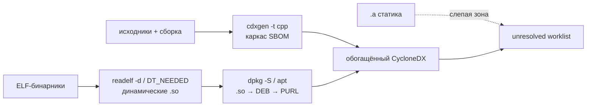

# Почему генерация SBOM — это искусство

> [!abstract] Тезис одной фразой
> **SBOM — это не свойство проекта, а снимок, сделанный конкретным инструментом на конкретном входе.** Поэтому один и тот же продукт можно «сфотографировать» так, что он покажется чистым и простым, а можно — так, что станет виден реальный состав со всеми рисками. Разница между плохим и хорошим SBOM — это не кнопка «сгенерировать», а инженерные решения: чем сканировать, что подавать на вход, что делать с неопознанным и как проверять результат.

## Почему вообще «искусство», а не «нажми кнопку»

Наивное ожидание: «есть инструмент → он выдаёт правильный SBOM». На практике правильного-единственного SBOM не существует. Запустите Syft, Trivy и cdxgen на одном репозитории — получите три разных `bom.json`: разное число компонентов, разная доля заполненных PURL, разный набор лицензий. Ни один из них не «врёт» — просто каждый смотрит в своё место.

Отсюда главный обман: **тишина в отчёте читается как «чисто», хотя часто означает «слепо»**. Сканер нашёл 12 компонентов и 0 уязвимостей — это хороший продукт или плохой SBOM? Без ответа на вопрос «чем и на каком входе сгенерировано» цифра findings не значит ничего. Garbage in → garbage out: на плохом SBOM даже идеальный анализатор уязвимостей даёт ложное спокойствие.

> [!warning] Первый вопрос аудита SBOM
> Не «сколько здесь компонентов», а: **чем сгенерировано, на каком входе, какой версией инструмента, что произошло с неопознанным?** Пока нет этих ответов — SBOM нельзя ни сравнивать, ни доверять ему.

## Плохой SBOM vs хороший SBOM

| Аспект | 🔴 Плохой SBOM | 🟢 Хороший SBOM |
|--------|----------------|------------------|
| **Вход** | только исходники или только манифест | сборка + бинарь + манифест вместе |
| **Координаты** | имя без версии, нет PURL/CPE | нормализованный PURL/CPE, точная версия |
| **Лицензии** | сырые текстовые строки или пусто | SPDX-выражение + evidence-привязка |
| **Полнота C/C++** | только `#include`, статика потеряна | динамика через ELF→DEB, статика — в worklist |
| **Неопознанное** | молча отброшено («компонентов мало») | `unresolved` worklist с пониженным confidence и владельцем |
| **Воспроизводимость** | нет версии инструмента и входа | зафиксированы tool version, commit/tag, параметры |
| **Проверка** | «много компонентов = хорошо» | quality gate по покрытию PURL/license/dependencies |
| **Контур** | онлайн-режим, утечка кода в облако | осознанный offline/закрытый контур |
| **Назначение** | формальная галочка «SBOM есть» | машинный источник фактов для VDR/VEX и лицензий |

Плохой SBOM **выглядит** так же, как хороший: валидный JSON, открывается, проходит схему. Дефект не в синтаксисе — в **полноте и точности координат**, а их видно только при сознательной проверке.

## Как сделать хорошо: инженерные решения

1. **Выбрать генератор под экосистему.** Манифесты — Syft/cdxgen; образ + CVE одним шагом — Trivy; C/C++ — cdxgen с последующим обогащением. См. [[01 Курс/М05 Инструменты генерации SBOM/01 Конспект|М05]].
2. **Снимать с правильного входа.** Манифест-скан показывает *объявленное*, бинарь-скан — *поставленное*. Полнота достигается на этапе сборки, а не поздним сканом готового артефакта.
3. **Обогащать, а не только генерировать.** Сырой SBOM довести до качества: дотянуть PURL/CPE, нормализовать лицензии до SPDX, привязать evidence.
4. **Не прятать неизвестное.** Каждый компонент без устойчивой координаты — в `unresolved` worklist с владельцем, а не «забыть».
5. **Фиксировать воспроизводимость.** `syft version`/`trivy --version`/`cdxgen --version`, commit/tag входа и параметры — рядом с `bom.json`. Иначе завтра не понять, изменился проект или инструмент.
6. **Проверять качество гейтом.** Не доверять числу компонентов — мерить покрытие PURL/CPE/license и наличие dependency-связей. См. [[08 Шаблоны/Чек-лист качества CycloneDX|чек-лист качества CycloneDX]] и [[03 Практикум/П34. SBOM quality gate|П34]].

> [!example] Один компонент решает исход

```json
{
  "name": "openssl",
  "version": "3.0.11",
  "purl": "pkg:deb/debian/openssl@3.0.11",
  "licenses": [{ "license": { "id": "Apache-2.0" } }]
}
```

Здесь есть `purl` — анализатор найдёт CVE и лицензию. А запись `{ "name": "libssl", "version": null }` без PURL **невидима** для сопоставления с уязвимостями: компонент есть в продукте, но «чист» в отчёте. Хороший SBOM — это про долю таких полных записей.

## Почему в C и C++ это искусство в квадрате

В управляемых экосистемах (npm, PyPI, Maven) состав почти полностью восстанавливается из lock-файла — генерация близка к «нажми кнопку». В **C/C++ без Conan/vcpkg** такого манифеста нет, и каждое допущение генератора может тихо исказить картину:

- **`#include` — это не зависимость.** Заголовок `<openssl/ssl.h>` виден компилятору, но не задаёт ни версию, ни факт линковки. Версию даёт только сборка и бинарь. См. [[06 C C++ legacy/include не равен зависимости|include ≠ зависимость]].
- **Статическая линковка — слепая зона.** Код `libfoo.a` копируется в исполняемый файл и теряет границу: компонента в SBOM нет вообще, и это не ошибка снятия, а свойство сборки. См. [[06 C C++ legacy/статическая линковка|статическая линковка]].
- **Stripped-бинари** лишены символов — бинарный анализ слепнет.
- **Vendored-каталоги и внутренние форки** выглядят как апстрим, но имеют другую версию и другой профиль риска.

Как сделать **хорошо** в C/C++ (то, что отличает зрелый процесс):



То есть: **build-scan** (перехват вызовов компилятора/линкера) + **анализ ELF** (`readelf -d`, `DT_NEEDED`) + **маппинг `.so` → DEB** (`dpkg -S`) → PURL + **обогащение** недостающих метаданных, а всё неопознанное — в worklist. Именно это делает enrichment-утилита («генератор фактов») в корпоративном кейсе [[01 Курс/М11 Корпоративный кейс генератор фактов и сервис вердиктов/01 Конспект|М11]]. Подробно — модуль [[01 Курс/М09 C и C++ legacy без дисциплины пакетного менеджера/01 Конспект|М09]] и практики [[03 Практикум/П22. ELF dynamic dependencies|П22]], [[03 Практикум/П23. Статическая линковка как слепая зона|П23]].

> [!tip] Учебный вывод
> Хороший SBOM по C/C++ — это **честный** SBOM: он показывает не только то, что удалось распознать, но и явно фиксирует, что осталось нераспознанным. Плохой SBOM прячет слепые зоны за красивым числом компонентов.

## Критерии «хорошего» (чек-лист)

- [ ] Зафиксированы инструмент, его версия, вход (commit/tag) и параметры запуска.
- [ ] Высокое покрытие PURL/CPE; версии нормализованы.
- [ ] Лицензии — SPDX-выражения с evidence, а не сырые строки.
- [ ] Для C/C++: динамика смаплена на DEB, статика и vendored отражены явно.
- [ ] Неопознанное — в `unresolved` worklist с владельцем и confidence.
- [ ] Пройден quality gate (а не просто «JSON валиден»).
- [ ] Решён вопрос контура: что и куда уходит при генерации.

## Связанные материалы

- Модули: [[01 Курс/М02 SBOM и ППК как машинный источник фактов/01 Конспект|М02 (факт vs интерпретация)]] · [[01 Курс/М04 Идентификаторы компонентов и уязвимостей/01 Конспект|М04 (PURL/CPE)]] · [[01 Курс/М05 Инструменты генерации SBOM/01 Конспект|М05 (инструменты)]] · [[01 Курс/М09 C и C++ legacy без дисциплины пакетного менеджера/01 Конспект|М09 (C/C++)]]
- Нормативка качества: [[05 Нормативка/BSI TR-03183-2 v2.1.0|BSI TR-03183-2]] · [[05 Нормативка/NTIA Minimum Elements for SBOM|NTIA Minimum Elements]] · [[05 Нормативка/CISA Minimum Elements for SBOM|CISA Minimum Elements]]
- Практики: [[03 Практикум/П34. SBOM quality gate|П34 SBOM quality gate]] · [[03 Практикум/П04. Генерация SBOM через cdxgen для C C++|П04]]
- Шаблоны: [[08 Шаблоны/Чек-лист качества CycloneDX|Чек-лист качества CycloneDX]] · [[08 Шаблоны/Соглашение о качестве данных SBOM|Соглашение о качестве данных SBOM]]
