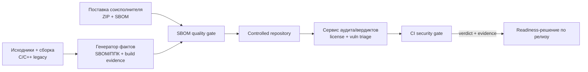

# П36. Итоговый мини-проект

## Цель

Собрать в один защищаемый артефакт сквозной SCA/OSA-процесс для C/C++ legacy-продукта с несколькими исполнителями — от генерации SBOM/ППК до readiness-решения по релизу. Проверяемый результат — комплект сдачи, в котором **каждое** решение трассируется по пяти обязательным элементам: источник факта → инструмент проверки → владелец решения → нормативная опора → evidence.

> [!info] Чем мини-проект отличается от предыдущих практик
> П37–П40 тренировали отдельные узлы (слои образа, честный SBOM, AI-кластеры, огнестойкость процесса). Здесь они сшиваются в один процесс: вы не запускаете новый инструмент, а показываете, что артефакты узлов складываются в управляемую цепочку «факт → проверка → владелец → норма → evidence» без разрывов.

## Команда или действие

Это интеграционная практика. Соберите комплект сдачи (см. [[10 Оценивание/Итоговый проект|задание итогового проекта]]) и пройдите по чек-листу самопроверки, прежде чем нести на защиту:

```text
Состав сдачи:
  [ ] архитектурная схема процесса (mermaid/диаграмма потоков артефактов)
  [ ] регламент поставки артефактов от соисполнителей (что, в каком формате, с какой подписью)
  [ ] SBOM quality checklist (пороги coverage PURL/CPE/license, unresolved worklist)
  [ ] license policy (allow/deny/review, порядок исключения)
  [ ] vulnerability triage policy (severity + БДУ + VDR/VEX, SLA)
  [ ] acceptance criteria для пилота инструмента
  [ ] матрица соответствия: ГОСТ Р 56939-2024, проект КАПО, NIST SSDF, BSI TR-03183-2

Самопроверка трассируемости (для каждого решения в процессе):
  source   -> откуда факт (SBOM/ППК, build log, layer diff, license scan, VDR)
  tool     -> чем проверено (генератор фактов, сервис аудита/вердиктов, CI gate)
  owner    -> чья роль принимает решение (роль, не ФИО)
  norm     -> на какой пункт нормы опирается
  evidence -> ссылка на артефакт, версия инструмента, дата
```

Архитектурную схему оформите как поток артефактов, чтобы на защите было видно, где стоят гейты:



## Что вы должны увидеть

Готовый комплект, который проходит **самопроверку трассируемости без «дыр»**: для каждого решения заполнены все пять элементов. Ориентир по рубрике (100 баллов, 6 блоков — та же, по которой идёт защита):

```text
| Блок                                          | Баллы | Закрыт, если...                          |
|-----------------------------------------------|------:|------------------------------------------|
| Полнота процесса и ролей                      |    20 | все артефакты на месте, у каждого владелец|
| Качество технической архитектуры             |    20 | схема показывает гейты и потоки фактов    |
| Учёт C/C++ legacy и сборочного контекста      |    20 | есть build evidence, не только SBOM       |
| Лицензионная чистота и юридический workflow    |    15 | allow/deny/review + порядок исключения    |
| Уязвимости, БДУ, VDR/VEX и readiness          |    15 | triage с SLA, связь с БДУ ФСТЭК           |
| Нормативная трассировка и evidence            |    10 | матрица соответствия + ссылки на evidence |
```

Признак готовой работы: вы можете взять **любое** решение из процесса (например, «компонент X допущен к релизу») и за минуту назвать его источник факта, инструмент, владельца, норму и evidence. Если хоть один элемент «повисает» — блок «Нормативная трассировка и evidence» (10 баллов) не закрывается.

> [!example] Одна строка трассировки целиком
> Решение: «libfoo 2.3 допущена, несмотря на CVE-2026-XXXX».
> source — SBOM продукта (PURL `pkg:conan/libfoo@2.3`) + VDR; tool — сервис аудита/вердиктов; owner — роль «владелец продукта по ИБ»; norm — ГОСТ Р 56939-2024 (управление уязвимостями), VEX-статус `not_affected`; evidence — VEX-документ с обоснованием reachability, дата, версия сканера.

## Если не получилось

- **Комплект есть, но решения не трассируются.** Самая частая потеря баллов: артефакты приложены, а связать конкретное решение с источником/нормой/evidence нельзя. Пройдите самопроверку построчно — каждая «дыра» это минус на защите.
- **SBOM без build evidence для C/C++.** Для legacy на C/C++ один SBOM не считается достаточным: нужны доказательства сборочного контекста (флаги, статически слинкованные библиотеки). Без них блок «Учёт C/C++ legacy» не закрывается.
- **Нет владельца у решений.** Если в процессе не назначены роли (без ФИО), это описание инструментов, а не процесс. Привяжите решения к ролям через [[08 Шаблоны/RACI для SCA OSA процесса|RACI]].
- **Матрица соответствия — список стандартов без маппинга.** Перечисление «ГОСТ, NIST, BSI» без указания, *какой пункт* какому шагу процесса соответствует, не закрывает нормативную трассировку.

## Критерий зачёта

Защита итогового проекта: комплект сдачи в полном составе + демонстрация на одном-двух решениях, что цепочка «источник → инструмент → владелец → норма → evidence» замкнута. Оценка выставляется по рубрике из 6 блоков; блок evidence закрывается только при наличии трассируемых артефактов, а не убедительности доклада.

> [!warning] Оценивается evidence, а не обаяние доклада
> На дне аттестации блок «Нормативная трассировка и evidence» не закрывается, если за словами нет артефакта для аудита. Готовьте не презентацию, а доказательную базу: ссылки на SBOM, VDR/VEX, протоколы гейтов с датами и версиями инструментов.

## Нормативная связка

- [[01 Курс/М15 Методика преподавания и итоговая аттестация/00 Карта модуля|Модуль М15]] — методика и день итоговой аттестации.
- Узлы, которые сшивает мини-проект: [[П37. Контейнерный образ слои секреты и удаленные файлы]], [[П38. Честный SBOM контейнерного образа]], [[П39. SBOM for AI minimum elements]], [[П40. Огнестойкость РБПО и SCA процесс]].
- Задание и рубрика: [[10 Оценивание/Итоговый проект|Итоговый проект]].
- Шаблоны: [[08 Шаблоны/Матрица соответствия требованиям|Матрица соответствия требованиям]], [[08 Шаблоны/Шаблон управленческой сводки готовности|Шаблон управленческой сводки готовности]], [[08 Шаблоны/RACI для SCA OSA процесса|RACI для SCA/OSA процесса]], [[08 Шаблоны/Регламент композиционного анализа ПО|Регламент композиционного анализа ПО]].
- Нормативка: [[05 Нормативка/ГОСТ Р 56939-2024|ГОСТ Р 56939-2024]], [[05 Нормативка/Проект ГОСТ Р КАПО|проект ГОСТ Р по КАПО]], [[05 Нормативка/NIST SP 800-218 SSDF|NIST SSDF (PS.3.2/PW.4/RV.1)]], [[05 Нормативка/BSI TR-03183-2 v2.1.0|BSI TR-03183-2]], [[05 Нормативка/БДУ ФСТЭК|БДУ ФСТЭК]].
